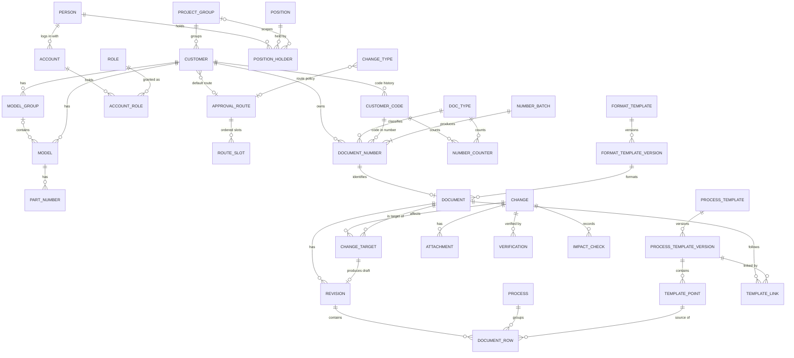
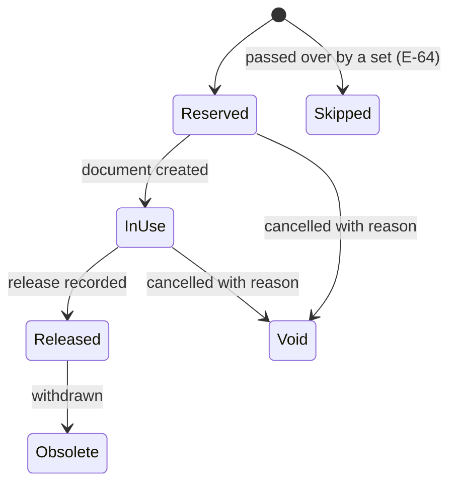
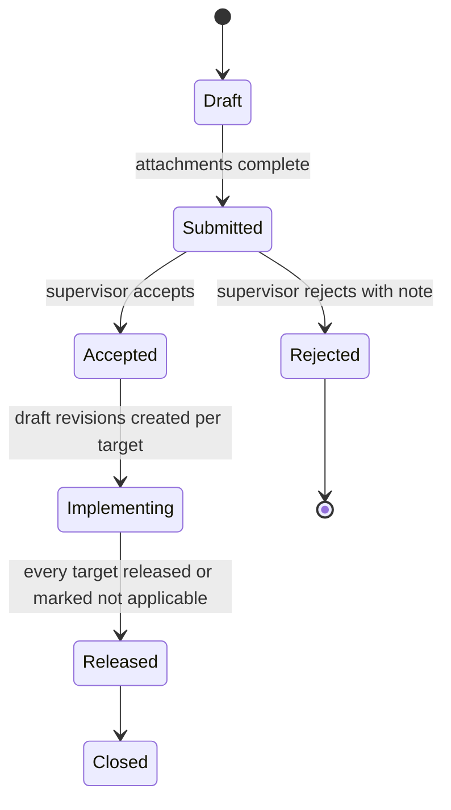

# PFMEA / Control Plan / PFD Web System: Design Brief for AI Collaborators

- Version: 1.34
- Date: 2026-11-14
- Status: living document. Update it whenever a decision changes, and mark replaced items [SUPERSEDED].
- Owner language: Indonesian. This brief is in English for precision and to match the earlier spec package. Domain terms stay in Indonesian where they matter (section 3).

## 0. How to use this document

**Audience.** AI assistants (for example Claude and Claude Code) and humans who continue the design or the build.

**Status tags**
- [DECIDED] the owner explicitly confirmed it.
- [PROPOSED] an assistant suggested it and the owner has not explicitly confirmed it. Treat it as the working plan, but expect changes.
- [OPEN] unresolved question. See section 12.
- [DEFERRED] intentionally postponed. Keep the schema hooks, do not build it yet.
- [SUPERSEDED] replaced by a later decision.

**ID scheme.** G goals, NG non-goals, R-xxx-nn design rules, D decisions, RK risks, Q open questions, S and M plan items, F findings from reference material (section 21), U artifacts of the UML package and UC use cases (section 20, artifact U3).

**Precedence when sources conflict**
1. The owner's latest explicit statement.
2. This brief.
3. The milestone plan (a separate document, see section 14).
4. The earlier spec package `pfmea-system-phase1-spec-v2`, only where section 13 says it still applies.

**Rules for reading**
- If a request conflicts with a [DECIDED] item, say so before acting.
- Do not assume customer-specific rules, legal acceptance of electronic signatures, company IT policies, or server specifications. They are unconfirmed (section 12).
- Do not invent measurements, baselines, or library versions. Verify them or mark them unverified.

## 1. Project summary

A self-hosted internal web system to create, revise, number, track, print, and approve on paper three linked quality documents of an electronics manufacturing plant (EMS).

| Document | Number pattern (example: customer code KT = Koito) |
|---|---|
| PFD (Process Flow Diagram) | SH-KT-nnn |
| PFMEA (Process Failure Mode and Effects Analysis) | SF-KT-nnn |
| Control Plan (CP) | SC-KT-nnn |

Today these documents live in Excel files and circulate as hard copies with wet signatures. Pain points the owner wants to remove:
- Revisions are slow and error-prone, especially "yokoten" revisions that apply one improvement to many models.
- It is hard to see what changed, when, why, and on whose request.
- Document numbers registered in Excel by different people are sometimes out of sync across the documents of one model.
- Applying a customer template change (SQAM), often retroactively, means editing many old files by hand.

Context
- The system is proposed as a QCC (quality control circle) improvement project inside the company.
- It is also a learning project: the owner will build it with Claude Code in small guided steps and wants to be able to rebuild it without AI.
- The owner's code is a personal learning project, not company development. The company deliverable is the specification and UML. Company IT may build its own version from the UML (D-33). The personal version runs on localhost for demos (D-36), and all code, including stages 9 and 10, is written as practice (D-37). The work started with the UML (D-43). From 2026-10-27 the code is built in parallel with the remaining UML work and is used to evaluate the design (D-77). Only stable versions of the tech stack are used (D-44). Scope stays PFD, PFMEA, and CP. The system is API-first, so other applications (for example for other PPAP documents such as the PSW) can be combined later (D-61).
- Expected scale (assumption inherited from the earlier spec): 10 to 50 concurrent internal users. See Q-21.
- Workflow positions [DECIDED] (D-45 to D-56), named as in the NPI department organization chart (update date 2026-01-22): the PPAP Engineer, the PPAP Staff, the Project Leader, and the Project Engineer may prepare and update PFD, PFMEA, and CP (D-63, D-67). One person checks: the Project Engineer or the Project Leader of the customer's project group, never the preparer. The NPI Manager, then the QA QC Manager, then the final approver approve. The final slot is called GM and is held by the Advisor today, possibly by the Factory Manager later. The route ends at the QA QC Manager or at the GM slot. Change requests are verified by the Project Engineer or the Project Leader of the customer's project group, or by the APQP/PPAP Controller (the PPAP Supervisor), and the system records who verified.
- System roles (D-78): the eight roles of the user map U3-peta-pengguna, stored as data: author (Penyusun), template maintainer (Pengelola template), PFMEA–CP checker (Pemeriksa PFMEA–CP), verifier (Verifikator), document control (Dokumen kontrol), migration (Petugas migrasi), viewer, and admin. Every logged-in account has the viewer rights (QA, QC, and internal audit use only these: read-only, QR verification, D-32, D-41). An approver role is kept for in-app approval later and is not created until then (R-APR-04). Mapping to positions (D-51, D-54, D-63 to D-75): author is the PPAP Engineer, the PPAP Staff, the Project Leader, or the Project Engineer; the PPAP Engineer also maintains the process master and process templates and sets the PFMEA to CP check mark; verifier is the Project Engineer, the Project Leader, or the APQP/PPAP Controller. The full user map is artifact U3-peta-pengguna (section 20). Approvers still approve on paper, and every position up to GM level gets a viewer account (D-70). The document control role is held by the PPAP Staff and the PPAP Engineer today, and may be given to the Document Control Department (DCC) later (D-60, D-68). The admin works through a separate admin account, held by the PPAP Staff for now, so that person has two accounts (D-72). Each admin account is linked to its named holder (D-74), and only the admin account sees the audit log (D-75). The migration role is held by the PPAP Staff and the PPAP Engineer (D-69). The Project Leader and the Project Engineer work only on the customers of their own project group (D-71). The admin manages the access rules (D-66).

## 2. Current goals, non-goals, and success measures

### Goals (current release scope)
| ID | Goal |
|---|---|
| G1 | Make revisions easy, especially yokoten: one change reaches many documents, with a per-document decision and a status board. |
| G2 | Make change history easy to see: row and cell diff between revisions, tied to reason, source, and attachments. |
| G3 | Assemble documents from process templates (process, sub-process, point) by selection. Template changes reach documents only through controlled revisions. |
| G4 | Register and track document numbers per customer and document type, with no collisions between users and with editable prefixes and patterns. |
| G5 | Treat printing as first-class: Excel and PDF, A3 and A4, because hard copies are still widely used. |
| G6 | Migrate existing Excel documents without first cleaning them (baseline migration). |
| G7 | Keep approval manual (printed, wet signature) while making the release record trustworthy. Prepare for digital signatures later. |
| G8 | Be a credible QCC proposal with measurable results, and a project the owner can learn from and rebuild alone. |
| G9 | Be secure by default for internal use: login required, tamper-resistant audit log, private attachments, on-premise hosting (for IT's version; the personal version runs on localhost, D-36). |
| G10 | Deliver a specification and UML complete enough for company IT to build its own version without the owner's code (D-33). Package contents: section 20. |
| G11 | Make adjusting the process flow easy, in the PFD and in the Process Flow column of the CP, especially the connector symbols where the flow continues on another page. Editing the flow means editing steps, never redrawing shapes (D-122). |

### Non-goals (current release)
| ID | Non-goal |
|---|---|
| NG1 | Automatic PFMEA to CP consistency checking by the system. People check it. The rule engine from the earlier spec stays disabled. |
| NG2 | In-app approval and digital signatures (design only). |
| NG3 | Active Directory or LDAP login. |
| NG4 | Full AIAG-VDA failure-network analysis. Only form compatibility. |
| NG5 | Fine-grained roles and permissions (hooks only). |
| NG6 | A full QMS suite (CAPA, audits, training, PPAP, and so on). |
| NG7 | Any access from outside the company in the first release. A read-only customer portal is a future feature (section 17). |
| NG8 | An integration API for other internal applications in the first release. It is designed in section 16 and built after the MVP (stage 9). |

### Success measures (to be measured by the owner, no baselines exist yet)
- Time to assemble the document set of a new model.
- Time to apply one yokoten change across N models, before and after.
- Percentage of document rows that still follow their template.
- Number of numbering conflicts and out-of-sync sets, before and after.
- Time to find the history of a change.
- Acceptance of printed output by users (A3 and A4, Excel and PDF).
- Migration effort per document, measured in a pilot (2 to 3 models of one customer).

## 3. Glossary

| Term | Meaning |
|---|---|
| Yokoten | Horizontal deployment: applying a change or lesson from one model, process, or document to others. |
| QCC | Quality Control Circle, the company's improvement project format. |
| SQAM | A customer's Supplier Quality Assurance Manual. It can define document formats and rules. Changes often apply retroactively. |
| AIAG 4th | AIAG FMEA 4th edition, RPN-based. |
| AIAG-VDA | The harmonized FMEA handbook, Action Priority (AP) based. |
| RPN / AP | Risk Priority Number / Action Priority. |
| 4M change | A change in Man, Machine, Material, or Method. Some customers require formal handling. |
| Set (satu set) | The PFD, PFMEA, and CP of one model that share one sequence number. |
| Process / sub-process / point | A manufacturing step (for example IQC) / a variant of it (IQC General, IQC MSD, IQC PCB, IQC Wireharness, IQC Connector) / one row-level item inside a sub-process. |
| Template General | The global process templates, not tied to a customer or a model. |
| Group model (model group) | A named set of models that share process template content. Template scope between customer and model (D-39). A group belongs to one customer, and a model belongs to at most one group (D-42). |
| Composition (perakitan) | Assembling a document from template processes with checkboxes and drag and drop. |
| Excluded point | A template point deliberately not used by a model. It is recorded, not silently dropped. |
| Local override / detach | A row changed only for one document and marked as different from its template / a document or row cut loose from its template link, with a reason. |
| Baseline migrasi | A legacy document imported at its current revision (for example -04), equal to the signed hard copy. |
| Controlled / uncontrolled copy | A printed copy that is distributed and tracked / a copy for reference or draft use. |
| Wet signature (tanda tangan basah) | A handwritten signature on paper. |
| Document control (dokumen kontrol) | The function that records releases and manages numbers and copies. |
| Prepared / Checked / Approved | The three signature stages on the cover page: the preparer, the checker, and the approvers (D-45). |
| Approval route (rute approval) | An ordered list of signature slots for one document. Two routes exist today: up to QA QC Manager, and up to GM (D-46). |
| Position (jabatan) | A job title in the workflow, named as in the organization chart (D-54): PPAP Engineer, PPAP Staff, Project Engineer, Project Leader, APQP/PPAP Controller, NPI Manager, QA QC Manager, Advisor, Factory Manager. Earlier names in this brief: Project Leader or Production Engineer for the Project Engineer, Project Leader Supervisor for the Project Leader, PPAP Supervisor for the APQP/PPAP Controller. PE Manager is only a possible future name of the NPI Manager (D-55). |
| Project group (GR) | A group of customers handled by one Project Leader and one Project Engineer. Each customer is allocated to one project group (GR1 to GR4 today, organization chart table 1) (D-54). |
| Release date (tanggal rilis) | The date the document is created or printed (D-53). Not the date document control records the release. |
| ECR | Engineering Change Request: a change request submitted to the customer. One of the change triggers (R-CHG-06). |
| PFD (PFC) | Process Flow Diagram. The job descriptions in the organization chart call it PFC. The system and the procedures use PFD (D-57). |
| DCC | Document Control Department (Dept Document Control). Formally responsible for release dates. May take over the document control role later (D-59, D-60). |
| Effective date (tanggal berlaku) | The date a revision takes effect. Equal to the release date for now; the rule can be changed later (D-59). |
| NCP | Nonconforming product: an NG disposition in the PFD and CP flow, next to scrap and rework (section 21). |
| PCP | Process Control Plan: the title on the SIIX Control Plan cover. Same document as CP. |
| IQC | Incoming Quality Control. |
| Person and account (orang dan akun) | A person is a named individual with an optional employee number. An account is a login of a person: a work account or an admin account, at most one of each per person. Positions are held by persons, and separation of duties compares persons (D-79). |
| Position holder (pemegang jabatan) | A person recorded as holding a position. The Project Leader and the Project Engineer are recorded per project group, and these records are the only source of their customer scope (D-82). The approver positions and the APQP/PPAP Controller have one holder each (D-115). |
| Factory code (kode pabrik) | The first letter of a document number prefix, S today. With the document type letter (H for PFD, F for PFMEA, C for CP) it forms the prefix SH, SF, or SC (D-89). |
| Special code (kode khusus) | A code in the customer code position for documents that belong to no single customer, for example ZZ (General/Common) and HSE (Health, Safety, and Environment). It never equals a customer code (D-89, D-114). |
| Running number (nomor berjalan) | The sequence part of a document number: three digits up to 999, then A001 to A999, B001, and so on (D-89). |

## 4. Domain model (conceptual)

All entities below are conceptual. Table and column names are decided during the UML and schema work (milestone S2).

| Entity | Purpose and key notes |
|---|---|
| customer, model_group, model, part_number | Master data, managed by the admin account (D-87). A document covers one or more models or part numbers. Customer has a code (for example KT) and belongs to one project group (D-54). Customers are never deleted, only deactivated (D-86). A model group is a named set of models (D-39). A group belongs to one customer, and a model belongs to at most one group (D-42). |
| customer_code | History of customer codes with validity dates (D-88). A code belongs to one customer only, ever (D-109). Old document numbers keep their code and match the customer it belonged to. |
| project_group | A group of customers (GR1 to GR4 today) with one Project Leader and one Project Engineer, recorded as position holders (D-54, D-82). |
| person, account, session | A person holds at most one work account and one admin account (D-79). Accounts are never deleted, only disabled (D-105). Sessions follow the login rules of D-85. |
| process | Process master with a fixed ID. The name is only a display value. Aliases allowed. |
| doc_type, number_settings, special_code | Document types with a letter (H for PFD, F for PFMEA, C for CP, plus other WI types such as W); the prefix is the factory code plus the letter (D-89). Only PFD, PFMEA, and CP are numbered by the system. number_settings holds the factory code. Special codes stand in the customer code position (D-114). |
| number_settings (pattern), number_counter, number_batch | One number pattern for every document type and customer, held in number_settings with the running-number format and the revision digits (working assumption E-61; patterns per customer wait for Q-05). One counter per customer code text and document type (D-93). A number batch is one request that produced numbers: a single registration, a set (M2.4), or an import (M2.5), with the person who made it and, for registrations, the idempotency key (working assumption E-63). |
| document_number | Registered number text (unique, never recomputed), customer, the customer code inside the number (current or old, R-POR-01), document type, running number, status (R-NUM-04, plus Skipped under working assumption E-64), initial revision, batch, and the reason of a manual status change. The linked document comes with M4.1. |
| format_template, format_template_version | Methodology (AIAG 4th, AIAG-VDA, customer SQAM), columns with immutable IDs, header fields, risk method and rating tables, export layout reference. Versioned. |
| process_template, process_template_version, template_point | Process, sub-process, and point library with scope general, customer, model group, or model (D-39). Points have immutable IDs and an optional linked counterpart. Versioned. |
| document | PFD, PFMEA, or CP of a model. Points to a number, a format template version, origin (new or migrated), and current revision. |
| position, position_holder, approval_route, route_slot | Positions are master data with one holder rule each (D-115). An approval route is an ordered list of slots, each with a stage (Prepared, Checked, Approved) and the positions allowed in it (D-45, D-46). Each customer has a default route. A document may use another route with a recorded reason (D-47). The route in force is frozen into the revision when it is printed for signature ([PROPOSED], R-APR-11). Each project group names its Project Leader and Project Engineer (D-54). One person may hold more than one position at a time, for example a Project Leader who is also the APQP/PPAP Controller. Each slot has an optional sign date (D-52), switched by a system setting. A route has one Prepared slot, one Checked slot, then one or more Approved slots (D-117). A customer may have no default route yet (D-116). Each change type may name a route; empty means the customer default (D-112). |
| role, permission, user_role | Access model [DECIDED] (D-66): permissions are a fixed catalog of actions defined by the system; a role is a named set of permissions that the admin can edit; an account holds one or more roles, each with a scope: all customers, or the own project group, which is read from the position holders (D-82). Each position suggests default roles, so a new holder starts with the right access. Admin accounts are a separate account type that holds only the admin role (D-72, D-120). |
| revision | Revision number as an integer (displayed -00, -01). Status draft, awaiting approval ([PROPOSED], R-REV-06), released, obsolete. Released revisions hold a frozen snapshot, a SHA-256 hash, effective date, and the signed scan. |
| document_row | One worksheet line. Immutable row ID, process ID, position, content in JSONB (validated against the format template version), optional template point ID, template link state (included, local override, detached), derived_from for copied rows, optional parent_id and node_type (VDA hook). |
| template_link | Document to process-template link with mode follow, pinned, or detached and the pinned version. |
| change | Single entity for every cause of revision (section 5, CHG). Source type, change type, reason, source reference, 4M category (optional), status. |
| change_target | One affected document of a change, with its decision and the draft revision it produced. |
| impact_check | Per change: which related documents are affected (PFD, PFMEA, CP, WI, inspection standard), decision, reason. |
| verification | Supervisor decision on a change (accept or reject, mandatory note). |
| attachment | Supporting file in private storage with SHA-256. |
| process_check_mark | "Checked by X on date" for PFMEA to CP consistency, per process per revision. |
| audit_log | Append-only record of every change to data, including sessions and failed logins (D-107). One hash chain for the whole system (D-83). Actor types human, system, and anonymous (D-106). |
| change_type, change_source, four_m_category | Master lists for changes (R-TPL-10, R-CHG-06). Change sources used by system mechanisms are marked and always active (D-113). |
| system_settings | Global switches, today the per-slot sign date (D-52). |
| print_log | Who printed which revision, when, and which copy number. |
| visibility_profile | Per customer, versioned rules that hide fields (columns, header fields) from the customer audience. |
| release_print_manifest | Per release: layout version, visibility profile version, field IDs printed, and file hashes. |
| publication_policy | Per customer, versioned: file source (scan then PDF, scan only, PDF only), roles that must give display permission, earliest stage (after release or after check). |
| display_permission | Per revision and content hash: required role, person, time, and status (requested, confirmed, invalidated, withdrawn). |
| authority_matrix (design only) | Role, document type, customer, and step that define who may sign what. |

Relationships

State of a document number [PROPOSED]

Legacy numbers enter the register at the status chosen for the import (Reserved, In use, Released, Obsolete, or Void; working assumption E-65). Skipped numbers never change status. In stage 2 only Void and Obsolete are set by hand (working assumption E-68); In use and Released follow M4.1 and M6.7.

State of a change [PROPOSED]

## 5. Design rules (current design)

### TPL: templates
| ID | Rule | Status |
|---|---|---|
| R-TPL-01 | Two template kinds: format template (methodology, columns, risk method, rating scales, header fields, export layout) and process template (process, sub-process, points). As built in M3.2 (working assumption E-72): one process template per master process, general scope only until M3.3, versioned on its own; sub-processes and points have identities separate from their per-version name, text, order, and hidden flag, and are hidden, never deleted. | [DECIDED] |
| R-TPL-02 | Format templates cover AIAG 4th (RPN), AIAG-VDA (form compatible), and customer SQAM formats. Columns have immutable IDs, labels are display only, templates are versioned, removed columns are hidden and their data kept. A structural change (new required column) flags documents whose data is incomplete. Columns carry an audience attribute, customer or internal (section 18, on hold by D-31). As built in M3.1 (working assumption E-70): a field identity (ID, area, kind) is fixed and only its per-version label, position, required flag, hidden flag, and select options change; the application role cannot delete fields or change their kind; row content is keyed by field ID, and a required field added later marks old content incomplete instead of invalid. Since migration 00014 (D-122 to D-124): filled columns (operation number, process, process flow) show and print like other columns, but their values come from the row and are never typed; the seeded PFD, PFMEA, and CP follow the column layout of the original Excel forms. | [DECIDED] |
| R-TPL-03 | Process templates have scope general, customer, model group, or model (D-39). The most specific wins (model, then model group, then customer, then general), merged per point. The data model supports N levels. The UI and engine implement only these four named scopes. A model group belongs to one customer, and a model belongs to at most one group (D-42). As built in M3.3 (D-129, migration 00015): one template per process; the scope sits on each point and never changes, and a point may have variants for narrower scopes inside its own scope, at most one per scope. For a model, the most specific visible variant replaces the point's text; hidden variants do not count; a point whose own scope does not cover the model is left out. | [DECIDED] |
| R-TPL-04 | Template points have immutable IDs. A point may be linked to a counterpart (for example a PFMEA control to a CP line). Linking is optional, manual or set in the template. As built in M3.2 (working assumption E-73): a point belongs to one sub-process and one document type (PFD, PFMEA, or CP), both fixed, and holds one line of text for now; full row content and counterpart links come before M4.5. | [DECIDED] |
| R-TPL-05 | Template versions go draft, then published. Published versions are immutable. As built in M3.4: the same rule for format templates (published by A-2) and process templates (published by E-6); a template has at most one draft; a new version copies the last published one with the same field, sub-process, point, and variant IDs; the database enforces immutability with triggers, also against the database owner. No propagation yet (M5.8). The preparer may publish (D-143). | [PROPOSED], built in M3.4 |
| R-TPL-06 | A template change never edits documents directly. It creates a change (draft revisions) that must be approved. | [DECIDED] |
| R-TPL-07 | Customer SQAM templates are often retroactive: a new version can apply to existing active documents. Released and obsolete revisions are never rewritten. Retroactive means new revisions. | [DECIDED] principle |
| R-TPL-08 | Each document to template link has mode follow, pinned, or detached. Each publication picks a scope: new documents only, active documents that follow (default), or all active documents including pinned ones (requires a reason, the SQAM revision reference, and an effective date). | [PROPOSED] |
| R-TPL-09 | Before applying a version, show an impact preview (dry run): which documents and rows change and which conflict with local overrides. Conflicts are resolved per run: keep local and flag, or overwrite. | [PROPOSED] |
| R-TPL-10 | Change type (content, layout only, administrative) decides the approval path. The policy per type is master data: a route per change type, empty meaning the customer default route (D-112). | [DECIDED] |
| R-TPL-11 | Format templates carry the symbol set (today Critical Process, Revision, Important Character, Regulation) and optional advisory highlights, such as the action rule printed on the current PFMEA form (RPN above 100 or severity 8). Highlights never block (R-DOC-06). As built in M3.1: symbols are per format template version with fixed keys; the highlight rule is an RPN threshold and a severity threshold per version (working assumption E-71: severity 8 and above, for current values and action results). Since migration 00013: a symbol carries an automatic flag; Revision is automatic (R-REV-09), so it prints in the legend but cannot be chosen in a symbol column. | [PROPOSED] |
| R-TPL-12 | The CP format template may carry the phase field from the AIAG Control Plan manual (2024): Prototype, Pre-Launch, Production, Safe Launch. The current SIIX form has no such field. | [PROPOSED] |

### CMP: composition
| ID | Rule | Status |
|---|---|---|
| R-CMP-01 | The owner enters header information by hand. Content is composed from templates: a left panel with the template tree and checkboxes, a right panel with the model's structure and drag and drop ordering. Operation numbers are automatic and editable. | [DECIDED] |
| R-CMP-02 | One composition produces PFD, PFMEA, and CP rows together. Unchecking a point offers to uncheck its linked counterpart (suggestion only). | [PROPOSED] |
| R-CMP-03 | Unchecked points are recorded as excluded with an optional reason. When a template later gains a new point, it appears as undecided for that model. | [PROPOSED] |
| R-CMP-04 | Composed rows stay linked to template points. Detaching needs a reason. Local changes are marked as different from the template. | [PROPOSED] |
| R-CMP-05 | A model can start from another model's composition. | [PROPOSED] |
| R-CMP-06 | The same composition screen serves new documents and migration. | [DECIDED] |

### DOC: documents and rows
| ID | Rule | Status |
|---|---|---|
| R-DOC-01 | PFD, PFMEA, and CP rows are flat rows (one worksheet line each), grouped by process. Content is JSONB validated against the format template version. Key fields are indexed. | [DECIDED] |
| R-DOC-02 | Rows have immutable IDs across revisions. Order is stored separately. Copied rows (yokoten) record where they came from. | [DECIDED] |
| R-DOC-03 | VDA hook: rows may carry parent_id and node_type. The failure network is deferred. | [DECIDED] for now |
| R-DOC-04 | PFD, PFMEA, and CP are matched by process. The process master holds the ID. PFMEA and CP rows pick a process from the PFD list instead of typing a name. Imports pass a name-to-ID mapping step. One process master serves all customers; names and aliases share one case-insensitive namespace, and processes are never deleted (D-110). Whether matching works at process or sub-process level is open until real documents are compared. As built in M3.2 (working assumption E-33, option a): matching stays at process level; a sub-process has its own fixed ID owned by one master process, with its name stored per process template version, so moving names and aliases into the master later (option b) keeps the same IDs. | [DECIDED] |
| R-DOC-05 | PFMEA row to CP row links are manual or defined in the template, and optional. | [DECIDED] |
| R-DOC-06 | People check PFMEA to CP consistency. The system offers a side-by-side view per process and a "checked by, date" mark per process per revision, set by the PPAP Engineer for now (D-65). The rule engine from the earlier spec stays disabled and may become an advisory audit later. | [DECIDED] |
| R-DOC-07 | Two editors must not overwrite each other. Use optimistic locking and show conflicts. | [PROPOSED] |
| R-DOC-08 | A document covers models and part numbers through master data (customer, model, part number). | [DECIDED] |
| R-DOC-09 | PFD rows carry the step number (hierarchical, for example 5.7.1), the process, the flow symbol (process, alternate process, decision, connector, merge, document), and for decisions the NG disposition (scrap, NCP, rework). The process flow column of the CP is generated from the PFD and always prints (D-122). Connectors where the printed flow continues on another page are placed automatically (G11). Since migration 00014: the CP format template shows Process Flow as a column filled from the PFD, never typed. | [PROPOSED], printing and goal [DECIDED] (D-122) |
| R-DOC-10 | A document can link to an interdependent document instead of repeating its steps, for example the ESD control plan SC-ESD-K001 referenced in TR-020, with the entry and exit points shown (AIAG CP manual 1.6). | [PROPOSED] |
| R-DOC-11 | A master list of referenced documents (WI, SOP, QEP, and similar, with number and title) feeds the CP column Relevant Document and the impact checklist (R-CHG-05), so numbers and titles stay exactly as in the source. | [PROPOSED] |

### CHG: changes (single entity)
| ID | Rule | Status |
|---|---|---|
| R-CHG-01 | One change entity covers four sources: manual revision request, yokoten, template propagation, and retroactive customer (SQAM) change. It has source type, change type, reason, source reference (origin model, complaint number, 8D number, audit finding, SQAM revision), optional 4M category, attachments, affected documents, impact checklist. One approval flow and one history view. | [DECIDED] |
| R-CHG-02 | Revision requests require supporting documents. The Project Engineer or the Project Leader of the customer's project group, or the APQP/PPAP Controller, verifies and accepts or rejects with a mandatory note. The system records who verified (D-51, D-54). The requester cannot verify their own request. | [DECIDED] |
| R-CHG-03 | Each affected document gets a draft revision. If a draft is already open, the change merges into it with the source marked and conflicts shown. | [DECIDED] |
| R-CHG-04 | Yokoten: choose targets by customer, model group (D-40), model, process, or text search. Each target owner decides apply, adapt, or not applicable (with a reason). A status board shows progress per model. | [DECIDED] principle |
| R-CHG-05 | Impact checklist per change: which related documents are affected (PFD, PFMEA, CP, WI, inspection standard), the decision, and the reason. Not every PFMEA change needs a CP revision, and the checklist records the decision either way. | [PROPOSED] |
| R-CHG-06 | Source master data starts with the triggers already used today: PP (pre-production), customer claim, and ECR (Engineering Change Request, a change request submitted to the customer), next to yokoten, template propagation, SQAM, and audit findings. Entries used by system mechanisms are marked and always active; at stage 5 mechanism and trigger become two fields of a change (D-113). | [PROPOSED], mechanism rule [DECIDED] (D-113) |
| R-CHG-07 | Changes that need customer approval before they take effect (for example a 4M change with PPAP resubmission) are handled outside the system, as today. The system neither blocks nor flags them (D-34). | [DECIDED] |

### REV: revisions and history
| ID | Rule | Status |
|---|---|---|
| R-REV-01 | The revision number is an integer shown through a master-data format (-00, -01, ...). Each document has its own revision. Migrated documents start at their current revision (for example -04). | [DECIDED] |
| R-REV-02 | Released revisions are immutable: content frozen as a snapshot with a SHA-256 hash. Obsolete revisions never change. | [DECIDED] |
| R-REV-03 | Git-like history: row and cell diff between revisions, linked to change, reason, source, and attachments, viewable per document and per process. | [DECIDED] |
| R-REV-04 | Printed output includes an automatic revision history table. | [PROPOSED] |
| R-REV-05 | History before a migration baseline is stored as text entries (revision, date, description) taken from the Excel history table, plus optional archived files. | [DECIDED] (D-180), archived files not built |
| R-REV-06 | A revision printed for wet signature moves to awaiting approval and is locked. The printed hash equals the locked content. An edit after printing cancels that print. When the approver asks for changes on paper, the preparer records the return and the revision goes back to draft (D-30). | [PROPOSED], recorder [DECIDED] |
| R-REV-07 | Three named hashes: snapshot_hash (full released content), customer_content_hash (what a customer receives, R-PUB-05), and file_hash (one specific scan or PDF). Prints, QR pages, and permissions always state which one they show. | [PROPOSED] |
| R-REV-08 | The release date is filled in automatically when a revision is printed for signature. The effective date equals the release date for now. Because the release date belongs to the Document Control Department (DCC), the rule must be changeable later, for example an effective date entered by DCC. [PROPOSED]: the rule is a setting. | [DECIDED] (D-59), setting [PROPOSED] |
| R-REV-09 | Printed documents mark each row changed in a revision with a triangle and the revision number, as the TR-020 documents do by hand. The marks come from the diff (R-REV-03). Only the marks of the current revision print: when a document goes from revision 1 to revision 2, the revision 1 marks disappear from the print. Every change stays viewable in the system: released revisions are frozen snapshots (R-REV-02), and the diff and history show the changes between any two revisions (R-REV-03) (D-121). Since migration 00013 the Revision symbol is automatic (R-TPL-11). | [DECIDED] (D-121) |

### NUM: document numbers
| ID | Rule | Status |
|---|---|---|
| R-NUM-01 | Register and track numbers for PFD, PFMEA, and CP, separated per customer and document type (example: SC-KT-000, SF-KT-000, SH-KT-000). The TR-020 documents show SH for PFD, SF for PFMEA, and SC for CP. | [DECIDED] |
| R-NUM-02 | Prefix and pattern are master data and editable. A change affects only new numbers. Issued numbers are stored as text and never recomputed. The parts follow WI SW-ZZ-000 (D-89): factory code and document type letter (prefix), customer code or special code, running number, and a two-digit revision that is not part of the registered number. | [DECIDED] |
| R-NUM-03 | No collisions: allocation happens on the server at submit time with a transactional counter row (not a PostgreSQL sequence), a unique constraint on the full number, and an idempotency key. 50 parallel registrations must give 50 distinct numbers with no gaps. Counters are kept per customer code text and document type, so a new customer code starts again at the first number (D-93). As built in M2.2 (finding E-69, open): every numbering transaction locks the customer row first, before inserting anything that references it, then the counters in the order customer code, document type, and the audit chain last; otherwise a registration and a customer code change can deadlock. | [DECIDED] |
| R-NUM-04 | Statuses Reserved, In use, Released, Obsolete, Void. Numbers are never reused or deleted. Stale Reserved numbers raise reminders. Search, filter, and export the register as a master document list. As built in M2.3: the application role has no DELETE on the register and may update only the status columns; Void needs a reason and Obsolete takes an optional one (working assumption E-68); the register shows how long a number has been Reserved, without reminders or export yet (working assumption E-62). | [PROPOSED] |
| R-NUM-05 | Most documents of a model share one number across the set, some do not (legacy Excel registration). Counters are per document type, and a "register as set" action takes the next number free in all three types so they align. The lagging counters then skip numbers, which R-NUM-03 (no gaps) does not allow, so skipped numbers need a rule: a status Skipped, or one counter per customer for sets. As built in M2.4: skipped numbers are recorded with status Skipped and never given again (working assumption E-64). | [PROPOSED] (see Q-05) |
| R-NUM-06 | Legacy numbers are imported with their original text. Counters start at the highest existing number. Gaps, duplicates, and misaligned sets are reported and never fixed or renumbered automatically, because numbers may already be with customers. As built in M2.5 (working assumptions E-65 and E-66): the number column of one customer is pasted, one status per import, and the current pattern reads each number; lines outside the pattern and numbers with another customer's code (R-POR-01) are reported and not imported; a duplicate is imported once; a dry run gives the same report without saving. | [PROPOSED] |

### APR: approval and release
| ID | Rule | Status |
|---|---|---|
| R-APR-01 | Approval is manual: print and sign by hand. The printout carries signature blocks built from the document's approval route (position and name, date blank, R-APR-08), document number, revision, short hash, and a QR code when QR is switched on (D-62). | [DECIDED] |
| R-APR-02 | Release is recorded by document control after the signed scan is uploaded. The recorder must differ from the preparer. The approver's in-app confirmation is optional per step. | [PROPOSED] |
| R-APR-03 | When QR is switched on (D-62), the QR code opens a verification page showing the status: valid, superseded, or withdrawn. Users are QA, QC, and internal audit. Leaders and above may carry phones in production areas (D-32). | [PROPOSED], users [DECIDED] |
| R-APR-04 | In-app approval and digital signatures are design only for now (section 8). | [DECIDED] |
| R-APR-05 | Authority matrix (role, document type, customer, step), separation of duties, and delegation with a validity period are designed now and enforced later. The first version is the user map U3-peta-pengguna (R-SEC-10). | [PROPOSED] |
| R-APR-06 | A read-only viewer role for QA, QC, and internal audit, so they can open verification pages and released documents without edit rights. | [DECIDED] (D-41) |
| R-APR-07 | Signature stages: Prepared by one preparer: the PPAP Engineer, the PPAP Staff, the Project Leader, or the Project Engineer (D-63, D-67). Checked by one person, who is the Project Engineer or the Project Leader of the customer's project group and not the preparer (D-48, D-54, R-APR-12). Approved by the NPI Manager, then the QA QC Manager, then the GM slot when the route includes it. The GM slot is held by the Advisor today and may move to the Factory Manager (D-56). | [DECIDED] (D-45, D-48, D-54, D-56, D-63, D-67) |
| R-APR-08 | The cover page and every page with signature blocks are built from the approval route, never fixed in the layout. A route is master data: an ordered list of slots with stage, print title, and allowed positions. Two routes now: up to QA QC Manager, and up to GM. Shape (D-117): one Prepared slot first, one Checked slot next, then one or more Approved slots; at most 10 slots; print titles of at most 100 characters. | [DECIDED] (D-46, D-117) |
| R-APR-09 | Each customer has a default approval route. The preparer may choose another route for a document, with a reason recorded in the audit log. Until the admin sets it, a customer has no default route, and printing for signature is refused unless the preparer chooses another route with a reason (D-116). | [DECIDED] (D-47, D-116) |
| R-APR-10 | Signing is sequential: Checked, then NPI Manager, then QA QC Manager, then the GM slot if the route includes it (D-49, D-55, D-56). Addition [PROPOSED]: when recording the release, document control confirms each slot in route order, and the release is refused while a slot is empty. | [DECIDED] (D-49), check [PROPOSED] |
| R-APR-11 | The route is frozen into the revision when it is printed for signature (R-REV-06). Changing the route afterwards cancels that print, like an edit. | [PROPOSED] |
| R-APR-12 | One person fills at most one slot in a route: the checker differs from the preparer, and an approver differs from both. | [PROPOSED] |
| R-APR-13 | While approval stays on paper (R-APR-04), approvers act in the system only through the signed scan. They get viewer accounts, like every position up to GM level (D-70). | [DECIDED] (D-70) |
| R-APR-14 | Each signature slot has an optional sign date. A setting switches it on or off, and when it is off the field is hidden. It is off for now, so only the release date (tanggal rilis: the date the document is created or printed, D-53) is recorded. Where the switch sits [PROPOSED]: one global admin setting. | [DECIDED] (D-52), switch location [PROPOSED] |
| R-APR-15 | Positions have fixed IDs and editable names, like processes (R-DOC-04). Renaming the NPI department back to PE, or moving the GM slot from the Advisor to the Factory Manager, changes master data only. One person may hold more than one position. Holders (D-115): one each for the approver positions and the APQP/PPAP Controller, one per project group for the Project Leader and the Project Engineer, several allowed for the other positions. | [DECIDED] (D-58, D-115) |
| R-APR-16 | The QR code on printed documents is optional: a setting switches it on or off, and it is off for now because QR codes are not used today. The verification page stays reachable inside the system. [PROPOSED]: one global admin setting, and the short hash on the print follows the same switch. | [DECIDED] (D-62), details [PROPOSED] |
| R-APR-17 | Each slot has a print title separate from the position name. The TR-020 covers print "Process. Eng", "Engineer", "NPI Manager", "QA / QC Mgr.", and "General Mgr.", each with the holder's name. | [DECIDED] (D-76) |

### PRT: print and export
| ID | Rule | Status |
|---|---|---|
| R-PRT-01 | Excel and PDF printing are mandatory. Excel A3 and A4 landscape from a layout, and PDF equally neat. | [DECIDED] |
| R-PRT-02 | Layout is data (an Excel template plus cell mapping), separate from row data. Developers author layouts at first. The schema must allow admins to edit layouts later. | [DECIDED] |
| R-PRT-03 | The PDF route is decided by a throwaway test (milestone S5) before the print milestones of stage 6 (timing [PROPOSED] after D-77). Options: (A) Excel to PDF through LibreOffice, for example Gotenberg, (B) HTML to PDF through headless Chromium, with fallbacks (C) a Go PDF library with layout in code and (D) print-ready Excel with manual Print to PDF. Test criteria: fonts, row heights for wrapped text, page breaks, repeated header rows, A3. | [DECIDED] test first |
| R-PRT-04 | Draft output is watermarked UNCONTROLLED COPY and released output CONTROLLED COPY. A print log records who printed, when, and the copy number. | [PROPOSED] |
| R-PRT-05 | There are two print audiences. The release print used for signature uses the customer-audience layout, so the signed scan is customer-safe (R-VIS-04). Internal prints may include internal-only fields and are watermarked INTERNAL, NOT FOR CUSTOMER. | [DEFERRED] (D-31) |
| R-PRT-06 | From the print log, list the controlled copies to recall when a new revision is released. | [PROPOSED] |
| R-PRT-07 | The cover follows the current SIIX cover (TR-020): document number at the top, title, header fields (Customer, Model Name, Part Name, Part Number, Process or Line), the revision history table (No, Date, Revision, Description of Change), the in-house approval slots from the route (R-APR-08, R-APR-17), a customer approval area, and the customer name in the footer. Inner sheets repeat the signature block with "Refer approval sheet". | [DECIDED] (D-76) |

### MIG: migration
| ID | Rule | Status |
|---|---|---|
| R-MIG-01 | Legacy documents are not cleaned before migration. This is why consistency checking is manual. | [DECIDED] |
| R-MIG-02 | Three routes: web form for header information, paste from Excel (preview and column mapping), and file import. Content can also be composed from templates. | [DECIDED] |
| R-MIG-03 | A migrated document is a baseline equal to the signed hard copy. Deviations from the template become local differences. An intentional improvement is a new revision through normal approval. | [PROPOSED] |
| R-MIG-04 | A compare screen takes the legacy Excel only for comparison (not import) and shows differences against the composed result. | [PROPOSED] |
| R-MIG-05 | Linking pass: pasted documents get suggested links to template points by text similarity, confirmed by a person. | [DECIDED] |
| R-MIG-06 | Verification against the signed hard copy is required before status "Released (migrated)". Migration mode is limited to a special role and can be switched off by the admin. The migration role is held by the PPAP Staff and the PPAP Engineer for now (D-69). | [DECIDED] (D-177) |
| R-MIG-07 | Pilot first: 2 to 3 models of one customer, measuring effort per document. The owner prepares the pilot data. | [DECIDED] |
| R-MIG-08 | For the company version: migrate the number register in full first, and migrate document content when a document next needs a revision (migrate on touch). With 380+ Control Plans alone, a one-time content migration is very heavy. | [PROPOSED] |

### SEC: security and access
| ID | Rule | Status |
|---|---|---|
| R-SEC-01 | Internal use only in the first release. Login required. Local accounts first. Active Directory or LDAP later. A customer portal is a future exception (section 17). | [DECIDED] |
| R-SEC-02 | One permission-check function from the start that enforces coarse roles from milestone M1.2 (D-35), and a customer scope field on documents. The project group scope (D-71) is checked in that function from M1.2 (D-81). The detailed authority matrix and row-level security come later (milestone M8.1). | [DECIDED], amended by D-35 and D-81 |
| R-SEC-03 | The audit log is append-only and enforced in the database: the application role has no UPDATE or DELETE, rejecting triggers exist, and a hash chain detects tampering. Addition [PROPOSED]: store the latest chain hash outside the database on a schedule (for example in the daily backup manifest), so a rewrite of the whole chain by a database admin is detected. Built in M1.3 with one global chain (D-83); the external anchor is the backup manifest of M1.7 (D-119). | [DECIDED] (D-83, D-119) |
| R-SEC-04 | Attachments sit in private storage with SHA-256 and antivirus scanning. Backups are encrypted and restores are tested. Hosting is on-premise with Docker and TLS for IT's version. The personal version runs on localhost with Docker Compose (D-36). | [PROPOSED] |
| R-SEC-05 | No source code is shared with company IT. The code is the owner's personal learning project. IT receives the specification, the UML, and a non-code information document, and may build its own version from them (D-33). | [DECIDED] |
| R-SEC-06 | Only the internal team writes PFD, PFMEA, and CP. Customers and any other external party have no write access of any kind. | [DECIDED] |
| R-SEC-07 | Development uses real company and customer documents with Claude Code. Code lives in the owner's private GitHub repository (D-29). | [DECIDED] |
| R-SEC-08 | Keep real data in a private repository separate from the code (or in an uncommitted folder when working locally), so the code repository never holds customer documents and the data can be removed in one step without rewriting git history. | [SUPERSEDED] by D-152 |
| R-SEC-09 | Enforce coarse roles from milestone M1.2, because R-CHG-02, R-APR-02, and R-MIG-06 need them before M8.1. The roles are the eight roles of U3-peta-pengguna with the permission catalog L-1 to A-4, stored as data from the start (D-78); the admin screen to edit them comes in M8.1. Amends R-SEC-02. | [DECIDED] (D-35, D-41, D-78) |
| R-SEC-10 | Access has four levels: create and edit, verify, view only, and administer. The admin assigns roles to users and edits which permissions a role holds, so access can be granted later without code changes (for example edit rights for DCC). Every change of access is audit-logged. The current user map is artifact U3-peta-pengguna, the approved baseline. | [DECIDED] (D-66) |
| R-SEC-11 | Guardrails that no role or admin setting can switch off: a requester never verifies their own request (R-CHG-02), one person fills at most one slot in a route (R-APR-12), the release recorder differs from the preparer (R-APR-02), released revisions are immutable (R-REV-02), the audit log is append-only (R-SEC-03), admin rights do not include editing document content, an admin account never holds work roles (R-SEC-13), the last admin account cannot be removed or lose its admin role (D-73), accounts are never deleted, only disabled (D-105), and every account may manage itself (sessions, logout, password) (D-104). | [DECIDED] for the admin account parts (D-72, D-73), rest [PROPOSED] |
| R-SEC-12 | Scope: the Project Leader and the Project Engineer act (prepare, verify, check) only on the customers of their own project group (D-71); the PPAP Engineer, the PPAP Staff, the APQP/PPAP Controller, and document control act on all customers; viewers see released documents of all customers. Enforced in the permission function from M1.2 (D-81); row-level security follows in M8.1. Project-group-scoped rights do not apply to operations without a customer (D-118). | [DECIDED] for the Project Leader and the Project Engineer (D-71), rest [PROPOSED] |
| R-SEC-13 | The admin uses a separate admin account that holds the admin rights (A-1 to A-4), including the audit log, plus the basic view rights every account has (L-1 to L-3) (D-120). An admin account never holds work roles, and a work account never holds the admin role. Today the PPAP Staff holds the admin account next to their own work account. Each admin account is linked to its named holder, and the audit log shows both the account and the holder (D-74). Only the admin account sees the audit log, including the log of access changes (D-75). | [DECIDED] (D-72, D-74, D-75, D-120) |
| R-SEC-14 | Passwords, tokens, keys, and connection strings that contain a password are never written to logs, error messages, or the audit log. Error messages to users carry no internal details; the details go to the server log with the request ID (R-API-13). Tests prove the rule. | [DECIDED] (D-95) |
| R-SEC-15 | A forgotten or locked last admin account is recovered only with the command `revioten reset-admin-password` on the server machine, recorded with the system actor. Admin accounts are locked for 15 minutes after every 10 failed logins but never disabled by failed logins (D-85). | [DECIDED] (D-101) |

## 6. Decision log

| ID | Decision | Reason | Status |
|---|---|---|---|
| D-01 | Keep Go + PostgreSQL + SvelteKit even though it means learning two new technologies. | Most optimal fit (single binary, on-premise, 10 to 50 users). The owner chose optimal over familiar (Laravel). | [DECIDED] |
| D-02 | Flat rows with JSONB content instead of the normalized failure-mode, effect, cause structure. | Easier Excel migration and diff, flexible formats. VDA stays possible through hooks. | [DECIDED] |
| D-03 | PFMEA to CP consistency is checked manually. | Legacy data is too messy to migrate with system validation. | [DECIDED] |
| D-04 | One unified change entity. | Avoids building four separate revision mechanisms. | [DECIDED] |
| D-05 | Retroactive and template-driven updates always create new revisions through approval. | Released revisions must stay immutable. | [DECIDED] |
| D-06 | Process master with fixed IDs. Names are display only. | Free-text matching drifts silently. | [DECIDED] |
| D-07 | Wet-signature approval is primary. In-app approval is design only. | Company practice and unknown customer acceptance of electronic approval. | [DECIDED] |
| D-08 | PDF route is decided after a test. | Fidelity risk (fonts, row heights). | [DECIDED] |
| D-09 | Local accounts first, internal only, roles later. | No dependency on IT for the pilot. | [DECIDED] |
| D-10 | Composition screen serves both new and migrated documents. | One feature instead of two. | [DECIDED] |
| D-11 | Specification first, with UML, before any code. | Avoid big changes after the project starts. | [DECIDED], amended by D-77 |
| D-12 | Milestones are small and used as learning material. | The owner wants to rebuild without AI. | [DECIDED] |
| D-13 | Layouts are written by developers now but stored as data. | Admin editing is wanted later. | [DECIDED] |
| D-14 | VDA support is form compatible for now and will be re-evaluated. | Scope control. | [DECIDED] |
| D-15 | The API is designed before building, because the first internal consumer must write into the system, not only read. | Writes need rules that are cheaper to design than to retrofit. | [DECIDED] |
| D-16 | Three API surfaces: UI API, integration API, customer portal. | UI changes must not break integrations. Different actors need different authentication and stability. | [PROPOSED] |
| D-17 | External writes are change proposals only. They never release, verify, or approve. | Keeps immutability, numbering, and approval rules intact. | [PROPOSED] |
| D-18 | The customer portal is a future read-only feature: only the internal team writes, and customers can only read and download their own documents. | Customers get files quickly or check availability without asking. | [DECIDED] as a future feature |
| D-19 | No integration token is issued before roles and customer scope are enforced (M8.1). | Until then roles and the project group scope of human users are enforced (D-35, D-81), but a token has no customer scope and row-level security does not exist yet, so a token could read every customer. | [PROPOSED] |
| D-20 | Portal v1 is a document register plus PDF download, with no in-browser row view. | Smaller attack surface and much less to build. | [PROPOSED] |
| D-21 | By default customers receive the signed scan when it exists, otherwise the system-generated PDF. Never Excel. The default can be switched per customer (D-25). | The signed scan is the approved form. Excel is editable. | [DECIDED] |
| D-22 | A visibility filter lets the company hide selected information from customers. | Some information is internal. | [DEFERRED] (D-31), was [DECIDED] |
| D-23 | The filter works at field level (columns and header fields) with per-customer profiles. Row and process hiding are not supported in v1. | A copy with missing rows differs from the approved document and conflicts with sharing the signed scan. | [DEFERRED] (D-31) |
| D-24 | The release print used for signature uses the customer-audience layout. Internal-only information stays web-only or on internal prints. | A scan cannot be filtered after signing. | [DEFERRED] (D-31) |
| D-25 | The customer file source is a per-customer policy that can be switched: scan then PDF (default), scan only, or generated unsigned PDF only. | Different customers and different situations need different files. | [DECIDED] as a requirement |
| D-26 | Customers see a new revision only after internal roles (default: preparer and checker) give display permission in the web system. Until then the portal keeps showing the old file, even if editing is finished and the revision is printed for manual approval. | Internal control over what customers see. | [DECIDED] |
| D-27 | Display permission is separate from approval and release, and is bound to the content hash of the customer-visible content. | Approval is a paper process, display is a web decision. A later edit must not inherit an old permission. | [PROPOSED] |
| D-28 | Showing a revision before approval is complete (earliest stage after_check) is opt-in per customer. The default is after release. | Customers could act on a document that may still change. | [PROPOSED], see Q-30 |
| D-29 | Develop with real company and customer documents, using Claude Code connected to a private GitHub repository. Replaces the earlier proposal to sanitize data. | Owner's decision (Q-34). | [DECIDED] |
| D-30 | When the approver asks for changes on the paper copy, the preparer records the return in the system. | Owner's decision (Q-35). | [DECIDED] |
| D-31 | Internal-only fields and the customer visibility filter are on hold (section 18, D-22 to D-24, R-PRT-05). Customer outputs carry all fields until the feature resumes. | Owner's decision (Q-37). | [DECIDED], feature [DEFERRED] |
| D-32 | QR verification users are QA, QC, and internal audit. Leaders and above may carry phones in production areas. | Owner's statement (Q-38). | [DECIDED] |
| D-33 | The owner's code is personal and serves learning, not company development. Company IT will use the UML to develop its own version. | Owner's decision (Q-39). | [DECIDED] |
| D-34 | Customer approval of changes (4M, PPAP resubmission) stays outside the system, as today. | Owner's decision (Q-36). | [DECIDED] |
| D-35 | Coarse roles are enforced from milestone M1.2, amending R-SEC-02. | Owner's decision (Q-40). Verification, release recording, and migration need separation of duties before M8.1. | [DECIDED] |
| D-36 | The personal version runs on localhost. For now it is a demo, used to mature the concept and the workflow of the website. | Owner's decision (Q-41). | [DECIDED] |
| D-37 | All code is practice, including stages 9 and 10. For the practice build, a stage starts when the previous stage is demonstrated and its gate is passed. Conditions that need real users, management, legal, or IT (Q-22, RK-33, RK-35) apply to IT's version only. | Owner's decision (Q-42). Entry conditions confirmed by the owner on 2026-10-24. | [DECIDED] |
| D-38 | The UML package for IT follows current best practice: UML 2.5.1, the C4 model, a crow's foot ERD, OpenAPI, decision records, acceptance scenarios, and a traceability matrix, as diagrams as code (section 20). | Owner's request (Q-43): IT's document needs are unknown. Chosen by Claude on the owner's behalf. Revise after IT's feedback (Q-44). | [DECIDED] by delegation |
| D-39 | Process templates exist at four levels: general, customer, model group, and model. | Owner's rule (2026-10-23). | [DECIDED] |
| D-40 | A model group can be chosen as a yokoten target, so one choice reaches every model in the group. | Owner accepted the suggestion (2026-10-24). | [DECIDED] |
| D-41 | A read-only viewer role exists for QA, QC, and internal audit (R-APR-06). | Owner accepted the suggestion (2026-10-24). | [DECIDED] |
| D-42 | A model group belongs to exactly one customer, and a model belongs to at most one group. | Owner's answer to Q-45 (a) and (b). Keeps template precedence deterministic (RK-11). | [DECIDED] |
| D-43 | The work starts with the UML (milestone S2), built directly from this brief. | Owner's decision (2026-10-24). | [DECIDED], extended by D-77 |
| D-44 | Only stable versions of the tech stack are used. | Owner's rule (2026-10-24). The criteria are in section 7. | [DECIDED], criteria [PROPOSED] |
| D-45 | Signature stages and positions: Prepared by the PPAP Engineer; Checked by the Project Leader, the Production Engineer, or the Project Leader Supervisor; Approved by the NPI Manager or PE Manager (NPI Manager today), the QA QC Manager, and the GM. | Owner's description of the current workflow (2026-10-24). | [DECIDED], names refined by D-54 to D-56 |
| D-46 | The signature page is flexible: the approval route ends either at the QA QC Manager or at the GM. | Owner's rule (2026-10-24). | [DECIDED] |
| D-47 | Each customer has a default route. The preparer may override it per document with a recorded reason. | Owner's answer (2026-10-24). | [DECIDED] |
| D-48 | The Checked stage has one signature, from any one of the three checker positions. | Owner's answer (2026-10-24). | [DECIDED], positions refined by D-54 (two positions) |
| D-49 | Signing order is sequential: Checked, NPI or PE Manager, QA QC Manager, GM. | Owner's answer (2026-10-24). | [DECIDED] |
| D-50 | Change requests (R-CHG-02) are verified by the Project Leader Supervisor only. | Owner's answer (2026-10-24). | [SUPERSEDED] by D-51 |
| D-51 | Each customer has one Project Leader and one Project Leader Supervisor. A change request is verified by any one of three people: that customer's Project Leader, that customer's Project Leader Supervisor, or the PPAP Supervisor. The system records who verified. | Owner's answer to Q-48 (2026-10-24). | [DECIDED], positions refined by D-54 |
| D-52 | Per-slot sign dates are prepared with a switch to turn them off and hide them. For now only the release date is recorded. | Owner's answer to Q-49 (2026-10-24). | [DECIDED] |
| D-53 | The release date (tanggal rilis) is the date the document is created or printed. | Owner's answer (2026-10-24). | [DECIDED] |
| D-54 | Position names follow the NPI organization chart. The earlier "Project Leader / Production Engineer" is the Project Engineer (Leader level), and the earlier "Project Leader Supervisor" is the Project Leader (Supervisor level). Each project group has one of each, and each customer is allocated to one project group. The PPAP Supervisor is the APQP/PPAP Controller (Supervisor level, one person, today held concurrently by the Project Leader of GR3). | Owner's answers and the organization chart (2026-10-24). | [DECIDED] |
| D-55 | PE Manager is not a separate position. PE (Production Engineering) was the earlier name of a department with the same role as NPI, so PE Manager is only a possible future name of the NPI Manager. PPAP and the Project Leaders sit under NPI. | Owner's statement (2026-10-24). | [DECIDED] |
| D-56 | The final Approved slot (GM) is held by the Advisor today and may be held by the Factory Manager later. | Owner's answer (2026-10-24). | [DECIDED] |
| D-57 | The system keeps the term PFD, as the WIs and procedures do. PFC is recorded as an alternative name. | Owner's answer (2026-10-24). | [DECIDED] |
| D-58 | Positions have fixed IDs and editable names, and one person may hold more than one position (R-APR-15). | Owner accepted the suggestion (2026-10-27). | [DECIDED] |
| D-59 | The release date is filled in when the document is printed for signature. The effective date equals the release date for now. The release date belongs to DCC, so this rule must be changeable later. | Owner's answer to Q-51 (2026-10-27). | [DECIDED] |
| D-60 | The document control role is held by the PPAP Staff today and may move to DCC later. | Owner's answer to Q-53 (2026-10-27). | [DECIDED], extended by D-68 |
| D-61 | Scope stays PFD, PFMEA, and CP. The system is API-first, so other applications can be combined later. | Owner's answer to Q-54 (2026-10-27). | [DECIDED] |
| D-62 | The QR code on documents is optional, with an on and off switch. It is off for now because QR codes are not used today. | Owner's rule (2026-10-27). | [DECIDED] |
| D-63 | Preparing documents is allowed for the PPAP Staff, the PPAP Engineer, and the Project Leader. | Owner's answer to Q-55 (2026-10-27). Matches the TR-020 covers (F-02). | [DECIDED], extended by D-67 |
| D-64 | The PPAP Engineer maintains the process master and the process templates. | Owner's answer to Q-56 (2026-10-27). | [DECIDED] |
| D-65 | The PPAP Engineer sets the "checked by, date" mark in the PFMEA to CP comparison for now. | Owner's answer to Q-57 (2026-10-27). | [DECIDED] |
| D-66 | The admin can change users' access rights, so access can be granted later (for example edit rights for DCC) without code changes. Roles are first mapped into create and edit, verify, and view only. | Owner's idea, confirmed by the owner on 2026-10-27 ("aturan hak akses dikelola admin"). The user map U3-peta-pengguna is the baseline. | [DECIDED] |
| D-67 | The Project Engineer may also prepare documents. "Project leader" in the answer to Q-55 meant both the Project Leader (Supervisor level) and the Project Engineer. | Owner's clarification (2026-10-27). | [DECIDED] |
| D-68 | The document control role is also given to the PPAP Engineer, so a release is always recorded by someone other than the preparer. | Owner's answer to Q-58, option (a) (2026-10-27). The owner labeled it Q-59. | [DECIDED] |
| D-69 | The admin role and the migration role are held by the PPAP Staff and the PPAP Engineer for now. | Owner's answer to Q-60 (2026-10-27). | [DECIDED] for the migration role; admin part [SUPERSEDED] by D-72 |
| D-70 | Every position up to GM level gets a viewer account, including the approvers (NPI Manager, QA QC Manager, Advisor, Factory Manager), DCC, QA, QC, internal audit, and the WI team. | Owner's answer to Q-60 (2026-10-27). | [DECIDED] |
| D-71 | The Project Leader and the Project Engineer prepare documents only for the customers of their own project group. | Owner's answer to Q-59 (2026-10-27). | [DECIDED] |
| D-72 | The admin has a separate admin account. For now the PPAP Staff holds it, so that person has two different accounts. The audit log is viewed through the admin account. | Owner's answer (2026-10-27). | [DECIDED] |
| D-73 | The last admin account cannot be removed and cannot lose its admin role. "Removed" means disabled, because accounts are never deleted (D-105). | Owner accepted the suggestion (2026-10-27). | [DECIDED] |
| D-74 | Each admin account is linked to its named holder, and the audit log shows both the account and the holder. | Owner accepted the suggestion (2026-10-27). | [DECIDED] |
| D-75 | The NPI Manager does not get a view of the log of access changes. The audit log, access changes included, stays visible only through the admin account (D-72). | Owner rejected the suggestion (2026-10-27). | [DECIDED] |
| D-76 | Covers and print titles follow the TR-020 covers: each slot prints its print title ("Process. Eng", "Engineer", "NPI Manager", "QA / QC Mgr.", "General Mgr.") with the holder's name. | Owner accepted the working assumption of Q-52 (2026-10-27). | [DECIDED] |
| D-77 | Coding starts now, in parallel with the remaining UML work (U4 to U14). The code is built milestone by milestone with Claude Code and is used to evaluate the design. | Owner's decision (2026-10-27): "kita akan memulai membuat code sambil mengevaluasi design web yang kita rancang". Amends D-11. How findings are recorded: section 15, item 11. | [DECIDED] |
| D-78 | The eight roles of U3-peta-pengguna and the permission catalog L-1 to A-4 are stored as data from M1.2, seeded from the U3 matrix. No approver role until in-app approval (R-APR-04). Amends R-SEC-09 and the role list in section 1. | Owner's decision on finding E-01 of `docs/evaluasi-desain.md` (2026-10-27). U3 is the approved baseline (D-66). | [DECIDED] |
| D-79 | Person and account are separate entities. A person (name, optional employee number) has at most one work account and one admin account. Positions are held by persons, and separation of duties compares persons. | Owner's decision on finding E-02 of `docs/evaluasi-desain.md` (2026-10-27). | [DECIDED] |
| D-80 | Stage 1 does not wait for U5 and U6. The UML is updated from the code as it is built. Replaces the mitigation proposed in RK-64. | Owner's decision on finding E-03 of `docs/evaluasi-desain.md` (2026-10-27): "untuk UML akan kita update sesuai code dikembangkan". | [DECIDED] |
| D-81 | The project group scope (D-71) is checked in the permission function from M1.2. Row-level security stays in M8.1. Amends R-SEC-02 and R-SEC-12. | Owner's decision on finding E-04 of `docs/evaluasi-desain.md` (2026-10-27). | [DECIDED] |
| D-82 | The project group master and its position holders are the single source of the Project Leader and Project Engineer scope. A role grant only says "all customers" or "own project group". | Owner's decision on finding E-05 of `docs/evaluasi-desain.md` (2026-10-27). | [DECIDED] |
| D-83 | One hash chain for the whole audit log. The chain tip is locked, entries are written by the Go service layer in the same transaction as the change, and two database roles exist: the owner for migrations, and an application role without UPDATE and DELETE on the audit log. | Owner's decision on finding E-06 of `docs/evaluasi-desain.md` (2026-10-27). | [DECIDED] |
| D-84 | The first admin account is created with a one-time command on the server machine (`revioten create-admin`), recorded with the system actor. | Owner's decision on finding E-07 of `docs/evaluasi-desain.md` (2026-10-27). | [DECIDED] |
| D-85 | Login and session rules come from open standards (OWASP, ASVS 5.0, NIST SP 800-63B-4): argon2id, passwords of 15 to 128 characters (minimum lowered to 8 by D-132) checked against a blocklist, a 30-minute idle and an 8-hour absolute session limit, a 15-minute lock after every 10 failed logins, disabling at the 100th failure except for admin accounts (D-101), and a reset by the admin with a forced change. The exact values are in E-08. | Owner's decision on finding E-08 of `docs/evaluasi-desain.md` (2026-10-27); values confirmed by the general approval of 2026-10-30 (E-52). | [DECIDED] |
| D-86 | Customer codes are unique, two letters A to Z, and never equal a special code. Customers are never deleted, only deactivated. Each customer belongs to one project group, required from M1.4. | Owner's decision on finding E-09 of `docs/evaluasi-desain.md` (2026-10-27); the code change rule is replaced by D-88. | [DECIDED] |
| D-87 | The masters of M1.4 (customer, project group, model group, model, part number) are managed by the admin account (A-2). Who should own model groups later stays open (Q-46). | Owner's decision on finding E-10 of `docs/evaluasi-desain.md` (2026-10-27). | [DECIDED] |
| D-88 | A customer code can be changed through master data. Old codes stay in a history with validity dates; old numbers keep their old code (R-NUM-02) and match the customer the code belonged to. After a change, the running number of the new code starts again, and active documents move to new numbers by hand (D-93). | Owner's decision on finding E-11 of `docs/evaluasi-desain.md` (2026-10-28). WI SW-ZZ-000 rev 04 and rev 09 record two code changes. | [DECIDED] |
| D-89 | The number structure follows WI SW-ZZ-000 and is kept as master data: the factory code (S) and the document type letter (H for PFD, F for PFMEA, C for CP) form the prefix, then the customer code or a special code (ZZ, HSE), then the running number (three digits up to 999, then A001 to A999, B001, and so on, "for now"), and a two-digit revision outside the registered number. SC-ESD-K001 is not a process control plan; the system does not number such documents and records them as referenced documents (R-DOC-10, R-DOC-11). | Owner's decision on finding E-12 of `docs/evaluasi-desain.md` (2026-10-28). | [DECIDED] |
| D-90 | Use the newest stable or LTS versions. `docs/versions.md` holds the exact versions with dates and sources; section 7 names only the lines. | Owner's decision on finding E-13 of `docs/evaluasi-desain.md` (2026-10-28); the line-only section 7 by the general approval of 2026-10-30. | [DECIDED] |
| D-91 | R-VER-04 exception: a line with a single release may be used when no other line satisfies the peer dependencies and the release is at least 14 days old. A 0.x package uses its newest release that is at least 14 days old when first installed. Exceptions are recorded in `docs/versions.md`. | Owner's decision on finding E-14 of `docs/evaluasi-desain.md` (2026-10-28). | [DECIDED] |
| D-92 | User flows and wireframes for the screens of stages 4 and 5 are made before stage 4 and stored with the UML package. The UI language is decided first (D-96). | Owner's decision on finding E-15 of `docs/evaluasi-desain.md` (2026-10-28). | [DECIDED] |
| D-93 | After a customer code change, an active document moves to a new number through a document control action, per document: the revision continues, the old number becomes Obsolete with a link to the new one, and the move needs a new revision with new signatures. Counters are kept per customer code text and document type. | Owner's decision on finding E-16 of `docs/evaluasi-desain.md` (2026-10-28); the counter rule by the general approval of 2026-10-30. | [DECIDED] |
| D-94 | `/health` stays at the root as an operational endpoint, outside `/api/v1`, and is documented in the OpenAPI contract. | Owner's decision on finding E-17 of `docs/evaluasi-desain.md` (2026-10-28). | [DECIDED] |
| D-95 | Passwords, tokens, keys, and connection strings with passwords are never written to logs, error messages, or the audit log. Error messages to users carry no internal details; the details go to the server log with the request ID. Tests prove it (R-SEC-14). | Owner's decision on finding E-18 of `docs/evaluasi-desain.md` (2026-10-28). | [DECIDED] |
| D-96 | The screens are in English for now. All screen texts sit in one catalog, so Indonesian can be added with the same keys. | Owner's answer to Q-14 (2026-10-28). | [SUPERSEDED] by D-128 |
| D-97 | TypeScript types for the OpenAPI contract are generated with @hey-api/openapi-ts (types plugin only); the fetch calls are written by hand. openapi-typescript 7.13.0 fails R-VER-03 with TypeScript 6. | Test at M0.5 (2026-10-28), approved by the general approval of 2026-10-30 (Q-47). | [DECIDED] |
| D-98 | The glossary U1 gets a column with the English screen term, and the screen text catalog follows it. | General approval of Claude Code's recommendations (2026-10-30), finding E-19 of `docs/evaluasi-desain.md`. | [DECIDED] |
| D-99 | The earlier spec package is not available, so the error codes built in M0.5 are the baseline for R-API-13. | General approval of Claude Code's recommendations (2026-10-30), finding E-20 of `docs/evaluasi-desain.md`. | [DECIDED] |
| D-100 | Customer name: required, at most 200 characters, one line, and may repeat. Customer code: unique, two letters A to Z. | General approval of Claude Code's recommendations (2026-10-30), finding E-21 of `docs/evaluasi-desain.md`. | [DECIDED] |
| D-101 | A forgotten or locked last admin account is recovered with the command `revioten reset-admin-password` on the server machine, recorded with the system actor. Admin accounts are not disabled by failed logins; the 15-minute lock still applies (R-SEC-15). | General approval of Claude Code's recommendations (2026-10-30), finding E-22 of `docs/evaluasi-desain.md`. | [DECIDED] |
| D-102 | The demo checks new passwords against an offline list of common passwords. Checking breached passwords through the Pwned Passwords API is discussed with IT for the company version. | General approval of Claude Code's recommendations (2026-10-30), finding E-23 of `docs/evaluasi-desain.md`. | [DECIDED] |
| D-103 | Viewing master data is part of permission L-2. | General approval of Claude Code's recommendations (2026-10-30), finding E-24 of `docs/evaluasi-desain.md`. | [DECIDED] |
| D-104 | Every account may manage itself (sessions, logout, password). This is a fixed rule outside the permission catalog, still checked by the permission function. | General approval of Claude Code's recommendations (2026-10-30), finding E-25 of `docs/evaluasi-desain.md`. | [DECIDED] |
| D-105 | Accounts are never deleted, only disabled. "Removed" in D-73 means disabled. | General approval of Claude Code's recommendations (2026-10-30), finding E-26 of `docs/evaluasi-desain.md`. | [DECIDED] |
| D-106 | Two more actor types for the audit log: system (a command on the server machine) and anonymous (not logged in). Neither has an account, and the permission function always refuses them. | General approval of Claude Code's recommendations (2026-10-30), finding E-27 of `docs/evaluasi-desain.md`. | [DECIDED] |
| D-107 | The audit log records every change of data, including sessions and failed logins; reading is not recorded. Exports and prints are added in stage 6. | General approval of Claude Code's recommendations (2026-10-30), finding E-28 of `docs/evaluasi-desain.md`. | [DECIDED] |
| D-108 | The demo runs migrations at program start with one `.env`. The document for IT recommends a separate migration step, owner credentials only at deploy time, a daily chain check, and an external chain anchor. | General approval of Claude Code's recommendations (2026-10-30), finding E-29 of `docs/evaluasi-desain.md`. | [DECIDED] |
| D-109 | A customer code belongs to one customer only, ever, never returns to a customer, and takes effect when recorded. | General approval of Claude Code's recommendations (2026-10-30), finding E-31 of `docs/evaluasi-desain.md`. | [DECIDED] |
| D-110 | One process master for all customers. Names and aliases share one case-insensitive namespace, with at most 200 characters and 20 aliases. Processes are never deleted, and an old name does not become an alias by itself. | General approval of Claude Code's recommendations (2026-10-30), finding E-32 of `docs/evaluasi-desain.md`. | [DECIDED] |
| D-111 | Contract fields whose empty value would change data (for example `active`) are optional and mean "unchanged" when absent. A middleware that validates requests against the contract is decided before M8.1. | General approval of Claude Code's recommendations (2026-10-30), finding E-34 of `docs/evaluasi-desain.md`. | [DECIDED] |
| D-112 | The approval policy per change type (R-TPL-10) is a route per change type; empty means the customer default route. Which route wins when the preparer chooses another route (R-APR-09) is still open, to be answered before stage 5. | General approval of Claude Code's recommendations (2026-10-30), finding E-35 of `docs/evaluasi-desain.md`. | [DECIDED], precedence [OPEN] |
| D-113 | Change sources stay one list for now; entries used by system mechanisms (yokoten, template propagation, SQAM) are marked and always active. At stage 5 a change gets two fields: mechanism and trigger. | General approval of Claude Code's recommendations (2026-10-30), finding E-36 of `docs/evaluasi-desain.md`. | [DECIDED] |
| D-114 | Special codes have two or three letters, the admin may add them, a code cannot be changed, and it never equals a customer code, now or before. Whether PFD, PFMEA, and CP may be numbered with a special code is still open. | General approval of Claude Code's recommendations (2026-10-30), finding E-37 of `docs/evaluasi-desain.md`. | [DECIDED], numbering with special codes [OPEN] |
| D-115 | The approver positions (NPI Manager, QA QC Manager, Advisor, Factory Manager) and the APQP/PPAP Controller have one holder each. The Project Leader and the Project Engineer have one per project group. Other positions may have several. The holder history is the audit log. | General approval of Claude Code's recommendations (2026-10-30), finding E-38 of `docs/evaluasi-desain.md`, matching the working assumption of Q-50 (E-45). | [DECIDED] |
| D-116 | A customer may have no default route yet ("Not set"). Printing for signature is refused until a route is set, unless the preparer chooses another route with a reason. | General approval of Claude Code's recommendations (2026-10-30), finding E-39 of `docs/evaluasi-desain.md`. | [DECIDED] |
| D-117 | A route has exactly one Prepared slot first, one Checked slot next, then one or more Approved slots; at most 10 slots; print titles of at most 100 characters. Revisit after Q-15. | General approval of Claude Code's recommendations (2026-10-30), finding E-40 of `docs/evaluasi-desain.md`. | [DECIDED] |
| D-118 | Project-group-scoped rights do not apply to operations without a customer. Lists across customers filter per customer. The yokoten target search (M5.9) gets the allowed customers from the permission function, so scoped users keep finding targets in their own project group. | General approval of Claude Code's recommendations (2026-10-30), finding E-41 of `docs/evaluasi-desain.md`, checked against the yokoten goal. | [DECIDED] |
| D-119 | Local backup (M1.7) is built before M2.1: encrypted backups to another disk, the audit chain tip copied into the backup manifest, and a tested restore into an empty database. Disk encryption of the laptop is the owner's step. | General approval (2026-10-30) of the stage 1 evaluation (`docs/catatan/Tahap-1-evaluasi.md`, section 5). | [DECIDED] |
| D-120 | The admin account holds the admin rights (A-1 to A-4) plus the basic view rights every account has (L-1 to L-3), and never holds work roles. Amends R-SEC-13. | General approval of Claude Code's recommendations (2026-10-30), finding E-42 of `docs/evaluasi-desain.md`. | [DECIDED] |
| D-121 | Only the revision marks of the current revision print. When a document goes from revision 1 to revision 2, the revision 1 marks disappear from the print, and every change stays viewable in the system: frozen released revisions (R-REV-02) and the diff and history between any two revisions (R-REV-03). Amends R-REV-09. | Owner's statement and question (2026-11-04) after the UI design review. | [DECIDED] |
| D-122 | The Process Flow column of the CP always prints, filled from the PFD steps (R-DOC-09). Making the process flow easy to adjust, especially the connector symbols at page breaks, is a main goal (G11). | Owner's statement (2026-11-04): the current PCP template contains the process flow, which makes editing the PCP slow. | [DECIDED] |
| D-123 | The process name and the operation number always show and print in the PFD, PFMEA, and CP, as columns filled from the row (process ID from the process master, operation number), never typed. | Owner's question (2026-11-04): readers of a PFMEA must see the process name. | [DECIDED] |
| D-124 | The column layout drawn in the UI design artboards "current form layout" matches the original Excel forms, and the seeded format templates follow it (migration 00014). Decides finding E-70 in part. | Owner's answer (2026-11-04). | [DECIDED] |
| D-125 | Customer codes stay two letters, as WI SW-ZZ-000 allows (D-100 unchanged). Numbers with three-letter codes in old registers are reported by the import and not imported, for now. Decides finding E-74. | Owner's answer (2026-11-04). | [DECIDED] |
| D-126 | The separate number registers PL1 and PL3 are the registers of Project Leaders, not plants. Numbering stays per customer code and document type (D-93). Decides finding E-75. | Owner's answer (2026-11-04). | [DECIDED] |
| D-127 | The screens already built (M0 to M3) use the design system of the UI design canvas, artboard "Design system": quiet neutral surfaces, one indigo accent for action and selection, status colors that always come with a word, and Geist with Geist Mono bundled with the app (not loaded from the internet). Body text is 15 px. The flat top menu becomes a grouped menu: Home, Documents, Template library, Master data, and Admin (shown only to holders of admin rights). Screens and menu entries of features not built yet are not added. Accepts part of UX-05; the workbook screen (stage 4) and the EN/ID language choice (would change D-96) stay open. | Owner's answer (2026-11-08): accepted UX-05 for the existing screens, then approved the plan including the menu group names. | [DECIDED] |
| D-128 | The screens have two languages, English (default) and Indonesian, from two catalogs with the same keys. An EN/ID switch sits in the top bar and on the login page; the choice is kept in the browser. Indonesian domain terms follow the glossary U1. Messages written by the server stay in English unless the screen maps their code to a catalog text. All screens are laid out for phone, tablet, and laptop widths. Replaces D-96 and resolves the language part of Q-14 and UX-05. | Owner's statement (2026-11-08): "kita akan menggunakan dua bahasa. namun sekarang gunakan bahasa inggris. dan sediakan tombol agar mudah peralihan bahasa", and "buat semua tampilan dengan mempertimbangkan semua device"; plan approved the same day. | [DECIDED] |
| D-129 | One process template per process (finding E-72, option a). Each point has a scope: general, customer, model group, or model, shown as what the point is usually used for. A point that is usually general may still be adjusted for a narrower scope, for example the laser type of a laser marking process differs per model although the point is normally general. Where several apply, the most specific wins (R-TPL-03). Accepts the scope part of UX-01; how the preparer picks the scope while composing (UX-01, UC-25) stays with M4.5. | Owner's answer (2026-11-08) to E-72. | [DECIDED] |
| D-130 | The Doc ref (Relevant Document) column is not stored in template points. It is filled from the master list of referenced documents (R-DOC-11) by model and process: each WI, SOP, or QEP is recorded once with its process and scope (general, customer, model group, or model), and the first row of each process shows all of them when a document is composed. General points stay general. Decides finding E-77 (option a). | Owner's answer (2026-11-08): "E-77 a". | [DECIDED] |
| D-131 | A point's scope is part of its identity and never changes after the point is created. A point created with the wrong scope is hidden and a new point is created with the right scope; rows already linked to the old point keep that link. Decides finding E-78 (option a). | Owner's answer (2026-11-08): "E-78 a". | [DECIDED] |
| D-132 | The minimum password length is 8 characters instead of 15; the maximum stays 128. This changes one value of D-85; every other login and session rule of D-85 stays. Note for the IT team: NIST SP 800-63B-4 allows 8 characters only for a password used with a second factor and asks for 15 for a password used alone, as in this system, so this is an accepted risk of the localhost demo. It is offset by the blocklist, now extended to passwords of 8 to 14 characters (finding E-79), and by the lock after every 10 failed logins. The backup passphrase keeps its 15-character minimum, because an encrypted file has no lock against guessing. | Owner's statement (2026-11-10): "untuk password, jadikan defaultnya 8 karakter saja, sesuai batas minimum NIST". | [DECIDED] |
| D-133 | Form sets. A form set is one package of format template versions for Cover, PFD, PFMEA, and Control Plan. Set 1 "AIAG 4th set" is today's behavior. Set 2 "AIAG-VDA set" shares the same Cover and PFD and uses the PFMEA AIAG-VDA 2019 form with Action Priority and the Control Plan AIAG 2024 form. Each customer has a default form set for new documents; existing documents keep theirs. This narrows the deferred item "Full AIAG-VDA" (section 9, NG4): the form and the AP calculation are now in scope, the failure network stays [DEFERRED] and PFMEA rows stay flat. Build order: `docs/rencana/form-set-aiag-vda.md` (awaits approval, finding E-80). | Owner's prompt `docs/design/form-set-aiag-vda/PROMPT-claude-code-form-set-aiag-vda.md`, handed over 2026-11-10. | [DECIDED] scope, [PROPOSED] build order |
| D-134 | Action Priority follows the PFMEA table of the AIAG & VDA FMEA Handbook 2019, stored as data in the PFMEA format template version (not as constants in code) and calculated by the server. The sheet "AP Reference Table" of the Excel file in use is not used; the owner reports that it differs from the handbook in 186 of 1,000 combinations (not re-counted by Claude Code). Documents moved or migrated to set 2 always get AP recalculated, and rows whose AP differs from the old sheet are listed in the report. Printed forms show the letters H, M, L only. | Owner's prompt `docs/design/form-set-aiag-vda/PROMPT-claude-code-form-set-aiag-vda.md`, handed over 2026-11-10; decision dated 2026-11-09 in the prompt. | [DECIDED] |
| D-135 | The Control Plan AIAG 2024 phase field has four choices: Prototype, Pre-launch, Safe Launch, and Production, printed as four check boxes. The form has no Process Flow column; the flow stays on the PFD. Extends R-TPL-12. | Owner's prompt `docs/design/form-set-aiag-vda/PROMPT-claude-code-form-set-aiag-vda.md`, handed over 2026-11-10; decision dated 2026-11-09 in the prompt. | [DECIDED] |
| D-136 | Optional multi-part documents, off by default: one document number may hold several parts. PFD, PFMEA, and Control Plan are all split per part, and one document has one form set for all its parts. Shared: number, cover, revision, approval route, customer, form set. Per part: name, part numbers, process flow, rows, sync check, yokoten target. A one-part document shows no part picker. | Owner's prompt `docs/design/form-set-aiag-vda/PROMPT-claude-code-form-set-aiag-vda.md`, handed over 2026-11-10; decisions dated 2026-11-09 in the prompt. | [DECIDED] |
| D-137 | Two reading features are in scope: search by process (master process names and all aliases, plus free text in cells, with customer and status filters, grouped per model) and a genba view (read-only view of the latest released revision per process for tablets, with OK marks and notes that never change the document and can become change requests). Both work for both form sets. They need document rows and releases, so they follow Stages 4 and 6 (`docs/rencana/form-set-aiag-vda.md`). | Owner's prompt `docs/design/form-set-aiag-vda/PROMPT-claude-code-form-set-aiag-vda.md`, handed over 2026-11-10. | [DECIDED] scope, [PROPOSED] build order |
| D-138 | Periodic review. A PFD, PFMEA, and Control Plan with no revision for 3 years raise a warning on the dashboard that the model must be reviewed, following the company's general Control Plan WI. A review has two outcomes: reviewed with changes (a normal change request and a new revision) or reviewed with no change (a review record; how it is evidenced is finding E-86). Design proposal: `docs/rencana/review-berkala-3-tahun.md`. It needs release dates, so it follows Stage 6. | Owner's statement (2026-11-10): "Control plan akan di review per 3 tahun, jadi tambahkan fitur untuk Control plan, PFD dan PFMEA yang tidak ada update / revisi selama 3 tahun, munculnya notifikasi di dashboard". | [DECIDED] requirement, [PROPOSED] design |
| D-139 | A new form set and a change of the AP table are approved by the PPAP Supervisor (position APQP/PPAP Controller) for now. Who approves is not fixed in code: it must be changeable later without a code change, for example so that Project Leaders also approve. Decides finding E-82. Proposed design, following the rights model of D-66: a new right in the catalog ("approve form sets and AP tables"), held by a new role given to the account of the APQP/PPAP Controller; the admin can give that role to other accounts later. The admin prepares the draft, a holder of the right publishes it, and the approver is a different person from the one who prepared the draft. Still open: when several people hold the right, whether one approval is enough (working assumption) or all must approve. | Owner's statement (2026-11-11): "E-82 untuk saat ini PPAP supervisor, namun buat ini juga flexible, jadi di masa depan bisa saja project leader ikut menyetujui". | [DECIDED] who approves, [PROPOSED] design |
| D-140 | Build order of the form set work (finding E-80, option a): the four parts that only touch format templates are built now, before Stage 4: the AP engine, the PFMEA AIAG-VDA 2019 format, the Control Plan AIAG 2024 format, and form sets with a default per customer. The other parts are built with the stage they depend on (Stages 4 to 6), as listed in `docs/rencana/form-set-aiag-vda.md`. | Owner's answer (2026-11-11): "E-80 A". | [DECIDED] |
| D-141 | A user manual is written for the users of the system (not for the IT team). Form and language are still to be chosen; Claude Code proposes a Help page inside the application, in both languages, with screenshots made automatically by Playwright. | Owner's statement (2026-11-11): "buku panduan untuk pengguna". | [DECIDED] audience; form decided on 2026-11-11: a Help page inside the application ("D-141 gunakan halaman help") |
| D-142 | Screen feedback. (1) Every success or failure message of a page is also shown as a pop-up notification in the corner of the screen. (2) When the admin creates an account or resets a password, the temporary password is copied to the clipboard automatically, the screen scrolls to it, and the pop-up shows where it is; a Copy password button stays as a fallback. Accepted risk: a clipboard manager may keep the temporary password; it must be changed at the first login (D-85). (3) Indonesian screen texts use Indonesian words for general terms: kata sandi (password), atur ulang (reset), bawaan (default). Domain terms of the WIs stay as they are (U1). | Owner's statement (2026-11-11): "di versi indonesia juga password", "beberapa tindakan tidak ada notifikasi pop up", and "ketika membuat akun, otomatis passwordnya di salin ke clipboard, dan ada notifikasi juga dimana melihat password acak nya". | [DECIDED] |
| D-143 | The person who prepared a draft version of a template may publish it; no second person is needed (finding E-87, option a). Form sets and AP tables keep their separate approver (D-139). | Owner's answer (2026-11-11): "E-87 boleh". | [DECIDED] |
| D-144 | In the PFMEA AIAG-VDA 2019 form, "2. Process Step" is filled from the process master through the row and never typed, like D-123; "1. Process Item" stays text. Decides finding E-89 (option a). Applied in migration 00019 before any document uses the form. | Owner's answer (2026-11-12): "E-89 ok". | [DECIDED] |
| D-145 | The document screen is a workbook like Excel: one screen per document set with sheet tabs Cover, PFD, PFMEA, Control Plan, and Check, labelled menus, and one clear next step, as in the UI design canvas and the form set boards (PfmeaVda, ControlPlan2024). Accepts the workbook part of UX-05, the last open part. Built from M4.2. | Owner's answer (2026-11-12): "UX-05 ok". | [DECIDED] |
| D-146 | A process template point holds its content per column of the format, keyed by the fixed field key (for example failure_mode, failure_effect, failure_cause, prevention_control), instead of one line of text. Columns that exist in both form sets are shared, so one point serves the AIAG 4th set and the AIAG-VDA set; columns only in AIAG-VDA (work element and the three function columns) are filled only for set 2. Decides findings E-73 and E-81 (option a). Needed before M4.5. | Owner's answer (2026-11-12): "E-73 dan E-81 OK". | [DECIDED] |
| D-147 | Screen labels of format fields stay unique per area; printed forms get a separate print label that may repeat, so the two "PFMEA AP" columns and the two "Other Approval/Date (if req'd)" fields print as in the original forms. The print label is added with the export (Stage 6). Decides finding E-88 (option a). | Owner's answer (2026-11-12): "E-88 ok". | [DECIDED] |
| D-148 | How many form approvers must approve a form set or a PFMEA format with an AP table is a system setting that the admin changes (A-3): all form approvers (the default, the owner's choice for now) or any one. Each approval is recorded per person and cannot be changed. "All" means the active work accounts holding V-3 at the time of the approval, without the person who prepared the draft. Completes the open part of D-139. | Owner's statement (2026-11-12): "Apakah ini bisa di buat flexible juga, jadi pengaturannya bisa di rubah di admin, untuk saat ini harus di setujui semua". | [DECIDED] |
| D-149 | Paste from Excel (M4.4): a cell that does not fit its column is marked in the preview and left empty; the row is still added. Decides finding E-91 (option a). | Owner's answer (2026-11-14): "E-91 untuk saat ini dikosongkan". | [DECIDED] for now |
| D-150 | The column pairs between the AIAG 4th forms and the AIAG-VDA forms are the ones in migration 00024 (for example CP Equipment with Evaluation / Measurement technique, Method with Control Method, Frequency with Sample Freq, PIC with Owner). A point fills text and rating columns only. Decides finding E-92. | Owner's answer (2026-11-14): "E-92 saya setuju". | [DECIDED] |
| D-151 | Excel import and paste are set aside for now; the work focuses on entering content by hand (grid, composition from process templates). Paste from Excel as built in M4.4 stays, but gets no further work until the owner says so. R-MIG-02 and R-MIG-05 keep their status. | Owner's statement (2026-11-14): "untuk metode import excel abaikan dahulu, kita akan fokus ke pengisian manual". | [DECIDED] |
| D-152 | Real company and customer data may be used in development and committed to this private repository, including documents, data in seed and test files, and reference files under docs/referensi/. The code runs only on the owner's computer and the repository is private. Still forbidden: copying the data anywhere else (public repositories, gists, paste sites, other services), committing secrets (passwords, tokens, .env), and giving source code to company IT (R-SEC-05). Supersedes R-SEC-08 (separate data repository). Names of real people in seed and test data are still avoided until the owner says otherwise (see section 12). | Owner's statement (2026-11-14): "sekarang saya mengizinkan untuk menggunakan data asli, karna web di jalankan di local komputer dan juga github private". | [DECIDED] |
| D-153 | The order of process steps and the operation numbers are kept per document. PFD, PFMEA, and CP of one set can be ordered on their own. Decides finding E-94 (option a). | Owner's answer (2026-11-14): "kalau dari saya adalah per dokumen". | [DECIDED] |
| D-154 | The attached Process_Flow_PCBA_Generic.xlsx (revision 20, generic PCBA flow from WI General and WI Process) is a reference for process templates, the PFD diagram, and the master list of referenced documents. Stored in docs/referensi/. | Owner's request (2026-11-14): "Jadikan dokumen lampiran sebagai referensi". | [DECIDED] |
| D-155 | One document for several models has two patterns. (1) The same model for different markets (local and export): the points are the same, so the document uses the variants of its first model (as built, ASUMSI E-93), and the composition screen warns when the models have different variants. (2) One model with several PCBs (several PCB names and PCB numbers), each with its own process flow, under one document number: the document gets one section per PCB, keyed by the part numbers of the document. Rows, composition, order, operation numbers, the PFMEA to CP check, and the PFD diagram work per section; the number, the revision, and the signatures stay one. The sections print one after another in the same document, each with its own heading. Not built yet. Decides finding E-93. | Owner's answers (2026-11-14): pattern 1 "biasanya semua point sama persis"; pattern 2 "seperti membuat 3 dokumen namun dengan 1 set dokumen number"; "dicetak berurutan dalam satu CP dengan judul per PCB". | [DECIDED] |
| D-156 | The master list of referenced documents (D-130, R-DOC-11) is built now, with default documents per process: for example Receiving uses SW-ZZ-103, SW-ZZ-318, and SW-ZZ-332 by default. Each link has a scope (general, customer, model group, or model); for one model all links that apply are added together. The Relevant Document column of the first row of each process is filled from the list when a document is composed, or on request, only when the cell is empty; the author can still change it. Template points never hold this column. R-DOC-11 becomes [DECIDED] for the master list part. | Owner's idea (2026-11-14): "ada master data nya, jadi nanti bisa kita buat sebagai default dengan memilih dokumen yang tercatat di data master"; go-ahead "ya, mulai D-130". | [DECIDED] |
| D-157 | The master list of referenced documents is changed by the PPAP Engineer through the Template maintainer role (E-6), because it holds only documents tied to processes. Decides finding E-96 (option a). | Owner's answer (2026-11-14): "E-96 ya untuk saat ini PPAP engineer, karna dokumen yang di daftarkan hanya dokumen terkait process saja". | [DECIDED] |
| D-158 | Names of real people may be used in seed data, tests, examples, and screenshots, in addition to real documents (extends D-152). Answers Q-61. | Owner's answer (2026-11-14): "Q-61 ya boleh". | [DECIDED] |
| D-159 | The real control plan SC-KT-040-00 (customer PT. Indonesia Koito, model 737D LED HL) is the reference for the pattern of sections per PCB (D-155): one cover with one number, one revision history and one approval, listing every part name and part number; then one sheet per section (PCB A, Heatsink Assy R/L, Base Assy R/L), each with its own header (product = section name, title = section name and its part numbers, sometimes two part numbers R and L) and its own process list numbered from 1. The content is not up to date; only the pattern is a reference. Stored in docs/referensi/. | Owner's request (2026-11-14): "itu contoh nyata nya, namun untuk isi nya belum update, jadi jadikan referensi untuk pola dokumennya"; go-ahead "bangun untuk E-93 pola 2 dan lanjut D-155". | [DECIDED] |
| D-160 | Sections per PCB apply to the PFD, PFMEA, and CP of one set, with the same section key (as built). Decides finding E-97 (option a). | Owner's answer (2026-11-14): "Bagian per PCB berlaku untuk PFD, PFMEA, dan CP satu set (E-97)". | [DECIDED] |
| D-161 | NG flow rules for the PFD. (1) A model that may not be reworked sends the NG branch of every decision to Scrap; incoming and outgoing inspection (IQC, OQC) send NG to NCP. (2) A model that may be reworked sends NG to Rework, except SPI and Laser Marking, which go to Scrap by default. (3) Router is a process symbol with an NG branch to Scrap and no OK label: it cuts away the NG cavities found at SMT inspection (for example one of four cavities in a panel). (4) A reworked unit returns to the inspection step before the one where it was found NG (for example NG at Final Visual Inspection, rework, then back to ICT if the rework is OK, Scrap if it is NG). The reference with rework will follow. The stable process SH-TR-020-02 / SF-TR-020-03 / SC-TR-020-04 (customer PT. Tokairika Indonesia, model D660A, part 75J081-7022, no rework) is the reference for this pattern. | Owner's statement (2026-11-14). | [DECIDED] |
| D-162 | Change reference numbers are a system sequence CHG-0001, one sequence for all customers. If a work instruction already has a change form with its own numbering, that numbering may replace it later. Decides finding E-98. | Owner's answer (2026-11-14): "untuk saat ini saya menerima semua saran anda". | [DECIDED] |
| D-163 | Attachments: at most 20 MB per file, a fixed list of file types (PDF, PNG, JPEG, Excel, Word, Outlook, text, CSV), no virus scan until stage 8. Before real use, the encrypted backup (M1.7) also covers the attachment folder. Decides finding E-99. | Owner's answer (2026-11-14): "untuk saat ini saya menerima semua saran anda". | [DECIDED] |
| D-164 | A rejected change is final; the requester makes a new change. Verification needs the V-1 permission and one of the verifier positions of D-51 and D-54. Decides finding E-100. | Owner's answer (2026-11-14): "untuk saat ini saya menerima semua saran anda". | [DECIDED] |
| D-165 | Working rows are the draft; the content of a released revision is its frozen snapshot, and diff compares snapshots (no separate row-version table). For manual changes, merging into an open draft only records which changes went in; content conflicts are handled by template propagation and yokoten. Decides finding E-101. | Owner's answer (2026-11-14): "untuk saat ini saya menerima semua saran anda". | [DECIDED] |
| D-166 | The preparer of a draft (R-APR-02) is every person who changed the document content since its last release, read from the audit log. After M6.1 the person in the Prepared slot of the approval route is added. A change stays Accepted after its documents are released for now. Decides finding E-102. | Owner's answer (2026-11-14): "untuk saat ini saya menerima semua saran anda". | [DECIDED] |
| D-167 | History per process is a process filter on the diff of one document. A cross-document history per process is built later when needed. Diff labels come from the format version of the newer revision. Decides finding E-103. | Owner's answer (2026-11-14): "untuk saat ini saya menerima semua saran anda". | [DECIDED] |
| D-168 | Impact checklist: related documents such as WI are picked from the master list of referenced documents (R-DOC-11), with free text for documents not in the master. A reason is required only when a document is not affected. The checklist can be filled while the change is submitted or accepted. Decides finding E-104; R-CHG-05 and the checklist part of R-DOC-11 become [DECIDED]. | Owner's answer (2026-11-14): "untuk saat ini saya menerima semua saran anda". | [DECIDED] |
| D-169 | Template propagation as built in M5.8: link mode per document and process template (follow, pinned, detached; pinned and detached need a reason), rows whose point is gone are kept and counted, new points are not added until R-CMP-03 is decided, the template maintainer is the requester, one change per customer, and the scope new documents only needs no button. Decides finding E-105; R-TPL-08 and R-TPL-09 become [DECIDED] as built. | Owner's answer (2026-11-14): "untuk saat ini saya menerima semua saran anda". | [DECIDED] |
| D-170 | Yokoten as built in M5.9: the source is an accepted change, one target per model, decisions are final, apply and adapt both make a yokoten change, numbers YKT-0001. Copying rows from the source is a later option of adapt, with the origin recorded (R-DOC-02). Decides finding E-106. | Owner's answer (2026-11-14): "untuk saat ini saya menerima semua saran anda". | [DECIDED] |
| D-171 | A retroactive SQAM change covers the active documents of one customer, with the document types chosen when it is submitted (all by default). Moving documents to a new SQAM format version or form set waits for Q-07. Requested with E-3. Decides finding E-107. | Owner's answer (2026-11-14): "untuk saat ini saya menerima semua saran anda". | [DECIDED] |
| D-172 | PDF route after test S5: HTML to PDF through the Chrome or Edge already installed on the server computer (option B), with print-ready Excel (option D) always available as the fallback. PDF footers carry no page numbers for now; Excel does. Answers Q-10 and decides finding E-108. | Owner's answer (2026-11-14): "Yes, accept all". | [DECIDED] |
| D-173 | Signed scans: PDF, PNG, or JPEG, at most 30 MB, uploaded by document control (E-7), replaceable until the release is recorded (the last one counts, earlier ones stay in the audit log), stored with SHA-256 in the attachment folder and covered by the backup (D-163). Decides finding E-109. | Owner's answer (2026-11-14): "Yes, accept all". | [DECIDED] |
| D-174 | Print details as built in stage 6: a slot prints its holder's name when the slot has exactly one holder for the customer, otherwise it stays blank for handwriting; prints for signature carry UNCONTROLLED COPY; each print for signature refills the release date; permissions L-4 draft, E-5 for signature, L-3 reference, E-9 controlled copy; footer status DRAFT, EFFECTIVE, or SUPERSEDED with the content hash. R-APR-10 (slot confirmation) and R-APR-11 (route freeze) stay [PROPOSED] and are to be decided before gate 6. Decides finding E-110. | Owner's answer (2026-11-14): "Yes, accept all". | [DECIDED] |
| D-175 | Layout as data is a JSON layout (paper, orientation, font size, margins, cover, revision marks, column widths per field key) used for both Excel and PDF and edited by the admin on screen; no Excel template files per customer for now. Decides finding E-111; refines R-PRT-02. | Owner's answer (2026-11-14): "Yes, accept all". | [DECIDED] |
| D-176 | The Excel compare screen (M7.3) only compares: the .xlsx file is read in memory, never imported and never stored, and cell texts are compared as a set without column mapping (case, spaces, and position ignored). Column mapping is considered only if the pilot shows wrong-column errors. Refines R-MIG-04 within D-151. Decides finding E-112. | Owner's answer (2026-11-15): "Ya, terima semua". | [DECIDED] |
| D-177 | Hard copy verification: the verifier is a migration officer (E-10) other than the person who entered or filled the document; the scan of the signed hard copy is required first and is uploaded by a migration officer; the revision is released with snapshot and SHA-256 and shown as Released (migrated); a normal release is refused for an unverified baseline; baseline and text history are immutable afterwards. Sets R-MIG-06 to decided. Decides finding E-113. | Owner's answer (2026-11-15): "Ya, terima semua". | [DECIDED], scan requirement amended by D-186 |
| D-178 | Linking pass: Dice coefficient on character bigrams (0 to 100), suggestion threshold 60 for the pilot, candidates are the points of the latest published process template of the row's process, one point per row per section, rows without a process get no suggestion, only pairs at 100 are pre-ticked, linking needs E-2. The threshold is reviewed with pilot numbers. Refines R-MIG-05. Decides finding E-114. | Owner's answer (2026-11-15): "Ya, terima semua". | [DECIDED] |
| D-179 | Migration mode is one global switch in Settings (A-3), off by default and audit-logged. While off, entering legacy documents, editing text history, and hard copy verification are refused. Decides finding E-115. | Owner's answer (2026-11-15): "Ya, terima semua". | [DECIDED] |
| D-180 | Legacy document form: the number comes from the register (no document yet; Reserved, In use, or Released), revision is a number 0 to 999, the effective date is required and becomes the release date of the baseline, preparer and approvers are free text, and the document uses the customer's current published form set. Text history: revision label, optional date, description, at most 200 lines, printed before system revisions; the baseline revision row is not duplicated. No archive upload of legacy Excel files for now. Sets R-REV-05 to decided without the optional archived files. Decides finding E-116. | Owner's answer (2026-11-15): "Ya, terima semua". | [DECIDED] |
| D-181 | Dashboard definitions: rows following a template = linked and not detached rows over all rows; documents by type and status with Released (migrated) separate; yokoten targets by decision; revision time = from the draft opened by an accepted change to the recorded release (average and median hours, without first releases and migration baselines); migration effort = minutes typed at verification. Open to every account (L-2), aggregate numbers only. QCC uses the median and labels the numbers as demo results (RK-50). Decides finding E-117. | Owner's answer (2026-11-15): "Ya, terima semua". | [DECIDED] |
| D-182 | Row-level security for the demo covers the three document content tables (documents, rows, revisions), keyed on the account written to the connection; calls without a subject (CLI, migrations, jobs) are not filtered, and yokoten and the verification page deliberately bypass it after the permission check. For the company version: extend it to every customer-scoped table and refuse calls without a subject, before any integration token or customer portal. Decides finding E-118. | Owner's answer (2026-11-15): "terima semua saran". | [DECIDED] |
| D-183 | Role contents are edited by the admin on the Roles screen with fixed guardrails in screen, code, and database: the admin and viewer roles cannot change, a work role never holds admin rights (A-1 to A-4), and the basic rights L-1 to L-3 always stay. No new roles and no role deletion. Role contents are reviewed periodically against the user map U3. Decides finding E-119. | Owner's answer (2026-11-15): "terima semua saran". | [DECIDED] |
| D-184 | Upload scanning with ClamAV is optional in the demo (active when CLAMAV_ADDR is set, fail closed when the scanner is down) and mandatory for the company version, where the company antivirus may replace it. The Docker image carries no browser, so the Docker deployment prints Excel only; the company version uses a separate PDF service. Decides finding E-120. | Owner's answer (2026-11-15): "terima semua saran". | [DECIDED] |
| D-185 | Stage 8 counts as built. Three completion criteria stay as the owner's tasks and are conditions for the QCC presentation: restore on another machine (M8.2), IT review of the document for IT (M8.4), and measured numbers for the QCC outline (M8.5). Decides finding E-121. | Owner's answer (2026-11-15): "terima semua saran". | [DECIDED] |
| D-186 | The scan of the signed hard copy is optional for a migration baseline: verification by a second migration officer is what counts. A scan may still be uploaded as extra evidence. Amends D-177 and R-MIG-06; a normal release still requires the signed scan (D-173). | Owner's statement (2026-11-15): "jadikan ini opsional, bukan wajib ... yang terpenting ada verifikasi nya saja". | [DECIDED] |
| D-187 | The login page has a control to show or hide the typed password. | Owner's statement (2026-11-15): "di login, tambahkan fitur untuk melihat password yang di tulis". | [DECIDED] |
| D-188 | Export jobs use a simple table and one worker in the server, not River; jobs left running when the server stopped are put back in the queue when it starts. River is reconsidered when webhooks are built. Decides finding E-122. | Owner's answer (2026-11-15): "terima semua saran". | [DECIDED] |
| D-189 | The network limit of an integration token checks the direct connection address. In the demo it is unchanged; the company version trusts a forwarded address only from a configured proxy. Decides finding E-123. | Owner's answer (2026-11-15): "terima semua saran". | [DECIDED] |
| D-190 | Proposals from other applications follow the rules built in stage 9 (one document or, from D-193, one set; at most 200 operations; the base revision must be the revision in force; on_behalf_of only recorded; idempotency keys kept) until a real consumer is known (Q-22). Decides finding E-124. | Owner's answer (2026-11-15): "terima semua saran". | [DECIDED] |
| D-191 | Stage 9 counts as built. Webhooks, a sample consumer script, CI, and OAuth2 or mutual TLS are not built; polling with updated_since is the sync method. Decides finding E-125. | Owner's answer (2026-11-15): "terima semua saran". | [DECIDED] |
| D-192 | The customer portal (stage 10) is a future feature and is not built now. The work focuses on stages 0 to 9. | Owner's statement (2026-11-15): "untuk portal customer akan menjadi fitur di masa depan, jadi kita fokus sampai M9 dahulu". | [DECIDED] |
| D-193 | The ECR web application of the company may connect through the integration API: a proposal may name its trigger (for example ECR) and carry the ECR number as reference, may cover the whole document set, and may come without row operations, in which case the change waits for verification and the author edits the draft. The ECR web uses a service account token; its users do not need an account in this system, but verifiers do. | Owner's statement (2026-11-15): "untuk peran ini sudah ada web khusus, jadi jika bisa bikin web kita agar bisa terhubung nantinya". | [DECIDED] |
| D-194 | Email notifications are sent for chosen events through Microsoft 365 (Microsoft Graph or SMTP), set up by IT through settings, from an outbox written in the same transaction as the event. Each event can be switched off by the admin. No secret, temporary password, or token is ever sent by email. | Owner's statement (2026-11-15): "kita juga butuh email notifikasi ... di perusahaan saat ini menggunakan email microsoft, siapkan agar nanti bisa di setting oleh pihak IT". | [DECIDED] |

## 7. Technology stack

Stack [DECIDED] (D-01)
- Backend: Go 1.27 with `net/http`, pgx v5, sqlc, goose, River (job queue inside PostgreSQL), excelize (Excel output). No ORM, no Redis.
- Database: PostgreSQL 18.
- Frontend: Svelte 5 and SvelteKit 3 as a static SPA embedded in the Go binary. Tabulator for grids, Svelte Flow with ELK for the PFD diagram. TypeScript types for the API come from the OpenAPI contract through @hey-api/openapi-ts (D-97).
- PDF engine: decided by test (R-PRT-03). Gotenberg (LibreOffice) is option A.
- Supporting: ClamAV for uploads, Caddy for TLS, Docker Compose for deployment, Playwright for end-to-end tests, Node.js LTS to build the frontend only.
- Design: PlantUML with the C4-PlantUML library for the UML package (D-38).
- Code conventions inherited from the earlier spec: comments in Indonesian, tests before code, no ORM, generated code never edited by hand.

Version policy (D-44: stable versions only)
| ID | Criterion | Status |
|---|---|---|
| R-VER-01 | Stable channel only: no alpha, beta, rc, next, canary, or nightly builds. For npm packages this means the `latest` dist-tag. | [DECIDED] (D-44) |
| R-VER-02 | Runtimes and the database use a supported line: Node.js an LTS line, Go one of the two newest major releases, PostgreSQL the newest generally available major (never a release candidate). | [PROPOSED] |
| R-VER-03 | All chosen versions must satisfy each other's peer dependencies without `--force` or `--legacy-peer-deps`. | [PROPOSED] |
| R-VER-04 | A new major release line is used only after it has at least one patch release. A line with a single release is a watch item and is re-checked at M0.1. Exception (D-91): a single-release line may be used when no other line satisfies R-VER-03 and the release is at least 14 days old; a 0.x package uses its newest release that is at least 14 days old when first installed. Exceptions are recorded in `docs/versions.md`. | [PROPOSED], exception [DECIDED] (D-91) |
| R-VER-05 | Use the newest stable or LTS release, including the newest patch. Versions are pinned when a package is first installed and re-checked in that milestone; `docs/versions.md` records each version with its date and source. | [DECIDED] (D-90) |

Version lines in use. The exact versions, release dates, and sources are in `docs/versions.md` of the code repository, which wins over this table (D-90). Versions are pinned when a package is first installed (`go.mod`, `web/package-lock.json`, `compose.yaml`, and the `go:generate` lines for the code generators).

| Item | Line | Note |
|---|---|---|
| Go | 1.27 | Supported lines are 1.27 and 1.26 (R-VER-02). |
| PostgreSQL | 18 | 19 is still a release candidate, so it is excluded (R-VER-01, R-VER-02). |
| Node.js | 24 LTS | Used only to build the frontend. 26 is not LTS yet. |
| pgx | v5 | |
| sqlc | v1 | Pinned in a `go:generate` line, not in `go.mod`. |
| goose | v3 | Migrations embedded in the binary. |
| River | v0 | Still 0.x: the newest release that is at least 14 days old when first used (D-91). Not used yet. |
| excelize | v2 | Not used yet. |
| testcontainers-go | v0 | 0.x, under D-91. |
| golang.org/x/crypto | v0 | argon2id. 0.x, under D-91. |
| oapi-codegen | v2 | Pinned in a `go:generate` line. Initial OpenAPI 3.1 support only, so the contract stays 3.0.4 (D-38). |
| SvelteKit | 3 | Configuration in `vite.config.ts`, import alias `#lib` instead of `$lib`. |
| Svelte | 5 | |
| Vite | 8 | |
| @sveltejs/adapter-static | 4 | A single-release line, used under the D-91 exception because it is the only line that supports SvelteKit 3. |
| TypeScript | 6 | 7 is excluded by R-VER-03: SvelteKit 3 and svelte-check accept only 5 or 6. |
| svelte-check, Vitest, Playwright | 4, 5, 1 | |
| @hey-api/openapi-ts | 0 | Types only (D-97). 0.x, under D-91. |
| tabulator-tables, @xyflow/svelte, elkjs | 6, 1, 0 | From stage 4. |
| PlantUML, C4-PlantUML | 1.2026, 2 | UML package (D-38). |
| Caddy, Gotenberg, ClamAV | 2, 8, 1.5 | Stages 6 and 8. Gotenberg only if the S5 test picks it. |
| OpenAPI specification | 3.0.4 | The newest version the whole tool chain supports (D-38). The newest specification is 3.2.1. |

Rule: never write unverified minimum versions into specs. Check each version with the package registry or the official release tags when the package is first installed, and record it with the date in `docs/versions.md`.

## 8. Future design (deferred, with hooks kept now)

| Item | Status | Hooks to keep in the design now |
|---|---|---|
| Rule engine (32 rules from the earlier spec) as an advisory audit after data is cleaned | [DEFERRED] | Keep the rule SQL and test fixtures. Rules never block approval. |
| Active Directory or LDAP login | [DEFERRED] | Abstract the auth layer. User record has an external identity field. |
| In-app approval and digital signatures | [DEFERRED] | Release record with a method field (wet, simple electronic, visible signature, cryptographic). Authority matrix tables. Immutable signature record bound to the snapshot hash. |
| Full AIAG-VDA (structure, function, failure network). The AIAG-VDA form and the Action Priority calculation left this row with D-133 and D-134 | [DEFERRED], re-evaluate later | Risk method and rating tables live in the format template. Rows have parent_id and node_type. |
| Admin-editable layout designer | [DEFERRED] | Layout stored as data (R-PRT-02). |
| Detailed authority matrix and row-level security in PostgreSQL | [DEFERRED] (M8.1) | Single permission function with the U3 roles from M1.2 (D-35, D-78) and the project group scope (D-81). Customer scope field on documents. |
| Real-time push updates (WebSocket) as in the earlier spec | [OPEN] (Q-13) | Optimistic locking is the baseline. |
| Integration API for other internal applications, with writes as change proposals | [DEFERRED] (stage 9) | Contract-first, idempotency keys, one error format, pagination, request IDs in the audit log, an actor model that knows service accounts. See section 16. |
| Customer portal: read-only access to the customer's own PFD, PFMEA, and CP | [DEFERRED] (stage 10) | customer_id on every document, customer-visible flag and published timestamp on revisions, internal-only flag per template column, customer user actor type, signed scan and generated PDF stored per revision, field audience attribute, visibility profile, print manifest, content hash, per-customer publication policy, display permission records. See sections 17 to 19. |

Digital signature scenario (design only, three levels chosen per approval step)
1. Simple electronic approval: the approver logs in and re-authenticates (password and one-time code) at signing. The system stores an immutable record: who, role at that time, meaning (prepared, checked, approved), server time, document hash, IP.
2. Visible signature: level 1 plus a signature image or stamp and the verification QR on the PDF.
3. Cryptographic signature (PAdES): the document is signed with a certificate. Private keys live in an HSM or KMS, never in the application or database. For full legal weight in Indonesia a certified electronic signature from an officially recognized provider is likely needed. This is not legal advice. Confirm with the company's legal function and with customers and auditors (Q-01).

Authority and authenticity (applies to every level)
- Authority matrix: role by document type by customer by step. Only people in the matrix can sign.
- Separation of duties: the preparer cannot approve their own document.
- Delegation with a validity period, recorded, never retroactive.
- The role at signing time is stored, so a later job change does not invalidate old signatures.
- Identity is bound to an employee number. Accounts are disabled automatically when someone leaves.
- Trusted time (NTP, optionally RFC 3161 for level 3) and a hash-chained audit log.
- QR verification page compares printed copies with the system state.

## 9. Current limitations

- No automatic PFMEA to CP consistency check. Quality depends on people and the side-by-side view plus the "checked by" mark.
- VDA support is form compatible only. The failure network is not modeled.
- Approval and release are paper-based. The system relies on the signed scan and the document control record.
- Local accounts only. The eight roles of the user map and the project group scope are enforced from M1.2 (D-78, D-81); the detailed authority matrix and row-level security come in M8.1.
- Layouts are written by developers. Admins cannot edit them yet.
- PDF fidelity is unproven until the S5 test.
- No real-time push updates (Q-13).
- Legacy documents are migrated as they are. Their quality is not improved by the migration itself.
- Single maintainer.
- No API for other applications and no customer access in the first release.
- The owner's code is a personal learning prototype. Company production use needs IT's own build from the UML (D-33).
- The internal-field visibility filter is on hold (D-31).
- The personal version runs only on localhost as a demo (D-36). It is not used in daily work.

## 10. Constraints and difficulties (kendala)

- One developer who is also learning Go and Svelte 5 while building.
- Goal of being able to rebuild without AI limits how clever or abstract the code may be.
- Legacy Excel documents are inconsistent. Numbers are not always aligned across a set. The volume to migrate is unknown (Q-09).
- Customer SQAM formats and their retroactive change rules have not been collected yet (Q-07).
- Company IT policies, server availability, and review requirements are unknown (Q-02, Q-03). The source code will not be shared with IT.
- Hard copies dominate, so print quality is a hard requirement.
- Customer documents are confidential, which pushes toward on-premise hosting.
- Some library versions in the earlier spec are unverified (section 7).
- The QCC schedule and baseline measurements are not defined yet (Q-16).
- Real company and customer documents are used in development outside company systems (D-29). See RK-45.

## 11. Risks

Likelihood (L) and impact (I) are assistant assessments on a High, Medium, Low scale and have not been validated by the owner.

| ID | Risk | L | I | Mitigation |
|---|---|---|---|---|
| RK-01 | Several revision mechanisms diverge (request, yokoten, propagation, retroactive). | M | H | One change entity (D-04). |
| RK-02 | Free-text process names drift and matching fails silently. | H | H | Process master with IDs (D-06). Name-to-ID mapping on import. |
| RK-03 | Rows cannot be recognized across revisions, which breaks diff and yokoten tracing. | M | H | Immutable row IDs (R-DOC-02). |
| RK-04 | Format template changes break old data. | M | H | Column IDs and versions (R-TPL-02). |
| RK-05 | A retroactive customer change floods approval and printing with many documents at once. | M | H | Impact preview, status board, batch printing, approval policy per change type. |
| RK-06 | An open draft conflicts with an incoming change. | M | M | Merge into the draft and show conflicts (R-CHG-03). |
| RK-07 | PDF output is not neat enough for signed hard copies (missing fonts, wrapped-text row heights, page breaks). | M | H | Throwaway test S5, install identical or metric-compatible fonts, compute row heights, fallback options C and D. |
| RK-08 | Every new customer format needs developer work. | M | M | Layout as data (R-PRT-02), admin editor later. |
| RK-09 | Approvers do not use the web, so in-app confirmation stalls releases. | H | M | Document control records releases from the signed scan (R-APR-02). |
| RK-10 | Missing master data for models and part numbers breaks yokoten targeting. | M | M | R-DOC-08. |
| RK-11 | Template inheritance complexity grows beyond what can be built or tested. Four scopes (D-39) raise it. | M | M | Four named scopes, deterministic precedence, N-level schema only, one customer per group and at most one group per model (D-42). |
| RK-12 | Pasted legacy documents have no template links and never receive propagation. | H | M | Linking pass (R-MIG-05). |
| RK-13 | VDA structure is a network, not a tree, so the parent_id hook may not be enough. | M | M | Form compatible only for now. Re-evaluate before any VDA build. |
| RK-14 | One customer's data is exposed to users working on another customer. | M | H | Customer scope field now, row-level security and cross-customer tests in M8.1. |
| RK-15 | Templates lose value if most rows become local overrides. | M | M | Measure the share of rows following templates. |
| RK-16 | Migration effort is much larger than expected. | M | H | Pilot of 2 to 3 models, measured per document (R-MIG-07). |
| RK-17 | IT refuses or restricts hosting, or the system depends on a single maintainer. | M | H | Talk to IT early, supply the information document, write an operations runbook, plan a handover. |
| RK-18 | Spec library versions that do not exist break the project setup. | H | M | Verify at M0.1 (section 7). |
| RK-19 | Scope is too large for a first release. | H | H | Vertical slices, deferred list, gates. |
| RK-20 | The learning curve of Go and Svelte slows delivery. | H | M | Small milestones, teaching mode, hand-written exercises, gates. |
| RK-21 | Customers or auditors reject electronic signatures, or the legal position is unclear. | M | M | Manual first, design only, confirm before building (Q-01). |
| RK-22 | Users prefer Excel and do not adopt the web system. | M | H | Paste from Excel, print parity, early pilot users, measured benefits. |
| RK-23 | Data loss. | L | H | Encrypted backups with tested restores. |
| RK-24 | Legacy numbering stays misaligned. | H | L | Report only, never auto-renumber. New sets are registered together. |
| RK-25 | An integration token inherits full rights before roles exist. | H | H | D-19, R-API-06. |
| RK-26 | An external write bypasses workflow rules (approval, immutability, numbering). | M | H | Writes are change proposals only (R-API-07). Releases cannot be triggered through any API. No direct database access. |
| RK-27 | Integration contract changes break other applications, made worse by the churn of a learning project. | H | M | Separate integration contract, versioning, notice period, contract tests, open it only when stable. |
| RK-28 | Confidential customer data flows into other systems. | M | H | Token scope per customer, field allow-lists, access logging. |
| RK-29 | Integration load or a runaway client degrades the single server. | M | M | Rate limits, pagination, asynchronous exports. |
| RK-30 | Support burden for the single maintainer grows with every consumer. | H | M | Small API, one consumer first, a named owner per integration. |
| RK-31 | A customer sees another customer's documents (tenant isolation failure). | L | H (critical) | Scope by customer_id, number-code validation, row-level security or a separate read model, cross-customer tests, penetration test. |
| RK-32 | Drafts, internal columns, or free text with internal or other-customer information reach customers. | M | H | Opt-in visibility at release, internal-only columns, release review. |
| RK-33 | Exposing the system beyond the company network changes the threat model of a single on-premise server. | M | H | Separate DMZ portal or VPN, IT security review, MFA, penetration test. |
| RK-34 | Customer account lifecycle and support (resets, staff turnover, shared credentials) burden one maintainer. | H | M | Invitation only, MFA, periodic account review, customer-side administrators if allowed. |
| RK-35 | Contractual or legal issues from sharing process know-how with customers, or customer rules on third-party hosting. | M | M | Management and legal approval, confirm customer expectations first. |
| RK-36 | Customers expect availability that a single on-premise server cannot give. | M | M | Set expectations, read model with caching, maintenance windows. |
| RK-37 | A superseded or withdrawn revision stays downloadable, or the portal lags behind the internal system. | M | H | Publish and supersede at release in one step, show an "as of" time, propagate withdrawals immediately, run a daily consistency check between the two. |
| RK-38 | Information that should be hidden still reaches customers: free text inside visible fields, a field printed on the signed copy, or a wrong profile. | M | H | Safe defaults (custom fields internal), customer preview, first-publication check by document control, print manifest comparison blocks publication of a conflicting scan, no reliance on automatic text redaction. |
| RK-39 | Pressure to hide rows or processes, which would make the customer copy differ from the approved document. | M | M | R-VIS-06: not supported in v1. Revisit only with explicit approval and a visible notice on the copy. |
| RK-40 | A profile change silently alters what customers see, or leaves already published files inconsistent with the profile. | M | M | Versioned profiles, audit log, a list of published files in conflict for document control to withdraw or republish. |
| RK-41 | Customers act on a pending, not yet approved revision (policy after_check). | M | H | Opt-in per customer, default after release, unremovable PENDING banner, the effective file shown alongside, automatic hiding on change or rejection, management approval to enable, check the customer's SQAM first. |
| RK-42 | An unsigned PDF is mistaken for the approved original, forwarded, or altered, and there is no handwritten signature as evidence. | M | H | Release record on the PDF, content hash, QR verification, login-only verification page, tell customers to rely on the portal and not on forwarded copies, confirm acceptance (Q-33). |
| RK-43 | Display permission becomes a rubber stamp, or publication stalls when the preparer or checker is unavailable. | M | M | Task queue with ageing alerts, delegation through the authority matrix, a monitor of documents where the portal lags behind the internal revision. Never bypass the two-person rule. |
| RK-44 | Switching the file source leaves the portal in a mixed state (some documents on scans, some on PDFs). | M | M | Switch per customer at an effective moment through a batch with per-document status, reversible, scans kept internal. |
| RK-45 | Real company and customer documents (forms, SQAM, pilot data) are read by an external AI service and stored in a personal private GitHub repository (D-29). This may conflict with company rules on uploading company documents to web or AI services and with customer confidentiality terms. | M | H | Separate private data repository (R-SEC-08), only the data the pilot needs, written confirmation from management, switch to a company-approved AI route when one exists. |
| RK-46 | Separation of duties exists only on paper until M8.1, including during the pilot, because every logged-in user may do everything. | L | M | Resolved by D-35: coarse roles from M1.2. |
| RK-47 | A signed copy does not match the recorded revision because the draft can still be edited after printing. | M | H | Awaiting-approval state (R-REV-06). |
| RK-48 | Content in internal-only fields is used in practice without ever being approved, because it never appears on the signed copy. | M | M | Not active while internal fields are on hold (D-31). Re-evaluate if the filter resumes. |
| RK-49 | Real data sits in a personal environment (laptop, repository, test machine) without encrypted backups, disk encryption, or access control. | H | H | Encrypted local backups with a tested restore (milestone M1.7, built before M2.1, D-119), disk encryption on the laptop, R-SEC-08. The localhost demo (D-36) keeps the data on the owner's machine. |
| RK-50 | QCC results cannot be shown because no "before" numbers exist, or are judged weak because the "after" numbers come from a localhost demo rather than daily use (D-36). | H | M | Measure baselines now with the Excel process (milestone S7). [PROPOSED] Time the demo runs with the same tasks as the baseline and label them as demo results. |
| RK-51 | Capacity: about 70 milestones up to stage 8, plus about 15 in stages 9 and 10 now that all code is practice (D-37), for one person outside a Monday-to-Saturday work week, next to routine Control Plan updates. At an assumed 1 to 2 milestones per week this is roughly 8 to 16 months (assumption, not measured). | H | H | Measure the real pace after gate 0. Use a thin MVP for the QCC. |
| RK-52 | Changes that need customer approval or PPAP resubmission are released without customer approval evidence. | M | H | Handled outside the system, as today (D-34). Re-evaluate for IT's version. |
| RK-53 | Design for future features (API, portal) keeps growing and adds hooks to stage 6 before the MVP is proven. Versions 1.1 to 1.4 were written in one day. | H | M | Freeze sections 16 to 19 until the MVP is demonstrated. Defer the pending label to stage 10. |
| RK-54 | Ownership of the personal code is questioned because it was built with company data and presented in a QCC, or the UML is not detailed enough for IT to build from (D-33). | M | H | Written confirmation of D-33 from management. IT will probably review only after the whole design is finished (Q-44), so gaps are found late: follow widely used standards (D-38), self-review with the spec-reviewer agent, and keep the traceability matrix (U13) complete. |
| RK-55 | AI-generated code uses SvelteKit 2 patterns (svelte.config.js, $lib) because SvelteKit 3 is new, which confuses learning. | M | M | Record the SvelteKit 3 differences in CLAUDE.md (done in the CLAUDE.md of 2026-10-27), and check the official documentation before writing SvelteKit code. |
| RK-56 | Old controlled copies are not recalled when a new revision is released. | M | M | Recall list from the print log (R-PRT-06). |
| RK-57 | QR verification is unusable in production areas. | L | L | Resolved by D-32 and D-62: QR is optional and off today; when on, users are QA, QC, and internal audit, who may carry phones. |
| RK-58 | On-premise operations: the audit hash chain can be rewritten in full without an external anchor, ClamAV without internet access gets no signature updates, and Windows fonts may not be licensed for use in a Linux container. | M | M | External chain anchor (R-SEC-03), ask IT about the company antivirus, licensed or metric-compatible fonts in the S5 test. |
| RK-59 | Fresh stable releases still have early bugs or gaps in companion packages: SvelteKit 3 is three weeks old on 2026-10-24, adapter-static 4 has a single release, and openapi-typescript does not accept TypeScript 6. | M | M | Version policy R-VER-01 to R-VER-05, re-check at M0.1. Code now starts at stage 0 in parallel with the UML (D-77), and the frontend packages are first used at M0.4. |
| RK-60 | A document is released with a shorter route than the customer requires, because the preparer overrode the customer default. | M | H | Reason required and audit-logged (R-APR-09). [PROPOSED] Document control sees the override when recording the release. |
| RK-61 | Change requests wait when no verifier is available. | L | M | Mostly resolved by D-51: three people can verify. Delegation with a validity period (R-APR-05) stays a later option. |
| RK-62 | Release recording deadlock: the PPAP Staff is both a preparer (D-63) and a document control holder (D-60), and the recorder must differ from the preparer (R-APR-02). | L | M | Resolved by D-68: the PPAP Engineer also holds document control, so each records the other's documents. A document prepared by the Project Leader or the Project Engineer can be recorded by either. |
| RK-63 | Access rights drift when the admin edits roles freely: users gain rights nobody reviewed, or separation of duties weakens. The admin account holder (the PPAP Staff) is also a preparer, so they could grant their own work account more rights. | M | M | Separate admin account (D-72, R-SEC-13), guardrails that cannot be switched off (R-SEC-11), audit log of every access change, the user map as the approved baseline (U3-peta-pengguna), each admin account linked to its holder (D-74). The owner rejected a review of the access-change log by the NPI Manager (D-75). |
| RK-64 | Code is written before the UML is complete (D-77). Stage 1 and later milestones may build rules that the domain classes (U5) or the state machines (U6) would change, which causes rework, or the code and the UML drift apart, which weakens the UML as IT's deliverable (D-33). | M | M | [SUPERSEDED] by D-80: stage 1 did not wait for U5 and U6; the UML is updated from the code after each stage. Record every gap the code finds in `docs/evaluasi-desain.md` (section 15, item 11), update the brief and the UML from the owner's decisions, and compare the UML with the code at each gate. |

## 12. Unconfirmed items and open questions

| ID | Question | Why it matters | Working assumption until confirmed |
|---|---|---|---|
| Q-01 | Do customers and auditors accept electronic approval, and what is the legal position in Indonesia? | Decides whether digital signature levels 2 and 3 are ever built. | Manual wet signature only. |
| Q-02 | Active Directory or local accounts? What does IT require (server request process, security checklist, AD policy)? | Auth design, deployment approval. | Local accounts. |
| Q-03 | Hosting target, server specification, backup location. | Deployment and the information document for IT. | On-premise Docker, specification to be defined. |
| Q-04 | Who owns Template General and who approves template changes? | Governance of the highest-impact change. | A template owner role. Affected documents still go through normal approval. |
| Q-05 | Final numbering pattern per customer. Any customer with a special pattern? Counters per document type, or shared across a set? How are numbers skipped by "register as set" recorded (R-NUM-05)? | Numbering master data. | Per document type with a "register as set" action. |
| Q-06 | Do all legacy Excel documents have a complete revision history table? | History migration (R-REV-05). | Most do. Missing ones start with an empty text history. |
| Q-07 | What do real SQAM formats look like, and how are retroactive changes communicated (effective dates, evidence)? | Format templates and retroactive propagation. | Collect samples first (milestone S3). |
| Q-08 | Which Excel forms, fonts, and paper sizes are used in practice? | The S5 PDF test and layouts. | A3 landscape, A4 as an option. |
| Q-09 | How many customers, models, and documents must be migrated? Which pilot models? | Effort estimate and schedule. | Pilot of 2 to 3 models of one customer. |
| Q-10 | RESOLVED 2026-11-14: option B (HTML to PDF through the installed Chrome or Edge), with Excel as the fallback (D-172). | Print architecture. | Decided after S5. |
| Q-11 | Does a document control role exist? Will approvers ever use the web? | Release recording (R-APR-02). | Document control records releases. |
| Q-12 | Do customers require 4M change notification? | Whether the 4M category is mandatory. | Optional field. |
| Q-13 | Keep real-time push updates and dashboards from the earlier spec? | Scope and architecture. | Drop for now. Optimistic locking only. |
| Q-14 | PARTLY RESOLVED 2026-10-28, updated 2026-11-08: the screens are in English and Indonesian with an EN/ID switch, English by default (D-128, replacing D-96). File naming conventions are still open. | i18n and UI work. | Code comments in Indonesian. |
| Q-15 | Which approval steps apply to content, layout-only, and administrative changes? | Change type policy master data. | Same flow for all until defined. The data shape is a route per change type (D-112). |
| Q-16 | QCC schedule, deadline, and baseline measurements. | Plan and success measures. | None. Baselines to be measured by the owner. "After" numbers come from timed demo runs (D-36). |
| Q-17 | RESOLVED 2026-10-28: every version was re-checked at M0.1 and is recorded in `docs/versions.md` (D-90, D-91). | Project setup. | |
| Q-18 | Retention and archive rules for obsolete revisions and attachments. | Storage and compliance. | Keep everything. |
| Q-19 | More than one plant or line? Numbering per plant? | Numbering and access scope. | Single plant. The separate registers PL1 and PL3 belong to Project Leaders, not plants (D-126). |
| Q-20 | Company data classification rules for customer-confidential documents. | Security controls and hosting. | Treat all documents as confidential. |
| Q-21 | Real roles, headcount per role, and concurrency. | Capacity and permissions. | 10 to 50 concurrent users, the eight roles of U3-peta-pengguna (D-78). |
| Q-22 | Which internal application connects first, what exactly does it write (data, frequency, trigger), and who owns it? | Scopes, change proposal shape, load. | Writes are change proposals. Candidate list in R-API-08. |
| Q-23 | Can one customer account see several customer codes (for example a customer group)? Who administers customer accounts? | Portal scoping and account lifecycle. | One customer, one code. Company admin manages accounts. |
| Q-24 | Portal policy: may customers see history or older revisions? Hosting model (separate DMZ portal, same application with row-level security, or VPN)? Any customer requirements of their own? | Portal architecture and security. | Latest released revision only, no history, separate DMZ portal preferred. |
| Q-25 | Which application-to-application authentication does IT prefer (tokens, OAuth2 client credentials, mutual TLS, an API gateway)? | Integration authentication. | Bearer tokens of service accounts. |
| Q-26 | Notice period for breaking API changes. | Deprecation policy. | Six months. |
| Q-27 | RESOLVED 2026-10-23: for now no information must appear on the signed copy but stay hidden from the customer. Revisit if that changes. | R-VIS-05 and section 19 cover the case. | Internal-only information stays web-only and is never printed on release copies. |
| Q-28 | Should customers be notified when a new revision is released? | Portal scope. | No notifications. |
| Q-29 | Which fields (columns, header fields) must be hidden, and for which customers? | Content of the visibility profiles. | Standard columns visible, custom columns hidden until marked visible. |
| Q-30 | May display permission be given before approval is complete (after_check), or only after release is recorded (after_release)? | Decides whether the pending-revision scenario SC-03 is built. | After release only. |
| Q-31 | Should the verification page need a login, and which details does it show (roles or names of those who permitted display)? | Confidentiality of the verification page. | Login required. Roles, not names. |
| Q-32 | Who are the preparer and the checker who give display permission: the persons in the Prepared and Checked slots of the revision's route, or anyone entitled in the authority matrix? | Permission rules. | The persons in the Prepared and Checked slots of the revision's route (D-45). |
| Q-33 | Do customers accept an unsigned, system-verified PDF as the effective document? | Whether pdf_only can be enabled for a customer at all. | Not confirmed. Keep the default policy (scan then PDF) until confirmed per customer. |
| Q-34 | RESOLVED 2026-10-23: development uses real company documents with Claude Code connected to a private GitHub repository (D-29). | Data handling in development. | See RK-45 and R-SEC-08. |
| Q-35 | RESOLVED 2026-10-23: the preparer records a return requested by the approver on paper (D-30). | Awaiting-approval state (R-REV-06). | The revision goes back to draft. |
| Q-36 | RESOLVED 2026-10-23: customer approval of changes stays outside the system, as today (D-34). | R-CHG-07, RK-52. | Option (c). |
| Q-37 | RESOLVED 2026-10-23: ignore internal fields for now. The feature is on hold (D-31). | Section 18. | Customer outputs carry all fields. |
| Q-38 | RESOLVED 2026-10-23: leaders and above may carry phones in production areas. QR users are QA, QC, and internal audit (D-32). | R-APR-03, Q-31. | Viewer role proposed (R-APR-06). |
| Q-39 | RESOLVED 2026-10-23: the code is personal and for learning. Company IT develops its own version from the UML (D-33). | R-SEC-05, G10. | Specification and UML are the company deliverable. |
| Q-40 | RESOLVED 2026-10-23: yes, coarse roles from M1.2 (D-35). | R-SEC-02, R-SEC-09, RK-46. | Amended R-SEC-02. |
| Q-41 | RESOLVED 2026-10-23: localhost, demo only for now, to mature the concept and the workflow (D-36). | Milestones M1.7, M7.6, M8.3, and the QCC story. | Server, company certificate, and daily use apply to IT's version. |
| Q-42 | RESOLVED 2026-10-23: all code is practice, stages 9 and 10 included (D-37). | Scope and effort (RK-51, RK-53). | Built as exercises on localhost. |
| Q-43 | RESOLVED 2026-10-23: use current best practice, because IT's needs are unknown (D-38, section 20). | D-33, milestone S2. | Section 20. |
| Q-44 | PARTLY ANSWERED 2026-10-24: not decided yet. IT will probably review after the whole design is finished. Who reviews is still open. | D-38, milestone M8.4, RK-54. | The owner reviews with the spec-reviewer agent until IT names a reviewer. |
| Q-45 | RESOLVED 2026-10-24: a group belongs to one customer, and a model belongs to at most one group (D-42). Part (c) moved to Q-46. | D-39, R-TPL-03, RK-11. | |
| Q-46 | What defines a model group (for example the same PCB platform or product family), and who creates and maintains groups? | Model group master data (milestone M1.4), model group as a yokoten target (D-40). | The admin account maintains groups for now (D-87), with no fixed definition. |
| Q-47 | RESOLVED 2026-10-30: @hey-api/openapi-ts with the types plugin only, after the M0.5 test (D-97). | R-API-02, R-VER-03, milestone M0.5. | |
| Q-48 | RESOLVED 2026-10-24: each customer has one Project Leader and one Project Leader Supervisor. A change request is verified by one of them or by the PPAP Supervisor, and the verifier is recorded (D-51). | Names printed in the slots, R-CHG-02, RK-61. | Remaining holder questions moved to Q-50. |
| Q-49 | RESOLVED 2026-10-24: per-slot sign dates are prepared with an off switch. For now only the release date is recorded (D-52). | R-APR-10, R-APR-14. | |
| Q-50 | RESOLVED 2026-10-24: one APQP/PPAP Controller (PPAP Supervisor), one Project Engineer and one Project Leader per project group, the GM slot held by the Advisor (D-54 to D-56). | Position master data (milestone M1.8). | The QA QC Manager sits outside the NPI chart. One holder, as for the other approver positions (D-115). |
| Q-51 | RESOLVED 2026-10-27: the release date is filled in at the print for signature, and the effective date equals the release date for now, changeable later (D-59). | R-REV-06, R-REV-08, U6. | |
| Q-52 | RESOLVED 2026-10-27: the owner accepted the working assumption. Print titles follow the TR-020 covers, with the holder's name (D-76). | Cover layout (R-APR-08, R-APR-17, R-PRT-07), milestone M6.1. | |
| Q-53 | RESOLVED 2026-10-27: the PPAP Staff today, possibly DCC later (D-60). | R-APR-02, R-APR-12, U3. | |
| Q-54 | RESOLVED 2026-10-27: scope stays PFD, PFMEA, and CP, and the system is API-first so other applications can be combined later (D-61). Whether the PPAP Staff also prepares moved to Q-55. | D-45, U3. | |
| Q-55 | RESOLVED 2026-10-27: the PPAP Staff, the PPAP Engineer, and the Project Leader may prepare documents (D-63). | D-45, R-APR-07, U3. | |
| Q-56 | RESOLVED 2026-10-27: the PPAP Engineer (D-64). | Milestones M1.5 and M3.2, U3 (UC-04, UC-21). | |
| Q-57 | RESOLVED 2026-10-27: the PPAP Engineer, for now (D-65). | Milestone M4.9, U3 (UC-36). | |
| Q-58 | RESOLVED 2026-10-27: option (a), the PPAP Engineer also holds the document control role (D-68). The owner's reply was labeled Q-59. | R-APR-02, R-SEC-11, RK-62. | |
| Q-59 | RESOLVED 2026-10-27: only for the customers of their own project group (D-71). | R-SEC-12, U3-peta-pengguna. | |
| Q-60 | RESOLVED 2026-10-27: the admin and migration roles are held by the PPAP Staff and the PPAP Engineer for now (D-69). Every position up to GM level gets a viewer account (D-70). | U3-peta-pengguna, R-APR-13, R-MIG-06. | |
| Q-61 | RESOLVED 2026-11-14: yes, real names may be used in seed data, tests, examples, and screenshots (D-158). | D-152, CLAUDE.md section 7. | |

## 13. Relation to the earlier spec package (`pfmea-system-phase1-spec-v2`)

The package is reference material. Where it conflicts with this brief, this brief wins. It is not in the code repository; its error code table was therefore replaced by the baseline built in M0.5 (D-99).

| Area | Earlier spec | Now |
|---|---|---|
| Stack | Go, PostgreSQL 18, SvelteKit | Same. Versions must be re-verified (section 7). |
| Data model | Normalized failure modes, effects, causes, chains | Flat JSONB rows with immutable IDs and a VDA hook (D-02). |
| Three documents | Three views of one dataset | Matched by process master ID. PFMEA to CP links are manual or template-defined (R-DOC-04, R-DOC-05). |
| Rule engine (32 rules) | Core feature that can block approval | Disabled. May become an advisory audit (D-03). |
| Templates | Template General only, per-variant in a later phase | Scopes general, customer, model group, and model with precedence (D-39). Changes flow through the change entity. |
| Approval | A workflow phase | Manual release plus the unified change entity. In-app approval deferred. |
| PDF | Later phase through Gotenberg | Mandatory early. The route is decided by test. |
| Excel import | Later phase | Earlier: web form, paste, and file import, plus composition. |
| Audit log | Append-only by convention | Enforced in the database (R-SEC-03). |
| Real-time updates and dashboards | Included | Open (Q-13). |
| Milestones | 13 milestones | Replaced by the staged plan in section 14. |

The spec files (README, CLAUDE.md, architecture, data model, scope, milestones) must be updated in milestone S1 so they match this brief. [PROPOSED] A new CLAUDE.md written from this brief on 2026-10-27 replaces the earlier one in the code repository (D-77). The other earlier spec files stay reference only.

## 14. Plan overview

The detailed milestones are in the separate document "Milestone Pembangunan Web PFMEA, Control Plan, dan PFD". Each milestone is small and vertical, ends with tests and a decision note, and each stage ends with a gate where the owner rewrites a small part by hand without AI.

| Stage | Content |
|---|---|
| S | Mature the specification, starting with the UML (D-43), in parallel with the code from 2026-10-27 (D-77): UML (the company deliverable, D-33), update spec files, real sample material (D-29), paper scenarios, throwaway PDF test, review. [PROPOSED] additions: baseline measurement with the current Excel process, early talk with IT and management. |
| 0 | Preparation and learning basics: tools and versions, first Go server, PostgreSQL, first SvelteKit page, first vertical slice (customer). |
| 1 | Foundation: local login, permission check point, tamper-resistant audit log, master data (customer, model, part number, process, document types, change types, positions and approval routes, D-45 to D-47), local encrypted backup (M1.7, D-119). |
| 2 | Document numbering: patterns, atomic counters, register, set registration, legacy import. |
| 3 | Templates: format templates, process template library, four scopes and precedence (D-39), template versions. |
| 4 | Documents and composition: rows, grid editor, locking, paste from Excel, two-panel composition, ordering, local differences, side-by-side check. |
| 5 | Changes, revisions, and history: unified change entity, attachments, verification, draft revisions, snapshots, diff, impact checklist, propagation, yokoten, retroactive SQAM changes. |
| 6 | Print and manual release: layout as data, signature blocks built from the approval route (D-46), Excel, PDF, watermark, QR and hash, print log, release recording, revision history table, PDF status labels (draft, pending, effective), content hash, release record footer (section 19). Internal and customer audience layouts, the field audience attribute, and the print manifest are on hold (D-31). |
| 7 | Migration and proof of value: legacy forms, history entries, compare screen, linking pass, hard copy verification, pilot, measurement dashboard. |
| 8 | Hardening and handover: roles and row-level security, secure uploads and backups, local deployment with Docker Compose (D-36), IT information document and UML package (D-33, section 20), QCC presentation. |
| 9 (after the MVP) | Integration API: service accounts, scoped tokens, read endpoints, change proposals, webhooks (section 16). Built as practice (D-37). |
| 10 (future) | Customer portal: customer identities, document register and file download, display permission, file source policy, verification page, watermarked downloads, access logs, visibility profiles and first-publication check (sections 17 to 19). Visibility profiles are on hold (D-31). Built as practice on localhost (D-37). |

## 15. Working agreements for AI collaborators

1. Reply to the owner in Indonesian. Write code comments in Indonesian. Keep this brief in English.
2. Teaching mode: explain a new concept before writing code, keep code simple and readable, and end each milestone with a summary, repeatable steps, one hand-written exercise, and a decision note.
3. Write tests first. Include a concurrency test for numbering and cross-customer access tests.
4. Do not build [DEFERRED] items. Ask first.
5. Do not invent data: baselines, measurements, versions, legal conclusions. Verify, or mark as unverified.
6. When a request conflicts with a [DECIDED] item, say so before acting. Ask one focused question at a time.
7. Reference decision and rule IDs in specs and commit messages. When a decision changes, update this brief and mark the old item [SUPERSEDED].
8. Real company and customer documents may be used in development (D-29). They live only in the owner's private GitHub repository and on the owner's machines. Never copy them anywhere else (public repositories, gists, paste sites, other services). Never provide source code to company IT unless the owner decides to (R-SEC-05). [PROPOSED]: keep real data in a repository separate from the code (R-SEC-08).
9. State assumptions explicitly and list them in the relevant milestone note.
10. [PROPOSED] The UML is a company deliverable (D-33). Keep it consistent with the code and readable without the code.
11. [PROPOSED] Design evaluation while coding (D-77): every gap, conflict, ambiguity, or rule that is hard to build, found while writing code, is recorded in `docs/evaluasi-desain.md` of the code repository with an ID E-nn, the IDs it touches, options, and a recommendation. Claude Code never resolves such a finding silently and does not edit this brief, the UML, or the milestone plan unless the owner asks. The owner decides, and the decision is recorded in this brief as a D item.
12. [PROPOSED] Claude Code reads the `CLAUDE.md` of the code repository at the start of each session. It summarizes this brief for coding. Where the two differ, this brief wins (section 0).

## 16. API and integration design (draft)

Status: [PROPOSED] unless marked. Decisions needed from the owner are in Q-22 to Q-26.

Facts
- The web UI is an API client: the SPA talks to the Go backend over JSON HTTP at `/api/v1`, described by an OpenAPI contract (`api/openapi.yaml`) with generated server code and generated client types (D-97). [DECIDED, inherited from the earlier spec]
- The first future internal consumer must write into the system, not only read. [DECIDED] (D-15)

Three API surfaces (D-16)
| Surface | Consumers | Authentication | Stability | Stage |
|---|---|---|---|---|
| UI API `/api/v1` | The SPA only | Cookie session with Origin check | May change with the UI | MVP |
| Integration API `/integration/v1` | Other internal applications | Bearer token of a service account | Versioned and stable | Stage 9 |
| Customer portal | Customer users, read only (register and file download) | Separate customer identity with MFA | Separate read model | Stage 10 (future) |

| ID | Rule | Status |
|---|---|---|
| R-API-01 | One domain service layer holds every rule: authorization, validation, audit, immutability, numbering, change workflow. The three surfaces are thin adapters over it. No adapter reads or writes tables on its own, and no other application touches the database. | [DECIDED] (D-61) |
| R-API-02 | Contract first. Each surface has its own OpenAPI file, so UI changes cannot break integrations. Types are generated on both sides. | [DECIDED] (D-61) |
| R-API-03 | Every call has an actor of type human, service, or customer user. The permission function takes (actor, action, resource) and evaluates role, scope, and customer scope. The audit log records actor type, service account, token ID, request ID, and source IP. For the audit log there are also the actor types system (a command on the server machine) and anonymous (not logged in); the permission function always refuses both (D-106). | [PROPOSED], system and anonymous [DECIDED] (D-106) |
| R-API-04 | Service accounts are created by an admin with name, owning team and contact, purpose, scopes, allowed customer IDs, allowed network ranges, and expiry. Tokens are random 256-bit values shown once, stored only as a hash, identifiable by a prefix, expiring (suggest 90 days), rotatable with overlap, and revocable. OAuth2 client credentials or mutual TLS are later options if IT requires them (Q-25). | [PROPOSED] |
| R-API-05 | Scopes are named resource:action, for example `documents:read`, `revisions:read`, `numbers:read`, `numbers:reserve`, `changes:read`, `changes:propose`, `attachments:write`, `exports:create`, `templates:read`. A token is also bound to a set of customers. | [PROPOSED] |
| R-API-06 | No integration token is issued before roles and customer scope are enforced (M8.1). Until then roles and the project group scope of human users are enforced (D-35, D-81), but a token has no customer scope, so it could read every customer (D-19). | [PROPOSED] |
| R-API-07 | Writes are proposals. An external application never edits documents or released revisions directly. It creates a change (source type integration, with the source application name) containing patch operations (add, modify, remove a row, by stable row ID) against an expected base revision. The system builds the draft revision and diff, and humans verify and approve under the normal rules. An integration can never verify, approve, release, record signed scans, void numbers, edit master data, or delete anything. | [PROPOSED] |
| R-API-08 | Candidate writes (to be confirmed by Q-22): create change proposals, upload attachments to a change, reserve a document number (atomic and idempotent), create export jobs. | [PROPOSED] |
| R-API-09 | A calling application may state which person a proposal is for (`on_behalf_of`). It is recorded and shown as asserted, never trusted for authorization. The verifier must be a different person from the stated requester. | [PROPOSED] |
| R-API-10 | Every write requires an `Idempotency-Key`, kept for a defined period. A repeated request returns the original result. | [PROPOSED] |
| R-API-11 | Patch proposals carry the base revision (or an ETag). A mismatch returns 409 `conflict` with the current state. The system never merges external changes silently. | [PROPOSED] |
| R-API-12 | Readable resources: customers, models, part numbers, processes, the number register, documents, released revisions and their rows, revision history and diffs, change status, published template versions and points, attachment downloads, exports. Only released data by default. Draft data needs an explicit scope. | [PROPOSED] |
| R-API-13 | Conventions: JSON over HTTPS, opaque stable IDs, UTC ISO 8601 times, cursor pagination with a maximum page size, filters (customer, model, status, updated_since) for incremental sync, one error format with code, message, details, and request ID, `X-Request-Id` accepted and returned. Error codes (D-99, baseline from M0.5): `invalid_request` (400, or 413 for a body over 1 MiB), `validation_failed` (422, with details per field), `conflict` (409), `not_found` (404), `method_not_allowed` (405 with an Allow header), `unauthenticated` (401), `invalid_credentials` (401), `password_change_required` (403), `forbidden` (403), and `internal_error` (500). JSON field names are snake_case. | [PROPOSED], error codes [DECIDED] (D-99) |
| R-API-14 | Heavy work (Excel and PDF exports) is asynchronous: create a job, poll the job resource, download the file. Rate limits per token return 429 with Retry-After. | [PROPOSED] |
| R-API-15 | Versioning: the major version is in the path. Within a major version only additive changes. A breaking change needs a new major version, `Deprecation` and `Sunset` headers, and a notice period (suggest six months, Q-26). Contract tests run in CI. | [PROPOSED] |
| R-API-16 | Webhooks come later: events such as revision released, change accepted or rejected, document number registered, template version published. Signed with HMAC, delivered at least once from an outbox through the job queue, consumers must be idempotent. Polling with updated_since is the initial alternative. | [PROPOSED] |
| R-API-17 | The integration OpenAPI file and a security note are what is shared with IT and other teams. This describes the interfaces without sharing source code (R-SEC-05). | [PROPOSED] |
| R-API-18 | Cheap hooks to build now: contract-first workflow, idempotency keys on writes, one error format, pagination, request IDs in audit entries, an actor model that knows service accounts, a permission function that takes an actor, stable IDs everywhere. | [PROPOSED] |

## 17. Customer portal (future feature)

Status: [DEFERRED]. Keep the hooks now, build after the integration API (stage 10).

Goal [DECIDED as a future feature]: customers can view, read-only, the PFD, PFMEA, and Control Plan of their own company. Purpose: a customer can get the file quickly, or just check whether a document is available. Only the internal team writes PFD, PFMEA, and CP. Customers have no write access of any kind. Example: a Koito login (customer code KT) sees only documents such as SC-KT-000, SF-KT-000, and SH-KT-000. A Kojima login (customer code KO) sees only documents such as SC-KO-000. Neither can open the other's documents.

| ID | Rule | Status |
|---|---|---|
| R-POR-01 | The scope key is the customer master record (customer_id) stored on the document, not the text of the document number. The customer code in the number must equal the customer's code, enforced at registration and reported on legacy import. A document whose number code and customer differ is not visible in the portal until the mismatch is resolved. | [PROPOSED] |
| R-POR-02 | A document revision is visible to a customer only if all hold: the customer matches the user's customer set, the revision is released, and it was marked customer-visible at release (opt-in, default off). Drafts, changes, attachments, internal notes, and obsolete revisions are not shown by default. | [PROPOSED] |
| R-POR-03 | Hiding information from customers is done by the visibility filter (section 18, R-VIS-01 to R-VIS-12). | [PROPOSED] |
| R-POR-04 | Customer users are a separate identity pool, not internal accounts. Invitation by a company admin, MFA required, short sessions, rate limits, optional IP allowlist, no self-signup. A user belongs to one or more customers (Q-23). | [PROPOSED] |
| R-POR-05 | Read-only register and PDF downloads of released revisions. Downloads carry a watermark with customer, user, and date. Every view and download is logged and visible to the company. | [PROPOSED] |
| R-POR-06 | Preferred isolation: publish released, customer-visible files and metadata to a separate portal in a DMZ, so a compromised portal exposes neither drafts nor other customers. With the reduced scope of R-POR-08 the portal is small: customer accounts, published metadata, and PDF files, with no access to the main database. Alternatives: the same application with row-level security (simpler, weaker isolation) or customer access through VPN. | [PROPOSED] preferred, hosting model [OPEN] (Q-24) |
| R-POR-07 | Not included: any write access, customer comments, customer approval, in-browser row view, revision history, attachments, Excel files, notifications. Some may be added later by decision (Q-24, Q-27, Q-28). | [PROPOSED] |
| R-POR-08 | Portal v1 scope: a document register (number, title, model or part number, latest released revision, effective date, status) and a download of the released PDF. A customer sees only the latest released revision. | [PROPOSED] |
| R-POR-09 | The downloadable file follows the customer's file source policy (R-PUB-02). Default: the signed scan when it exists, otherwise the system-generated PDF filtered by the visibility profile. Excel is never offered. | [DECIDED] |
| R-POR-10 | Publication is controlled by display permission (section 19). A new effective revision supersedes the previous one in the portal when its display permission is complete. A withdrawn document disappears or shows as withdrawn. The portal shows an "as of" time. | [PROPOSED] |

Hooks to keep now: customer_id on every document, a customer-visible flag and published timestamp on revisions, an internal-only flag per template column, the customer user actor type, a permission function with customer scope, immutable released snapshots, the signed scan and the generated PDF stored per revision, a per-customer publication default, and number-code validation.

## 18. Customer visibility filter (design)

Status: [DEFERRED] by D-31 (owner decision 2026-10-23: internal fields on hold). R-VIS-06, R-VIS-07, and R-VIS-12 stay in force, because they only restrict customer outputs. Before D-31: the filter itself was [DECIDED] (D-22), the details [PROPOSED].

Purpose: let the company hide selected information from customers, per customer, without maintaining two documents.

Facts that shape the design
- Customers receive the signed scan when it exists, otherwise a system-generated PDF (D-21).
- A scan cannot be filtered after signing. The filter therefore has to work before printing: whatever is printed on the release copy must already be customer-safe.
- Internal users always see everything in the web UI.

| ID | Rule | Status |
|---|---|---|
| R-VIS-01 | Every field has an audience attribute: customer or internal. Fields are format template columns (by column ID) and header fields. Defaults: standard fields are customer, custom fields are internal until someone marks them visible (safe default). | [PROPOSED] |
| R-VIS-02 | A visibility profile per customer overrides the default audience of fields for that customer. Profiles are versioned, immutable once published, and audit-logged. Only document control or an admin can change them. | [PROPOSED] |
| R-VIS-03 | Customer-audience outputs leave internal fields out: the customer-layout print, the generated customer PDF, and the register fields shown in the portal. Internal users are not affected. | [PROPOSED] |
| R-VIS-04 | The release print used for signature uses the customer-audience layout, so the signed scan can be offered to the customer as it is. Internal-only information stays in the system and on internal prints watermarked INTERNAL, NOT FOR CUSTOMER (R-PRT-05). | [PROPOSED] |
| R-VIS-05 | Every release stores a print manifest: layout version, visibility profile version, field IDs printed, and file hashes. Publishing a signed scan is allowed only if the profile in effect hides none of the printed fields. Otherwise automatic publication is blocked and document control chooses: publish the filtered generated PDF instead, or reissue the release copy. | [PROPOSED] |
| R-VIS-06 | Row-level and process-level hiding are not supported in v1. A copy with missing rows differs from the approved document and conflicts with sharing the signed scan. Revisit only if a customer legitimately requires it, with explicit approval and a visible notice on the copy. | [PROPOSED] |
| R-VIS-07 | No automatic text redaction (patterns or regular expressions). It is brittle and gives false confidence. Free text inside customer-visible fields is the author's responsibility, backed by the preview and the first-publication check. | [PROPOSED] |
| R-VIS-08 | A customer-view preview shows exactly what the customer copy will contain. The first publication for a customer needs a recorded check by document control. | [PROPOSED] |
| R-VIS-09 | A profile applies to customer-layout prints, the generated customer PDF, and the portal register fields. It does not apply to internal users or internal prints. | [PROPOSED] |
| R-VIS-10 | A profile change applies to future prints and publications only. Already published files are not changed automatically. The system lists published files whose manifest conflicts with the new profile, for document control to withdraw or republish. | [PROPOSED] |
| R-VIS-11 | Per-model overrides of a profile are not supported yet. Profiles are per customer only. | [DEFERRED] |
| R-VIS-12 | Attachments, change requests, and internal notes are never part of any customer output, regardless of the profile. | [PROPOSED] |

Flow in practice
1. Admin marks fields as customer or internal in the format template (custom fields start as internal).
2. Document control adjusts the profile of a customer if that customer needs something different.
3. Document control checks the customer-view preview before the first publication for that customer.
4. At release, the release print uses the customer layout and the system stores the print manifest.
5. At publication, the system compares the manifest with the profile in effect. If nothing printed is hidden, the signed scan is published. Otherwise automatic publication stops for a decision.

Stage placement
- Stage 6 [DEFERRED] (D-31): field audience attribute, internal and customer layouts, release print on the customer layout, print manifest. These are needed even before the portal exists, because they make the signed copy customer-safe by construction.
- Stage 10: per-customer profile editor, customer-view preview, first-publication check, and the conflict list.

## 19. Customer file source and display permission (design)

Status: D-25 and D-26 (including R-PUB-04) are [DECIDED]. Everything else is [PROPOSED] unless marked. Q-27 is resolved: for now no information must appear on the signed copy but stay hidden from the customer. While the visibility filter is on hold (D-31), customer outputs carry all fields and the visibility profile version in R-PUB-05 stays empty.

Three independent gates decide what a customer sees.

| Gate | Question it answers | Who controls it |
|---|---|---|
| 1. Approval and release | Is the revision approved and effective? | Wet signature, recorded by document control |
| 2. Display permission | May customers see this revision? | In-app confirmation by internal roles (default: preparer and checker) |
| 3. File source policy | Which file does the customer get? | Per-customer policy set by an admin or document control |

| ID | Rule | Status |
|---|---|---|
| R-PUB-01 | The three gates are independent. Finishing an edit, printing for approval, or completing approval never changes what a customer sees by itself. Only display permission and the file source policy do. | [PROPOSED] |
| R-PUB-02 | Each customer has a versioned, audit-logged publication policy changed only by an admin or document control: file_source = scan_then_pdf (default, D-21), scan_only, or pdf_only (generated unsigned PDF, scans never shown); permission_roles = the internal roles that must confirm display (default preparer and checker, approver optional); earliest_stage = after_release (default) or after_check (R-PUB-07). | [PROPOSED] |
| R-PUB-03 | Display permission is an in-app confirmation by each required role. It records who, role, time, revision, and content hash. The persons must be entitled for that role and different people (preparer is not the checker). Confirming needs re-authentication with the password. | [PROPOSED] |
| R-PUB-04 | Until every required confirmation exists, the portal keeps showing the previously published file, even if the new revision is finished, printed, and in approval. The new file replaces the old one when the last confirmation is given and the policy conditions hold. | [DECIDED] |
| R-PUB-05 | Permission is bound to the content hash: SHA-256 of the customer-visible content of the revision plus the visibility profile version. Any edit that changes that content invalidates the permission and needs new confirmations. Changes of status labels or the release footer do not. | [PROPOSED] |
| R-PUB-06 | In pdf_only mode the customer PDF is generated from customer-audience data. It shows document number, revision, effective date, status, content hash, QR code, and for released revisions a release record (release date, record ID, approver roles or names as policy allows) in place of handwritten signatures. Scans stay internal as evidence. | [PROPOSED] |
| R-PUB-07 | earliest_stage = after_check allows display permission while approval is still in progress. The portal then shows the revision with an unremovable PENDING APPROVAL, NOT YET EFFECTIVE banner, and the previous effective file stays visible as the effective one. Opt-in per customer, default off, enabled only with management approval and not for customers whose SQAM requires approved documents only. | [PROPOSED] (Q-30) |
| R-PUB-08 | Fail closed. Rejection of approval hides a pending entry automatically. A content change after permission hides it too, and the effective file stays. An internal role can withdraw a published file at any time, and the portal reverts to the last effective file. | [PROPOSED] |
| R-PUB-09 | Every customer PDF carries a QR code and short code that open a verification page: document number, revision, status (effective, pending, superseded, withdrawn), effective date, whether the content hash matches, and when display was permitted. Login is required. It shows roles, not names, unless policy allows (Q-31). | [PROPOSED] |
| R-PUB-10 | A permission queue lists, per required role, the revisions waiting for display permission with a customer-view preview. A monitor lists documents where the portal shows an older revision than the internal effective one, with ageing alerts. | [PROPOSED] |
| R-PUB-11 | Switching the file source (SC-02) applies per customer from an effective moment. It runs as a batch that generates customer PDFs for every published effective revision of that customer, with per-document status. Permission for the same content hash carries over. Document control checks previews first. The switch is reversible and scans are kept. | [PROPOSED] |
| R-PUB-12 | Every permission, invalidation, withdrawal, policy change, and file switch is audit-logged. The portal access log records which revision and file each customer user saw or downloaded. | [PROPOSED] |
| R-PUB-13 | The print manifest check of R-VIS-05 applies only when scans are offered. In pdf_only mode the PDF is generated from the profile in effect, so there is nothing to compare. | [PROPOSED] |

Scenarios

SC-01 Normal flow (pdf_only, after_release, permission by preparer and checker)
Note [PROPOSED]: the default file source is scan_then_pdf (D-25). This flow applies only to a customer for whom pdf_only is enabled after Q-33.
1. Editing of draft revision -05 is finished and the PDF and Excel are printed for manual approval. The portal still shows -04.
2. Wet-signature approval runs. Document control records the release and uploads the scan. The scan stays internal.
3. The system generates the customer PDF (customer audience, status effective, release record). Tasks appear for the preparer and the checker.
4. Each confirms with re-authentication. They are different people.
5. The portal switches to -05. Revision -04 is superseded and no longer shown. The verification page shows -05 as effective.

SC-02 Switching a customer from scan_then_pdf to pdf_only
1. An admin or document control changes the customer's policy and sets the effective moment. This is audit-logged.
2. The system generates customer PDFs (profile applied) for every published effective revision of that customer and lists them with status.
3. Document control checks the previews. Existing permissions carry over because the content hashes are unchanged.
4. Each document switches from the scan to the PDF as its file is ready. Scans stay internal.
5. If needed, the policy can be switched back. Nothing is lost.

SC-03 Pending publication (after_check, opt-in)
1. Draft -05 is finished and printed. Approval is in progress. Preparer and checker confirm display.
2. The portal shows -04 as effective and -05 with the PENDING APPROVAL banner.
3a. Approval completes and the release is recorded. The PDF is regenerated with the release record. Permission still holds because the content hash is unchanged. -05 becomes effective and -04 is superseded.
3b. The approver asks for changes and the content changes. The pending -05 is hidden automatically and -04 remains. The new content needs new confirmations.
3c. Approval is rejected. The pending entry is withdrawn automatically and -04 remains.

SC-04 Permission withheld
1. A customer asks for -05 while internal roles have not given permission.
2. The portal shows only -04, by design. The permission queue shows who is still to confirm, and the lag monitor shows the age.

Stage placement
- Stage 6: PDF status labels (draft, pending, effective), content hash, and the release record footer on generated PDFs.
- Stage 10: publication policy, display permission, permission queue and lag monitor, verification page, and the source switch batch.

Before enabling pdf_only for a customer, confirm that the customer accepts a system-verified PDF without handwritten signatures as the effective document (Q-33). Until then keep the default policy.

## 20. UML package for company IT (D-38)

Status: [DECIDED] by delegation (Q-43). The owner does not know which documents IT uses and asked for current best practice. Revise when IT gives feedback (Q-44).

Purpose: company IT builds its own version from these documents without the owner's code (D-33). Every part must be readable without the code and traceable to IDs in this brief.

Notation and tools
- UML 2.5.1, the current formal OMG version, for structure and behavior diagrams.
- The C4 model (context, container, component) for the architecture overview.
- Crow's foot notation for the physical ERD.
- OpenAPI for API contracts, in the newest version that every tool in the chain fully supports. As of 2026-10-24 that is 3.0.4: oapi-codegen v2.8.0 has only initial 3.1 support and none for 3.2, although the latest specification is 3.2.1 (2026-09-10). Re-check at M0.1 (section 7).
- Decision records in ADR form (context, decision, consequences), based on the decision log in section 6.
- Diagrams as code, stored in git next to the specification. PlantUML is the single diagram tool (versions in section 7). It covers every UML diagram type, C4 through the C4-PlantUML library, and ER diagrams. Each diagram is also exported to SVG, and the whole package to one PDF, so IT can read it without tools. Mermaid stays for quick sketches in this brief.
- The document follows the arc42 template structure.

Contents
| ID | Artifact | Answers | Made in |
|---|---|---|---|
| U1 | Glossary | Domain terms, using the same terms as the existing WIs and procedures | S2, kept current |
| U2 | C4 context and container diagrams | Who uses the system and which parts it has. Actors come from D-45 to D-52 and D-32 | S2 |
| U3 | Use case diagram and use case specifications, plus the user map (U3-peta-pengguna): positions, roles, access levels, and the permission matrix | What each actor can do and who holds which access. Per use case: actors, preconditions, main and alternative flows, postconditions, rule IDs | S2 |
| U4 | Activity diagrams with swimlanes | End-to-end flows across roles: change to release, yokoten, template propagation, migration, display permission | S2 |
| U5 | Domain class diagram | Entities and relationships (section 4) | S2 |
| U6 | State machine diagrams | Document number, revision, change, template version, display permission | S2 |
| U7 | Sequence diagrams | Number allocation, template propagation, release and print, QR verification, API change proposal | S2, refined per milestone |
| U8 | Physical ERD | Tables, keys, constraints | Per milestone, from the migrations |
| U9 | C4 component diagram (Go API) and UML deployment diagram | Internal structure and the on-premise target for IT's version | M8.4 |
| U10 | OpenAPI files | API contracts | Per milestone |
| U11 | Decision records | Why each decision was made | Continuous |
| U12 | Acceptance scenarios (Given, When, Then) | How to tell that it works. From the S4 scenarios and SC-01 to SC-04 | S4 |
| U13 | Traceability matrix | Rule ID to use case, diagram, acceptance scenario, test, and milestone | S2, completed in M8.4 |
| U14 | Quality requirements | Security, backup and restore, performance, 10 to 50 users | M8.4 |

Rules
| ID | Rule | Status |
|---|---|---|
| R-UML-01 | Diagram elements carry the brief IDs (R-, D-, SC-) in notes, so every element traces back to a rule. | [DECIDED] (D-38) |
| R-UML-02 | The package describes behavior, data, and rules, not the owner's code structure. IT may choose another stack. | [DECIDED] (D-38) |
| R-UML-03 | Conceptual and behavior diagrams are made in S2. Physical diagrams follow the code per milestone. M8.4 freezes a versioned package (v1.0) with its own change log. | [DECIDED] (D-38) |
| R-UML-04 | The package lives in `docs/uml/` of the repository: one file per artifact named by its ID (for example `U1-glosarium.md`, `U2-c4-konteks.puml`), exports in `docs/uml/export/`, and C4-PlantUML v2.14.0 copied into `docs/uml/lib/` with its MIT license, so rendering works offline and stays pinned. | [PROPOSED] |
| R-UML-05 | Language: descriptions in Indonesian for company IT. Job titles, standard names (PFMEA, Control Plan, AIAG-VDA), and signature stages keep the terms used in this brief and in the existing WIs and procedures. | [PROPOSED] |
| R-UML-06 | Elements that are not in the current release (stages 9 and 10, practice only) are drawn dashed and labeled as future. | [PROPOSED] |

## 21. Reference material and findings (background only)

Status: notes. The owner supplied these as references for the web design, not as requirements (2026-10-27). Design consequences are listed with their rule IDs, and they stay [PROPOSED] unless a rule says otherwise. No text from the manuals is copied here.

Material
| Item | Use |
|---|---|
| AIAG Control Plan Reference Manual, 1st edition (effective March 1, 2024) | Families of control plans (1.5), interdependent processes and control plans (1.6), rework and repair (1.7), use of software to develop and manage control plans (1.13, 4.2), control plan phases including Safe Launch (chapter 3), foundation and family FMEAs (4.5), form fields (2.5, appendix B). |
| AIAG APQP, 2nd edition | Place of the process flow chart (3.3), PFMEA (3.6), pre-launch control plan (3.7), and process instructions (3.8) in product quality planning. The CP manual states that APQP 3rd edition replaces this edition from March 1, 2024. APQP also calls the PFD a process flow chart, which explains the term PFC (D-57). |
| AIAG FMEA, 4th edition (2008) | The RPN-based PFMEA form used on the current SIIX PFMEA (format template AIAG 4th, R-TPL-02). |
| AIAG & VDA FMEA Handbook, 1st edition | Seven-step approach and Action Priority. Basis for the AIAG-VDA format template (form compatible). The full structure stays deferred (R-DOC-03). |
| TR-020 documents: SH-TR-020-02 (PFD), SC-TR-020-04 (CP), and the file SF-TR-020-03 (PFMEA), customer TR, part 75J081-7022 | The current SIIX forms and covers. Findings below. |
| Process_Flow_PCBA_Generic.xlsx, revision 20 (docs/referensi/, D-154) | Generic PCBA process flow from WI General and WI Process: level 1 flow in four stages, 33 processes with type and NG flow, level 2 steps and failure modes per process, document register and document-by-process matrix, draft PFMEA (AIAG 4th) and CP. Findings F-13 to F-18 below. |

Findings from the TR-020 documents
| ID | Finding | Design consequence |
|---|---|---|
| F-01 | All three covers share one layout: document number top right, title, five header fields, a 10-row revision history table, five in-house approval slots (Prepared by, Checked by, Approved by three times) with names and print titles, an empty customer approval area, and the customer name in the footer. | R-PRT-07, R-APR-17, R-REV-04 |
| F-02 | The print titles under the slots differ from the organization chart: "Process. Eng" (Prepared), "Engineer" (Checked), "NPI Manager", "QA / QC Mgr.", "General Mgr.". The person in the Prepared slot holds the PPAP Staff position in the organization chart. | R-APR-17, Q-52, Q-55 |
| F-03 | Prefixes: SH for PFD, SF for PFMEA, SC for CP. The set number TR-020 is shared. Revisions are per document (PFD -02, CP -04). | R-NUM-01, R-NUM-05, R-REV-01 |
| F-04 | The file named SF-TR-020-03 for 75J081-7022 contains PFMEA SF-TR-022 for part 75J082-7022 (PC BOARD CP RH B), revision 02. | Example of the number and file mix-ups the register prevents (R-NUM-04). Confirm with the owner. |
| F-05 | The same process step is named differently across the three documents, for example "Parts Receiving" and "Part Receiving", "Cleaning PCB" and "PCB Cleaning", "LED Test Lighting" and "LED Lighting Test", "Router" and "PCB Depanelization - Router". The model name is "D660A" on the PFD and "660A" on the PFMEA and CP. | Evidence for R-DOC-04 (process master with IDs) and a QCC baseline example (milestone S7). |
| F-06 | The CP revision history numbers rows out of order (1, 3, 4, 2, 5), and date formats are mixed (7-Jan-2014, 8-Dec-14). | Generated history table (R-REV-04). |
| F-07 | One change appears in several documents with different dates: "False NG (Good Ratio) AOI, ref SW-ZZ-116" in the PFMEA revision 02 and the CP revision 04; "solder paste Harimatec to KOKI" and "additional internal symbol QES-SSC-K049" in the PFMEA revision 01 and the CP revision 03, across two part numbers. | One change with several affected documents (R-CHG-01), yokoten (R-CHG-04). |
| F-08 | Rows changed in a revision carry a hand-drawn triangle with the revision number. | R-REV-09 |
| F-09 | The PFD is a flowchart with symbols (process, alternate process, decision, connector, merge, document) and NG dispositions (scrap, NCP, rework), with hierarchical step numbers. The CP repeats the flow in its first column. | R-DOC-09 |
| F-10 | The PFMEA uses the AIAG 4th edition form: header (part, model, process, process responsibility, key date, revision, FMEA number, prepared by, core team, rating remark) and the RPN columns with action results. The remark states an action rule (RPN above 100 or severity 8). | R-TPL-02, R-TPL-11 |
| F-11 | The CP uses a SIIX form: header (control plan number, product, core team, customer, revision), a signature table on every page, a symbol legend (Critical Process, Revision, Important Character, Regulation), and columns for process flow, process, machine and tools, product and process characteristics with specification, special characteristics, control method (equipment, method, frequency, PIC), relevant document, pokayoke, and reaction plan. | R-TPL-02, R-TPL-11, R-PRT-07 |
| F-12 | The CP column Relevant Document lists WI, SOP, and QEP numbers, and refers to a separate ESD control plan (SC-ESD-K001). | R-DOC-10, R-DOC-11 |
| F-13 | The process list uses a different symbol set from the TR-020 PFD: operation, inspection, storage, and transport at level 1, plus decision inside level 2 steps. TR-020 uses process, alternate process, decision, connector, merge, and document, which is what the PFD form holds now. | Which symbol set the PFD form offers is open (E-95). |
| F-14 | Each process has a type: Mandatory, Optional (only if the model needs it), Conditional (only when a condition is met, for example Natural Drying only after Coating), or Alternative in an OR group (Laser Marking or Paste Label for traceability). | Data the diagram and the composition need (E-95, R-CMP-03). |
| F-15 | Each process names its previous and next process, and the NG flow can return to an earlier process (2nd Side SMT Completion Check returns to P060 Loading PCB). Level 1 is drawn in four columns with "continue to" between them. | Rework loops and page or column connectors (E-95, G11). |
| F-16 | Process IDs go in steps of 10 (P010, P020, …), and a new process is inserted between them without renumbering (P135). | Matches automatic operation numbers in steps of 10 (M4.6, D-153). |
| F-17 | The document register lists number, title, level, revision, revision date, and the processes that use each document; a matrix marks each document General, General with a conditional clause, or Model-specific. | Shape of the master list of referenced documents (D-130, R-DOC-11). |
| F-18 | The rules sheet asks not to cite document numbers in PFMEA and CP control wording; document numbers belong in the Relevant Document column. | Supports D-130: document numbers come from the master list, not typed into point text. |

## Change log

- 1.0 (2026-10-22): first version, consolidating the design discussions up to the milestone plan.
- 1.1 (2026-10-23): added the API and integration design draft (section 16), the customer portal as a future feature (section 17), and the related decisions, risks, and open questions.
- 1.2 (2026-10-23): clarified the customer portal purpose (quick file retrieval and availability check, internal team only writes). Reduced portal v1 to a document register plus PDF download. Added R-SEC-06, R-POR-08 to R-POR-10, D-20, Q-27, Q-28, and RK-37.
- 1.3 (2026-10-23): added the customer visibility filter (section 18), decisions D-21 to D-24 (customers receive the signed scan, otherwise the generated PDF, never Excel), R-PRT-05, R-VIS-01 to R-VIS-12, RK-38 to RK-40, and Q-29. Reworked Q-27. Updated R-POR-03 and R-POR-09.
- 1.4 (2026-10-23): added the customer file source policy and display permission (section 19), decisions D-25 to D-28, rules R-PUB-01 to R-PUB-13, scenarios SC-01 to SC-04, risks RK-41 to RK-44, and questions Q-30 to Q-33. Resolved Q-27. Updated D-21, R-POR-09, R-POR-10, and the plan.
- 1.5 (2026-10-23): recorded owner decisions D-29 to D-33 (answers to Q-34 to Q-39): real data with Claude Code and a private GitHub repository, the preparer records returns, internal fields and the visibility filter on hold, QR users, and personal code with UML as the company deliverable. Added review findings as [PROPOSED] or [OPEN]: G10, R-REV-06, R-REV-07, R-CHG-06, R-CHG-07, R-APR-06, R-PRT-06, R-MIG-08, R-SEC-07 to R-SEC-09, risks RK-45 to RK-58, questions Q-40 to Q-43, a note on SC-01, and the skipped-number rule in R-NUM-05. Deferred section 18, D-22 to D-24, and R-PRT-05. Moved D-19 to its place in the decision log.
- 1.6 (2026-10-23): recorded owner answers to Q-36 and Q-40 to Q-43 as D-34 to D-38: customer approval outside the system, coarse roles from M1.2 (R-SEC-02 amended, R-SEC-09 decided), localhost demo, all code as practice, and the UML package (new section 20 with R-UML-01 to R-UML-03). Added the owner's rule D-39: four template scopes (general, customer, model group, model), with updates to the glossary, domain model, R-TPL-03, RK-11, and the plan. Added Q-44 and Q-45. Updated R-CHG-07, R-SEC-04, D-19, R-API-06, RK-46, RK-49 to RK-53, and Q-16.
- 1.7 (2026-10-24): recorded D-40 to D-44: model group as a yokoten target, the viewer role, one customer per group and one group per model, start with the UML, and stable versions only. Confirmed the D-37 entry conditions. Added the version policy R-VER-01 to R-VER-05 and replaced the version table with versions verified on 2026-10-24 (River v0.49.0 and Vitest 5 are now stable, TypeScript stays at 6, Node 24 LTS, PostgreSQL 18.6, OpenAPI 3.0.4). Added RK-59, Q-46, and Q-47. Updated Q-44, Q-45, R-CHG-04, R-APR-06, R-SEC-09, RK-11, RK-54, and section 20.
- 1.8 (2026-10-24): recorded the signature workflow as D-45 to D-50: positions per stage, flexible approval route ending at the QA QC Manager or the GM, default route per customer with override and reason, one checker signature, sequential signing, and verification of change requests by the Project Leader Supervisor. Added R-APR-07 to R-APR-13, glossary terms, the position and approval route entities, RK-60, RK-61, Q-48, and Q-49. Updated the role summary, R-CHG-02, R-APR-01, Q-32, the plan, and U2.
- 1.9 (2026-10-24): recorded D-51 (verification by the customer's Project Leader, the customer's Project Leader Supervisor, or the PPAP Supervisor, with the verifier recorded; supersedes D-50) and D-52 (optional per-slot sign dates, off for now). Added R-APR-14, R-UML-04 to R-UML-06, and Q-50. Resolved Q-48 and Q-49. Updated the role summary, glossary, domain model, R-CHG-02, RK-61, and U2.
- 1.10 (2026-10-24): mapped the workflow positions to the NPI organization chart (D-54): Project Engineer and Project Leader per project group, APQP/PPAP Controller as the PPAP Supervisor. Recorded D-53 (release date is the date the document is created or printed), D-55 (PE Manager is only a possible future name of the NPI Manager), D-56 (GM slot held by the Advisor, possibly the Factory Manager later), and D-57 (PFD stays, PFC is an alternative name). Added R-APR-15, glossary terms (project group, release date, ECR, PFD), Q-51 to Q-54. Resolved Q-50. Updated the role summary, domain model, R-CHG-02, R-CHG-06, R-APR-07, R-APR-14, and the status of D-45, D-48, and D-51.
- 1.11 (2026-10-27): recorded D-58 to D-62: position IDs fixed with editable names, release date at print and effective date equal to it for now (changeable, DCC), document control by the PPAP Staff (DCC later), scope PFD, PFMEA, and CP with an API-first system, and optional QR (off today). Added section 21 with the reference material and findings F-01 to F-12 from the TR-020 documents. Added R-REV-08, R-REV-09, R-DOC-09 to R-DOC-11, R-TPL-11, R-TPL-12, R-PRT-07, R-APR-16, R-APR-17, glossary terms (DCC, effective date, NCP, PCP), and Q-55 to Q-57. Resolved Q-51, Q-53, and Q-54. Set R-API-01 and R-API-02 to [DECIDED]. Updated R-NUM-01, R-APR-01, R-APR-03, R-APR-15, RK-57, and Q-52. Added F and UC to the ID scheme.
- 1.12 (2026-10-27): recorded D-63 (preparers: PPAP Staff, PPAP Engineer, Project Leader), D-64 (PPAP Engineer maintains the process master and templates), D-65 (PPAP Engineer sets the PFMEA to CP check mark for now), and the owner's idea D-66 (admin-managed access rights). Added R-SEC-10 to R-SEC-12, the role and permission entities, RK-62, RK-63, Q-58 to Q-60, and the user map artifact (U3-peta-pengguna). Resolved Q-55 to Q-57. Updated the role summary, R-DOC-06, R-APR-05, R-APR-07, R-SEC-09, and U3.
- 1.13 (2026-10-27): recorded D-67 (the Project Engineer also prepares), D-68 (the PPAP Engineer also holds document control; answer to Q-58), D-69 (admin and migration roles: PPAP Staff and PPAP Engineer), and D-70 (viewer accounts for every position up to GM level). Resolved Q-58 and Q-60 and RK-62. Q-59 stays open. Updated the role summary, R-APR-07, R-APR-13, R-MIG-06, R-SEC-12, D-60, D-63, and RK-63.
- 1.14 (2026-10-27): recorded D-71 (Project Leader and Project Engineer prepare only for their own project group) and D-72 (separate admin account, held by the PPAP Staff, audit log through it). Confirmed D-66: the admin manages the access rules, and the user map U3-peta-pengguna is the baseline. Added R-SEC-13. Resolved Q-59. Updated the role summary, domain model, R-SEC-10 to R-SEC-12, D-69, and RK-63.
- 1.15 (2026-10-27): recorded D-73 (the last admin account cannot be removed), D-74 (each admin account linked to its holder), D-75 (no access-change log review by the NPI Manager, rejected suggestion), D-76 (print titles as on the TR-020 covers, answer to Q-52), and D-77 (coding starts in parallel with the UML and is used to evaluate the design; amends D-11). Resolved Q-52. Added RK-64 and working agreements 11 and 12. Updated the role summary, R-SEC-11, R-SEC-13, R-APR-17, R-PRT-03, R-PRT-07, D-11, D-43, RK-55, RK-59, RK-63, section 13, and the stage S row.
- 1.16 (2026-10-30): recorded the owner's decisions on the code findings of `docs/evaluasi-desain.md` as D-78 to D-120: E-01 to E-18 (decided 2026-10-27 and 2026-10-28), Q-14 (D-96), Q-47 (D-97), and E-19 to E-42 together with the stage 1 evaluation, approved on 2026-10-30 through the owner's general approval of Claude Code's recommendations, each checked against the main goal of easier yokoten revisions. E-30 and E-33 wait for real documents; the precedence question of D-112 and numbering with special codes (D-114) stay open. As the owner allowed ("anda juga saya izinkan untuk merubah brief sesuai dengan aktual code"), the text now follows the code of stages 0 and 1: the role list in section 1; the glossary (PPAP Staff, person and account, position holder, factory code, special code, running number); the domain model and ER diagram of section 4; R-DOC-04, R-TPL-10, R-CHG-06, R-NUM-02, R-NUM-03, R-APR-08, R-APR-09, R-APR-15, R-SEC-02, R-SEC-03, R-SEC-09, R-SEC-11, R-SEC-12, R-SEC-13, the new R-SEC-14 and R-SEC-15, R-VER-04, R-VER-05, R-API-03, R-API-06, and R-API-13; D-19 and D-73; section 7 (lines only, exact versions in `docs/versions.md`); sections 8, 9, 13, 14, and 16; RK-49 and RK-64; and Q-14, Q-15, Q-17, Q-21, Q-46, Q-47, and Q-50.
- 1.17 (2026-10-30): updated the brief to the stage 2 code (M2.1 to M2.5), as the owner allowed ("anda juga saya izinkan untuk merubah brief sesuai dengan aktual code", 2026-10-30): the numbering entities in section 4 (one pattern in number_settings, counters per customer code text, number batches, document numbers with the code inside the number and the initial revision), the relationship diagram, the Skipped state, and the as-built notes of R-NUM-04 to R-NUM-06. Added the as-built lock order to R-NUM-03 after a deadlock between registration and a customer code change was found and fixed (E-69). No new decisions: the stage 2 findings E-60 to E-69 stay open in `docs/evaluasi-desain.md`, and the code marks each working assumption with `ASUMSI E-nn`.
- 1.22 (2026-11-08): recorded D-127 (design system and grouped menu for the screens of M0 to M3, part of UX-05) and D-128 (English and Indonesian screens with an EN | ID switch, and layouts for phone, tablet, and laptop; replaces D-96), and D-129 (one process template per process, scope per point; decides E-72). The workbook screen stays open. Also D-130 (Doc ref filled from the referenced document master by model and process; decides the new finding E-77). Also D-131 (a point's scope never changes; a wrong scope is fixed by hiding the point and creating a new one; decides E-78).
- 1.23 (2026-11-11): recorded D-132 (password minimum 8), D-133 to D-137 (form sets, AP table, CP 2024 phase, multi-part documents, search by process and genba view, from the owner's prompt), D-138 (periodic review every 3 years), D-139 (who approves form sets and AP tables), D-140 (build order of the form set work), D-141 (user manual for users), and D-142 (pop-up notifications, automatic copy of the temporary password, Indonesian wording). R-TPL-05 updated as built in M3.4. Later the same day: D-143 (the preparer may publish a template version) and the AP engine built (D-134, form set step A). 2026-11-12: the PFMEA AIAG-VDA 2019 and Control Plan AIAG 2024 formats seeded (form set steps B and C), with findings E-88 and E-89.
- 1.34 (2026-11-15): recorded D-188 to D-191 (stage 9 findings E-122 to E-125 accepted), D-192 (customer portal deferred to the future), D-193 (ECR web connects through the integration API), and D-194 (email notifications through Microsoft 365). Stage 9 built (M9.1 to M9.5).
- 1.33 (2026-11-15): recorded D-182 to D-185 (stage 8 findings E-118 to E-121 accepted), D-186 (hard copy scan optional for migration, amends D-177), and D-187 (show password on login). Stage 8 built (M8.1 to M8.5).
- 1.32 (2026-11-15): recorded D-176 to D-181, the owner's acceptance of every recommendation for the stage 7 findings E-112 to E-117 (Excel compare, hard copy verification, linking pass, migration mode, legacy form and text history, dashboard definitions). Stage 7 built (M7.1 to M7.7); the pilot of M7.6 is the owner's task.
- 1.31 (2026-11-14): recorded D-172 to D-175, the owner's acceptance of every recommendation for the stage 6 findings E-108 to E-111 (PDF route after S5, answering Q-10; signed scans; print details; layout as data).
- 1.30 (2026-11-14): recorded D-162 to D-171, the owner's acceptance of every recommendation for the stage 5 findings E-98 to E-107 (change numbers, attachments, verification, drafts and snapshots, preparer, diff, impact checklist, template propagation, yokoten, retroactive SQAM changes).
- 1.29 (2026-11-14): recorded D-160 (sections per PCB for the whole set; decides E-97) and D-161 (NG flow rules: Scrap, NCP, Rework, Router special case, rework returns to the previous inspection), with the stable TR-020 set as reference (files in docs/referensi/).
- 1.28 (2026-11-14): recorded D-157 (referenced documents changed by the PPAP Engineer; decides E-96), D-158 (real names allowed; answers Q-61), and D-159 (control plan SC-KT-040-00 as the reference for sections per PCB). Sections per PCB (D-155) are being built.
- 1.27 (2026-11-14): recorded D-155 (two patterns of one document for several models; sections per PCB; decides E-93) and D-156 (master list of referenced documents with defaults per process, built now).
- 1.26 (2026-11-14): recorded D-152 (real data allowed in the private repository; R-SEC-08 superseded), D-153 (step order per document; decides E-94), and D-154 (Process_Flow_PCBA_Generic.xlsx as reference). Added the reference to section 21 with findings F-13 to F-18. The owner's answers on E-93 (two patterns of one document for several models), E-95 (which data the diagram needs), and D-130 (default documents per process from a master list) are recorded in docs/evaluasi-desain.md; they need a decision before being built.
- 1.25 (2026-11-14): recorded D-149 (odd pasted cells are left empty; decides E-91), D-150 (column pairs between the two form sets as in migration 00024; decides E-92), and D-151 (Excel import and paste set aside, focus on manual entry). M4.3 to M4.6 built: optimistic locking, paste from Excel, point content per column with two-panel composition, and step order with automatic operation numbers.
- 1.24 (2026-11-12): recorded D-144 (process step filled from the process master in PFMEA AIAG-VDA; decides E-89), D-145 (workbook screen; closes UX-05), D-146 (point content per column; decides E-73 and E-81), and D-147 (separate print labels; decides E-88). Form sets built (form set step D) with the right V-3 and the role Form approver (D-139). D-148: the approval rule (all or any form approver) is a system setting, all by default.
- 1.21 (2026-11-04): recorded the owner's decisions after the UI design review as D-121 to D-126 (revision marks of the current revision only, CP Process Flow always printed, process name and operation number always shown, original form layout, two-letter customer codes, Project Leader registers), added goal G11, set R-REV-09 to decided, and added notes for migration 00014 to R-TPL-02 and R-DOC-09.
- 1.20 (2026-11-03): reviewed the UI design canvas "Desain UI Sistem PFD PFMEA CP" and the owner's UML draft 0.12, whose proposals UX-01 to UX-07 (`docs/uml/usulan-desain-ui.md`) stay open until the owner decides. Added as-built notes for migration 00013 to R-TPL-02, R-TPL-11, and R-DOC-09 (automatic Revision symbol, hidden seeded columns), new evidence for findings E-33 and E-70 to E-73, and new findings E-74 to E-76 in `docs/evaluasi-desain.md`. No new decisions.
- 1.19 (2026-10-31): added the as-built notes of M3.2 (process library) to R-TPL-01, R-TPL-04, and R-DOC-04, with working assumptions E-33 (option a), E-72, and E-73. The owner asked to continue without the real documents needed for E-33 ("lanjutkan proyek untuk saat ini", 2026-10-31). No new decisions.
- 1.18 (2026-10-31): added the as-built notes of M3.1 (format templates) to R-TPL-02 and R-TPL-11, with working assumptions E-70 and E-71. Stage 3 started before gate 2 at the owner's request (2026-10-31), as an exception to D-37 for this stage; gate 2 stays open. No new decisions.
