# Process Flow Master - Generic PCBA

## 0. Instructions for AI reading this file
- This file is the MASTER DATA. Excel (A3) and PFMEA / Control Plan are derived from it; keep IDs (Pxxx, Sxx) identical across outputs.
- Facts come only from documents listed in section 2 with `attached: Y`. If a newer revision is attached, update affected fields, update the register revision, and add a line to the change log (section 1). Do not delete old facts silently: replace them and note what changed.
- `ng_flow_source`: `WI` = verified against attached document; `user_stated` (⚑) = from user's actual practice, WI not yet attached (confirm later); `draft` = generic assumption, not from documents.
- Failure mode `source`: `WI` = addressed by a control in the WI; `history` = from NG / claim data; `potential` = not stated in WI.
- Empty string / empty list = not yet filled or not sure. Do NOT invent values; ask the user or wait for documents.
- In PFMEA / Control Plan wording, do not cite document numbers (describe generally, e.g. "checked per Working Instruction"). `ref` fields here are for traceability only.
- Rating fields (S/O/D/RPN) are intentionally not in this file yet.
- Section 7 = document impact matrix (which document affects PFMEA / Control Plan, general vs model-specific, document x process). Rebuild it whenever the register (section 3) or the references in section 6 change.

## 1. Change log
| Rev | Date | Change |
|---|---|---|
| 00 | 2026-10-02 | Level 1 flow created from process list (no documents). |
| 01 | 2026-10-02 | Level 2 filled for P010 Receiving, P020 IQC (partial), P030 Storage, P040 Kitting from SW-ZZ-103 r19, SW-ZZ-318 r04, QEP-RAS-K012 r07, QEP-NCP-K002 r05/06. Added common NCP reaction, document register. |
| 02 | 2026-10-02 | P020 rebuilt from QEP-IQC-K014 r07 + SW-ZZ-044 r16; P030 rebuilt from SW-ZZ-032 r33 + SW-ZZ-299 r01; P040 rebuilt from SW-ZZ-181 r09 + SW-ZZ-032 5.3; P010 S09 + urgent memo failure mode from SW-ZZ-332 r01. Doc register updated with new inconsistencies and needed documents. |
| 03 | 2026-10-02 | Added SW-ZZ-293 r02, SW-ZZ-023 r24 (p1-6), SW-ZZ-080 r07, SW-ZZ-104 r00, SW-ZZ-321 r00, SW-ZZ-451 r00, SW-ZZ-030 r08, QES-MIL-K054 r04, SW-ZZ-341 r00, QR-WHS-25-K002, SW-ZZ-059 r15, QEP-INS-K015 r03. P010 expiry input; P020 criteria, portal approval, QIS, CPAR, expired re-inspection; P030 vacuum / MSL, solder paste storage (S05a), expired material flow (S09); P040 baking conditions; common reaction extended (PDRF, rework, IPQC). |
| 04 | 2026-10-02 | Added P050 Laser Marking (SW-ZZ-323, SW-ZZ-041 laser line); baking step P030 S09a (SW-ZZ-237, SW-ZZ-243, SW-ZZ-145); IQC measuring tools (SW-ZZ-081); common ESD controls section (SC-ESD-K001, SW-ZZ-052, SW-ZZ-088); quality feedback flows (SW-ZZ-039); parked notes for SMT. |
| 05 | 2026-10-02 | Inspection symbol changed to ◇ (decision ◆). P080 / P090 NG flow corrected per user: SPI NG -> technician re-check -> confirmed NG scrap (previous generic 'wash & re-print' removed, no WI instructs cleaning), marked ⚑. P290 LED Lighting Test required only when neither ICT nor FCT exists. P050 check items from QR-PRD-18-K004 r03; QR-PRD-26-K004 is a daily cleaning table (SW-ZZ-041 reference wrong). Parked: SW-ZZ-045, 046, 072, 074, 082, 086. |
| 06 | 2026-10-02 | Added L2 P060 Loading PCB (model-specific WI SW-MT-052 as reference only; bare PCB only; other PCB types pending), P070 PCB Cleaning (SW-ZZ-101 r05), P080 Solder Paste Printing (SW-ZZ-007, 068, 034, 114, 005, 025, 008, 016, 023). CLL example SL-MT-042 r07 noted. |
| 07 | 2026-10-02 | Added L2 P090 SPI (SW-ZZ-006 r16). SPI WI confirms NG PCB is scrapped (abnormal rule) -> P080 / P090 NG flow now WI-verified (⚑ removed). P040 S01 updated from SW-ZZ-327 r02 (production order, picking list H-2, WCS). |
| 08 | 2026-10-02 | Added L2 P100 SMT Part Placement (SW-ZZ-045, 033, 035, 018, 074, QEP-INS-K015) and P110 Reflow (SW-ZZ-058, 042, 017, 119). New optional process P135 2nd Side SMT Completion Check (double-side SMT only) per user request ⚑, WI pending. |
| 09 | 2026-10-02 | P135 defined as WCS / tag check only (user ⚑). Added L2 P190 Coating (partial: mixing & cleaning, SW-ZZ-297), P250 Spray Fluxer (SW-ZZ-122), P270 Wave Solder (SW-ZZ-128, 120, 124, 169, 143, 042, 390). Excel now includes 'PFMEA (Draft)' and 'Control Plan (Draft)' sheets in AIAG 4th ed format generated from this master data (ratings, class, requirements, sample size, control method left blank; doc numbers removed; RoHS kept out of PFMEA). |
| 10 | 2026-10-02 | PFMEA S / O / D filled as DRAFT from AIAG FMEA 4th ed Tables Cr1-Cr3 + project rules (rating basis column per row); O is an estimate until NG data. Added sheets 'Cara Isi PFMEA', 'Cara Isi Control Plan' (Indonesian), 'Glossary (Istilah)'. Terminology: shop term + (standard term); combined failure modes split (P080, P100, P270). CP Product / Process columns split by rule. |
| 11 | 2026-10-02 | Ranks and RPN switched to pure AIAG (Cr1-Cr3, no RPN threshold); previous ZZ199 rules no longer applied; RoHS / Pb failure modes now included in PFMEA (regulatory severity); guide sheets and Legend updated with source labels. |
| 12 | 2026-10-02 | Added L2 P120 AOI (SW-ZZ-036, 346, 264 I1, 086), P130 Visual Manual Inspection (SW-ZZ-264 I2 / I3), P150 ICT (SW-ZZ-092, 096, 250). 'Dipole' confirmed = flipped chip / upside-down (merged with upside-down row in P100). Glossary extended with AOI / VMI terms. |
| 13 | 2026-10-02 | Added L2 P160 Router (SW-ZZ-053, 055, 097), P170 Dust Removal (SW-ZZ-055), P210 Screw Tightening partial (SW-ZZ-479), P240 Manual Solder (SW-ZZ-363, 374), P260 Selective Solder (SW-ZZ-330, 574 partial, analysis control sheets). P190 coating visual criteria (SW-ZZ-572). P270 composition rule aligned to analysis control sheets. P130 model reference (SW-MT-052 A6). |
| 14 | 2026-10-02 | Added L2 P220 Manual Insert partial (SW-ZZ-577, 370, QR-IPQC-12-K002), P280 FCT (SW-ZZ-576, 349), P290 LED Lighting Test partial (first piece only). SW-ZZ-506 digital WIP registered. |
| 15 | 2026-10-02 | Added L2 P310 OQC (SW-ZZ-087), P320 Delivery (SW-ZZ-090). Cogiscan interlock steps in P150 / P160 (SW-ZZ-184; detection rank 3). Flux amount at PP (SW-ZZ-127) and auto soldering condition matrix (SW-ZZ-121) in P250 / P270. Screw skill evaluation (SW-ZZ-347) in P210. Registered SW-ZZ-152, 490, 095. |
| 16 | 2026-10-02 | P190 coating application added (SW-ZZ-328 Asymtech; drip time 15-17 s). P060 PCB packing handling at SMT (SW-ZZ-220). P100 MSD packing at line (SW-ZZ-242) and N1 checker (SW-ZZ-270). P150 ICT change model & fixture PM (SW-ZZ-329, 353). P320 loose pack (SW-ZZ-326). Common: daily line check (SW-ZZ-333), repair jig 4S (SW-ZZ-204). |
| 17 | 2026-10-02 | Cogiscan steps / controls marked 'traceability models only' (user). P050 before / after laser handling (SW-ZZ-567). P020 PCB N=5 (SW-ZZ-560). P160 router jig handling (SW-ZZ-453) and V-cut (SW-ZZ-571). P260 change model fluxer / selective (SW-ZZ-378, 379). New partial L2 P300 FVI (criteria SW-ZZ-375, 572). Common: MSA (SW-ZZ-369). |
| 18 | 2026-10-02 | P160 customer-requested control: separation of cross-marked NG after router (SW-ZZ-352). Model references SW-GW-003: P135 WCS check before 2nd side, P190 coating on jig, new partial L2 P200 Natural Drying and P230 Glue. |
| 19 | 2026-10-02 | Model-reference WIs added: P140 Paste Label (SW-AV-039, AV-032), P180 ROM Writer (SW-MS-013, TR-310 D4), P290 LED lighting (TR-310 D7), P210 screw (HN-025), P300 FVI operation (MT-182), P310 PP 100 % (MT-177), P160 manual V-cut (MT-004). All processes now have L2. |
| 20 | 2026-11-05 | Update from general WIs: NEW SW-ZZ-004 r06 (PM / calibration -> section 5f + calibration steps P050, P080-P120), SW-ZZ-618 r00 (chemical loading -> P230 S00, P250 S02a), SW-ZZ-628 r00 (customer label control Koito / Hino / Kojima -> P140 S00a, S00b, S05), SW-ZZ-634 r00 (defect PCB handling -> P050 S09a, P090 S05, P120 S07, P130 S02, P160 S04b, P300 S05), SW-ZZ-056 r01 + QR-IPQC-12-K007 r01 (first piece -> P100 S03, P120 S02, P280 S03), SW-ZZ-135 r01 (IPQC back-end -> P220 S02a, P270 S10a, P300 S06), SW-ZZ-203 r00 (P240 S04, S06), SW-ZZ-461 r02/r01 (P080 S01), QES-SSP-K004 r04 (P310 S03), QEP-FAD-K013 r07 (P320). NEW REV: SW-ZZ-027 r02 (IPC-A-610J, P130 / P300 / P310), SW-ZZ-120 r05 (selective dross, P260 / P270), SW-ZZ-363 r03 (iron tester check, P240 S00), SW-ZZ-090 r21 (pallet arrangement, wrapping criteria, P320). SW-ZZ-080 / 074 / 025 re-sent with same revision (no change). Duplicate SW-ZZ-086 register row merged. New section 7 document impact matrix. Excel: L2 sheets get column 'Rev 20' (NEW / UPDATED); PFMEA / CP drafts get new rows (ratings blank) and tags. |

## 2. Fixed rules (PFMEA / Control Plan)
| Rule | Value | Source |
|---|---|---|
| Standard | AIAG PFMEA 4th Edition (not AIAG-VDA); AIAG APQP 2nd ed Control Plan | User |
| Severity / Occurrence / Detection | Per AIAG Tables Cr1 / Cr2 / Cr3 only | User (rev 11) |
| RPN | S x O x D; NO threshold (AIAG: threshold not recommended); priority Severity 9-10 first, then highest O / D for S <= 8 | AIAG |
| Occurrence without data | Subjective estimate allowed by AIAG; replace with statistical data when available | AIAG |
| Row format | One failure mode per row | User |
| Control wording | No document numbers in PFMEA / CP | User |
| Language | English familiar to Indonesian readers; shop term + (standard term) | User |
| Process boundaries | Receiving only receives & identifies; quality check = IQC | User |
| Customer-requested control | Separation of cross-marked NG (VMI / AOI) after router cutting is controlled at customer request; marked 'Customer req.' in PFMEA Class / CP Special Char. column | User |
| Cogiscan | Cogiscan traceability / interlock only for models using the traceability system; not all laser-marked models use Cogiscan | User |
| Previous ZZ199 rules (RPN 100 threshold, visual D6, O2 / O3, PCBA-level S7, RoHS CP-only) | NOT applied in this AIAG draft; kept for reference only | User (ZZ199) |

## 3. Document register
| Doc No. | Title | Level | Rev | Rev date | Attached | Used in | Notes / to confirm |
|---|---|---|---|---|---|---|---|
| SW-ZZ-103 | Material Receiving | WI (Level 3) | 19 | 26-Jun-2026 | Y | P010 | Review sheet lists SW-ZZ-318 rev 03, attached SW-ZZ-318 is rev 04. |
| SW-ZZ-318 | Incoming SAP System Barcode | WI (Level 3) | 04 | 26-Mar-2026 | Y | P010 | - |
| SW-ZZ-332 | Memo Input Material | WI (Level 3) | 01 | 23-May-2025 | Y | P010 | - |
| QEP-RAS-K012 | Receiving and Storage | Procedure (Level 2) | 07 | 21-Nov-2024 | Y | P010-P040 | - |
| QEP-IQC-K014 | Incoming Quality Control | Procedure (Level 2) | 07 | 03-Mar-2025 | Y | P020 | Tracking lists SW-ZZ-044-14 (current rev 16) and SW-ZZ-080-06 (current rev 07). |
| SW-ZZ-044 | Incoming QC Inspection | WI (Level 3) | 16 | 22-Oct-2025 | Y | P020 | General Rule 3 (solder paste = indirect, not checked by IQC) vs 4.8 (solder material checked after SAP label); SW-ZZ-023 places solder paste receiving check outside IQC -> confirm who performs it. 4.8.3 expiry limit text cut off. |
| SW-ZZ-080 | SEK IQC Inspection Standard | WI (Level 3) | 07 | 30-Jun-2026 | Y | P020 | Refers molding details to Kakotora list QES-KSH-K128 (not attached). Re-sent 05-Nov-2026: same revision, no change. |
| SW-ZZ-104 | SEK QC Sampling Plan Standard | WI (Level 3) | 00 | 12-Apr-2013 | Y | P020 (later OQC, IPQC) | Still references SW-ZZ-044 rev 03. OQC table text appears duplicated for Class 1 / 2 (0.25 % vs 0.65 %) -> confirm when doing OQC. IPQC: every 2 h per IPQC check sheet. Company default sampling now in QES-SSP-K004 rev 04 (IQC 0.65 G-II, OQC 0.15 G-II, IPQC every 2 h). |
| SW-ZZ-321 | Operation IQC Portal | WI (Level 3) | 00 | 03-Mar-2025 | Y | P020 | Page count in header (of 11 / of 14) inconsistent. |
| SW-ZZ-451 | QIS System for All Model | WI (Level 3) | 00 | 19-Dec-2024 | Y | P020, P030 | - |
| SW-ZZ-030 | IQC for Issuing NCP and CPAR to Supplier | WI (Level 3) | 08 | 20-Sep-2024 (last rev) | Y | P020, common | - |
| QES-MIL-K054 | IQC Material Inspection List | Standard (Level 2) | 04 | 31-Jul-2026 | Y | P020 | Type D definition differs: K054 = 'material approval by supplier inspection data'; SW-ZZ-044 / 080 = type A not measurable. K054 type B also includes MBB condition. |
| SW-ZZ-032 | Material Storage and Control | WI (Level 3) | 33 | 10-Mar-2026 | Y | P030, P040 | MSD label rounding conflict p13 vs p14. |
| SW-ZZ-293 | PCB (PCB_FPC) & MSD Component Handling | WI (Level 3) | 02 | 01-Dec-2025 | Y | P010, P020, P030, P040 | Baking WI cited inconsistently: SW-ZZ-237 (p6) vs SW-ZZ-243 (p12, p14). Scope 2.2: Indonesian lists WH, IQC, SMT; English lists WH, IQC only. Review sheet references SW-ZZ-032 rev 30 (current 33). |
| SW-ZZ-023 | Solder Paste Control | WI (Level 3) | 24 | 10-Aug-2026 | Y | P030 (p1-6); P080 later (p7-29) | Department = Maintenance; receiving check PIC not stated. |
| SW-ZZ-341 | Operator Vacuum Machine (WH) | WI (Level 3) | 00 | 10-Dec-2020 | Y | P030, P040 | - |
| QR-WHS-25-K002 | MSD Device Self-Life Control Label | Record (Level 4) | 00 | - | Y | P030, P040 | - |
| SW-ZZ-299 | Handling of Production Material Returns | WI (Level 3) | 01 | 11-Nov-2024 | Y | P030 | - |
| SW-ZZ-181 | Material Kitting | WI (Level 3) | 09 | 07-Jan-2026 | Y | P040 | Review sheet references SW-ZZ-032-31 / SW-ZZ-293-01. |
| QEP-NCP-K002 | Control of Non-Conforming Product | Procedure (Level 2) | 05 (cover) / 06 (content) | 04-Dec-2024 | Y | Common | Revision mismatch cover vs content pages. |
| SW-ZZ-059 | Proses Rework PCB / FPC | WI (Level 3) | 15 | 05-Nov-2025 | Y | Common (rework) | Pages 7-26 (model repair matrices) not yet used. |
| QEP-INS-K015 | Inspection (IPQC / OQC) | Procedure (Level 2) | 03 | 08-Nov-2017 | Y | Common; P060+ and P310 later | - |
| SW-ZZ-237 | How to Baking PCB (All Model) | WI (Level 3) | 01 | 18-Mar-2025 | Y | P030, P040 | Resolves earlier question: SW-ZZ-237 = PCB baking, SW-ZZ-243 = IC / PS / LED baking; both valid. Refers PCB packing handling to SW-ZZ-220 (not attached). |
| SW-ZZ-243 | Standard Time Baking IC-PS-LED for MSL / MSD | WI (Level 3) | 03 | 18-Mar-2025 | Y | P030 | Refers HIC handling to SW-ZZ-242 and reseal to SW-ZZ-031 (not attached). |
| SW-ZZ-145 | Operation Baking Chamber Box | WI (Level 3) | 06 | - | Y | P030 | - |
| SW-ZZ-081 | IQC Measurement Tools | WI (Level 3) | 02 | - | Y | P020 | - |
| SW-ZZ-323 | Laser Marking in Line (A1a, A1b, A2 rev 02; A3, A4, A5 rev 00) | WI (Level 3) | 02 / 00 | 20-Jun-2025 / 26-May-2025 / 21-Sep-2024 | Y | P050 | Laser check sheet confirmed = QR-PRD-18-K004 r03. NG-marked PCB handling (re-mark / scrap) not stated. |
| SW-ZZ-041 | Change Model Control | WI (Level 3) | 09 | 03-Aug-2026 | Y | P050; later P060-P120, router, MI, coating, FCT | Laser line page cites QR-PRD-26-K004 as QR barcode verification check sheet, but QR-PRD-26-K004 r00 is the Daily Routine Cleaning Table (C) -> wrong reference; laser check sheet is QR-PRD-18-K004. |
| QR-PRD-18-K004 | Check Sheet Pengecekan Laser Mark | Record (Level 4) | 03 | - | Y | P050 | - |
| QR-PRD-26-K004 | Daily Routine Cleaning Table (C) | Record (Level 4) | 00 | - | Y | Later P160 router, ICT, FCT, VMI (5S) | Types: A preparation, B SMT, C router, D manual insert; 5S after break and before going home. |
| SW-MT-052 | Loading SMT (model A8848-006-01, MT) - MODEL-SPECIFIC REFERENCE | WI (Level 3, model) | 05 | 16-Jun-2025 | Y | P060 (reference only) | No general loading WI exists (user). Model WI lists 'next process AOI' (model-specific). Bare PCB only; metal PCB / FPC handling not yet referenced. |
| SL-MT-042 | Component Loading List (SMT) A8848-006-01 - MODEL EXAMPLE | CLL (model) | 07 | 05-Dec-2024 | Y | P050-P120 (structure reference) | Shows per-model settings: laser program & jig, magazine jig, cleaner PCB size / thickness, printer program, stencil & squeegee reg. no., paste, SPI / mounter / reflow / AOI programs. |
| SW-ZZ-101 | PCB Surface Cleaning System | WI (Level 3) | 05 | - | Y | P070 | Brush touch check frequency not stated. |
| SW-ZZ-007 | Change Model Procedure for Screen Printer SP60/70 | WI (Level 3) | 02 | - | Y | P080 | Auto cleaning stated as 5 prints (1st round) on p4 / p7 vs 10 prints on p5 / p7; paste thickness spec -30 % / +50 % (SPI data) vs -30 % / +60 % of stencil thickness (p7 step 4) -> confirm. |
| SW-ZZ-068 | Parameter Setting Standard for Printing Machine | WI (Level 3) | 02 | - | Y | P080 | - |
| SW-ZZ-034 | Guide Line Set-up & Adjust for Screen Printer | WI (Level 3) | 01 | - | Y | P080 | - |
| SW-ZZ-114 | Tooling Verification with Barcode Scan at Change Model (SMT) | WI (Level 3) | 02 | - | Y | P080 | - |
| SW-ZZ-005 | Stencil Control and Storage (New & Old) | WI (Level 3) | 05 | - | Y | P080 | - |
| SW-ZZ-025 | Squeegee Control and Storage | WI (Level 3) | 05 | - | Y | P080 | Re-sent 05-Nov-2026: same revision, no change. |
| SW-ZZ-008 | Squeegee Cleaning using Sawa Cleaner | WI (Level 3) | 03 | - | Y | P080 | Machine operation; summarised only. |
| SW-ZZ-016 | Stencil Cleaning using Sawa Cleaner | WI (Level 3) | 10 | - | Y | P080 | Machine operation; summarised only. |
| SW-ZZ-006 | Solder Paste Inspection Machine | WI (Level 3) | 16 | 27-Apr-2026 | Y | P090, P080 | Confirms SPI NG PCB is scrapped (abnormal rule p12). Conflicts: p3 #8 lets operator click PASS if within spec vs change history rev 11 / 15 (no human pass judgement); p6 uses production PCB for printer test print marked 'TP' vs SW-ZZ-007 'master PCB only, production PCB not allowed'; p10 tolerance written '± 5 mm' (should be µm). SW-ZZ-634 rev 00 (p2): OK / NG printing judgement only by capable PIC (leader line, SOP line, technician, SOP technician, leader technician) -> p3 #8 (operator click PASS) should be aligned. |
| SW-ZZ-327 | Create Production Order, Picking List & Print WCS in SAP | WI (Level 3) | 02 | 31-Jan-2025 | Y | P040, P050 (WCS) | - |
| SW-ZZ-297 | Mixing Coating & Thinner by Technician (I1a-I1c rev 01) / Cleaning Coating Equipment (I02 rev 00) | WI (Level 3) | 01 / 00 | 05-Mar-2026 | Y | P190 (partial) | Mixing matrix (volumes and drip-time spec) referenced but not attached; coating application WI not attached. |
| SW-ZZ-122 | Fluxer Machine Change Model Procedure (Tamura TAF40-12F) | WI (Level 3) | 01 | - | Y | P250 | Refers to parameter sheets QW-INE-3296 and QW-INE-3269 (number differs) and to SW-ZZ-041-03C / SW-ZZ-041/C forms. |
| SW-ZZ-128 | Dip Solder Machine | WI (Level 3) | 04 | 17-Mar-2022 | Y | P270 | Cu text 'below 0.5 %' is outdated vs analysis control sheet (accept 0.40-0.80, treatment 0.81-0.85, reject > 0.85); refers to SW-ZZ-042-09 (current rev 10) and SW-ZZ-121 (not attached). SW-ZZ-120 rev 05: solder content internal 1x / month, external 1x / 6 months vs this WI / P270 'external every 2 weeks' -> confirm. |
| SW-ZZ-120 | Solder Dross Control & Cleaning | WI (Level 3) | 05 | 16-Jul-2026 | Y | P260, P270 | Rev 05 adds dross cleaning for selective & Selbo machines (1x per shift at break; dross weighed; records: cleaning solder bath & remove dross check sheet cited as QR-ENG-26-K008 (p10) and QR-PRD-26-K008 (p11) - number differs; cleaning equipment QR-ENG-26-K016; dross storage QR-PRD-25-K007; dross handover QR-PRD-25-K009). Solder content: internal 1x / month, external 1x / 6 months (p8), but English text p7 still says 1 week / 2 weeks; P270 used SW-ZZ-128 'external every 2 weeks' -> confirm. Cu 0.50-0.85 % -> top-up with non-Cu bar (analysis control sheet: 0.40-0.80 accept, 0.81-0.85 treatment). Approval form cited as 'QR-ENG-K029 (Rev.02)' vs QR-ENG-12-K029 rev 03. Jet height after cleaning 5-6 mm vs SW-ZZ-128 3.9-4.5 mm -> confirm. |
| SW-ZZ-124 | Solder Pallet Cleaning | WI (Level 3) | 03 | - | Y | P270 (also selective pallet, later P260) | - |
| SW-ZZ-169 | Dip Solder Palette Management | WI (Level 3) | 00 | - | Y | P270 | - |
| SW-ZZ-143 | Problem and Solution Wave Solder Guidelines | WI (Level 3) | 00 | - | Y | P270 (also reflow defects) | - |
| SW-ZZ-390 | X-Ray Inspection for PTH Solder Filling Ratio & Voids | WI (Level 3) | 02 | - | Y | P270 (automotive PTH / hidden joints, also SMT LED / IC) | - |
| SW-ZZ-144 | Basic Dip Solder Machine | WI (Level 3) | 00 | - | Y | P270 (background) | Not read in detail (basic theory). |
| SW-ZZ-036 | AOI Operation for Production | WI (Level 3) | 07 | 30-Jul-2026 | Y | P120, P130 | Pages 11-12 header shows 'SW-ZZ-037' (document number mismatch). Shows AOI emergency stop of conveyor before reflow on some lines -> AOI position (before / after reflow) may differ per line. SW-ZZ-634 rev 00 (p3): 'operator does not judge on AOI machine' vs 5.7-5.8 operator review of machine NG (false NG -> OK) -> confirm who may judge false calls. |
| SW-ZZ-346 | Change Model AOI Procedure for Operator | WI (Level 3) | 01 | - | Y | P120 | Uses QR-PRD-21-K001 as 'Production Control Sheet Process AOI', while SW-ZZ-006 uses QR-PRD-21-K001 as 'Yield Monitoring for SPI' -> confirm record number. |
| SW-ZZ-264 | Criteria AOI item (I1 rev 06) / VMI (I2, I3 rev 05) inspection and judgement OK-NG SMT | WI (Level 3) | 06 / 05 | 02-Sep-2026 | Y | P120, P130 | Reference IPC-A-610 Rev J Class 3. VMI items 12-13 not attached (I2 ends at 11, I3 starts at 14). |
| SW-ZZ-086 | Master Sample OK & NG Procedure | WI (Level 3) | 09 | - | Y | P090, P120, P150, P280, P290 (also LED jig) | Pages 6-18 only skimmed. (Duplicate register row merged in rev 20.) |
| SW-ZZ-116 | Debugging False NG on AOI Machine | WI (Level 3) | 03 | - | Y | P120 (engineering) | Not read in detail (programmer procedure). |
| SW-ZZ-092 | Procedure for Loading Program ICT Tester | WI (Level 3) | 00 | - | Y | P150 | - |
| SW-ZZ-096 | Procedure for Initial Setup ICT Jig Fixture | WI (Level 3) | 00 | - | Y | P150 | - |
| SW-ZZ-250 | Handling PCB NG ICT for All Model | WI (Level 3) | 01 | 25-Aug-2021 | Y | P150 | - |
| QES-MSP-K005 | Matrix SEK Process to ISO Clause | Standard (Level 2) | 04 | - | Y | Background | Not used for process content. |
| QR-PRD-21-K001 | Production Control Sheet Process AOI (AOI + VMI) | Record (Level 4) | 03 | - | Y | P120, P130 | Confirms QR-PRD-21-K001 = AOI control sheet -> reference in SW-ZZ-006 (SPI yield monitoring) is wrong. |
| QR-PRD-11-K008 | Production Control Sheet (hourly) / Quality Information Sheet; includes First Piece Inspection Check Sheet B/E (QR-IPQC-12-K002) | Record (Level 4) | 12 | - | Y | All production lines; back-end first piece (later P210-P300) | - |
| SW-MT-052 A6 | AOI 3D & VMI SMT (model A8848-006-01) - MODEL REFERENCE | WI (model) | 01 | 16-Jun-2025 | Y | P130 (reference) | Model shows next process ICT. |
| SW-ZZ-053 | Sayaka Router Cutter Machine Control for Engineering | WI (Level 3) | 10 | - | Y | P160, P170 | - |
| SW-ZZ-055 | Sayaka Router Machine Operation | WI (Level 3) | 02 | - | Y | P160, P170 | Page header 'of 8' vs content up to p10. |
| SW-ZZ-097 | Change Model Procedure Machine ICT - Router | WI (Level 3) | 03 | - | Y | P160 (ICT part refers to SW-ZZ-329, not attached) | Page 2 shows rev 02 while others rev 03. |
| SW-ZZ-572 | Criteria Visual Manual Inspection OK-NG Coating | WI (Level 3) | 00 | 27-Sep-2024 | Y | P190 | - |
| SW-ZZ-479 | Flow Check Digital Torque Tester | WI (Level 3) | 01 | - | Y | P210 (partial) | Screw tightening process WI not attached. |
| SW-ZZ-363 | Flow Process Manual Solder | WI (Level 3) | 03 | 28-Jul-2026 | Y | P240 | Rev 03 adds solder iron tester inspection (sensor condition; calibration status - inform leader 14 days before re-calibration). Tip NG check sheet QR-ENG-11-K031. Refers to tip list / cleaning matrix (QES-MST-K081, QES-MCS-K082) not attached. |
| SW-ZZ-374 | Flow Check Temperature Solder | WI (Level 3) | 00 | - | Y | P240 | Small print in scan; summarised with SW-ZZ-363. |
| SW-ZZ-330 | Selective Solder Machine (Kokitec Ultima-TR2) | WI (Level 3) | 06 | - | Y | P260 | N2 setting range 18-25 L/min vs 'rank of setting 19-25 L/min' on the same page -> confirm. |
| SW-ZZ-574 | Selective Solder Selbo Machine | WI (Level 3) | 01 | - | Y | P260 (Selbo) | Master profile board life '5 times use' vs SW-ZZ-042 '6 months' -> confirm per machine; Selbo solder temperature 290 °C ±3 °C. Read only in part. |
| SW-ZZ-331 | Selective Solder Fluxer | WI (Level 3) | 04 | - | Y | P250 / P260 (selective fluxer) | Registered only, not read in detail. |
| SW-ZZ-573 | Selective Fluxer & Preheat Machine Selbo | WI (Level 3) | 01 | - | Y | P250 / P260 (Selbo fluxer) | Registered only, not read in detail. |
| QR-ENG-12-K029 | Solder Analysis Control for Pb Free (internal) | Record (Level 4) | 03 | - | Y | P260, P270 | Cu accept 0.40-0.80 / treatment 0.81-0.85 / reject > 0.85; resolves SW-ZZ-128 text 'Cu below 0.5 %'. |
| QR-ENG-14-K014 | Solder Analysis Control for Pb Free (external) | Record (Level 4) | 01 | - | Y | P260, P270 | - |
| SW-ZZ-349 | Handling PCB NG FCT for All Model Backend | WI (Level 3) | 01 | 15-May-2025 | Y | P280 | Two attached copies (G_01a / G_01b) have the same text. Path 'A' after NG FCT area not shown. |
| SW-ZZ-576 | Change Model FCT Back End | WI (Level 3) | 00 | - | Y | P280 | - |
| SW-ZZ-370 | Flow Process Change Model Back End | WI (Level 3) | 01 | - | Y | P220 (back-end change model & first piece) | Refers to SW-ZZ-555, 378, 379, 573, 574, 576, 086, 577, 056 (555 / 378 / 379 / 056 not attached). SW-ZZ-056 now attached (rev 01). |
| SW-ZZ-577 | Material Process Flow and Handling Material in Line Backend | WI (Level 3) | 01 | - | Y | P220 | - |
| SW-ZZ-506 | Digital WIP Control Backend | WI (Level 3) | 00 | - | Y | Back-end WIP storage (traceability) | Application steps for WIP rack in / out with WCS; not a product control step. |
| QR-IPQC-12-K002 | First Piece Inspection Check Sheet (back-end) | Record (Level 4) | 07 (rev 01 copy inside QR-PRD-11-K008) | - | Y | P220, P280, P290 | Lead protrusion 1.50-2.50 mm and jumper wire 3.80 ±0.1 mm appear as fixed values; note says dimensions per model drawing -> confirm if generic. SW-ZZ-056 rev 01 shows this check sheet as rev 05. |
| SW-ZZ-087 | OQC Inspection | WI (Level 3) | 02 | 14-Oct-2024 | Y | P310 | Refers to SW-ZZ-027 (attached earlier), QES-SSP-K004 sampling table (not attached). AQL 0.15 Level II consistent with SW-ZZ-104 class 3. QES-SSP-K004 rev 04 now attached: OQC default AQL 0.15 G-II consistent. |
| SW-ZZ-090 | Finished Good & Delivery Handling | WI (Level 3) | 21 | 16-Sep-2026 | Y | P320 | Rev 21 adds 1.3 FG box arrangement on pallet for local delivery (same box size per pallet; KO and RBIY projects: dummy box when stack not full; wrapping inspection criteria) (p24-28). Vehicle check sheet QR-PPIC-22-K006 (1.1.14). 40 pages. |
| SW-ZZ-121 | Auto Soldering Condition for All Model (wave / dip) | WI (Level 3, matrix) | 04 | - | Y | P250, P270 | O2 setting 4500 ppm (+200 / -400) vs SW-ZZ-128 SEK standard 3000 ppm; solder temp 253-255 °C vs SW-ZZ-128 253 °C ±3 °C -> confirm which governs. |
| SW-ZZ-127 | Flux Amount Apply | WI (Level 3) | 04 | - | Y | P250 | Measurement at PP model only. |
| SW-ZZ-184 | Interlocking and Cogiscan System Line Router | WI (Level 3) | 01 | - | Y | P150, P160 (also SPI / AOI NG marking) | Cogiscan applies only to models using the traceability system (user statement); not all laser-marked models use Cogiscan. SW-ZZ-634 rev 00 (p4) adds 'Waiting verification' (autolock) status; change to OK only by leader password. |
| SW-ZZ-347 | Specific Skill Screw Evaluation (training) | WI (training) | 00 | 24-Mar-2021 | Y | P210 | Training torque 0.5 ±0.1 N·m is for training jig. |
| SW-ZZ-152 | Change Model Yamaha Machine YSD-Xg Bonding (dispenser) | WI (Level 3) | 02 | - | Y | Glue dispensing (SMT bond) - not placed in flow yet | Registered only. |
| SW-ZZ-490 | Robotic Solder Maintenance | WI (Level 3) | 00 | - | Y | Robotic soldering (not in L1 flow yet) | Registered only; robotic solder process not in current flow. |
| SW-ZZ-095 | Counting Material using X-Ray | WI (Level 3) | 03 | - | Y | P030 / P040 (counting) | Registered only; radiation worker must use TLD. |
| SW-ZZ-328 | Operation of Asymtech Machine for Technician (coating) | WI (Level 3) | 00 | 07-Sep-2020 | Y | P190 | Drip time 15-17 s per tube gives the viscosity spec missing in SW-ZZ-297 for the Asymtech line; mixing volumes still not attached. |
| SW-ZZ-220 | Penanganan PCB Packing (handling PCB packing at SMT) | WI (Level 3) | 03 | 18-Mar-2025 | Y | P060 | - |
| SW-ZZ-242 | Handling IC / PS / LED based on Packing Condition | WI (Level 3) | 03 | 18-Mar-2025 | Y | P100 | Two attached copies differ in file but same content. |
| SW-ZZ-270 | Operational Machine N1 Checker | WI (Level 3) | 00 | 20-Jul-2017 | Y | P100 (first sample LCR) | - |
| SW-ZZ-329 | Change Model ICT | WI (Level 3) | 00 | - | Y | P150 | Counter: report at 45,000; max pin use 50,000 shots (refers to SW-ZZ-041-03C). |
| SW-ZZ-353 | Preventive Maintenance Jig Fixture ICT (technician) | WI (Level 3) | 01 | 12-Mar-2025 | Y | P150 | - |
| SW-ZZ-333 | Flow Line Verification (daily line check) | WI (Level 3) | 01 | 25-Jan-2025 | Y | Common controls (all lines) | - |
| SW-ZZ-204 | 4S Repair for All Model (repair jig cleaning) | WI (Level 3) | 01 (rev 00 copy also attached) | 06-Jul-2023 | Y | Common reaction (rework) | Page 2 (cleaning matrix per model) not attached. |
| SW-ZZ-326 | Special Control Loose Pack PCB | WI (Level 3) | 01 | - | Y | P320 | Summarised only (small print); scope excludes Honda Lock model. |
| SW-ZZ-209 | Preventive Maintenance Machine Janome | WI (Level 3) | 00 | - | Y | Robot (not in flow yet) | Registered only. |
| SW-ZZ-567 | Handling PCB Before Laser (A1) / Laser Marking (A2) / Handling PCB After Laser (A3) - SMT | WI (Level 3) | 00 | 11-Sep-2024 | Y | P050 | - |
| SW-ZZ-560 | IQC Inspection Sampling N=5 (PCB) | WI (Level 3) | 00 | - | Y | P020 | - |
| SW-ZZ-453 | Handling PCB & Jig in Line Router (general) | WI (Level 3) | 00 | 17-Apr-2023 | Y | P160 | - |
| SW-ZZ-571 | Maintenance V-Cut Machine | WI (Level 3) | 00 | - | Y | P160 (V-cut alternative) | V-cut is not a separate process in L1; covered inside P160. |
| SW-ZZ-375 | Criteria Visual Manual Inspection OK-NG Solder (MI & back-end) | WI (Level 3) | 02 | - | Y | P300, P240, P260, P270 | Reference IPC-A-610 Revision H, while SW-ZZ-264 (SMT) uses IPC-A-610 Revision J -> confirm which revision governs. SW-ZZ-027 rev 02 now cites IPC-A-610J -> align this WI (Rev H). |
| SW-ZZ-378 | Flow Process Change Model Fluxer Machine (selective) | WI (Level 3) | 00 | - | Y | P260 | - |
| SW-ZZ-379 | Flow Process Change Model Selective Machine | WI (Level 3) | 00 | - | Y | P260 | - |
| SW-ZZ-369 | Measurement System Analysis (MSA) | WI (Level 3) | 02 | - | Y | Common controls | Read pages 1-4 only. |
| SW-ZZ-352 | Handling PCB Scrap After Cross Mark in Router Process | WI (Level 3) | 01 | 04-Aug-2026 | Y | P160 (customer-requested control) | Separation of cross-marked NG after router is a customer-requested control (user). |
| SW-GW-003 A5 / D6 / D7a | Loading top side 2nd (SMT) / Coating bottom / Applying glue (router) - model ZZ098 - MODEL REFERENCE | WI (model) | 00 / 01 | 09-Jan-2026 / 12-May-2026 | Y | P135, P190, P200, P230 (reference only) | - |
| SW-AV-039 | Print Label Barcode (WH) - model AV - MODEL REFERENCE | WI (model) | 00 / 01 | 16-Jun-2023 | Y | P140 (reference) | 5 files I1a-I1e; refers to barcode label specification QES-BLS-K031 (not attached). |
| SW-AV-032 A8 | AOI 3D & VMI Bottom Side (2nd) SMT - model AV - MODEL REFERENCE | WI (model) | 02 | 05-Mar-2025 | Y | P120, P130, P140 (reference) | Includes barcode label pasting after AOI / VMI. |
| SW-MS-013 | ROM Writer (back-end) - model MS - MODEL REFERENCE | WI (model) | 03 | 06-Feb-2024 | Y | P180 (reference) | Dot marking removed because FCT detects unwritten PCB. |
| SW-TR-310 D4 / D7 | ROM Writing / LED Lighting (router area) - model TRI - MODEL REFERENCE | WI (model) | 03 / 02 | 24-Dec-2025 | Y | P180, P290 (reference) | Marked customer characteristic 'IC' (regulation / importance control) on these WIs. |
| SW-HN-025 | Screw CN2 (MI) - model HN - MODEL REFERENCE | WI (model) | 00 | 25-Nov-2025 | Y | P210 (reference) | Torque 0.21-0.23 N·m is model specific. |
| SW-MT-177 | OQC Inspection PP 100 % - model MT - MODEL REFERENCE | WI (model) | 01 | 19-Feb-2026 | Y | P310 (reference) | - |
| SW-MT-182 | Final Visual 8 Cavity (back-end) - model MT - MODEL REFERENCE | WI (model) | 00 | 20-05-2026 | Y | P300 (reference) | - |
| SW-MT-004 | V-Cut (back-end) - model MT - MODEL REFERENCE | WI (model) | 05 / 06 | 28-Nov-2023 | Y | P160 V-cut (reference) | Two revisions attached; rev 06 used. |
| SW-ZZ-045 | Change Model CM402 / CM602 Procedure & Machine Setting | WI (Level 3) | 00 | - | Y | P100 | - |
| SW-ZZ-033 | Verification Barcode Scan Component SMT / AI / MI | WI (Level 3) | 04 | 29-Sep-2023 | Y | P100 (later AI / MI) | Pages 7-8 (NPM / AI / MI) not yet read in detail. |
| SW-ZZ-035 | Method Connecting Reel Material on SMT Line (splicing) | WI (Level 3) | 11 | - | Y | P100 | - |
| SW-ZZ-018 | Nozzle Cleaning with Tozai Cleaner | WI (Level 3) | 06 | - | Y | P100 | - |
| SW-ZZ-058 | Change Model Machine Reflow (7 / 8 / 10 zone) | WI (Level 3) | 01 | - | Y | P110 | Refers to profile WI as 'SW-ZZ-17' (= SW-ZZ-017). |
| SW-ZZ-042 | Reflow & Wave Solder Basic Profile Lead Free (Sn-3.0Ag-0.5Cu) | WI (Level 3) | 10 | - | Y | P110; later P270 wave | Pages 9-11 (customer requirements) not yet read. |
| SW-ZZ-017 | Temperature Profile with KIC Explorer | WI (Level 3) | 00 | - | Y | P110 | - |
| SW-ZZ-119 | Operating Thermocouple Welding Machine | WI (Level 3) | 00 | - | Y | P110 | Summarised only. |
| SW-ZZ-046 | Procedure Change Model Machine Loader | WI (Level 3) | 02 | - | Y | P060 | - |
| SW-ZZ-072 | Setting & Cleaning Magazine | WI (Level 3) | 03 | - | Y | Later P060 / unloaders | Parked. |
| SW-ZZ-074 | Management Support Jig & Template SMT (CM402-602, Print SP60-70) | WI (Level 3) | 04 | - | Y | P080, P100 | Summarised only (small print in scan). Re-sent 05-Nov-2026: same revision, no change. |
| SW-ZZ-082 | Create Program Machine SMT-AI Instruction | WI (Level 3) | 07 | - | Y | P080-P120 (engineering, NPI) | Parked (44 pages, program creation). |
| QR-ENG-20-K014 | SMT Change Model Check Sheet | Record (Level 4) | 07 | - | Y | Later P060-P120 | Parked (specs listed in .md parked notes). Reflow O2 SEK standard 1200-1800 ppm vs SW-ZZ-004 rev 06 calibration table 'SEK < 1750' -> confirm meaning. |
| SW-ZZ-039 | Quality Feedback and Action Flow | WI (Level 3) | 10 | - | Y | Common | - |
| SW-ZZ-052 | ESD / EOS Controls | WI (Level 3) | 14 | - | Y | Common (ESD) | Ionizer section used; tracking in ESD manual lists rev 13. |
| SW-ZZ-088 | ESD / EOS Abnormality Handling | WI (Level 3) | 01 | - | Y | Common (ESD) | - |
| SC-ESD-K001 | ESD Control Plan | Control Plan | 06 | 04-May-2026 | Y | Common (ESD) | Review sheet shows revision 03. Footwear limit exponent hard to read in scan (8.0 x 10^6 ?) -> confirm. |
| ECP-GEN-K001 | ESD Manual (ESD Control Program) | Manual (Level 1) | 03 | - | Y | Common (ESD) | Program-level reference only. |
| SW-ZZ-027 | SEK Inspection Standard (Standar Inspeksi SEK) | WI (Level 3) | 02 | 09-Oct-2026 | Y | P130, P300, P310; P270 first PCB (soldering judgement); common rework | Rev 02 (change of IPC revision): IPC-A-610J latest revision with product level table - level 3 ECU / EPB / various controllers = IPC Class 3; level 2 camera / laptop / printer / smartphone / TV = Class 2; level 1 general home appliance = Class 2. Defect classes Major / Minor (p3-4); judgement sketches p5-50. SW-ZZ-375 still cites IPC-A-610 Rev H and SW-ZZ-135 cites IPC-A-610D -> align. |
| SW-ZZ-029 | Proses Inspeksi Mesin SMT oleh QC | WI (Level 3) | 06 | - | Y | Later P060-P120 (IPQC) | Parked. |
| SW-ZZ-004 | Work Instruction Preventive & Corrective Maintenance | WI (Level 3) | 06 | 18-Sep-2026 | Y | Common equipment controls (5f); calibration rows in P050, P080, P090, P100, P110, P120 | Rev 06 adds SMT machine calibration standards (SP, SPI, mounter, reflow, AOI, laser marker; external every 1 year and after machine / layout / critical part change) and PM schedule change request QR-ENG-26-K025 (reschedule max 1 week). Reflow O2 analyzer standard SEK < 1750 / RB < 1500 / MT-TR < 1000 (unit not stated; ppm assumed) - confirm whether this is an O2 limit or a calibration standard (QR-ENG-20-K014: SEK 1200-1800 ppm). Mounter Cmk >= 1.67 for RB project (customer-specific). |
| SW-ZZ-618 | Loading Chemical (flux, grease, glue) | WI (Level 3) | 00 | 13-Jul-2026 | Y | P250 (flux canister), P230 (glue syringe); grease - process not in flow | Expiry and type vs CLL checked and recorded on QR-PRD-26-K007 (chemical loading check sheet); canister / syringe clean; fill to green mark. Fluxer type that uses the canister (spray or selective) not stated -> confirm. Grease (stirred 30 times, syringe) - which process / machine uses grease is not in the L1 flow -> confirm. PIC not stated. |
| SW-ZZ-628 | Flow Handling Label Material (Koito / Hino / Kojima labels) | WI (Level 3) | 00 | 10-Aug-2026 | Y | P140 (customer labels) - confirm process | Customer-specific scope inside a general WI: Koito, Hino and Kojima labels only. Preparation area and production. Process where these labels are pasted is not stated (P140 or FG / packing) -> confirm. |
| SW-ZZ-634 | Handling Flow for Defect PCB on Process Laser, SMT, Router, MI | WI (Level 3) | 00 | 23-Sep-2026 | Y | P050, P090, P120, P130, P160, P300 | Five sheets: laser (p1), SPI (p2), SMT / AOI (p3), router (p4), MI / final visual (p5). AOI sheet says operator does not judge on AOI machine vs SW-ZZ-036 operator review -> confirm. Cross-mark rules written for AOI applied also to VMI (P130) -> confirm. Router: RB products must not be repaired / reworked (customer-specific). Cogiscan waiting verification only for traceability models. |
| SW-ZZ-056 | First Piece Inspection | WI (Level 3) | 01 | - | Y | P100, P120 (end of SMT), P280 (after FCT) | First piece at 4M change: end of SMT (N1 checker + final visual; NPM / Fuji lines OK when AOI OK; CM lines AOI + N1 checker) and after FCT (harness dimension & polarity, final visual). NG -> stop, segregate, EDER. Tracking lists SW-ZZ-133, 134, 135, 346, 029, 097. |
| QR-IPQC-12-K007 | First Piece Checking & Verification Report (SMT) | Record (Level 4) | 01 | - | Y | P100, P120 | LCR per location per cavity; regular (change shift / model / line) and irregular (ECN / PCN, new model, program fine-tune) inspection; buy-off items: solderability, component, appearance, measurement, electrical test, mechanical test (if required). |
| SW-ZZ-135 | In Process QC Manual Insert and Back End Process Inspection | WI (Level 3) | 01 | 22-Oct-2013 | Y | P220, P270, P300 | Records: component verification sheet (CVCPL) QR-IPQC-12-K005, first piece approval sheet QR-IPQC-12-K013, first piece sample approval label QR-IPQC-11-K002, IPQC sheet QR-IPQC-13-K002, CPAR. X-ray fill >= 75 % and top 180° vs SW-ZZ-390 (wetting 330° / 270°) -> confirm. Old document (2013); cites IPC-A-610D; no V-cut. |
| SW-ZZ-203 | ON / OFF Soldering, How to Hold, Step Soldering (Repair) | WI (Level 3) | 00 | 26-Feb-2016 | Y | P240; common rework | Refers to 'Matrix of use solder wire SW-ZZ-183' which was not found (user) -> correct the reference. |
| SW-ZZ-461 | Solder Paste Stirring by Thinky Mixer SR-500 (I1a rev 02, I1b rev 01) | WI (Level 3) | 02 / 01 | - / 23-Jul-2026 | Y | P080 | Natural drying machine timer 120 min; paste max 4 days after natural drying (else scrap); stirring 3 min 600 rpm; balance per cup + paste weight; scan in solder board web portal; FIFO rack. Mixer trouble -> spare mixer per SW-ZZ-026 (not attached). |
| QES-SSP-K004 | Summarize AQL's Sampling Plan G-II | Standard (Level 2) | 04 | - | Y | P020, P310; IPQC | Default sampling: IQC AQL 0.65 G-II, OQC AQL 0.15 G-II, IPQC periodic sampling every 2 h. SW-ZZ-044 IQC uses AQL 0.4 % level III (more specific). |
| QEP-FAD-K013 | Finish Good & Delivery | Procedure (Level 2) | 07 | - | Y | P320 | Shipping instruction QR-PPIC-12-K001; D/O, packing list, invoice, kanban & manifest made in SAP; delivery note signed by customer. Tracking still lists SW-ZZ-090-18 (current rev 21) -> update tracking. |
| QES-KSH-K128 | Kakotora IQC list (molding defects) | Standard | - | - | N | P020 | Optional. |
| SW-ZZ-593 | Miscellaneous Portal (solder paste request) | WI (Level 3) | - | - | N | P080 later | Later. |
| QEP-CPA-K003 | Corrective & Preventive Action | Procedure (Level 2) | - | - | N | Common | Optional. |
| SW-ZZ-083 | Handling of Customer Return Product | WI (Level 3) | - | - | N | Common | Low priority. |
| SW-ZZ-026 | Solder paste stirring with spare mixer (referred) | WI (Level 3) | - | - | N | P080 | Referred by SW-ZZ-461; not attached. |
| SW-ZZ-183 | Matrix of use solder wire (referred) | WI (Level 3) | - | - | N | P240 | Referred by SW-ZZ-203; not found (user). |

Records (forms):
- QR-QAD-11-K020-01: Nonconforming Product Tag (NCP)
- QR-PPIC-11-K010: Shipment Discrepancy Report (SDR)
- QR-PPIC-19-K004-00: Abnormality Report
- QR-PPIC-24-K001-01: Receipt Transaction Priority Form (urgent memo)
- QR-QAD-23-K014: IQC Inspection Data / Check sheet
- QR-QAD-23-K007: On Hold / NG Parts Monitoring
- QR-QAD-11-K019: Failed Lot Screening / Lot Screening
- QR-QAD-11-K037: IQC Inspection Check Report (Pb-free / RoHS)
- QR-QAD-25-K012: Label Use As It
- QR-QAD-25-K013: Label Under IQC Sampling Lot
- QR-QAD-11-K011: Reject Label
- QR-QAD-25-K018: New model IQC record (per SW-ZZ-044 p14)
- QR-PPIC-22-K004: Dry Box Inventory (Daftar Isi Dry Box)
- QR-PPIC-22-K001: Baking Label for MSD part & PCB
- QR-PRD-24-K006: Laser Model Change Check Sheet
- QR-PRD-18-K004: Check Sheet Pengecekan Laser Mark
- QR-PRD-26-K004: Daily Routine Cleaning Table (C)
- QR-ENG-14-K011: Master PCB test print check sheet (warp / damage)
- QR-PRD-11-K014: SPI Cpk monitoring (2 h / change model)
- QR-PRD-21-K001: SPI yield monitoring
- QR-ENG-25-K053: SPI yield improvement
- QR-ENG-13-K023: Daily machine check sheet (SPI Cpk 27a)
- QR-ENG-11-K074: Stencil usage / cleaning record
- QR-ENG-11-K085: Squeegee usage / cleaning record
- QR-ADM-22-K017: Ionizer measurement record
- QR-ADM-22-K015: Footwear & wrist strap verification
- QR-QAD-24-K013: IQC measuring tool daily verification
- QR-QAD-11-K012: Measuring tool damage report
- QR-PRD-13-K002: Defect Tag
- QR-IPQC-11-K009: Verification Part Replacement
- QR-PRD-11-K017: Daily Rework / Repair Report
- QR-PPIC-11-K009: Material Request Form
- QR-PRD-25-K005: Solder paste refrigerator humidity / temperature check sheet
- QR-IPQC-11-K010: IPQC Inspection Sheet
- QR-WHS-25-K002-00: MSD Device Self-Life Control Label
- QR-QAD-11-K018: CPAR
- QR-PPIC-11-K004: Loss / Scrap Form
- QR-PPIC-11-K008: PDRF
- QR-MTL-K004: PCB Assembly Transfer Form
- QR-QAD-11-K022: Customer Return Analysis Report
- QR-MTL-022: Material Requisition Form
- QR-PRD-26-K007: Chemical loading check sheet (flux canister / grease & glue syringe) (SW-ZZ-618)
- QR-ENG-11-K069: Preventive maintenance schedule (SW-ZZ-004)
- QR-ENG-26-K025: Preventive maintenance schedule change request (SW-ZZ-004)
- QR-ENG-11-K071: Machine service report (SW-ZZ-004)
- QR-ENG-11-K072: Machine history / machine trouble history (SW-ZZ-004, SW-ZZ-023)
- QR-PPIC-11-K012: Spare part stock card (SW-ZZ-004)
- QR-ENG-26-K004: Line layout verification (SW-ZZ-004)
- QR-ENG-11-K031: Solder tip NG check sheet (SW-ZZ-363)
- QR-PRD-26-K008 / QR-ENG-26-K008: Cleaning solder bath & remove dross check sheet (SW-ZZ-120; number differs in WI)
- QR-ENG-26-K016: Cleaning equipment solder dross check sheet (SW-ZZ-120)
- QR-PRD-25-K007: Solder dross storage check sheet (SW-ZZ-120)
- QR-PRD-25-K009: Solder dross handover form (SW-ZZ-120)
- QR-ENG-13-K030: Solder pot installation check sheet (SW-ZZ-120)
- QR-IPQC-12-K005: Checking Verification Component Preparation List (CVCPL) (SW-ZZ-135)
- QR-IPQC-12-K013: First Piece Inspection Approval Sheet (SW-ZZ-135)
- QR-IPQC-11-K002: First Piece Sample Approval label / golden sample tag (SW-ZZ-135)
- QR-IPQC-12-K007: First Piece Checking & Verification Report (SMT)
- QR-PPIC-12-K001: Shipping Instruction (QEP-FAD-K013)
- QR-PPIC-22-K006: Delivery vehicle check sheet (SW-ZZ-090 r21)
- (no number): Data Monitoring Scrap NG Proses SPI check sheet (SW-ZZ-634 p2)
- (no number): Customer label handover list, label return form, label discrepancy investigation report (SW-ZZ-628)

## 4. Flow Level 1 (Mermaid)

```mermaid
flowchart TD
  P010["P010 Receiving"]
  P020{"P020 IQC - Incoming Quality Control"}
  P030[("P030 Material Storage")]
  P040["P040 Material Kitting"]
  P050{"P050 Laser Marking"}
  P060["P060 Loading PCB"]
  P070["P070 PCB Cleaning"]
  P080["P080 Solder Paste Printing"]
  P090{"P090 SPI - Solder Paste Inspection"}
  P100["P100 SMT Part Placement"]
  P110["P110 Reflow"]
  P120{"P120 AOI - Automatic Optical Inspection"}
  P130{"P130 Visual Manual Inspection"}
  P135{"P135 2nd Side SMT Completion Check"}
  P140["P140 Paste Label"]
  P150{"P150 ICT - In Circuit Test"}
  P160["P160 PCB Depanelization - Router"]
  P170["P170 Dust Removal"]
  P180["P180 ROM Writer"]
  P190["P190 Coating"]
  P200["P200 Natural Drying"]
  P210["P210 Screw Tightening"]
  P220["P220 Manual Insert"]
  P230["P230 Glue"]
  P240["P240 Manual Solder"]
  P250["P250 Spray Fluxer"]
  P260["P260 Selective Solder"]
  P270["P270 Wave Solder"]
  P280{"P280 FCT - Function Test"}
  P290{"P290 LED Lighting Test"}
  P300{"P300 FVI - Final Visual Inspection"}
  P310{"P310 OQC - Outgoing Quality Control"}
  P320["P320 Delivery"]
  P010 --> P020
  P020 --> P030
  P030 --> P040
  P040 -->|Alternative| P050
  P050 --> P060
  P060 --> P070
  P070 --> P080
  P080 --> P090
  P090 --> P100
  P100 --> P110
  P110 --> P120
  P120 -->|Conditional| P130
  P130 -->|Optional| P135
  P135 -->|Alternative| P140
  P140 -->|Optional| P150
  P150 --> P160
  P160 -->|Optional| P170
  P170 -->|Optional| P180
  P180 -->|Optional| P190
  P190 -->|Conditional| P200
  P200 -->|Optional| P210
  P210 -->|Optional| P220
  P220 -->|Optional| P230
  P230 -->|Optional| P240
  P240 -->|Conditional| P250
  P250 -->|Optional| P260
  P260 -->|Optional| P270
  P270 -->|Optional| P280
  P280 -->|Conditional| P290
  P290 --> P300
  P300 --> P310
  P310 --> P320
  P010 -. auto-labelled reels, no IQC .-> P030
  P120 -. AOI NG .-> P130
  P135 -. only one side done .-> P060
  P090 -. NG .-> P080
  classDef opt stroke-dasharray: 5 5,fill:#E7E6E6
  classDef cond stroke-dasharray: 5 5,fill:#FFF2CC
  classDef alt stroke-dasharray: 5 5,fill:#E4DFEC
  class P135,P150,P170,P180,P190,P210,P220,P230,P240,P260,P270,P280 opt
  class P130,P200,P250,P290 cond
  class P050,P140 alt
```


## 5. Common reaction plan (Control of Nonconforming Product, applies to all processes)
- **Detect** (Related dept.): Detect nonconforming product and attach NCP tag (source: IQC, OQC, IPQC, audit, manufacturing process, dead stock / obsolete) [ref: QEP-NCP-K002 QEP-NCP-K002 5.1 #1]
- **In IQC** (IQC): NG found in Incoming QC -> follow Incoming QC procedure [ref: QEP-NCP-K002 5.1 #2]
- **In OQC** (OQC): NG found in Outgoing QC -> raise CPAR, return rejected lot to production [ref: QEP-NCP-K002 5.1 #3]
- **Screening / rework** (Production): Production raises Failed Lot Screening Report, sorts / screens / reworks per WI, records result; OK lot re-inspected by OQA [ref: QEP-NCP-K002 5.1 #4-7]
- **Analysis** (Production, QA): If analysis needed -> PDRF; if not -> Loss/Scrap Replacement form, QA GM/Mgr approval, submit to PPIC [ref: QEP-NCP-K002 5.1 #8-13]
- **Consigned material** (PPIC, EXIM): Customer-consigned NG material -> return to customer; otherwise dispose (EXIM, SAP update) [ref: QEP-NCP-K002 5.1 #12]
- **Shipped NG** (QA): If NG already shipped -> escalate to QA GM / QA Mgr before informing customer [ref: QEP-NCP-K002 5.1 #15-16]
- **Material cause** (QA, Eng, Prd): If defect caused by supplier material -> feedback to IQC [ref: QEP-NCP-K002 5.1 #18]
- **Disposition** (QA, Eng): Use As Is (special acceptance, inform customer if needed) / Rework per approved WI + inspection / Return or dispose [ref: QEP-NCP-K002 5.1 #19]
- **External (customer return)** (OQC, QA, Eng): Receive & record RMA, update SAP, verify & analyse, part replacement if broken, repair, acceptance after repair, then normal inspection [ref: QEP-NCP-K002 5.2 #1-11]
- **Supplier defect found in production** (Production, QA / ENG, IQC): Production leader issues PDRF (checked by SPV, approved by Production Manager); QA / ENG judge origin (process -> return to production); NG parts moved to NG locator then to IQC damage locator within 1 x 24 h; IQC verifies qty within 1 x 24 h; On Hold / NG area; feedback / CPAR to supplier [ref: SW-ZZ-030 2, 4]
- **Rework / repair** (QA-Repair, Production): Defect tag on each NG PCB, NG box; repairable types: QA-Repair (wrong / missing / damaged component, polarity, solder defects) or Production (label, scratch, coating, bracket); material request; replacement part verified (smart tweezer for R / C, visual for others) and recorded; touch-up per model soldering profile; microscope visual; PTH -> X-ray solder fill >= 75 %; repair identity marking and daily rework report; return to original inspection (SMT -> AOI, AI -> visual, back-end -> visual touch-up); verification by production shift 1 on the same day; automotive: LED & IC not repairable [ref: SW-ZZ-059 r15 1.3, 2.1-2.2, 6]
- **Rework lead time exceeded** (QA-Repair, Production SPV): Repair max 7 working days from NG declaration; exceeded -> NCP and EDER, decision by EDER result / management [ref: SW-ZZ-059 1.4]
- **IPQC detects major defect / out of control limit** (IPQC, QA): Stop process, segregate, quarantine, WIP screening (Failed Lot Screening Report); release only by QA SPV / Mgr via CPAR special approval [ref: QEP-INS-K015 r03 5.1 #10, 5.2 #8-10]
- **ESD / EOS abnormality** (ESD coordinator, QA / QC, Engineering, Sales): Stop line, report to ESD / EOS coordinator; investigate with QA / QC & Engineering (when, where, why, interval, affected products), record on CPAR; classify Critical / Major / Minor / No impact. Critical & Major: stop production, quarantine WIP, hold / recall FG (QA / QC Manager), inform customer, 100 % re-test or customer instruction. Minor: inform customer, sampling re-test. No impact: close by coordinator / OM / QM / FM [ref: SW-ZZ-088 r01]
- **NG found at inspection / test (AOI, VMI, ICT, FCT, FVI)** (Production, QC, Engineering): Operator turns on alarm, line stop, call leader / QC; leader & QC judgement; NG recorded on Quality Information Sheet with defect tag; defect analysis and corrective action; check with master sample; monitoring after action; QC SV / QC Mgr verify before continuing [ref: SW-ZZ-039 r10 2.1]
- **Equipment / jig failure** (Production, Engineering, IPQC): Turn on alarm, line stop; hold product not finished in WIP box; technician repairs; first product checked by IPQC (NG -> defect tag, NG box, QC disposition); continue and monitor [ref: SW-ZZ-039 r10 2.2]
- **Checker failure (LED test, ICT, FCT)** (Production, Engineering, IPQC): Turn on alarm, line stop; hold product; technician repairs checker; verify with master sample; re-test held product [ref: SW-ZZ-039 r10 2.3]
- **Repair jig 4S** (Repair operator): Repair jig and wire mesh cleaned after every use (solder balls removed with bamboo stick and brush into container, dirt to B3 bin); per-model repair jig cleaning matrix [ref: SW-ZZ-204 r01]

## 5b. Common ESD / EOS controls (apply to all processes in EPA)
| Object | Limit | Method / tool | Frequency | PIC | Ref |
|---|---|---|---|---|---|
| Wrist strap system | < 3.0 x 10^7 ohm | Wrist strap / footwear tester (HZR 6808) | Daily | All operators | SC-ESD-K001 #1 |
| Footwear system | < 8.0 x 10^6 ohm (as read, confirm exponent) | Wrist strap / footwear tester | Daily | All employees | SC-ESD-K001 #2 |
| Flooring | Point to ground < 1.0 x 10^9 ohm | Surface resistivity / wide range ohm meter | Annually | ESD team | SC-ESD-K001 #3; SW-ZZ-052 |
| Worksurface table | Point to ground < 1.0 x 10^9 ohm; static voltage < 100 V | Surface resistivity meter; electrostatic fieldmeter | Annually | ESD team | SC-ESD-K001 #4 |
| Continuous monitor / grounding box | 1 Mohm PASS, 35 Mohm FAIL | Decade resistance box | Annually | ESD team | SC-ESD-K001 #5 |
| Ionizer (bench-top, bar, nozzle type) | Decay time (+/-) 1000 V -> 100 V < 8 s; offset voltage -35 V < V < +35 V (30 s); distance to target 15-30 cm | Electrostatic fieldmeter & ionizer monitoring unit (Keyence SK-H050); record on SEK portal | Monthly, and before / after maintenance (needle cleaning with IPA, filter vacuum cleaning, replace bent needle) | ESD team | SC-ESD-K001 #6; SW-ZZ-052 r14 p7-11 |
| Shelving / mobile equipment (trolley) | Point to ground < 1.0 x 10^9 ohm; static voltage < 100 V | Surface resistivity meter; fieldmeter | Annually | ESD team | SC-ESD-K001 #7-8 |
| Equipment grounding / EOS | Point to ground < 1 ohm; leakage < 2 V AC | Insulation continuity tester; digital multimeter | Monthly | ESD team | SC-ESD-K001 #9 |
| Static control garment | Point to point < 1.0 x 10^11 ohm | Surface resistivity meter | Annually | ESD team | SC-ESD-K001 #10 |
| Soldering / desoldering hand tools | Tip to ground < 10 ohm | Soldering iron tester | Annually | ESD team | SC-ESD-K001 #11 |
| Jigs | Point to ground < 1 ohm (fixed aluminium jig, listed model); static voltage < 100 V | Continuity tester; fieldmeter | Annual sampling 1 pc per model | ESD team | SC-ESD-K001 #12 |
| Magazine | Point to point 1.0 x 10^4 to < 1.0 x 10^11 ohm; static voltage < 100 V | Surface resistivity meter, two-point probe; fieldmeter | Every 3 months, sampling 50 pcs | ESD team | SC-ESD-K001 #13 |
| Gloves | < 3.5 x 10^7 ohm (in-use) | Wrist strap / footwear tester | New admission, 1 pair per model | ESD team | SC-ESD-K001 #14 |
| Scissors | Point to point 1.0 x 10^4 to < 1.0 x 10^11 ohm; static voltage < 100 V | Two-point probe; fieldmeter | Annually | ESD team | SC-ESD-K001 #15 |
| Dissipative packaging | Point to point 1.0 x 10^4 to < 1.0 x 10^11 ohm | Surface resistivity meter, two-point probe | Annual sampling 1 pc per model | ESD team | SC-ESD-K001 #16 |
| Daily line check before production | Check items per line check sheet: tools / jigs on line, cables not damaged, soldering temperature correct, wrist strap, work desk clean, microscope available, WI available, correct material, gauges clean; SOP / Leader verifies | Daily line check sheet | Start of each shift | Operator, SOP / Leader (problem -> line stop & repair) | SW-ZZ-333 r01 |
| Measurement system analysis (MSA) | Variable MSA type 1 / 2 / 3 (GR&R) and attribute MSA (kappa / effectiveness) must meet MSA manual requirements before use | Type 1: laser marking, ICT, FCT, stencil / AOI, N1 checker; Type 2: caliper, LCR (smart tweezer); attribute: inspection | APQP trial, new tester / instrument, after repair / relocation / software change, new product, new operator / inspector, as customer requires | PIC (leader), approval by manager | SW-ZZ-369 r02 |

Ionizer used (user-stated): P060 Loading PCB (PCB preparation table), P070 PCB Cleaning, P160 Router.

## 5c. Parked source notes for upcoming processes (from attached docs, not yet built into L2)
Use these when building the listed processes; verify against the latest WI when attached.

### SMT change model check sheet (QR-ENG-20-K014 rev 07) - P060-P120
- Loader: PCB part number, magazine width, pitch between PCB, pusher position, loading WI per customer.
- PCB cleaner: PCB width, brush centering, PCB thickness 1.0-4.0 mm, conveyor speed (Rayon & NIK type 30-50; Unitech type 3-5), counter display.
- Screen printer: program name, stencil / squeegee / template reg. no., backup support plate gap <= 5 mm and screws not loose, solder paste maker / part no. / expiry, spatula condition & type, PCB thickness 1.0-4.0 mm, clamp pressure per SW-ZZ-068, print speed 30-70 mm/s, squeegee pressure 20-45 (x10^-2) N, cleaning 1st round 1-20 sheets / 2nd round 20-40 sheets / wait 5-10 s, printing 50-100 sheets, clearance down -0.50 to +0.50 mm, printed inspection on blank PCB with plastic film (misalignment, less / excess solder, bridge, dry solder), room temperature 23-27 C, Cogiscan scanner tuning, scan squeegee / stencil / solder paste vs CLL.
- Glue dispenser: program, glue maker, nozzle type, dot size, backup, layout no.
- SPI: program, Cogiscan setting & barcode setting 'Used' (Cogiscan only for traceability models), test master sampling (blank PCB), first piece check.
- Mounter (1 & 2): program, component setup barcode check vs CLL, backup template / pins, nozzle check, feeder position vs CLL, after-mount check (misalignment, polarity, dipole / upside down, unskip mounting), dust box drop part cleaning.
- Reflow: program, profile measurement result, O2 density (special 500-1000 ppm or 1000-1500 ppm; SEK standard 1200-1800 ppm), conveyor width per QES-SPM-K095, Cogiscan tuning.
- Unloader: magazine width, pusher position, pitch.
- AOI: program, test PCB missing all components, master PCB verification OK and NG, Cogiscan setting.
- Rules: spec column filled from CLL before change model; actual values written by engineer; program names for SP, mounters, reflow prepared before change model; NG -> report superior, fix, mark with double line.

### Change model control (SW-ZZ-041 rev 09) - general
- Scope SMT, router, back-end. Machine stopped > 3 days or software update -> check per QR-ENG-25-K006 / holiday sheet; product not run > 1 year (EOL) -> back to PP procedure.
- Production prepares material & WIP; barcode scanner verification vs CLL (NG -> feedback, machine stops); IPQC verification; engineering changes equipment, installs program, first test run; solder thickness & temperature profile measurement; N-1 checker / LCR verification; all checkpoints verified by SOP / IPQC vs CLL. Separate step pages exist for SP machine, mounter, SMT line, laser line, MI line, router line, coating, FCT.
- Laser line: see P050.

### Solder paste control (SW-ZZ-023 rev 24) - P080 (pages 4-6 now used in P080 S01; pages 7-29 still to read)
- Production requests paste via Misc portal (SW-ZZ-593) per daily schedule; WH issues by FEFO into cooler box.
- Line refrigerator: FEFO; humidity & temperature checked daily 09:00-10:00 (10 min after door closed), record QR-PRD-25-K005; 3 consecutive days trend up / down -> analysis & repair, history QR-ENG-11-K072.
- Natural drying min 2 h (P/N 8001-01284 Heraeus: min 4 h); label 'out of refrigerator' date / time; do not open cap before use (opened = discard); stirring fresh 3 min 500 g, storage again 1 min; verify paste type vs model; open & check viscosity (NG -> manual stirring -> re-check, NG -> scrap); paste on stencil; container finished -> empty bottle to store; still in use within 48 h else scrap (special max for P/N 8001-01284). Remaining pages 7-29 not yet read in detail.

### IPQC / inspection (QEP-INS-K015 rev 03, SW-ZZ-029 rev 06, SW-ZZ-104) - P060-P120, P310
- First sample at start-up, change shift / model / line, 4M change, new model, program fine-tune: LCR check all components in all cavities, visual, monitor first 20 pcs; regular sampling (IPQC every 2 h per check sheet).
- Loading / replenish / splicing: barcode scan verification vs CLL; splicing -> LCR check of previous & new reel; NG -> stop, quarantine, WIP screening, QA release via CPAR special approval.
- Outgoing (P310): outgoing certificate, AQL sampling (OQC class 3 AQL 0.15 % Lv II; class 2 / 1 table unclear), OQA PASSED / REJECTED stamp, QA accepted area, PCB Assembly Transfer form.
- SW-ZZ-029 (in-process SMT inspection by QC, 20 pages) and SW-ZZ-027 (SEK inspection standard, 52 pages) to be read in detail when building SMT / VMI / FVI.

### Loader change model (SW-ZZ-046 rev 02) - P060
- Magazine width set with special jig / pallet (never with a PCB), equal at top / middle / bottom, all locks tightened and position re-checked; pusher centred on PCB (4 screws); PCB guide set so PCB transfers smoothly; pitch per model: pitch 2 = blank or single-side PCB, pitch 3 = double-side or axial, pitch 4 = double-side or axial-radial; close cover, AUTO, START.
- Daily PM checklist loader / unloader (SW-ZZ-046/01A): cover clean, pusher / lifter cylinder & motor normal (no leak / vibration), abnormal -> engineering.

### Other parked documents
- SW-ZZ-045 rev 00 (CM402 / CM602 mounter): program must match CLL before download (PT200); nozzles replaced must be in good condition (else high pick-up error); doubts -> programmer / supervisor.
- SW-ZZ-072 rev 03: magazine setting & cleaning (loader / unloader area).
- SW-ZZ-074 rev 04: support jig & template management for mounters and printers (making, verification, storage, cleaning).
- SW-ZZ-082 rev 07: program creation for SMT / AI machines (engineering).
- SW-ZZ-086 rev 09: master sample OK / NG for verifying AOI, ICT, FCT, LED jig; registration, storage, periodic verification and program debug rules (to be read in detail at P090 / P120 / P150 / P280 / P290).
- QR-PRD-26-K004 r00: daily routine cleaning table type C (router, ICT, FCT, VMI), operator performs, line leader checks.
- User-stated: ion blower at PCB preparation table (P060), PCB cleaner (P070), router (P160).
- (P090 now built from SW-ZZ-006.) Earlier notes: SPI program per CLL; Cogiscan & barcode setting 'Used'; test master sampling on blank PCB; first piece; master test print judged by SPI auto PASS (SW-ZZ-007); master sample OK / NG rules (SW-ZZ-086).

### Wave solder profile (SW-ZZ-042 rev 10 section 7) - now used in P270
- >= 5 profile points on bottom / soldered parts; MLCC, LED and ground plane tracks of connectors mandatory points (top or bottom).
- Master profile required at first PP stage (customer requirement, part datasheet, SEK spec). SEK spec: preheat 100-125 °C; peak per datasheet; dip time 1st + 2nd wave 3-6 s at 245 °C; customer requirements on page 9.

### Other
- SW-ZZ-082 rev 07 (44 pages): program creation for SMT / AI machines (NPI / programmer) - background for P080-P120 program control.
- SW-ZZ-327 rev 02 change history mentions 'control time running bottom to top side PCB at SMT line and BE' - may define the time limit between 1st and 2nd SMT side (relevant to P135).

- SW-ZZ-390 X-ray criteria also apply to SMT hidden joints (LED / IC) on automotive products - consider at P110 / P120 when AOI WI is attached.
- SW-ZZ-124 also covers selective solder pallet cleaning (for P260 when selective WI is attached).

### Back-end first piece check (QR-IPQC-12-K002 inside QR-PRD-11-K008 rev 12) - P210-P300
- Dimension: lead protrusion (caliper), connector floating (feeler gauge) per model drawing; FCT / LED lighting test master sample OK and NG; visual: wire harness and connector polarity (naked eye).
- Hourly production control sheet (target / OK / NG / balance / loss time) and Quality Information Sheet (process, NG item, DJ, location, qty, SOP / leader, IPQC).

## 5d. PFMEA / Control Plan draft generation rules
- PFMEA rows = failure_modes of each process (one per row): Process Step = process, Failure Mode = mode, Effect = effect, Cause = cause, Prevention = prevention, Detection = detection. Sev / Occ / Det, Class, Requirements, actions = blank (team rating). RPN = S x O x D formula. RoHS items excluded from PFMEA.
- Control Plan rows = steps of each process (one per step): Process no. = Pxxx-Sxx, Machine = equipment, Process characteristic = activity, Specification = check_item, Technique = method, Frequency = frequency, Reaction Plan = if_ng. Product characteristic, Special class, Sample size, Control method = blank unless stated.
- Document numbers are stripped from PFMEA / CP text.
- Rev 20: rows added from new documents get blank Sev / Occ / Det (team rating) and a 'Rev 20' tag (NEW / UPDATED) in the Excel drafts; existing draft ratings are kept.

## 5e. Draft rating rules (AIAG FMEA 4th ed Cr1-Cr3 only; mapping = draft interpretation for team review)
- Severity (Cr1, higher of product vs process effect): no / wrong function, open, short, wrong / missing part = 8; degradation, joint defect, damage, moisture, contamination = 7; identity / traceability only (re-label off-line) = 5; appearance / residue = 4; logistics only = 2; regulatory (RoHS / lead-free) = 10.
- Occurrence (Cr2, no statistical data -> subjective estimate): system / mistake-proof prevention = 2; procedural prevention = 4; no prevention listed = 6.
- Detection (Cr3, best control): system error detection = 2; SPI with auto stop = 4; AOI / alarm / in-station measurement / first piece / laser recorder scan = 5; post-process measurement (dimension, X-ray) = 6; operator visual / document check in-station = 7; visual after process = 8; periodic audit = 9; none = 10.
- RPN: no threshold; red highlight on Severity 9-10.
- Terminology: shop term used in Indonesia with standard term in brackets. 'Dipole' = flipped chip / upside-down (confirmed by AOI criteria).

## 5f. Common equipment controls (maintenance & calibration) - SW-ZZ-004 rev 06
Applies to all production machines. Calibration items of high-accuracy SMT machines are also written as steps in P050, P080, P090, P100, P110, P120.

| Item | Requirement | Frequency | PIC | Record | Ref |
|---|---|---|---|---|---|
| Preventive maintenance (PM) | All maintenance items done per WI / PM checklist and recorded | Daily, weekly, monthly, 6-monthly per PM schedule | Engineering technician | PM schedule QR-ENG-11-K069; PM checklist | SW-ZZ-004 r06 2-3 |
| PM not on schedule | PM schedule change request; re-schedule with PPIC, max 1 week from due date | When PM is late | Engineering, PPIC | QR-ENG-26-K025 | SW-ZZ-004 3 |
| PM result NG | Reactive plan / corrective maintenance; problem list on PM checklist; machine history; inform engineer | When PM NG | Technician | Machine history QR-ENG-11-K072 | SW-ZZ-004 3 |
| Spare part replacement | Stock card and machine history filled; safety stock per part life time, periodic replacement and machine problems | Every replacement | Technician | Stock card QR-PPIC-11-K012; QR-ENG-11-K072 | SW-ZZ-004 3-4 |
| After PM | Machine warm-up before production | After PM | Technician / Production | Machine PM list | SW-ZZ-004 3 |
| Before monthly / 6-monthly PM | Tools prepared; briefing & training; police line, 'under maintenance' lamp and red carpet on line; all machines OFF; lock on main switch; LOTO tag | Monthly / 6-monthly PM | Engineering | - | SW-ZZ-004 5 |
| Corrective maintenance | 'UNDER MAINTENANCE' tag on machine; machine stop > 30 min -> call superior; service report and machine history | Every machine problem | Technician | Service report QR-ENG-11-K071; QR-ENG-11-K072 | SW-ZZ-004 4 |
| Line layout change | Plan with departments; ECR / 4M (internal & external); layout per approved drawing; verification of dimension, height, levelling, distance between machines / lines; external calibration; product trial until QC approval before mass production | Every layout change | Engineering, QC | QR-ENG-26-K004 | SW-ZZ-004 6 |
| Calibration of high-accuracy SMT machines | External calibration of printer, SPI, mounter, reflow, AOI, laser marker; standards: SP X/Y >= 1.67 Cpk; SPI / AOI 3D illumination 45 ±5, Z-scale & height accuracy 501.7 ±1.5 %; mounter X/Y >= 1.0 Cpk (local) / >= 1.67 Cmk (CetaQ, RB project), nozzle height 13.80 ±0.05 mm, nozzle force 3 N ±0.5 / ±0.6; reflow O2 analyzer SEK < 1750, RB < 1500, MT / TR < 1000 (unit not stated), profiler ±1.2 °C; laser marker CMK >= 2.0 | Every 1 year + after added machine, new installation, layout change, critical part change | Engineering (external vendor) | Calibration certificate | SW-ZZ-004 7 |
| Critical items needing calibration | Vision camera; servo motor & encoder; placement head / nozzle; linear guide & ball screw; vacuum system; PCB clamping; conveyor positioning; temperature control (reflow) | When replaced / changed | Engineering | - | SW-ZZ-004 8 |

## 6. Process master data

### P010 - Receiving
```yaml
id: P010
stage: "1. Material"
name: "Receiving"
symbol: Operation
type: Mandatory
group_condition: "-"
inspection_point: false
previous: START
next: P020
ng_flow: "Not in schedule -> not received; damaged packaging -> photo, NCP tag, NCP area, follow NCP disposition; part/qty discrepancy -> SDR; expired found at label print -> NCP tag & NCP area"
ng_flow_source: WI
scope: "Receive material from supplier / forwarder, verify vs document, input SAP, label, place on roller waiting IQC. Material checking (quality) is done by IQC, not Receiving."
product_characteristics: "Part no., quantity, packaging condition, remaining shelf life (B3), LED/IC rank, SEK barcode label vs maker label"
process_characteristics: "Receiving schedule, storage condition (roof, no sun/rain), reception time target, SAP input data (PO, External ID, GR date, qty, maker lot, date of manuf.), FIFO sequence"
spec_criteria: "Part no. & qty = DO/invoice; no damaged packaging; B3 >= 4 months before expiry; solder paste/adhesive <= 1 h, PCB/MSD L3 <= 24 h, others <= 7 days in receiving"
steps:
  - id: S01
    type: dec
    activity: "Check receiving schedule"
    equipment: "Receiving schedule screen (Today Incoming)"
    check_item: "Material listed in today's schedule (Purchasing updates by 9am, Mon-Fri)"
    frequency: "Every delivery"
    method: "Visual check vs schedule"
    pic: "Receiving member"
    if_ng: "Not in schedule -> material not received"
    ref: "SW-ZZ-103 p3 #1"
  - id: S02
    type: trans
    activity: "Unloading"
    equipment: "Empty pallet, yellow parking line, B3 unloading area"
    check_item: "Truck parked to yellow line; B3 material placed in B3 unloading area, max stack 3 jerrycans"
    frequency: "Every delivery"
    method: "Visual"
    pic: "Receiving member / supplier"
    if_ng: "-"
    ref: "SW-ZZ-103 p3 #2"
  - id: S03
    type: insp
    activity: "Document vs actual check (local supplier)"
    equipment: "Delivery Order (Surat Jalan)"
    check_item: "Part no. & qty actual = DO; packaging not damaged; B3 received >= 4 months before expiry"
    frequency: "Every delivery, 100% items"
    method: "Visual + document check"
    pic: "Receiving member"
    if_ng: "Damaged packaging -> not accepted / NCP; discrepancy -> SDR"
    ref: "SW-ZZ-103 p2 #2, p3 #3"
  - id: S04
    type: insp
    activity: "Document vs actual check (forwarder / import)"
    equipment: "Forwarder letter, camera"
    check_item: "Box/pallet qty = forwarder letter; packaging not damaged"
    frequency: "Every delivery"
    method: "Visual + document check"
    pic: "Receiving member"
    if_ng: "Damage -> photo, inform superior, NCP area, NCP tag, Abnormality Report, follow NCP disposition; discrepancy vs invoice -> photo + SDR, signed, emailed"
    ref: "SW-ZZ-103 p4 #4"
  - id: S05
    type: op
    activity: "Stamp & sign documents, update schedule status"
    equipment: "Receipt stamp"
    check_item: "Invoice / packing list / DO stamped, signed, clear name; status updated on receiving schedule"
    frequency: "Every delivery"
    method: "Visual"
    pic: "Receiving member"
    if_ng: "-"
    ref: "SW-ZZ-103 p4 #5-6"
  - id: S06
    type: store
    activity: "Temporary hold in receiving area"
    equipment: "Roofed receiving area, tarpaulin"
    check_item: "Under roof, free from sunlight & rain; priority by reception time target: solder paste 1 h, adhesive 1 h, PCB 24 h, MSD level 3 24 h, others 7 days; carton boxes dismantled in change room"
    frequency: "Every delivery"
    method: "Visual"
    pic: "Receiving member"
    if_ng: "-"
    ref: "SW-ZZ-103 p3 storage std, p5 #7"
  - id: S07
    type: op
    activity: "Make material identity (receiving date)"
    equipment: "Identity tag"
    check_item: "Receiving date shown on material"
    frequency: "Every delivery"
    method: "Visual"
    pic: "Receiving member; shift leader follows up daily"
    if_ng: "-"
    ref: "SW-ZZ-103 p5 #8"
  - id: S08
    type: insp
    activity: "Detail verification for import material"
    equipment: "Invoice / packing list"
    check_item: "Part no., qty per lot/packing, received qty, total reel/box; LED & IC rank separated by rank, placed at rank location, rank qty written on invoice/DO"
    frequency: "Every import delivery, 100% items"
    method: "Visual + document check"
    pic: "Receiving member"
    if_ng: "Discrepancy -> SDR"
    ref: "SW-ZZ-103 p6 #9"
  - id: S09
    type: op
    activity: "Urgent material handling (if any)"
    equipment: "Receipt Transaction Priority Form (memo), urgent material area"
    check_item: "Memo from Purchasing (project, SAP code, description, qty, PO, invoice, supplier, forwarder, AWB/BL, ETA, model, production date, on-hand stock) signed by related sections with supplier invoice, given to WH Receiving & IQC; memo issued by 16:00 WIB so manpower can be prepared outside normal hours; urgent material prepared and placed in urgent area"
    frequency: "When Purchasing issues memo"
    method: "Memo check"
    pic: "Purchasing / Receiving member"
    if_ng: "-"
    ref: "SW-ZZ-103 p6 #10; SW-ZZ-332 C1-5"
  - id: S10
    type: op
    activity: "Input SAP inbound delivery & print SEK barcode label"
    equipment: "SAP (VL31N, /SCWM/MON), PC, barcode printer, barcode scanner (MSD QR), shelf-life matrix"
    check_item: "PO; External ID = DO / invoice no. registered in PIB; actual GR date; delivery qty; date of manuf.; country of origin; maker lot no. + qty; same maker lot on several reels -> separate line (different batch). Expiry date: PCB = maker expiry date, or calculated from manufacturing date / date code by surface finish (maker lot = date code, expiry entered manually); MSD parts (IC, LED, photo sensor) from date code; non-MSD parts from receiving date. SAP label placed on PCB packing without covering supplier label"
    frequency: "Every item / lot"
    method: "SAP input; system shelf-life warning"
    pic: "Receiving member"
    if_ng: "Expired material found at label print -> NCP tag, NCP area"
    ref: "SW-ZZ-318 #1-22, notes; SW-ZZ-293 V-VI, VIII"
  - id: S11
    type: op
    activity: "Paste barcode label on each packing"
    equipment: "SEK barcode label"
    check_item: "SEK item description matches original maker part code; PIC identity code marked"
    frequency: "Every box / reel"
    method: "Visual"
    pic: "PIC receiving"
    if_ng: "Mismatch -> correct label before roller"
    ref: "SW-ZZ-103 p7 #12"
  - id: S12
    type: insp
    activity: "VA System Label Receiving scan"
    equipment: "Barcode scanner, VA System Label Receiving"
    check_item: "SAP label matches original supplier label; result saved"
    frequency: "Every box / reel"
    method: "Scanner verification"
    pic: "Receiving member"
    if_ng: "Mismatch -> correct label"
    ref: "SW-ZZ-103 p7 #12"
  - id: S13
    type: store
    activity: "Place on roller waiting IQC with FIFO indicator"
    equipment: "Roller (koro-koro), FIFO number cards (line 1 yellow, line 2 white, 1-10 1st & 2nd)"
    check_item: "FIFO number per box; roller full -> 'Material Waiting Check IQC' area"
    frequency: "Every box"
    method: "Visual"
    pic: "Receiving member"
    if_ng: "-"
    ref: "SW-ZZ-103 p2 #4, p7 #13, p8 #14"
  - id: S14
    type: dec
    activity: "Reel processed by auto-labelling (robotic)?"
    equipment: "Auto-labelling machine"
    check_item: "Yes -> directly to Storage (put away), no IQC; No -> IQC (P020)"
    frequency: "Every reel via auto-labelling"
    method: "-"
    pic: "Receiving member"
    if_ng: "-"
    ref: "SW-ZZ-103 p8"
failure_modes:
  - mode: "Material received without schedule (not ordered / wrong timing)"
    source: WI
    effect: "Unneeded / wrong material enters warehouse"
    cause: "Schedule not checked"
    prevention: "Receiving schedule prepared by Purchasing (updated daily, Mon-Fri)"
    detection: "Receiving member checks schedule before receiving"
    reaction: "Material not received"
    ref: "SW-ZZ-103 p3 #1"
  - mode: "Wrong part number received (actual differs from DO / invoice)"
    source: WI
    effect: "Wrong material stored and used -> wrong part on PCBA"
    cause: "Supplier delivery error"
    prevention: ""
    detection: "100% document vs actual check (part no.)"
    reaction: "Photo + SDR, follow-up to target"
    ref: "SW-ZZ-103 p3 #3, p4, p6 #9"
  - mode: "Quantity discrepancy (short / over) vs DO / invoice"
    source: WI
    effect: "Stock mismatch, material shortage at production"
    cause: "Supplier delivery error"
    prevention: ""
    detection: "100% qty check (qty per lot, received qty, total reel/box)"
    reaction: "Photo + SDR, follow-up to target"
    ref: "SW-ZZ-103 p3 #3, p4, p6 #9"
  - mode: "Damaged packaging accepted (material inside damaged)"
    source: WI
    effect: "Damaged material used in production"
    cause: "Damage during transport / handling"
    prevention: ""
    detection: "Visual check of packaging condition (OK/NG photo examples)"
    reaction: "Not accepted / photo, NCP tag, NCP area, Abnormality Report, follow NCP disposition"
    ref: "SW-ZZ-103 p3 #3, p4 #4"
  - mode: "B3 material received with short remaining shelf life"
    source: WI
    effect: "Material expires before use"
    cause: "Supplier sends old lot"
    prevention: ""
    detection: "Check expiry: B3 must be received >= 4 months before expiry"
    reaction: "Not accepted"
    ref: "SW-ZZ-103 p3 #3"
  - mode: "Material exposed to sunlight / rain in receiving area"
    source: WI
    effect: "Material / packaging deterioration"
    cause: "Insufficient roofed space"
    prevention: "Store under roof; tarpaulin cover in designated area if roof space not enough"
    detection: ""
    reaction: ""
    ref: "SW-ZZ-103 p5 #7"
  - mode: "Solder paste / adhesive held in receiving beyond time target (1 h)"
    source: WI
    effect: "Material property degraded (temperature-sensitive)"
    cause: "Not prioritized"
    prevention: "Priority receiving list with reception time target"
    detection: "Material identity with receiving date; shift leader daily follow-up"
    reaction: ""
    ref: "SW-ZZ-103 p5 #7-8"
  - mode: "PCB / MSD level 3 part held in receiving beyond time target (24 h)"
    source: WI
    effect: "Moisture / handling risk before controlled storage"
    cause: "Not prioritized"
    prevention: "Priority receiving list with reception time target"
    detection: "Material identity with receiving date; shift leader daily follow-up"
    reaction: ""
    ref: "SW-ZZ-103 p5 #7-8"
  - mode: "Dust carried into warehouse / production from carton box"
    source: WI
    effect: "Contamination, product quality reduced"
    cause: "Carton opened in clean area"
    prevention: "Carton boxes dismantled in change room"
    detection: ""
    reaction: ""
    ref: "SW-ZZ-103 p3 purpose & storage std"
  - mode: "LED / IC rank mixed"
    source: WI
    effect: "Wrong rank used -> brightness / color / function variation"
    cause: "Ranks not separated at receiving"
    prevention: "Separate by rank, place at designated rank location"
    detection: "Rank verification result recorded on invoice / DO"
    reaction: ""
    ref: "SW-ZZ-103 p6 #9"
  - mode: "Wrong data input in SAP (PO, qty, maker lot, date of manuf.)"
    source: potential
    effect: "Wrong label / batch -> traceability lost, stock mismatch"
    cause: "Manual input error"
    prevention: ""
    detection: "Label check vs maker part code; VA System Label Receiving scan"
    reaction: "Correct SAP data / reprint label"
    ref: "SW-ZZ-318"
  - mode: "Same maker lot on several reels recorded as one batch"
    source: WI
    effect: "Traceability per reel lost"
    cause: "Lot entered once for several reels"
    prevention: "Each reel entered on its own line -> different batch number (per WI)"
    detection: ""
    reaction: ""
    ref: "SW-ZZ-318 note"
  - mode: "Wrong barcode label attached (SAP label not match maker label)"
    source: WI
    effect: "Wrong material identity -> wrong part issued"
    cause: "Label pasted on wrong packing"
    prevention: ""
    detection: "Item description vs maker part code check; VA System Label Receiving scan"
    reaction: "Correct label"
    ref: "SW-ZZ-103 p7 #12"
  - mode: "Expired material labelled and passed on"
    source: WI
    effect: "Expired material used in production"
    cause: "Old lot delivered / not noticed"
    prevention: ""
    detection: "SAP shelf-life warning at label print"
    reaction: "NCP tag, move to NCP area"
    ref: "SW-ZZ-318 note (rev 04)"
  - mode: "FIFO sequence not followed on roller"
    source: WI
    effect: "Older material waits too long / IQC sequence wrong"
    cause: "No sequence indication"
    prevention: "FIFO number indicator per box (yellow line 1, white line 2)"
    detection: ""
    reaction: ""
    ref: "SW-ZZ-103 p7 #13"
  - mode: "Material sent to storage without IQC (non auto-labelled)"
    source: potential
    effect: "Uninspected material used"
    cause: "Wrong route after labelling"
    prevention: "Roller / 'Material Waiting Check IQC' area"
    detection: ""
    reaction: ""
    ref: "SW-ZZ-103 p7-8"
  - mode: "Urgent material not prioritized at receiving / SAP input"
    source: WI
    effect: "Late material -> production delay"
    cause: "Priority not communicated"
    prevention: "Receipt Transaction Priority Form (memo) issued to WH Receiving & IQC, latest 16:00 WIB"
    detection: ""
    reaction: ""
    ref: "SW-ZZ-332"
  - mode: "Wrong expiry date entered in SAP (shelf life miscalculated)"
    source: WI
    effect: "Expired material used, or good material blocked"
    cause: "Wrong base date / wrong shelf-life class"
    prevention: "Shelf-life matrix and expiry calculation rule per material type (maker expiry, date code, receiving date)"
    detection: ""
    reaction: ""
    ref: "SW-ZZ-293 IV.4.3, V, VII.7.7, VIII"
reaction_plan: "Damage -> photo, NCP tag, NCP area, Abnormality Report, follow NCP disposition. Discrepancy -> SDR (local <=7 WD, overseas <=30 WD; cargo damage with insurance claim <=90 WD, without <=30 WD; daily auto email until closed). Expired -> NCP tag & NCP area."
pic: "Warehouse receiving member, PIC receiving, shift leader, Purchasing (schedule, urgent memo), QC/QA (NCP disposition)"
references:
  - doc: "SW-ZZ-103 rev 19"
    section: "p2 flow; p3-p8 #1-14"
    key_points: "Scheduled receipt only; document vs actual (part no., qty, packaging); B3 >= 4 months to expiry; forwarder damage -> photo, NCP, Abnormality Report; SDR with response targets; stamp & sign documents; roofed storage; reception time targets; identity with receiving date; import verification incl. LED/IC rank; urgent area; SAP label check & VA scan; roller with FIFO indicator; auto-labelled reels skip IQC."
  - doc: "SW-ZZ-318 rev 04"
    section: "Steps 1-22, notes"
    key_points: "SAP inbound delivery data; batch per reel; MSD collective label by QR scan; expired at label print -> NCP."
  - doc: "SW-ZZ-293 rev 02"
    section: "V, VI, VIII"
    key_points: "Expiry date calculation and SAP input for PCB / MSD / non-MSD parts."
  - doc: "SW-ZZ-332 rev 01"
    section: "C.1-5"
    key_points: "Purchasing issues Receipt Transaction Priority Form with full material info, signed, to WH Receiving & IQC, latest 16:00 WIB."
  - doc: "QEP-RAS-K012 rev 07"
    section: "A"
    key_points: "Receiving paths into storage."
```

### P020 - IQC - Incoming Quality Control
```yaml
id: P020
stage: "1. Material"
name: "IQC - Incoming Quality Control"
symbol: Inspection
type: Mandatory
group_condition: "Not inspected: auto-labelled reels of listed makers (still input to portal & QIS), indirect material not in BOM"
inspection_point: true
previous: P010
next: P030
ng_flow: "NG -> alarm, NCP tag, NG box / quarantine; superior: OK -> IQC PASSED; sorting -> 2nd sampling 50 %; NG -> CPAR, scrap / RTV; UAI -> PASSED + Use As It label"
ng_flow_source: WI
scope: "Inspect direct material per material type (A/B/C/D) using IQC portal. Not inspected: auto-labelled reels of listed makers (still input to IQC portal & QIS opened), indirect material not in BOM (e.g. solder paste, packaging, labels). Self-purchased axial/radial/reel: packing condition only. MSD: MBB packing only unless customer requires."
product_characteristics: "Part no. / description / rank (label), appearance, dimension, Pb-free / RoHS mark, PCB remaining life, MSD barrier bag condition"
process_characteristics: "Inspection lead time (<= 2 x 24 h, FIFO), inspection room 23-27 °C / 35-70 %RH, sampling plan, measuring tool calibration, re-pack of sampled material, status identification (stamp / label / QIS)"
spec_criteria: "AQL ANSI/ASQ Z1.4-2003 C=0 (level 3: 0.40 % Lv III; level 2: 0.65 % Lv II; level 1: 0.65 % Lv I); dimension N=5 per delivery; PCB >= 2 months to expiry; RTV local <= 7 d, overseas <= 30 d"
steps:
  - id: S01
    type: op
    activity: "Take material from roller / IQC waiting area"
    equipment: "Roller (koro-koro), IQC waiting area"
    check_item: "SAP/SEK label attached; inspect in receiving sequence (FIFO); finish within 2 x 24 h after arrival; room 23-27 °C, 35-70 %RH"
    frequency: "Every incoming lot"
    method: "Visual"
    pic: "IQC inspector"
    if_ng: "-"
    ref: "SW-ZZ-044 p2 #1, p3 1.2.1, p8 GR 1-2"
  - id: S02
    type: op
    activity: "Input data to IQC portal"
    equipment: "IQC portal, PC, barcode scanner; master check sheet"
    check_item: "Master check sheet prepared beforehand by IQC leader (part no., description, supplier, customer, material type, drawing, measuring items, visual items); transaction starts by scanning SAP label: inspection date, part no., description, model, supplier, customer, shift, qty, batch"
    frequency: "Every lot"
    method: "System input"
    pic: "IQC inspector (master: IQC leader)"
    if_ng: "-"
    ref: "SW-ZZ-044 1.2.2; SW-ZZ-321 #1-2"
  - id: S03
    type: dec
    activity: "Determine material category / type"
    equipment: "IQC material inspection list (per SAP code), portal check sheet"
    check_item: "Type per material list: A (PCB, molding, harness, metal, FPC, label); B (LED / IC rank); C (chip R/C/L reel); D (type A not measurable); exempt: auto-labelled reels, indirect material"
    frequency: "Every lot"
    method: "Check sheet"
    pic: "IQC inspector"
    if_ng: "-"
    ref: "SW-ZZ-044 p7-8; QES-MIL-K054 r04"
  - id: S04
    type: insp
    activity: "Label check (SAP label vs supplier label)"
    equipment: "Barcode scanner, Excel master file, IQC check sheet"
    check_item: "Type A/D: customer P/N or description same, actual part = label; Type B: 100 % scan P/N, description AND rank; Type C: 100 % scan P/N, description; not in master -> manual compare; mark (✓) on SAP label"
    frequency: "Type A/D per lot; Type B/C 100 % labels"
    method: "Scan compare / manual compare"
    pic: "IQC inspector"
    if_ng: "Mismatch -> NG handling (S12)"
    ref: "SW-ZZ-044 1.2.3 A1, B, C, D1"
  - id: S05
    type: insp
    activity: "Visual & dimension inspection (type A / D)"
    equipment: "Inspection standard with OK / NG photos, approved boundary sample, loop lamp / microscope, measuring tools (digital caliper, multimeter, feeler gauge, thickness gauge, dial indicator, ruler, height gauge, micrometer, granite surface) verified daily at shift 1 and within calibration"
    check_item: "AQL ANSI/ASQ Z1.4-2003 (product level 3: AQL 0.40 % Lv III; level 2: 0.65 % Lv II; level 1: 0.65 % Lv I; C=0); dimension N=5 per delivery. PCB packing: SEK + supplier label, HIC, silica gel, vacuum, not torn; PCB HIC >= 30 %RH = not dry. Bare PCB: nick <= 2.5 mm, measling, pits / voids, exposed copper <= 1.25 mm, edge burr, legible marking, solder resist, dewetting <= 15 %, misregistration / annular ring, crack, warpage, exposed EPGM, contamination, foreign material; remaining life >= 2 months. Molding: sink mark, black dot, short mold, flash, burr, scratch, over-printing, crack. Harness: polarity / wire position, crimping, terminal, housing, retainer, tube, tape, grommet. Metal: dent, bending, rust, discolor, oily, burr in tapping hole. Tray: broken, oily, scratch, foreign material, deform, crack, dirty. Connector / switch: pins, corrosion, function"
    frequency: "Every lot (sampling)"
    method: "Visual (AQL) + dimension N=5"
    pic: "IQC inspector"
    if_ng: "NG -> NG handling (S12); PCB HIC not dry -> tag expired floor life / NCP, plan baking"
    ref: "SW-ZZ-044 1.2.3, p8-10; SW-ZZ-080 r07 1-4, D, E; SW-ZZ-104; SW-ZZ-081 r02"
  - id: S05a
    type: insp
    activity: "PCB inspection N=5 (bare PCB)"
    equipment: "Gloves, flat table, feeler gauge, Keyence measurement, caliper, digital thickness gauge (all calibrated)"
    check_item: "SAP label vs supplier label (description, maker part, expiry); 5 panels from one pack: warpage with feeler gauge on flat table, dimension with Keyence, panel length / width with caliper, thickness with thickness gauge, per check sheet; OK -> IQC PASSED stamp (legible, date updated); results recorded"
    frequency: "Every PCB lot"
    method: "Measurement"
    pic: "IQC inspector"
    if_ng: "Abnormal -> STOP-CALL-WAIT"
    ref: "SW-ZZ-560 r00"
  - id: S06
    type: insp
    activity: "Supplier outgoing report (OQC) & RoHS / Pb-free check"
    equipment: "IQC portal"
    check_item: "OQC report attached for PCB, metal, molding, harness; part no. = SAP label; check items = IQC check sheet; results within drawing tolerance; signed as verified; Pb-free / RoHS logo / label (SOC) on component"
    frequency: "Every lot"
    method: "Document verification + visual"
    pic: "IQC inspector"
    if_ng: "No OQC report -> request supplier; PCB without supplier data -> IQC reject area with NCP tag, leader/SPV follow up"
    ref: "SW-ZZ-044 1.2.3 A4, D3, 4.1.2-4.1.3, p7 table"
  - id: S07
    type: insp
    activity: "MSD packing check"
    equipment: "Visual"
    check_item: "MBB not holed / cut / opened; bag seal date legible. If customer requires part check: open at <= 30 °C / 60 %RH, repack in MBB with desiccant, store in dry box (J-STD-033)"
    frequency: "Every MSD lot"
    method: "Visual"
    pic: "IQC inspector"
    if_ng: "NG -> NG handling (S12)"
    ref: "SW-ZZ-044 3.5, 4.7"
  - id: S08
    type: op
    activity: "Re-pack sampled material"
    equipment: "Vacuum sealer, HIC, silica gel, MSD Device Self-Life label, 'Under IQC Sampling Lot' label"
    check_item: "PCB re-vacuumed with HIC & silica gel immediately, open / close time on MSD self-life label (opened < 24 h); loose / sample / new parts re-packed as original + 'Under IQC Sampling Lot' label (inspection date, re-pack date, PIC)"
    frequency: "Every sampled pack"
    method: "Visual"
    pic: "IQC inspector"
    if_ng: "-"
    ref: "SW-ZZ-044 4.1.5, 5.3"
  - id: S09
    type: dec
    activity: "Judgement & portal approval"
    equipment: "IQC portal"
    check_item: "Inspector decision; 1st approval by SOP / Leader (part no., inspection date, expiry, dimension within tolerance, visual, supplier report attached) -> approve / reject; 2nd approval by Supervisor / Manager (can reject and pull back released material); OK -> S10, NG -> S12"
    frequency: "Every lot"
    method: "Portal 2-level approval"
    pic: "IQC inspector, SOP / Leader, SPV / Manager"
    if_ng: "Reject -> reject handling (S12)"
    ref: "SW-ZZ-044 p2 #3; SW-ZZ-321 #3-5"
  - id: S10
    type: op
    activity: "Stamp IQC PASSED, release QIS"
    equipment: "IQC PASSED stamp (per inspector PIC no.), SAP (/SCWM/MON QIS step, IQC/Repack work center)"
    check_item: "Stamp legible on SAP label, date & month updated daily; QIS external process step confirmed (status 'C') and material released in IQC / Repack"
    frequency: "Every OK lot"
    method: "Visual + system"
    pic: "IQC inspector"
    if_ng: "Status not 'C' -> material stays blocked"
    ref: "SW-ZZ-044 1.2.4-1.2.5, p14 #3; SW-ZZ-451"
  - id: S11
    type: trans
    activity: "Place in after-check area / storage trolley"
    equipment: "After-check area, storage trolley, alarm button"
    check_item: "Only QIS-opened material on trolley; trolley full -> alarm to call WH PIC"
    frequency: "Every OK lot"
    method: "Visual"
    pic: "IQC inspector"
    if_ng: "-"
    ref: "SW-ZZ-044 1.2.5-1.2.6"
  - id: S12
    type: store
    activity: "NG handling: hold & quarantine"
    equipment: "Alarm button, NCP tag, NG box / On Hold-NG area with finger-print auto lock, NCP monitoring display"
    check_item: "Alarm to call leader / SPV; NCP issued and no. input on check sheet; NCP tag attached; NG box (shift 2-3); On Hold / NG area opened only by registered PIC (finger-print lock), padlock maintained weekly; NCP shown on monitoring display (notice if local > 7 days, overseas > 30 days)"
    frequency: "Every NG lot"
    method: "Visual + display"
    pic: "IQC inspector / leader / SPV"
    if_ng: "See S13"
    ref: "SW-ZZ-044 1.2.7-1.2.8; SW-ZZ-030 1 #3-4"
  - id: S13
    type: dec
    activity: "Disposition by superior & CPAR to supplier"
    equipment: "CPAR, Lot Screening record, 'Use As It' label, NCP & supplier CPAR monitoring"
    check_item: "OK -> S10; NG -> CPAR to supplier (issued H+1 after NG found; supplier first response 24 h; CPAR reply <= 5 working days; monitor 14 consecutive lots or 6 months; not effective after 3 lots -> revise CPAR); sorting by supplier -> 2nd sampling 50 % (OK -> S10, NG -> scrap / RTV); UAI -> IQC PASSED + 'Use As It' label (date, NCP no.), maker lot & batch on NCP tag; RTV / debit note local <= 7 days, overseas <= 30 days (RTV via PPC shipping instruction)"
    frequency: "Every NG lot"
    method: "Judgement"
    pic: "IQC superior / IQC SV"
    if_ng: "Scrap / RTV"
    ref: "SW-ZZ-044 p2 #9-12; QEP-IQC-K014 #9-11; SW-ZZ-030 1, 3"
  - id: S14
    type: insp
    activity: "New model material (PP stage & initial MP 3 months)"
    equipment: "IQC portal, drawing, Gerber data"
    check_item: "PPAP completeness & PSW approval; 100 % visual + N=5 dimension during PP stage and 3 months initial MP; circuit vs Gerber; stamp on SEK & supplier label; NG -> NCP, CPAR, countermeasure monitoring 14 lots"
    frequency: "New model lots"
    method: "Visual + dimension + document"
    pic: "IQC inspector"
    if_ng: "NCP, CPAR, 14-lot monitoring"
    ref: "SW-ZZ-044 p14"
  - id: S15
    type: insp
    activity: "Re-inspection of expired material (shelf-life extension request)"
    equipment: "Visual, attention check label"
    check_item: "Packing good; correct SEK label; material condition good; attach attention check (IQC) label; PCB visual 1 pack; electronic parts visual 10 pcs"
    frequency: "When expired material is approved for evaluation"
    method: "Visual"
    pic: "IQC inspector"
    if_ng: "NG -> scrap"
    ref: "SW-ZZ-293 IX"
failure_modes:
  - mode: "Wrong part not detected (SAP label vs supplier label mismatch)"
    source: WI
    effect: "Wrong part stored and mounted -> wrong function"
    cause: "Label check skipped / misread"
    prevention: ""
    detection: "Label compare: 100 % barcode scan (type B/C), check (✓) on SAP label (type A/D)"
    reaction: "NG flow: NCP tag, quarantine, disposition"
    ref: "SW-ZZ-044 1.2.3"
  - mode: "LED / IC rank mismatch not detected"
    source: WI
    effect: "Wrong rank mounted -> brightness / color / function variation"
    cause: "Rank not compared"
    prevention: ""
    detection: "100 % scan compare including rank (type B)"
    reaction: "NG flow"
    ref: "SW-ZZ-044 1.2.3 B"
  - mode: "Appearance defect passed (visual)"
    source: WI
    effect: "Defective part used"
    cause: "Sampling miss / criteria unclear"
    prevention: "Inspection standard with OK / NG photos; approved boundary sample"
    detection: "Visual sampling per AQL ANSI/ASQ Z1.4-2003 (C=0)"
    reaction: "NG flow"
    ref: "SW-ZZ-044 1.2.3; SW-ZZ-080"
  - mode: "Dimension out of tolerance passed"
    source: WI
    effect: "Assembly / fitting problem"
    cause: "Measuring error / tool damaged / sampling miss"
    prevention: "Measuring tool daily verification at shift 1 (damage report if NG, repair / scrap); valid calibration label"
    detection: "Dimension check N=5 per delivery vs drawing"
    reaction: "NG flow"
    ref: "SW-ZZ-044 1.2.3 A3; SW-ZZ-081"
  - mode: "Supplier OQC report missing or not matching"
    source: WI
    effect: "Supplier quality not assured"
    cause: "Supplier did not send report"
    prevention: ""
    detection: "OQC report verification (part no., check items, results vs tolerance); signed as verified"
    reaction: "Request supplier; PCB without data -> IQC reject area with NCP tag"
    ref: "SW-ZZ-044 A4, 4.1.2-4.1.3"
  - mode: "Pb-free / RoHS mark missing not detected"
    source: WI
    effect: "Non-RoHS material used"
    cause: "Logo / label not checked"
    prevention: ""
    detection: "Check Pb-free / RoHS logo-label (SOC) on component"
    reaction: "NG flow"
    ref: "SW-ZZ-044 p7 table"
  - mode: "PCB with short remaining life accepted (< 2 months to expiry)"
    source: WI
    effect: "PCB expires before use / solderability risk"
    cause: "Old lot from supplier"
    prevention: ""
    detection: "Check PCB production / expiry date at IQC"
    reaction: "NG flow"
    ref: "SW-ZZ-044 4.1.1"
  - mode: "Sampled PCB not resealed (moisture absorption)"
    source: WI
    effect: "Moisture -> soldering defect / delamination"
    cause: "Re-pack step missed"
    prevention: "Immediate vacuum reseal with HIC & silica gel; open / close time on MSD self-life label"
    detection: ""
    reaction: ""
    ref: "SW-ZZ-044 4.1.5"
  - mode: "MSD barrier bag damage not detected"
    source: WI
    effect: "Moisture-sensitive part exposed"
    cause: "MBB not checked"
    prevention: ""
    detection: "MBB check: no hole / cut / open, seal date legible"
    reaction: "NG flow"
    ref: "SW-ZZ-044 4.7.2-4.7.3"
  - mode: "MSD part exposed during customer-required inspection"
    source: WI
    effect: "Floor life consumed / moisture damage"
    cause: "Opened in uncontrolled condition"
    prevention: "Open only at <= 30 °C / 60 %RH; repack in MBB with desiccant, dry box"
    detection: ""
    reaction: ""
    ref: "SW-ZZ-044 4.7.4"
  - mode: "Inspection delayed (> 2 x 24 h) or not in FIFO sequence"
    source: WI
    effect: "Older material waits; MSD / PCB exposure; supply delay"
    cause: "Workload"
    prevention: "Inspection by receiving sequence (FIFO), limit 2 x 24 h"
    detection: ""
    reaction: ""
    ref: "SW-ZZ-044 GR 1-2"
  - mode: "Uninspected material mixed with inspected material"
    source: WI
    effect: "Uninspected material used"
    cause: "Status identification missed"
    prevention: "IQC PASSED stamp; 'Under IQC Sampling Lot' label; QIS release required before putaway"
    detection: "System blocks putaway if QIS not opened (warning)"
    reaction: ""
    ref: "SW-ZZ-044 1.2.4-1.2.6, 5.3; SW-ZZ-032 4.1c"
  - mode: "NG material released / mixed with OK material"
    source: WI
    effect: "NG part used in production"
    cause: "Segregation failure"
    prevention: "NCP tag; locked NG box; On Hold-NG area with finger-print lock (registered PIC only); monitoring list"
    detection: "NCP monitoring display"
    reaction: ""
    ref: "SW-ZZ-044 1.2.7-1.2.8; SW-ZZ-030"
  - mode: "Sorted and unsorted parts mixed during supplier sorting"
    source: WI
    effect: "NG parts escape"
    cause: "Sorting not controlled"
    prevention: "IQC controls supplier sorting (before / after not mixed); lot screening record"
    detection: "2nd sampling 50 % of sorted qty"
    reaction: "Scrap / RTV"
    ref: "SW-ZZ-044 p2 #10-12"
  - mode: "UAI material without traceability"
    source: WI
    effect: "Cannot trace / contain later"
    cause: "Record missed"
    prevention: "'Use As It' label (date, NCP no.); maker lot & batch recorded on NCP tag"
    detection: ""
    reaction: ""
    ref: "SW-ZZ-044 1.2.9"
  - mode: "ESD damage during inspection handling"
    source: WI
    effect: "Latent / functional failure"
    cause: "No ESD protection"
    prevention: "Wrist strap, gloves / finger coat, anti-static bag / bin / tray"
    detection: ""
    reaction: ""
    ref: "SW-ZZ-044 General Requirements"
  - mode: "New model part nonconforming released"
    source: WI
    effect: "Wrong / unapproved part used"
    cause: "PPAP incomplete"
    prevention: "PPAP / PSW approval check"
    detection: "100 % visual + N=5 during PP stage & 3 months MP; circuit vs Gerber"
    reaction: "NCP, CPAR, 14-lot monitoring"
    ref: "SW-ZZ-044 p14"
  - mode: "Inspection done with wrong / missing criteria (master check sheet error)"
    source: WI
    effect: "NG material passes"
    cause: "Master check sheet incomplete / wrong"
    prevention: "Master check sheet created by IQC leader before transaction; material inspection list per SAP code"
    detection: "Portal 1st approval (SOP / Leader) and 2nd approval (SPV / Manager)"
    reaction: "Reject, re-inspect"
    ref: "SW-ZZ-321 #1-5; QES-MIL-K054"
  - mode: "PCB with moisture (HIC >= 30 %RH) accepted"
    source: WI
    effect: "Delamination / soldering defect"
    cause: "HIC not checked"
    prevention: ""
    detection: "Read HIC on PCB packing at IQC"
    reaction: "Tag expired floor life / NCP, plan baking"
    ref: "SW-ZZ-080 1.1.2; SW-ZZ-293 3.3.4"
  - mode: "Supplier CPAR not answered / problem recurs"
    source: WI
    effect: "Same defect repeats on next lots"
    cause: "Supplier countermeasure not followed up"
    prevention: "CPAR timeline (H+1 issue, 24 h response, 5 working days reply)"
    detection: "14-lot (or 6-month) monitoring; effectiveness check after 3 lots"
    reaction: "Revise CPAR"
    ref: "SW-ZZ-030 1"
  - mode: "Expired material used without evaluation"
    source: WI
    effect: "Solderability / reliability failure"
    cause: "Shelf-life extension without check"
    prevention: "QA / Manager approval and NCP before evaluation"
    detection: "IQC re-inspection; production trial (3 samples, 30x) before extension"
    reaction: "Scrap"
    ref: "SW-ZZ-293 IX"
  - mode: "PCB warpage / dimension / thickness out of spec accepted"
    source: WI
    effect: "Printing / mounting / fitting problem"
    cause: "Measurement skipped or tool error"
    prevention: "Calibrated feeler gauge, Keyence, caliper, thickness gauge"
    detection: "PCB measurement N=5 per lot"
    reaction: "STOP-CALL-WAIT, NCP"
    ref: "SW-ZZ-560"
reaction_plan: "NG -> alarm to call leader / SPV, NCP tag, NG box / quarantine. Superior disposition: OK -> IQC PASSED; NG -> CPAR to supplier; sorting by supplier -> 2nd sampling 50 % (NG -> scrap / RTV); UAI -> IQC PASSED + 'Use As It' label with traceability. RTV / debit note: local <= 7 days, overseas <= 30 days. CPAR: issue H+1, supplier response 24 h, reply <= 5 working days, 14-lot monitoring."
pic: "IQC inspector, IQC leader / SOP, IQC SPV / Manager, supplier (sorting, CPAR), PPC (RTV), WH PIC"
references:
  - doc: "SW-ZZ-560 rev 00"
    section: "1-4"
    key_points: "PCB N=5: warpage, dimension, length / width, thickness."
  - doc: "QEP-IQC-K014 rev 07"
    section: "Flow A #1-11"
    key_points: "Portal-based inspection flow; PASSED stamp; QIS open; NCP & quarantine; disposition (scrap / RTV / UAI / sorting); supplier sorting; 2nd sampling."
  - doc: "SW-ZZ-044 rev 16"
    section: "p2-p14"
    key_points: "Material types A/B/C/D and item checks; AQL by product level; N=5 dimension; OQC report verification; PCB / metal / molding / harness / connector / switch / MSD criteria; 2 x 24 h & FIFO; exemptions (auto-labelled reels, indirect material); NG box & quarantine; UAI label; RTV targets; re-pack & 'Under IQC Sampling Lot'; ESD requirements; new model flow (PPAP/PSW, 3 months MP, 14-lot monitoring)."
  - doc: "SW-ZZ-103 rev 19"
    section: "p2 #5, p8"
    key_points: "Handover from Receiving; auto-labelled reels not inspected."
  - doc: "SW-ZZ-080 rev 07"
    section: "1-4, D, E"
    key_points: "Visual criteria with OK / NG photos: PCB packing & HIC, bare PCB, molding, harness, metal, connectors, switches, MSD, tray; boundary sample flow."
  - doc: "SW-ZZ-104 rev 00"
    section: "4"
    key_points: "AQL per product class (IQC / OQC), IPQC every 2 h."
  - doc: "SW-ZZ-321 rev 00 / SW-ZZ-451 rev 00"
    section: "all"
    key_points: "Portal master check sheet, inspection transaction, 2-level approval; QIS release in SAP."
  - doc: "SW-ZZ-030 rev 08"
    section: "1, 3"
    key_points: "NCP & CPAR to supplier timeline, On Hold area lock, 14-lot monitoring, RTV."
  - doc: "QES-MIL-K054 rev 04"
    section: "list"
    key_points: "Material type per SAP code."
  - doc: "SW-ZZ-293 rev 02"
    section: "IX"
    key_points: "IQC re-inspection of expired material."
```

### P030 - Material Storage
```yaml
id: P030
stage: "1. Material"
name: "Material Storage"
symbol: Storage
type: Mandatory
group_condition: "Input: IQC released (QIS opened), auto-labelled reels, return material from production"
inspection_point: false
previous: P020
next: P040
ng_flow: "Putaway blocked if QIS not released; environment out of spec -> report superior, quick action; MSD balance open time 0 -> inform superior; expired at stock take -> feedback"
ng_flow_source: WI
scope: "Put away and keep material: IQC-released material, auto-labelled reels, return material from production. Covers environment, FEFO/FIFO, MSD control, excess material, inventory."
product_characteristics: "Material identity / location, expiry, MSD / PCB packing condition, MSD open time, PCB HIC, solder paste expiry & bottle condition"
process_characteristics: "Warehouse temp / humidity, dry box humidity, refrigerator temp, FEFO / FIFO storage method, stack limits, putaway scan, cycle count"
spec_criteria: "WH 23-27 °C / 35-70 %RH; dry box 20-30 °C / 0-10 %RH; refrigerator 0-10 °C (control 1-7 °C); solder paste >= 4 months life at receipt; PCB HIC < 30 %RH; MSL floor life per label; PCB box <= 15 kg; pile <= 0.5 cm (PCB box) / 5 cm (shelf); B3 <= 3 jerrycans; actual stock = SAP"
steps:
  - id: S01
    type: dec
    activity: "Material source"
    equipment: "After-check area / trolley, return material area"
    check_item: "IQC released (QIS opened) / auto-labelled reel / return from production"
    frequency: "Every putaway"
    method: "Visual + system"
    pic: "Warehouse"
    if_ng: "-"
    ref: "QEP-RAS-K012 A; SW-ZZ-299 #1-2"
  - id: S02
    type: op
    activity: "Putaway scan to locator"
    equipment: "Barcode scanner (HT Putaway), SAP"
    check_item: "Scan to storage location, data auto uploaded to SAP; material has IQC stamp; system warning 'No open putaway warehouse task / Duplicate putaway' if QIS not released"
    frequency: "Every putaway"
    method: "Scanner + system"
    pic: "Warehouse"
    if_ng: "Warning -> do not store, return to IQC status check"
    ref: "SW-ZZ-032 4.1c"
  - id: S03
    type: store
    activity: "Store by FEFO / FIFO per material type"
    equipment: "Reel box with IN/OUT indication, black box PCB storage, shelf, dry box, refrigerator, B3 storage"
    check_item: "SMT reel: IN/OUT & 'take here' sign; PCB: black box max 15 kg, horizontal, pile max 0.5 cm from top; shelf: FIFO 1->2->3, max 5 cm from top; solder paste: refrigerator FIFO, 1 reel max 10 bottles; B3: special area, max 3 jerrycans"
    frequency: "Every putaway"
    method: "Visual"
    pic: "Warehouse"
    if_ng: "-"
    ref: "SW-ZZ-032 4.1 a-f"
  - id: S04
    type: insp
    activity: "Environment monitoring"
    equipment: "Raspberry IoT recorder (hourly log), thermo-hygro meter on dry box"
    check_item: "Warehouse 23-27 °C, 35-70 %RH; dry box 20-30 °C, 0-10 %RH; refrigerator 0-10 °C; ESD controlled area"
    frequency: "Hourly (system log)"
    method: "Monitoring"
    pic: "Warehouse"
    if_ng: "Out of spec -> report to superior immediately, quick action; refrigerator out of spec per solder paste WI"
    ref: "SW-ZZ-032 1.1-1.2"
  - id: S05
    type: op
    activity: "MSD / PCB moisture control"
    equipment: "Vacuum sealing machine, aluminium bag / MBB, HIC, silica gel, dry box, MSD Device Self-Life label, dry box inventory record"
    check_item: "Packing: moisture-proof, HIC, silica, vacuum (NG: not vacuum, torn). Vacuum machine: wrist strap connected, silica gel inside before vacuum, vacuum 12 s + sealing 12 s, check result (NG -> re-vacuum; NG twice -> new aluminium bag). Floor life per MSL on label: MSL 2 = 1 year, 2A = 4 weeks, 3 = 168 h, 4 = 72 h, 5 = 48 h, 5A = 24 h (PCB / FPC treated as 5A), 6 = bake before use. Record open / vacuum time, total & balance open time; opened PCB & IC tray: vacuum repack; opened IC / LED / photo sensor / crystal reel: dry box (vacuum preferred); PCB HIC >= 30 %RH -> not dry"
    frequency: "Every opened MSD pack"
    method: "Visual + label record"
    pic: "Warehouse"
    if_ng: "Vacuum NG twice -> replace bag; balance open time = 0 -> inform superior; PCB HIC >= 30 %RH -> expired floor life tag / NCP, baking"
    ref: "SW-ZZ-032 4.2, 5.1-5.4; SW-ZZ-341; QR-WHS-25-K002; SW-ZZ-293 3.3, VII"
  - id: S05a
    type: store
    activity: "Solder paste receiving check & refrigerator storage"
    equipment: "Refrigerator (0-10 °C, control 1-7 °C, alarm), Raspberry IoT log, solder paste label, yellow box, locked scrap box, backup refrigerator, generators"
    check_item: "Receiving: type & content = document, bottle not broken / leaking, label complete, >= 4 months before expiry, FIFO by expiry, 'PASS' recorded. Storage: label start storage date / time; separate by paste type; expiry report email daily before 09:00; <= 60 days to expiry -> yellow sticker; 1 day before -> yellow box (issue only if production schedule); expired -> locked scrap box, scrap form + Abnormality Report + NCP within 24 h; issue by FEFO into cooler box. Malfunction: alarm (1 or 7) -> adjust; 0 or 8 -> move to backup refrigerator; broken -> report SPV, move, Abnormality form, call Maintenance; power outage -> generator, confirm indicator; both generators fail -> monitor room temperature, use within maker room-temperature shelf life, beyond -> NG label, scrap"
    frequency: "Every lot; temperature hourly; expiry daily"
    method: "Visual + system log"
    pic: "Warehouse / Maintenance"
    if_ng: "Abnormal at receiving -> inform supplier / return; refrigerator NG -> backup refrigerator"
    ref: "SW-ZZ-023 r24 #1-3.6, p5"
  - id: S06
    type: store
    activity: "Excess material when shelf full"
    equipment: "WHA / WHB new building, pallet area locator WH-DKJXX-PXXX"
    check_item: "SMT parts -> WHA / WHB new building; PCB, connector tray / stick, IC reel -> pallet area; BIN-to-BIN correct; neat, labels sequential; operators trained; WI posted at area"
    frequency: "When shelf full"
    method: "Visual + system"
    pic: "Warehouse"
    if_ng: "-"
    ref: "SW-ZZ-032 4.3"
  - id: S07
    type: op
    activity: "Return material from production"
    equipment: "Return material area, barcode scanner"
    check_item: "Receive, place in return area, scan to locator before rack, store FEFO / FIFO by batch (enter from top, move lower material up)"
    frequency: "Every return"
    method: "Scanner + visual"
    pic: "Warehouse"
    if_ng: "-"
    ref: "SW-ZZ-299 #1-4"
  - id: S08
    type: insp
    activity: "Cycle count / inventory"
    equipment: "PID (Physical Inventory Document), SAP"
    check_item: "Actual stock = system stock; expired material by life span control fed back"
    frequency: "Daily cycle count; regular inventory"
    method: "Count vs system"
    pic: "PIC cycle count"
    if_ng: "Expired found -> feedback; mismatch -> (reaction not stated)"
    ref: "SW-ZZ-032 2.2; QEP-RAS-K012 C"
  - id: S09
    type: dec
    activity: "Expired material (shelf life) handling"
    equipment: "SAP (auto block of expired material), monthly expired list (Purchasing, every 25th), NCP, baking label"
    check_item: "Expired material blocked by system for picking. QA / Manager check 2 days in advance: approve -> NCP, pick expired material -> IQC re-inspection (NG -> scrap) -> back to WH; not approved -> Sales proposes special acceptance to customer (rejected -> scrap). Baking needed -> Purchasing issues NCP to QA for baking requirement; WH checks NCP tag instruction, packaging (reel / tray / tube) temperature rating, attaches baking label. QA trial: production mounts samples, 3 PCBA checked at 30x -> pass: monitor first run, extend shelf life 1 month in system; fail -> scrap"
    frequency: "Monthly + when expiry reached"
    method: "System + QA evaluation"
    pic: "Warehouse, Purchasing, QA, Sales, Production"
    if_ng: "Fail -> scrap"
    ref: "SW-ZZ-293 IX"
  - id: S09a
    type: op
    activity: "Baking (PCB / MSD components)"
    equipment: "Baking chamber box, thermo controller, NCP (signed by QA), baking label, baking record check sheet, HIC, silica gel, MBB"
    check_item: "Baking only by NCP from Purchasing signed by QA; temperature / time per NCP, confirmed with leader. PCB: out of packing (not in bag), stack max 1 pack, vertical or horizontal with spacing, door not opened before time, cool down to 25 °C, use within 24 h after baking, bake only once. IC / PS / LED: time per IPC/JEDEC J-STD-033D Table 4-1 (package thickness, MSL), check HIC, trays flat, reels horizontal, special parts (LED etc.) per maker datasheet, reseal in aluminium bag with silica gel, bake only once. Baking label & record filled"
    frequency: "When NCP baking instruction issued"
    method: "Visual + controller setting + record"
    pic: "Warehouse / NPI"
    if_ng: "Not per NCP -> stop, confirm with leader / QA"
    ref: "SW-ZZ-237 r01; SW-ZZ-243 r03; SW-ZZ-145 r06"
failure_modes:
  - mode: "Material stored before IQC release (QIS not opened)"
    source: WI
    effect: "Uninspected material used"
    cause: "Wrong route"
    prevention: "System blocks putaway: 'No open putaway warehouse task / Duplicate putaway'"
    detection: "Check IQC PASSED stamp at putaway"
    reaction: "Return to IQC"
    ref: "SW-ZZ-032 4.1c"
  - mode: "Material stored at wrong location"
    source: WI
    effect: "Wrong / missing material at kitting"
    cause: "Putaway error"
    prevention: "Putaway by scan to locator (auto SAP upload)"
    detection: "Daily cycle count (PID)"
    reaction: ""
    ref: "SW-ZZ-032 4.1c, 2.2"
  - mode: "FEFO / FIFO not followed in storage"
    source: WI
    effect: "Material expires / ages in storage"
    cause: "Storage method not followed"
    prevention: "IN/OUT indication, 'take here' sign, storage method per material type"
    detection: ""
    reaction: ""
    ref: "SW-ZZ-032 4.1; SW-ZZ-299 #4"
  - mode: "Warehouse temperature / humidity out of spec"
    source: WI
    effect: "Material deterioration (moisture, solderability)"
    cause: "Air-conditioning abnormality"
    prevention: "Controlled warehouse 23-27 °C, 35-70 %RH"
    detection: "Raspberry IoT hourly log"
    reaction: "Report superior immediately, quick action"
    ref: "SW-ZZ-032 1.1.1, 1.1.4"
  - mode: "Dry box humidity out of spec"
    source: WI
    effect: "MSD moisture absorption"
    cause: "Dry box malfunction / door open too long"
    prevention: "Minimize door open time; dry box inventory record"
    detection: "Thermo-hygro meter on dry box"
    reaction: "Report superior immediately"
    ref: "SW-ZZ-032 1.1.2, 4.2"
  - mode: "Refrigerator temperature out of spec (solder paste, glue)"
    source: WI
    effect: "Solder paste / glue degraded"
    cause: "Refrigerator abnormality / power outage"
    prevention: "Refrigerator 0-10 °C with control 1-7 °C; backup refrigerator; two generators with preventive maintenance"
    detection: "Raspberry IoT hourly log; alarm at indicator 1 / 7"
    reaction: "Adjust; move to backup refrigerator; Abnormality Report; scrap if room-temperature shelf life exceeded"
    ref: "SW-ZZ-023 3.2-3.3, p5"
  - mode: "MSD floor life exceeded in storage"
    source: WI
    effect: "Moisture -> popcorn / solder defect"
    cause: "Open time not controlled"
    prevention: "Vacuum repack with silica / dry box; MSD self-life label (open, vacuum, total & balance open time)"
    detection: "Balance open time on label"
    reaction: "Balance = 0 -> inform superior"
    ref: "SW-ZZ-032 5.3-5.4"
  - mode: "Damaged MSD / PCB packing (not vacuum, torn) stored"
    source: WI
    effect: "Moisture absorption"
    cause: "Handling damage"
    prevention: "Vacuum machine method (silica inside, 12 s vacuum, 12 s sealing)"
    detection: "Visual check of vacuum result and packing (OK / NG examples)"
    reaction: "Re-vacuum; NG twice -> new aluminium bag"
    ref: "SW-ZZ-032 5.1; SW-ZZ-341"
  - mode: "PCB damaged or position changed in storage box"
    source: WI
    effect: "PCB damage; FEFO / FIFO sequence broken"
    cause: "Overweight / vertical stacking"
    prevention: "Black box max 15 kg, horizontal stacking"
    detection: ""
    reaction: ""
    ref: "SW-ZZ-032 4.1b"
  - mode: "Over-stacking damage on shelf / B3 area"
    source: WI
    effect: "Package / material damage"
    cause: "Stack limit exceeded"
    prevention: "Pile limits: 0.5 cm (PCB box), 5 cm (shelf), max 3 jerrycans (B3)"
    detection: ""
    reaction: ""
    ref: "SW-ZZ-032 4.1"
  - mode: "Excess material stored randomly"
    source: WI
    effect: "Wrong / missed picking"
    cause: "Shelf full, no rule"
    prevention: "Designated excess area & WH-DKJ locator, sequential labels, operator training, WI posted"
    detection: ""
    reaction: ""
    ref: "SW-ZZ-032 4.3"
  - mode: "System stock differs from actual stock"
    source: WI
    effect: "Shortage / wrong material at kitting"
    cause: "Recording / putaway error"
    prevention: ""
    detection: "Daily cycle count with PID; regular inventory"
    reaction: ""
    ref: "SW-ZZ-032 2.2"
  - mode: "Expired material remains in storage"
    source: WI
    effect: "Expired material issued"
    cause: "Life span not monitored"
    prevention: "Expiry date on SAP label (life span control)"
    detection: "Expiry check at stock take with feedback"
    reaction: "Feedback; handling per PCB & MSD handling WI"
    ref: "SW-ZZ-032 2.1, 2.2 note"
  - mode: "Return material stored without scan / out of FEFO"
    source: WI
    effect: "Stock mismatch; FEFO broken"
    cause: "Return handling error"
    prevention: "Scan to locator before rack; store by batch FEFO / FIFO"
    detection: ""
    reaction: ""
    ref: "SW-ZZ-299"
  - mode: "ESD damage in storage"
    source: WI
    effect: "Latent component damage"
    cause: "ESD not controlled"
    prevention: "Storage area under ESD control"
    detection: ""
    reaction: ""
    ref: "SW-ZZ-032 1.2"
  - mode: "Solder paste accepted with short remaining life / damaged bottle"
    source: WI
    effect: "Paste expires in storage / contamination"
    cause: "Receiving check skipped"
    prevention: ""
    detection: "Receiving check: content vs document, bottle condition, label, >= 4 months to expiry"
    reaction: "Inform supplier / return"
    ref: "SW-ZZ-023 2"
  - mode: "Expired / near-expiry solder paste issued"
    source: WI
    effect: "Printing / soldering defect"
    cause: "Expiry not followed"
    prevention: "Daily expiry email; yellow sticker <= 60 days; yellow box 1 day before; FEFO issue"
    detection: ""
    reaction: "Locked scrap box, scrap form, Abnormality Report, NCP within 24 h"
    ref: "SW-ZZ-023 3.1-3.5"
  - mode: "Expired material extended / issued without proper evaluation"
    source: WI
    effect: "Solderability / reliability failure"
    cause: "Shelf-life extension without check"
    prevention: "System blocks expired material; QA / Manager approval with NCP; special acceptance via customer"
    detection: "IQC re-inspection; QA trial with 30x check before 1-month extension"
    reaction: "Scrap"
    ref: "SW-ZZ-293 IX"
  - mode: "Material baked above packaging temperature rating"
    source: WI
    effect: "Reel / tray / tube deformation, part damage"
    cause: "Packaging rating not checked"
    prevention: "WH checks packaging temperature rating and NCP baking instruction before baking"
    detection: ""
    reaction: ""
    ref: "SW-ZZ-293 IX"
  - mode: "PCB baked inside its packaging"
    source: WI
    effect: "Bag damage / ineffective baking"
    cause: "Not unpacked"
    prevention: "PCB taken out of packing before baking; stack max 1 pack"
    detection: "Visual (NG example in WI)"
    reaction: "Re-do per WI"
    ref: "SW-ZZ-237 #1-3"
  - mode: "Wrong baking temperature / time"
    source: WI
    effect: "Under-baking (moisture remains) or part / PCB damage"
    cause: "Setting error"
    prevention: "Setting per NCP confirmed with leader; J-STD-033D table for components; maker datasheet for special parts"
    detection: "Baking record check"
    reaction: "Stop, QA judgement"
    ref: "SW-ZZ-145; SW-ZZ-243"
  - mode: "Baked PCB not used within 24 h"
    source: WI
    effect: "Moisture re-absorbed"
    cause: "Planning"
    prevention: "Use within 24 h after baking (per PCB & MSD handling WI)"
    detection: "Baking label time"
    reaction: "Inform superior"
    ref: "SW-ZZ-237 #8"
reaction_plan: "Environment out of spec -> report to superior immediately and take quick action (refrigerator: per solder paste control WI). MSD balance open time = 0 -> inform superior. Expired found at stock take -> feedback, handle per PCB & MSD handling WI. Nonconforming material -> NCP tag & NCP procedure. Solder paste refrigerator abnormal -> adjust / backup refrigerator / Abnormality Report; expired paste -> locked box, scrap + NCP within 24 h. Expired material -> QA evaluation or scrap."
pic: "Warehouse (storage operator, PIC cycle count), Maintenance (refrigerator), Purchasing / QA / Sales (expired material), NPI (baking)"
references:
  - doc: "SW-ZZ-032 rev 33"
    section: "1-5, p2-p14"
    key_points: "Environment specs & Raspberry monitoring; ESD area; barcode label info; daily cycle count; FEFO/FIFO methods per material; QIS putaway block; dry box; B3; excess material; MSD packing, label time management, storage rules."
  - doc: "SW-ZZ-237 rev 01 / SW-ZZ-243 rev 03 / SW-ZZ-145 rev 06"
    section: "all"
    key_points: "Baking method for PCB and IC / PS / LED, chamber operation, baking once, 24 h use."
  - doc: "SW-ZZ-299 rev 01"
    section: "#1-4"
    key_points: "Return material: receive, return area, scan to locator, store FEFO/FIFO by batch."
  - doc: "QEP-RAS-K012 rev 07"
    section: "A.3-4, C"
    key_points: "Storage requirement and inventory."
  - doc: "SW-ZZ-293 rev 02"
    section: "IV, VII, IX"
    key_points: "PCB shelf life by finish (OSP 6 m, HASL / ENIG 12 m, Imm Tin / Silver 3 m), component shelf-life matrix, MSL floor life, HIC reading, expired material flow, baking conditions."
  - doc: "SW-ZZ-023 rev 24"
    section: "1-3, p5"
    key_points: "Solder paste receiving check, refrigerator 0-10 °C (control 1-7 °C), expiry control, FEFO, malfunction / power outage handling."
  - doc: "SW-ZZ-341 rev 00 / QR-WHS-25-K002"
    section: "-"
    key_points: "Vacuum machine method; MSD self-life label and MSL floor life."
```

### P040 - Material Kitting
```yaml
id: P040
stage: "1. Material"
name: "Material Kitting"
symbol: Operation
type: Mandatory
group_condition: "-"
inspection_point: false
previous: P030
next: P050
ng_flow: "System warning (wrong batch / FEFO breaking / expired) -> stop & re-pick; expired PCB at split -> NCP, QA disposition, baking max 1x"
ng_flow_source: WI
scope: "Prepare material per picking list from PPC for MI / backend line and SMT line, split batch if needed, transfer stock to production (good issue)."
product_characteristics: "Part no. / description / batch, quantity, expiry, MSD label, PCB packing (HIC, silica, vacuum)"
process_characteristics: "Picking by picking list (FEFO batch), split label, picking scan with system warnings, tray cover, PCB baking count"
spec_criteria: "Kit 100 % match picking list; no expired material; PCB baking max 1 time"
steps:
  - id: S01
    type: op
    activity: "Production order & picking list from PPC"
    equipment: "PPM system, SAP (STO, DO, warehouse task), picking list, WCS (WIP control sheet)"
    check_item: "Daily production schedule made >= 2 days ahead from forecast / PO; production order, stock transfer order and DO created in SAP; warehouse task OK (NG -> check SAP); picking list printed and issued to WH normally H-2 before production; WCS printed (used for DJ scan at laser marking)"
    frequency: "Every production order"
    method: "System"
    pic: "PPC (RPA)"
    if_ng: "Warehouse task NG -> check SAP"
    ref: "SW-ZZ-327 r02; QEP-RAS-K012 B.1"
  - id: S02
    type: insp
    activity: "Pick & match material vs picking list"
    equipment: "SEK barcode label, picking list"
    check_item: "Description & batch no. on picking list = SEK label; take qty per picking list (SMT: retrieval per material condition)"
    frequency: "Every item"
    method: "Visual matching"
    pic: "Warehouse"
    if_ng: "Mismatch -> re-pick"
    ref: "SW-ZZ-181 3.1.2, 3.2.2"
  - id: S03
    type: op
    activity: "Split batch if qty > picking list"
    equipment: "HT Split Label (EWM), label printer, ESD plastic bag"
    check_item: "Split label: '00' on original pack (IQC stamped), '01' on new pack / ESD bag; split batches 01, 02 ... need no IQC stamp"
    frequency: "When batch qty > required"
    method: "System"
    pic: "Warehouse"
    if_ng: "-"
    ref: "SW-ZZ-181 3.1.3-3.1.6"
  - id: S04
    type: op
    activity: "PCB split control (if PCB pack opened)"
    equipment: "Vacuum sealing machine, aluminium bag, HIC, silica gel, MSD label, baking label"
    check_item: "PCB expired? No -> split, insert HIC & silica, vacuum, fill MSD label, remainder back to store (original HIC stays with WH stock, new HIC for issued PCB); Yes -> NCP to QA (via Purchasing), QA disposition, baking (OSP: not recommended, 105 °C 1 h if needed; HASL / ENIG / Imm Tin / Imm Silver: 105-125 °C 4-6 h; max 1 time), HIC & silica, vacuum, MSD + baking label; SAP label = supplier label"
    frequency: "When PCB pack opened"
    method: "Visual + label"
    pic: "Warehouse / QA"
    if_ng: "Expired -> NCP, QA disposition, baking"
    ref: "SW-ZZ-032 5.3; SW-ZZ-293 4.2"
  - id: S05
    type: op
    activity: "Count & record qty; MSD label for opened MSD"
    equipment: "Picking list, MSD label, tray with cover"
    check_item: "Count per picking list, record qty; opened MSD material gets MSD label; trays covered (no dust)"
    frequency: "Every item"
    method: "Count + visual"
    pic: "Warehouse"
    if_ng: "-"
    ref: "SW-ZZ-181 3.1.7, 3.2.2, note"
  - id: S06
    type: insp
    activity: "Picking scan & good issue"
    equipment: "Handheld scanner (Picking with Picking List), SAP"
    check_item: "Scan WH order no., all kitted labels, then DO no. to transfer stock to production; system warnings: 'Stock type of scanned batch is not allowed for picking' (item / batch mismatch), 'FEFO is breaking' (batch / expiry not per list), 'Expiration date is not acceptable' (expired)"
    frequency: "Every kit, 100 % labels"
    method: "Scanner + system"
    pic: "Warehouse"
    if_ng: "Warning -> stop, re-pick correct batch; expired -> handle per PCB & MSD handling WI"
    ref: "SW-ZZ-181 3.1.8, 3.2.3, p5-6"
  - id: S07
    type: trans
    activity: "Move to kitting area / deliver to line"
    equipment: "Kitting area (MI / SMT), trolley"
    check_item: "Kit complete, covered"
    frequency: "Every kit"
    method: "Visual"
    pic: "Warehouse"
    if_ng: "-"
    ref: "SW-ZZ-181 3.2.4; QEP-RAS-K012 B.4"
failure_modes:
  - mode: "Wrong material / batch kitted"
    source: WI
    effect: "Wrong part mounted on PCBA"
    cause: "Picking error"
    prevention: ""
    detection: "Visual match description & batch vs SEK label; system warning 'Stock type of scanned batch is not allowed for picking'"
    reaction: "Re-pick"
    ref: "SW-ZZ-181 3.1.2, p5"
  - mode: "Wrong quantity kitted (short / over)"
    source: WI
    effect: "Shortage / line stop; stock mismatch"
    cause: "Counting error"
    prevention: ""
    detection: "Count & record qty on picking list; scan against WH order"
    reaction: "Correct qty"
    ref: "SW-ZZ-181 3.1.7"
  - mode: "FEFO broken at kitting"
    source: WI
    effect: "Older material ages / expires"
    cause: "Batch picked not per list"
    prevention: "Picking list batch generated by FEFO in system"
    detection: "System warning 'FEFO is breaking'"
    reaction: "Re-pick per list"
    ref: "SW-ZZ-181 p5"
  - mode: "Expired material issued to production"
    source: WI
    effect: "Solderability / reliability problem"
    cause: "Expiry not checked"
    prevention: ""
    detection: "System warning 'Expiration date is not acceptable'"
    reaction: "Handle per PCB & MSD handling WI"
    ref: "SW-ZZ-181 p6"
  - mode: "Split label wrong (qty / batch, '00' / '01' mixed)"
    source: WI
    effect: "Traceability lost; IQC status unclear"
    cause: "Manual split error"
    prevention: "Split via HT Split Label (EWM) system"
    detection: ""
    reaction: ""
    ref: "SW-ZZ-181 3.1.4-3.1.6"
  - mode: "Opened MSD material issued without MSD label"
    source: WI
    effect: "Floor life not controlled -> moisture defect"
    cause: "Label step missed"
    prevention: "Paste & fill MSD label for opened MSD material"
    detection: ""
    reaction: ""
    ref: "SW-ZZ-181 3.2.2"
  - mode: "Split PCB not resealed (moisture)"
    source: WI
    effect: "Moisture -> soldering defect / delamination"
    cause: "Reseal step missed"
    prevention: "HIC & silica gel, vacuum pack, MSD label per PCB split flow"
    detection: ""
    reaction: ""
    ref: "SW-ZZ-032 5.3"
  - mode: "Expired PCB issued without disposition"
    source: WI
    effect: "Solderability / delamination risk"
    cause: "Expiry not checked at split"
    prevention: "NCP to QA, QA disposition, baking before issue"
    detection: "Expiry check in PCB split flow; system expiry warning"
    reaction: "NCP, QA disposition"
    ref: "SW-ZZ-032 5.3"
  - mode: "PCB baked more than once"
    source: WI
    effect: "PCB degradation (finish / laminate)"
    cause: "Baking history unknown"
    prevention: "Baking max 1 time; baking label"
    detection: ""
    reaction: ""
    ref: "SW-ZZ-032 5.3 note"
  - mode: "Dust contamination in kitting tray"
    source: WI
    effect: "Foreign material on PCBA"
    cause: "Tray not covered"
    prevention: "Trays covered"
    detection: ""
    reaction: ""
    ref: "SW-ZZ-181 3.1.7 note"
  - mode: "SAP label not matching supplier label after split"
    source: WI
    effect: "Wrong identity"
    cause: "Label error"
    prevention: ""
    detection: "Check SAP label vs original supplier label"
    reaction: "Correct label"
    ref: "SW-ZZ-032 5.3 note"
  - mode: "Picking list issued late / wrong production order"
    source: WI
    effect: "Material shortage or wrong material kitted"
    cause: "Schedule / SAP error"
    prevention: "Schedule >= 2 days ahead; picking list issued H-2; SAP warehouse task check"
    detection: ""
    reaction: "Check SAP, re-issue"
    ref: "SW-ZZ-327"
reaction_plan: "System warning (wrong batch / FEFO breaking / expired) -> stop, re-pick correct batch. Expired material -> handle per PCB & MSD handling WI. Expired PCB at split -> NCP to QA, QA disposition, baking (max 1 time). Nonconforming material -> NCP tag & NCP procedure."
pic: "Warehouse (kitting operator), PPC (production order, picking list, WCS), QA (expired PCB disposition)"
references:
  - doc: "SW-ZZ-327 rev 02"
    section: "flow 1-11"
    key_points: "Schedule, production order, STO, DO, warehouse task, picking list H-2, WCS."
  - doc: "SW-ZZ-181 rev 09"
    section: "3.1-3.2, p2-p6"
    key_points: "Picking list; match description & batch; split label 00 / 01; count & record; tray cover; picking scan & good issue; MSD label; system warnings (stock type / FEFO breaking / expiration)."
  - doc: "SW-ZZ-032 rev 33"
    section: "5.3"
    key_points: "PCB split control flow incl. expired PCB -> NCP, QA disposition, baking max 1 time."
  - doc: "QEP-RAS-K012 rev 07"
    section: "B"
    key_points: "Kitting overview."
  - doc: "SW-ZZ-293 rev 02"
    section: "4.2"
    key_points: "PCB baking conditions, max 1 time."
```

### P050 - Laser Marking
```yaml
id: P050
stage: "1. Material"
name: "Laser Marking"
symbol: Operation
type: Alternative
group_condition: "OR group A (option 1) - traceability"
inspection_point: true
previous: P040
next: P060
ng_flow: "Scan NG at laser recorder / visual NG -> quality alarm, line stop, leader / QC judgement; first piece NG -> technician adjust, re-verify; laser NG PCB -> SOP / Leader judgement -> NG: cross mark (both sides + QR code), defect tag, locked NG box, scrap"
ng_flow_source: WI
scope: "In-line laser marking of QR / serial on bare PCB (alternative OR group A with P140 Paste Label), including change model, initial panel verification and per-PCB scan at laser recorder."
product_characteristics: "QR / serial content (model, DJ / PO, serial, LED rank, weekly code), mark readability, mark position, PCB condition"
process_characteristics: "Laser program per CLL, DJ / serial input, loader / unloader conveyor width & knife height, loading direction, first piece verification"
spec_criteria: "QR content = matrix / plan; readable at laser recorder (100 %); no blur / double / dirty / damage / missing / wrong / misalignment; conveyor gap <= 0.2 mm"
steps:
  - id: S00
    type: trans
    activity: "Handling PCB before laser"
    equipment: "Trolley, boxes, PCB rack 'before laser', 'before laser' label"
    check_item: "PCB taken from before-laser rack with both hands (do not drop); 'before laser' label in pocket box; trolley to laser line; PCB box placed at before-laser position"
    frequency: "Every lot"
    method: "Visual"
    pic: "Operator"
    if_ng: "-"
    ref: "SW-ZZ-567 r00 A1"
  - id: S01
    type: op
    activity: "Prepare change model (offline)"
    equipment: "Change model check sheet, CLL, scanner"
    check_item: "Check sheet for next model prepared <= 1 h before run (customer, product, PO / DJ, lot qty per plan); PCB for next model prepared <= 1 h before; PCB part number scan-compared with CLL; laser master sample PCB prepared"
    frequency: "Every change model"
    method: "Document + scan compare"
    pic: "SOP / Leader"
    if_ng: "Mismatch -> correct before change"
    ref: "SW-ZZ-041 p10 (laser line)"
  - id: S02
    type: op
    activity: "Stop previous model & load master sample"
    equipment: "Change model lamp, WI digital"
    check_item: "Change model lamp ON; last 1 pack of previous model run out; WI digital opened per model; master sample loaded in loader per WI direction"
    frequency: "Every change model"
    method: "Visual"
    pic: "Operator"
    if_ng: "-"
    ref: "SW-ZZ-041 p10"
  - id: S03
    type: op
    activity: "Set loader / unloader"
    equipment: "Loader, unloader, conveyor width lever, knife height jigs LSR-ZZ-001~005 (1.0 / 1.2 / 1.4 / 1.6 / 4.0 mm)"
    check_item: "Manual mode; gap PCB to conveyor base <= 0.2 mm; knife jig per PCB / pallet thickness in CLL, jig not loose / not tight; loader sensor active; cover closed; back to AUTO"
    frequency: "Every change model"
    method: "Visual + jig"
    pic: "Technician"
    if_ng: "-"
    ref: "SW-ZZ-323 A2, A3"
  - id: S04
    type: op
    activity: "Change laser program"
    equipment: "Laser marking machine, Marking Builder software, scanner, CLL, DJ SMT WIP control sheet"
    check_item: "Auto: switch AUTO, scan CLL sheet no. 2 (MODEL), scan DJ SMT WIP control sheet (DJ NO), input NEXT SERIAL NO, arrows shown, PREPARATION. Manual: connect machine, load program per CLL, change DJ no. in every barcode block per schedule (DJ digit rule per customer QES), transfer, program shown on laser display. PO no. scanned per PPM plan; AOI program changed for first piece; laser change model check sheet filled"
    frequency: "Every change model"
    method: "Scan + system"
    pic: "Technician"
    if_ng: "-"
    ref: "SW-ZZ-323 A1a, A1b; SW-ZZ-041 p10"
  - id: S05
    type: op
    activity: "Run first piece"
    equipment: "Laser machine, loader"
    check_item: "First PCB loaded in direction per model WI"
    frequency: "Every change model"
    method: "-"
    pic: "Operator / SOP / Leader / Technician"
    if_ng: "-"
    ref: "SW-ZZ-323 A3 #7"
  - id: S06
    type: insp
    activity: "Initial panel verification (first piece)"
    equipment: "Laptop verification program, Excel 1st piece data, plan schedule, matrix, AOI (laser line)"
    check_item: "Scan first piece: QR no. range vs PO; model, PO no., LED rank, schedule remarks; initial QR LED rank reading OK; QR not missing / blur / misaligned; QR content vs matrix; weekly code (if any); AOI checks laser characters, LED model & rank; all check sheet columns filled (N/A if no spec); first piece kept in first piece area with 'first sample approval' tag; change model lamp OFF after OK. Laser mark check sheet items: pattern pad not damaged, no wrong location, no wrong information, no missing mark, no blur / double mark; sampling check 5 pcs marked (√) with LED rank, QR code and lot qty; scan data saved in Excel; signed by technician, leader / SOP and QC"
    frequency: "Every change model (start & end of run)"
    method: "Scan + visual + AOI"
    pic: "SOP / Leader, Technician, QC"
    if_ng: "NG -> technician adjusts, re-verify"
    ref: "SW-ZZ-323 A5; SW-ZZ-041 p10; QR-PRD-18-K004 r03"
  - id: S06a
    type: op
    activity: "Open PCB packing & load to laser"
    equipment: "MSD Device Self-Life label, scissors"
    check_item: "MSD label attached to packing and filled (expiry date, control time, open date & time); packing opened per PCB packing WI; all PCB in same direction; PCB placed on laser machine per model WI direction"
    frequency: "Every pack"
    method: "Visual + label"
    pic: "Operator"
    if_ng: "Different direction -> correct immediately"
    ref: "SW-ZZ-567 A2 #1-6"
  - id: S07
    type: op
    activity: "Laser marking (running)"
    equipment: "Laser marking machine (in-line)"
    check_item: "Program, DJ / PO and serial per verified first piece"
    frequency: "Every PCB"
    method: "Machine"
    pic: "Operator"
    if_ng: "-"
    ref: "SW-ZZ-323"
  - id: S08
    type: insp
    activity: "Scan PCB at laser recorder"
    equipment: "Laser recorder scanner (unloader), quality alarm"
    check_item: "Scan result OK for every PCB"
    frequency: "Every PCB (100 %)"
    method: "Scanner"
    pic: "Operator / SOP / Leader / Technician"
    if_ng: "Scan NG -> press quality alarm"
    ref: "SW-ZZ-323 A3 #8"
  - id: S09
    type: insp
    activity: "Visual check of laser barcode"
    equipment: "VMI criteria sheet (OK / NG photos)"
    check_item: "No blur, double laser, foreign material / dirty laser, laser damage, missing laser, wrong laser, misalignment"
    frequency: "First piece and when NG suspected (frequency not stated)"
    method: "Visual"
    pic: "Operator / SOP / Leader"
    if_ng: "NG -> quality alarm flow"
    ref: "SW-ZZ-323 A4"
  - id: S09a
    type: dec
    activity: "NG handling of laser-defect PCB"
    equipment: "Abnormality alarm, defect tag, NG box with lock, loss & scrap form"
    check_item: "Operator finds laser NG -> turns on abnormality alarm and calls SOP / Leader; SOP / Leader verifies the PCB (NG standard per laser WI): OK -> continue; NG -> cross mark on both sides of the PCB and on the QR code (if the PCB has a QR code), defect tag attached; NG PCB put in NG box and box locked; a PCB waiting for verification must not be put in the box without cross mark; loss & scrap form made and input to system, quantity = actual NG PCB; NG box moved to scrap area at end of shift"
    frequency: "Every laser NG"
    method: "Visual + verification"
    pic: "Operator, SOP / Leader"
    if_ng: "NG -> scrap (cross mark, defect tag, locked NG box)"
    ref: "SW-ZZ-634 r00 p1"
  - id: S10
    type: store
    activity: "Handling PCB after laser"
    equipment: "Plastic packing, tape, 'after laser' label, after-laser rack"
    check_item: "After 1 pack marked: check laser result; PCB into plastic packing with tape; write 'After Laser' and LED rank on packing; after-laser label in pocket box; box to after-laser rack (both hands), then trolley to SMT line"
    frequency: "Every pack"
    method: "Visual + label"
    pic: "Operator"
    if_ng: "-"
    ref: "SW-ZZ-567 A2 #7-12, A3"
  - id: S11
    type: insp
    activity: "Laser marker calibration (external)"
    equipment: "External calibration (vendor)"
    check_item: "Laser marker CMK >= 2.0; external calibration every 1 year and after added machine, new installation, layout change or change of critical part that affects accuracy"
    frequency: "Every 1 year + after machine / layout / critical part change"
    method: "External calibration"
    pic: "Engineering"
    if_ng: "(not stated in WI)"
    ref: "SW-ZZ-004 r06 7-8"
failure_modes:
  - mode: "Wrong laser program / model marked"
    source: WI
    effect: "Wrong identity / traceability on PCB"
    cause: "Program selected wrongly"
    prevention: "Program loaded per CLL; auto mode by scanning CLL barcode"
    detection: "Initial panel verification (QR content vs matrix); AOI check"
    reaction: "Quality alarm, technician correction, re-verify"
    ref: "SW-ZZ-323 A1a-A1b, A5"
  - mode: "Wrong DJ / PO number in QR content"
    source: WI
    effect: "Traceability to wrong order"
    cause: "DJ not changed per schedule"
    prevention: "DJ scanned from DJ SMT WIP control sheet; DJ digit rule per customer QES"
    detection: "Initial verification: PO / QR no. vs plan schedule"
    reaction: "Quality alarm, correct program"
    ref: "SW-ZZ-323 A1a-A1b, A5"
  - mode: "Wrong / duplicated serial number sequence"
    source: WI
    effect: "Traceability conflict"
    cause: "Next serial input wrong"
    prevention: "Next serial input per start number; Excel 1st piece data checked for next QR no."
    detection: "Scan at laser recorder (100 %)"
    reaction: "Quality alarm"
    ref: "SW-ZZ-323 A1a, A5, A3"
  - mode: "Wrong LED rank in marking"
    source: WI
    effect: "Wrong rank traceability / wrong LED applied"
    cause: "Rank not per plan"
    prevention: "LED rank from plan schedule"
    detection: "Initial verification of LED rank; AOI checks LED model & rank"
    reaction: "Quality alarm, re-verify"
    ref: "SW-ZZ-323 A5; SW-ZZ-041 p10"
  - mode: "Laser blur / unreadable code"
    source: WI
    effect: "Code cannot be read downstream"
    cause: "Laser setting / PCB surface"
    prevention: ""
    detection: "Scan at laser recorder (100 %); visual criteria"
    reaction: "Quality alarm"
    ref: "SW-ZZ-323 A3, A4"
  - mode: "Double laser"
    source: WI
    effect: "Unreadable / wrong code"
    cause: "Machine re-marking"
    prevention: ""
    detection: "Scan at laser recorder; visual criteria"
    reaction: "Quality alarm"
    ref: "SW-ZZ-323 A4"
  - mode: "Laser misalignment"
    source: WI
    effect: "Code out of area / unreadable"
    cause: "Conveyor / jig setting; laser machine accuracy drift"
    prevention: "Conveyor width gap <= 0.2 mm; knife jig per thickness; laser marker external calibration every 1 year (CMK >= 2.0)"
    detection: "Scan at laser recorder; AOI (first piece); visual criteria"
    reaction: "Quality alarm"
    ref: "SW-ZZ-323 A2, A4"
  - mode: "Laser missing (no mark)"
    source: WI
    effect: "No traceability"
    cause: "Machine skip"
    prevention: ""
    detection: "Scan at laser recorder (no read = NG)"
    reaction: "Quality alarm"
    ref: "SW-ZZ-323 A3, A4"
  - mode: "Dirty laser / foreign material on mark"
    source: WI
    effect: "Unreadable code"
    cause: "Dust / residue"
    prevention: ""
    detection: "Visual criteria; scan at laser recorder"
    reaction: "Quality alarm"
    ref: "SW-ZZ-323 A4"
  - mode: "Laser damage on PCB"
    source: WI
    effect: "PCB damage"
    cause: "Laser power / setting"
    prevention: ""
    detection: "Visual criteria"
    reaction: "Quality alarm"
    ref: "SW-ZZ-323 A4"
  - mode: "PCB jam / damage at loader-unloader"
    source: WI
    effect: "PCB scratch / bending"
    cause: "Wrong conveyor width or knife height"
    prevention: "Width gap <= 0.2 mm; knife jig per PCB / pallet thickness (CLL); jig not loose / tight; sensor active"
    detection: ""
    reaction: ""
    ref: "SW-ZZ-323 A2, A3"
  - mode: "Wrong PCB (part number) loaded at change model"
    source: WI
    effect: "Wrong board used for model"
    cause: "PCB preparation error"
    prevention: "PCB part number scan-compared with CLL"
    detection: "First piece verification"
    reaction: "Stop, correct"
    ref: "SW-ZZ-041 p10"
  - mode: "PCB loaded in wrong direction"
    source: WI
    effect: "Mark at wrong position"
    cause: "Loading error"
    prevention: "Loading direction per model WI"
    detection: "First piece / AOI"
    reaction: "Quality alarm"
    ref: "SW-ZZ-323 A3 #7"
  - mode: "Previous model PCB mixed at change model"
    source: WI
    effect: "Wrong model marked"
    cause: "Change over not controlled"
    prevention: "Change model lamp; last 1 pack run out; change model check sheet"
    detection: "First piece verification"
    reaction: "Stop, segregate"
    ref: "SW-ZZ-041 p10"
  - mode: "PCB dropped / damaged during handling before or after laser"
    source: WI
    effect: "PCB crack / scratch"
    cause: "Handling"
    prevention: "Take PCB with both hands"
    detection: ""
    reaction: ""
    ref: "SW-ZZ-567 A1-A3"
  - mode: "PCB marked in different direction within a pack"
    source: WI
    effect: "Mark at wrong position / unreadable"
    cause: "Mixed direction"
    prevention: "Check all PCB in same direction before loading"
    detection: "Scan at laser recorder"
    reaction: "Correct immediately"
    ref: "SW-ZZ-567 A2 #5"
  - mode: "Wrong LED rank written on after-laser packing"
    source: WI
    effect: "Wrong rank used at SMT"
    cause: "Writing error"
    prevention: "Write LED rank per laser result"
    detection: ""
    reaction: ""
    ref: "SW-ZZ-567 A2 #10"
  - mode: "PCB floor life not controlled after packing opened at laser"
    source: WI
    effect: "Moisture -> soldering defect"
    cause: "Open time not recorded"
    prevention: "MSD label with open date / time filled at laser"
    detection: ""
    reaction: "Baking per PCB handling WI"
    ref: "SW-ZZ-567 A2 #2-3"
  - mode: "Laser-NG PCB not segregated (mixed with OK PCB)"
    source: WI
    effect: "NG PCB continues to SMT -> wrong / unreadable traceability, wasted processing"
    cause: "NG PCB not cross-marked or NG box not locked"
    prevention: "Cross mark on both sides and on QR code; defect tag; NG box locked; PCB waiting verification not put in box without cross mark"
    detection: "SOP / Leader verification; scrap quantity vs loss & scrap form"
    reaction: "Scrap"
    ref: "SW-ZZ-634 p1"
reaction_plan: "Scan NG / visual NG -> press quality alarm (line stop, call leader / QC, judgement per quality feedback flow). First piece NG -> technician adjusts, re-verify before running. Laser-NG PCB -> SOP / Leader verifies; NG -> cross mark on both sides and QR code, defect tag, locked NG box, loss & scrap form, scrap at end of shift."
pic: "Operator, SOP / Leader, Technician (NPI / Engineering), QC (judgement)"
references:
  - doc: "SW-ZZ-567 rev 00"
    section: "A1-A3"
    key_points: "Handling before laser, opening packing & MSD label at laser, after-laser packing, LED rank, racks."
  - doc: "QR-PRD-18-K004 rev 03"
    section: "all"
    key_points: "Check items: pad not damaged, no wrong location / information, no missing, no blur / double; sampling 5 pcs; signed by technician, leader / SOP, QC."
  - doc: "SW-ZZ-323 rev 02 / 00"
    section: "A1a, A1b, A2, A3, A4, A5"
    key_points: "Change program (auto / manual), loader & unloader setting with knife jigs, first piece, scan at laser recorder, VMI barcode criteria, initial panel verification steps."
  - doc: "SW-ZZ-041 rev 09"
    section: "p10 laser line"
    key_points: "Change model roles (SOP / Leader, Operator, Technician), timing, AOI check of laser characters, first sample tag, change model lamp."
  - doc: "SW-ZZ-634 rev 00"
    section: "p1 (laser)"
    key_points: "Handling flow for defect PCB at laser: alarm, SOP / Leader judgement, cross mark both sides + QR, locked NG box, loss & scrap."
  - doc: "SW-ZZ-004 rev 06"
    section: "7-8"
    key_points: "Laser marker external calibration (CMK >= 2.0) every 1 year and after machine change."
```

### P060 - Loading PCB
```yaml
id: P060
stage: "2. SMT"
name: "Loading PCB"
symbol: Operation
type: Mandatory
group_condition: "-"
inspection_point: false
previous: P050
next: P070
ng_flow: "HIC NG -> superior, QC, baking; wrong PCB / orientation -> stop, re-load; remaining PCB resealed, MSL exceeded -> baking"
ng_flow_source: WI_and_user_stated
scope: "PCB packing handling at SMT line from general WI (SW-ZZ-220). Magazine loading steps still from model-specific WI (SW-MT-052) as REFERENCE ONLY; bare PCB only (metal PCB / FPC pending)."
product_characteristics: "PCB part number (main / alternative), side & direction, laser mark present, PCB condition"
process_characteristics: "Magazine width / pusher / pitch, loading method, ESD (ion blower ⚑)"
spec_criteria: "Per model WI & CLL; magazine width set with special jig"
steps:
  - id: S01
    type: op
    activity: "Loader change model setting"
    equipment: "Loader (Tamura / Autoveyor), special SUS magazine jig per CLL, magazine"
    check_item: "Magazine width set with special jig (never with a PCB), equal at top / middle / bottom, all locks tight and re-checked; pusher centred on PCB; PCB guide set for smooth transfer; pitch per PCB type: 2 = blank or single-side, 3 = double-side or axial, 4 = double-side or axial-radial; cover closed, AUTO, START"
    frequency: "Every change model"
    method: "Visual + jig"
    pic: "Technician"
    if_ng: "-"
    ref: "SW-ZZ-046 r02; CLL (e.g. SL-MT-042 cover 2)"
  - id: S01a
    type: insp
    activity: "Open PCB packing at SMT line"
    equipment: "Scissors (no cutter), MSD Device Self-Life label, HIC reading table"
    check_item: "Packing vacuum tight, not torn; part number on SAP label = model / CLL / WI; MSD label: open date & time written clearly; aluminium foil opened at the end with scissors (do not scratch PCB); bubble bag opened on 3 sides with scissors (no cutter, no tearing); HIC read: NG -> report superior, QC judgement, baking per PCB baking WI; HIC OK -> run"
    frequency: "Every PCB pack"
    method: "Visual + HIC"
    pic: "Operator / Preparation leader"
    if_ng: "HIC NG -> superior, QC, baking"
    ref: "SW-ZZ-220 r03 I1, I2"
  - id: S02
    type: op
    activity: "Prepare PCB at preparation table"
    equipment: "PCB preparation table with ion blower ⚑, ESD wrist strap & gloves"
    check_item: "PCB part number = WI / CLL (main or registered alternative PCB); PCB comes from laser marking with mark on required side; handled with ESD protection"
    frequency: "Every lot"
    method: "Visual"
    pic: "Operator"
    if_ng: "Wrong PCB -> stop, inform leader"
    ref: "SW-MT-052 r05 #1 (model ref); user-stated ion blower ⚑"
  - id: S03
    type: op
    activity: "Orient PCB"
    equipment: "Model WI picture"
    check_item: "Flip PCB as per model WI; loading direction per WI (e.g. part name on the left)"
    frequency: "Every PCB"
    method: "Visual"
    pic: "Operator"
    if_ng: "-"
    ref: "SW-MT-052 r05 #2-3 (model ref)"
  - id: S04
    type: op
    activity: "Load PCB into magazine"
    equipment: "Magazine"
    check_item: "Both hands, from top to bottom sequentially; 1 pitch arrangement; all slots filled"
    frequency: "Every PCB"
    method: "Visual"
    pic: "Operator"
    if_ng: "-"
    ref: "SW-MT-052 r05 #3 (model ref)"
  - id: S05
    type: trans
    activity: "Set magazine on loader, feed to line"
    equipment: "Loader"
    check_item: "Magazine clamped; loader auto feeds PCB"
    frequency: "Every magazine"
    method: "Machine"
    pic: "Operator"
    if_ng: "Loader trouble -> call technician"
    ref: "SW-ZZ-046"
  - id: S06
    type: store
    activity: "Handle remaining PCB"
    equipment: "Aluminium foil, silica gel, HIC, vacuum machine, MSD label, SAP / supplier label"
    check_item: "Remaining PCB from SMT line: into aluminium foil, add silica gel & HIC, vacuum and seal, MSD / SAP / supplier labels, write vacuum time, total open time and balance open time on MSD label; place in designated area (SOP / Leader); if MSL open time near expiry -> return to warehouse for baking"
    frequency: "After use / end of lot"
    method: "Visual + label"
    pic: "Operator, SOP / Leader"
    if_ng: "Expiry exceeded -> return to warehouse for baking"
    ref: "SW-ZZ-220 r03 II"
failure_modes:
  - mode: "Wrong PCB part number loaded (not per CLL main / alternative)"
    source: WI
    effect: "Wrong board -> wrong product"
    cause: "PCB preparation error"
    prevention: "PCB part number per WI / CLL"
    detection: "Barcode / visual check at change model (SW-ZZ-041)"
    reaction: "Stop, segregate, correct"
    ref: "SW-MT-052; SW-ZZ-041"
  - mode: "PCB loaded on wrong side / wrong direction"
    source: WI
    effect: "Printing / mounting on wrong side or rotated"
    cause: "Orientation not followed"
    prevention: "Model WI picture (flip & direction)"
    detection: "First piece at printer / SPI"
    reaction: "Stop, re-load"
    ref: "SW-MT-052 #2-3"
  - mode: "PCB without laser mark loaded"
    source: WI
    effect: "No traceability"
    cause: "Laser NG passed"
    prevention: "Laser mark side check at preparation"
    detection: "Scan at laser recorder (P050)"
    reaction: "Return to P050 judgement"
    ref: "SW-MT-052 #1"
  - mode: "PCB damage or drop during loading"
    source: WI
    effect: "Scratch / crack / bending"
    cause: "Handling"
    prevention: "Load with both hands, top to bottom, 1 pitch"
    detection: ""
    reaction: ""
    ref: "SW-MT-052 #3"
  - mode: "PCB jam / misfeed at loader"
    source: WI
    effect: "PCB damage, line stop"
    cause: "Magazine width / pusher / pitch wrong"
    prevention: "Magazine width with special jig (not PCB), equal top / middle / bottom, pusher centred, pitch per PCB type"
    detection: ""
    reaction: "Stop, technician re-sets"
    ref: "SW-ZZ-046"
  - mode: "ESD damage / static attracting dust at preparation"
    source: WI
    effect: "Latent component damage later; contamination"
    cause: "Static charge"
    prevention: "Ion blower at preparation table ⚑; wrist strap & gloves; ESD controls (see Common Controls)"
    detection: "Ionizer monthly check"
    reaction: "ESD abnormality flow"
    ref: "SC-ESD-K001; user-stated ⚑"
  - mode: "Wet PCB used (HIC indicates moisture)"
    source: WI
    effect: "Delamination / soldering defect"
    cause: "HIC not read"
    prevention: "HIC reading before use"
    detection: "HIC check at opening"
    reaction: "Report superior, QC, baking"
    ref: "SW-ZZ-220 I2"
  - mode: "PCB scratched when opening packing"
    source: WI
    effect: "Pattern / solder mask damage"
    cause: "Cutter used"
    prevention: "Open with scissors only (no cutter, no tearing)"
    detection: ""
    reaction: ""
    ref: "SW-ZZ-220 I1"
  - mode: "Remaining PCB not resealed / open time not recorded"
    source: WI
    effect: "Moisture absorption, floor life exceeded"
    cause: "Reseal step missed"
    prevention: "Reseal with silica gel, HIC, vacuum; MSD label times"
    detection: ""
    reaction: "Return to warehouse for baking"
    ref: "SW-ZZ-220 II"
reaction_plan: "Wrong PCB / wrong orientation -> stop, segregate, re-load and inform leader; loader trouble -> technician; ESD abnormality -> ESD abnormality flow."
pic: "Operator, Technician (loader setting), SOP / Leader"
references:
  - doc: "SW-ZZ-220 rev 03"
    section: "I-II"
    key_points: "Opening PCB packing at SMT, HIC reading, remaining PCB reseal."
  - doc: "SW-MT-052 rev 05 (model reference)"
    section: "#1-3"
    key_points: "PCB after laser marking, flip per picture, both hands top to bottom, 1 pitch, all slots."
  - doc: "SW-ZZ-046 rev 02"
    section: "p2-5"
    key_points: "Loader controls, pitch table, magazine width with special jig, pusher, PCB guide, daily PM."
  - doc: "SL-MT-042 rev 07 (CLL example)"
    section: "cover 2"
    key_points: "Magazine SUS jig per model."
  - doc: "User statement ⚑"
    section: "-"
    key_points: "Ion blower at PCB preparation table."
```

### P070 - PCB Cleaning
```yaml
id: P070
stage: "2. SMT"
name: "PCB Cleaning"
symbol: Operation
type: Mandatory
group_condition: "-"
inspection_point: false
previous: P060
next: P080
ng_flow: "Dust remaining / transfer error -> stop, adjust speed / width / brush, clean roller, renew tape; trouble -> engineering"
ng_flow_source: WI
scope: "In-line PCB surface cleaning before solder paste printing (Unitech UC-250M-CV / Rayon RJB-1133C): brush, exhaust, ionizer, sticky rollers, adhesive tape, ionizer."
product_characteristics: "PCB surface cleanliness, no scratch"
process_characteristics: "Conveyor speed, width, brush height, roller / tape / brush maintenance, ionizer"
spec_criteria: "Unitech 3-5 / Rayon 30-50; roller clean per 100 PCB; brush height 2.0 mm with jig"
steps:
  - id: S01
    type: op
    activity: "Set cleaner at change model"
    equipment: "PCB cleaner, speed adjuster, CLL"
    check_item: "PCB width; brush centring; PCB thickness 1.0-4.0 mm (CLL dimension & thickness); Rayon: brush & clean roll height per PCB; conveyor speed: Unitech dial 3-5 (recommended 4 = 3.6 m/min), Rayon 30-50 (recommended 40 = 12.5 m/min); too low = transfer error, too high = dust remaining"
    frequency: "Every change model"
    method: "Visual + setting"
    pic: "Technician / Operator"
    if_ng: "-"
    ref: "SW-ZZ-101 r05 p3; QR-ENG-20-K014"
  - id: S02
    type: op
    activity: "Select cleaning mode & run"
    equipment: "Touch panel"
    check_item: "AUTO / OPERATION, START; PASS THROUGH OFF (cleaning active); BRUSH CL ON; ROLLER CL ON; PCB SUPPORT as needed"
    frequency: "Every start"
    method: "Setting"
    pic: "Operator"
    if_ng: "-"
    ref: "SW-ZZ-101 p3-4"
  - id: S03
    type: op
    activity: "Clean PCB surface"
    equipment: "Brush, exhaust, ionizer (2), sticky rollers, adhesive tape"
    check_item: "Big dirt by brush and exhaust, ionizer blow, small dirt by 2 sticky rollers transferred to adhesive tape, ionizer blow"
    frequency: "Every PCB"
    method: "Machine"
    pic: "Operator"
    if_ng: "Trouble -> call superior -> engineering / technician"
    ref: "SW-ZZ-101 p2"
  - id: S04
    type: insp
    activity: "Daily / periodic maintenance"
    equipment: "IPA, cloth, adhesive tape, brush, filter, maintenance check sheet"
    check_item: "Clean roller every 100 PCB (counter 100; swap dirty roller, IPA if very dirty); adhesive tape check daily, tape renewal at counter (maker recommends 100); brush daily (damage, foreign material), bristles monthly, replace brush every 6 months; filter box daily; drop box weekly; sliding parts oil monthly; drive unit every 6 months; electronic controls yearly"
    frequency: "Per counter / daily / weekly / monthly / 6-monthly / yearly"
    method: "Visual"
    pic: "Operator / Technician"
    if_ng: "-"
    ref: "SW-ZZ-101 p5-7"
  - id: S05
    type: insp
    activity: "Brush touch check with inspection jig"
    equipment: "Brush inspection jig (200 x 200 mm), torch, mirror"
    check_item: "Conveyor width = jig 200 mm; brush height 2.0 mm; brush speed 0; brush touches PCB surface evenly"
    frequency: "Frequency not stated"
    method: "Visual with jig"
    pic: "Technician"
    if_ng: "Uneven -> adjust brush"
    ref: "SW-ZZ-101 3.9"
failure_modes:
  - mode: "Dust / foreign material remains on PCB"
    source: WI
    effect: "Printing / soldering defect, contamination"
    cause: "Speed too high, dirty roller, tape not renewed, worn brush"
    prevention: "Speed table (Unitech 3-5, Rayon 30-50); roller cleaning per 100 PCB; tape renewal; brush checks & 6-month replacement"
    detection: "Downstream SPI / AOI"
    reaction: "Re-clean (cleaner setting), technician"
    ref: "SW-ZZ-101"
  - mode: "PCB transfer error / jam in cleaner"
    source: WI
    effect: "PCB damage, line stop"
    cause: "Speed too low, wrong width"
    prevention: "Speed within table; width set per PCB"
    detection: ""
    reaction: "Stop, technician"
    ref: "SW-ZZ-101 p3"
  - mode: "PCB scratch from brush"
    source: WI
    effect: "Pattern / solder mask damage"
    cause: "Brush height wrong"
    prevention: "Brush height per PCB; brush touch check with jig"
    detection: ""
    reaction: "Stop, adjust"
    ref: "SW-ZZ-101 p3, 3.9"
  - mode: "Cleaning bypassed (PASS THROUGH ON)"
    source: WI
    effect: "Dirty PCB to printer"
    cause: "Mode setting error"
    prevention: "PASS THROUGH OFF, BRUSH / ROLLER CL ON"
    detection: ""
    reaction: "Correct mode"
    ref: "SW-ZZ-101 p4"
  - mode: "Static charge on PCB after cleaning"
    source: WI
    effect: "ESD damage / dust attraction"
    cause: "Ionizer not working"
    prevention: "Ionizer in cleaner; ionizer monthly check (Common Controls ESD)"
    detection: "Ionizer monthly measurement"
    reaction: "ESD abnormality flow"
    ref: "SW-ZZ-101 p2; SC-ESD-K001"
reaction_plan: "Machine trouble -> superior calls engineering / technician. Dust remaining or transfer error -> stop, adjust speed / width / brush, clean roller or renew tape."
pic: "Operator, Technician / Engineering"
references:
  - doc: "SW-ZZ-101 rev 05"
    section: "p2-7, 3.9"
    key_points: "Cleaning principle, speed tables, modes, roller / tape / brush maintenance, brush touch jig check."
  - doc: "QR-ENG-20-K014 rev 07"
    section: "cleaner"
    key_points: "Change model check items."
```

### P080 - Solder Paste Printing
```yaml
id: P080
stage: "2. SMT"
name: "Solder Paste Printing"
symbol: Operation
type: Mandatory
group_condition: "-"
inspection_point: false
previous: P070
next: P090
ng_flow: "Printing NG found by SPI -> PCB scrapped at P090 (no wash / re-print); abnormal print -> stop, clean stencil / adjust gap, parameters, trial on dummy PCB"
ng_flow_source: WI
scope: "Screen printing (SP60 / SP70 / SPG) incl. paste preparation, change model, tooling verification, parameters, test print, running and tool life."
product_characteristics: "Paste volume / thickness, position, shape (no bridge / smear / horn)"
process_characteristics: "Paste conditioning, tooling per CLL, printing parameters, cleaning interval, support, tool life, room temp"
spec_criteria: "Thickness -30 % to +50 % (SPI) [conflict +60 %]; parameters per SW-ZZ-068; stencil 500,000 / squeegee 100,000 prints; 23-27 °C"
steps:
  - id: S01
    type: op
    activity: "Prepare solder paste at line"
    equipment: "Line refrigerator, Misc portal, mixer, paste label, cooler box; natural drying machine (timer), Thinky mixer SR-500 with balance, solder paste rack, solder board web portal"
    check_item: "Request via Misc portal per schedule; FEFO; natural drying min 2 h (Heraeus 8001-01284: min 4 h); 'out of refrigerator' date / time on label; cap not opened before use; stirring fresh 3 min 500 g, stored-again 1 min; paste type verified vs model / CLL; viscosity checked (NG -> manual stirring -> re-check, NG -> scrap); use within 48 h after opening else scrap; line refrigerator temperature / humidity checked daily | Natural drying machine: timer 120 min, paste comes out automatically; paste must be stirred / used within 4 days after natural drying (> 4 days -> scrap). Thinky mixer: balance set to total weight of cup + paste (e.g. 300 g or 550 g); paste locked fully in holder (no gap); stirring 3 min at 600 rpm; after stirring paste scanned in solder board web portal; paste placed on rack per part number, taken from left (FIFO); stirring date / time written when cap opened; mixer trouble -> use spare mixer"
    frequency: "Every bottle"
    method: "Visual + label + timer"
    pic: "Operator / SOP"
    if_ng: "Viscosity NG twice -> scrap; > 48 h -> scrap; > 4 days after natural drying -> scrap"
    ref: "SW-ZZ-023 r24 p4-6; SW-ZZ-461 r02 / r01"
  - id: S02
    type: op
    activity: "Change model printer"
    equipment: "Screen printer SP60 / SP70, L key, stencil, squeegee, program, support pin / block, template"
    check_item: "Program loaded per CLL; conveyor width adjust; stencil per CLL reg. no., good condition, locked; mask fiducial recognition; squeegee per CLL; support pins per registered template (or support block), PCB flat with clamp; back-up plate gap <= 5 mm, screws not loose"
    frequency: "Every change model"
    method: "Visual + system"
    pic: "Technician / Operator"
    if_ng: "-"
    ref: "SW-ZZ-007 r02 p3, p5; QR-ENG-20-K014"
  - id: S03
    type: insp
    activity: "Tooling barcode verification"
    equipment: "Barcode scanner, Panasonic verification data (paste, squeegee, mask, holder), Cogiscan"
    check_item: "Scanned paste / squeegee / stencil / holder = data registered from CLL by programmer; traceability history kept [Cogiscan applies only to models using the traceability system; not all laser-marked models use Cogiscan]"
    frequency: "Every change model / tooling change"
    method: "Scan + system"
    pic: "Operator / Technician; registration by programmer"
    if_ng: "Mismatch -> stop, correct tooling"
    ref: "SW-ZZ-114 r02; QR-ENG-20-K014"
  - id: S04
    type: op
    activity: "Set printing parameters"
    equipment: "Printer data modify"
    check_item: "Within standard: print speed 30-70 mm/s; pressure 20-45 x10^-2 N/mm; squeegee angle 60°; length 350 mm (SP60/70) / 370 mm (SPG); clearance 0.00 to -0.50 mm; down speed 0.5-5.0 mm/s; down stroke 1.5-3.0 mm; cleaning interval 1st round 1-20, 2nd round 20-40 sheets; wait 3-5 min; paste counter 50 or 100; clamp pressure by PCB thickness (t1.6 / 1.2: 0.2-0.4; t1.0: 0.1-0.3; t0.8: 0.05-0.20; t0.6: 0.04-0.15; t0.5: 0.03-0.10; palette 0.2-0.4 x10^-2 N/mm)"
    frequency: "Every change model"
    method: "Setting check vs standard"
    pic: "Technician"
    if_ng: "-"
    ref: "SW-ZZ-068 r02; SW-ZZ-007 p4"
  - id: S05
    type: insp
    activity: "Test print with master PCB & thickness check"
    equipment: "Master test PCB (registered, life 6 months, warp check monthly 8 points), SPI, Keyence thickness measurement"
    check_item: "Master PCB only (never production PCB); SPI auto result PASS; paste thickness measured and recorded, verified by QC; spec -30 % to +50 % (SPI data) [p7 also states -30 % to +60 % of stencil thickness]; no slide / misalignment. Note: SPI WI says production PCB used for test print is marked 'TP' and run at end of model -> conflicts with 'master PCB only'"
    frequency: "Every change model and every shift change"
    method: "SPI + Keyence + IPQC"
    pic: "Operator / Technician, IPQC / QC"
    if_ng: "NG -> repeat setting from start until PASS"
    ref: "SW-ZZ-007 p4-7; QR-ENG-14-K011; SW-ZZ-006 C"
  - id: S06
    type: op
    activity: "Printing (running)"
    equipment: "Screen printer"
    check_item: "Auto cleaning per interval; cycle stop / manual cleaning of paste outside squeegee area every 50 prints; room temperature 23-27 °C"
    frequency: "Continuous / every 50 prints"
    method: "Machine + operator"
    pic: "Operator"
    if_ng: "Abnormal print -> stop, adjust per printer guideline"
    ref: "SW-ZZ-007 p4-5; SW-ZZ-034"
  - id: S07
    type: insp
    activity: "Stencil & squeegee life and condition"
    equipment: "Print counter, check sheet, Sawa cleaner, tension meter (Shinovo), registered rack"
    check_item: "Total prints recorded every shift; stencil max 500,000 prints (inform at 450,000), cleaned every shift if running continuously, thickness 0.15 mm (SEK std), frame 550 x 550 mm, tension / opening checked; squeegee max 100,000 prints (inform at 85,000), cleaned every shift, blade clean / straight / not broken (light test)"
    frequency: "Every shift"
    method: "Counter + visual"
    pic: "Operator / Technician"
    if_ng: "Damaged before life -> report supervisor, replace"
    ref: "SW-ZZ-007 p8-9; SW-ZZ-005 r05; SW-ZZ-025 r05; SW-ZZ-008; SW-ZZ-016"
  - id: S08
    type: insp
    activity: "Screen printer calibration (external)"
    equipment: "External calibration (vendor)"
    check_item: "X / Y accuracy >= 1.67 Cpk; external calibration every 1 year and after added machine, new installation, layout change or change of critical part (vision camera, servo motor & encoder, linear guide & ball screw, PCB clamping, conveyor positioning)"
    frequency: "Every 1 year + after machine / layout / critical part change"
    method: "External calibration"
    pic: "Engineering"
    if_ng: "(not stated in WI)"
    ref: "SW-ZZ-004 r06 7-8"
failure_modes:
  - mode: "Less solder paste (insufficient solder paste)"
    source: WI
    effect: "Less solder (insufficient solder) / open joint after reflow"
    cause: "Stencil aperture clogged; machine stopped > 30 min; high viscosity; print speed; dirty / oxidised PCB"
    prevention: "Cleaning interval; paste natural drying & stirring; parameters within standard; trial on dummy PCB after long stop"
    detection: "SPI (P090)"
    reaction: "See P090 (scrap); clean stencil, adjust"
    ref: "SW-ZZ-034"
  - mode: "No solder paste (missing solder paste)"
    source: WI
    effect: "Open (open solder joint) after reflow"
    cause: "Stencil aperture clogged; machine stopped > 30 min; high viscosity; print speed; dirty / oxidised PCB"
    prevention: "Cleaning interval; paste natural drying & stirring; parameters within standard; trial on dummy PCB after long stop"
    detection: "SPI (P090)"
    reaction: "See P090 (scrap); clean stencil, adjust"
    ref: "SW-ZZ-034"
  - mode: "Over solder paste (excess solder paste / paste height too high)"
    source: WI
    effect: "Short (solder bridging) / solder ball after reflow"
    cause: "Squeegee levering, high pressure"
    prevention: "Pressure within standard; squeegee condition check"
    detection: "SPI (P090); thickness check at test print"
    reaction: "See P090 (scrap); adjust"
    ref: "SW-ZZ-034; SW-ZZ-068"
  - mode: "Print shifting (solder paste misalignment) > P/3"
    source: WI
    effect: "Short (solder bridging) / tombstone (tombstoning) / open after reflow"
    cause: "Position shift, stencil tension down; printer accuracy drift"
    prevention: "Mask fiducial recognition; stencil tension check; support pins per template; printer external calibration every 1 year (X / Y >= 1.67 Cpk)"
    detection: "SPI (P090); test print"
    reaction: "Adjust position (F-R ~2 pcs), adjust stencil"
    ref: "SW-ZZ-034; SW-ZZ-007"
  - mode: "Solder horn (solder paste peak / dog-ear)"
    source: WI
    effect: "Short (solder bridging) / solder ball after reflow"
    cause: "Low viscosity, stencil workmanship, parameters"
    prevention: "Paste preparation per WI; parameter standard"
    detection: "SPI (P090)"
    reaction: "Adjust parameters"
    ref: "SW-ZZ-034"
  - mode: "Solder smear (solder paste smearing / bleeding)"
    source: WI
    effect: "Short (solder bridging) / solder ball after reflow"
    cause: "Dirty stencil back, gap PCB-stencil, stencil damage"
    prevention: "Cleaning interval; zero gap; stencil condition check"
    detection: "SPI (P090)"
    reaction: "Clean stencil, adjust gap, shorten cleaning interval"
    ref: "SW-ZZ-034"
  - mode: "Paste bridge (solder paste bridging)"
    source: WI
    effect: "Short (solder bridging) after reflow"
    cause: "Dirty stencil back, large gap"
    prevention: "Cleaning interval; zero gap"
    detection: "SPI (P090)"
    reaction: "Adjust gap, repair stencil"
    ref: "SW-ZZ-034"
  - mode: "Wrong stencil / squeegee / paste used"
    source: WI
    effect: "Wrong print pattern / wrong solder alloy"
    cause: "Tooling mix-up"
    prevention: "Tooling barcode verification vs CLL-registered data; Cogiscan (traceability models only)"
    detection: "Change model check sheet / IPQC verification"
    reaction: "Stop, correct tooling, re-test print"
    ref: "SW-ZZ-114; QR-ENG-20-K014"
  - mode: "Wrong printing program"
    source: WI
    effect: "Wrong print position / volume"
    cause: "Program selection error"
    prevention: "Program loaded per CLL"
    detection: "Test print with SPI PASS"
    reaction: "Re-load program"
    ref: "SW-ZZ-007"
  - mode: "Solder paste not conditioned (drying / stirring) or used > 48 h"
    source: WI
    effect: "Poor printing and poor wetting (poor solderability)"
    cause: "Preparation skipped"
    prevention: "Natural drying min 2 h, stirring time, 48 h limit, label time; natural drying timer 120 min and max 4 days after drying; mixer weight / time / speed set per standard; stirring scanned in solder board portal"
    detection: "Viscosity check"
    reaction: "Manual stirring; scrap if NG / expired"
    ref: "SW-ZZ-023"
  - mode: "Stencil / squeegee used beyond life or damaged"
    source: WI
    effect: "Paste volume / shape defect (less / over solder paste)"
    cause: "Counter not monitored"
    prevention: "Print counter recorded every shift; stencil 500,000 (inform 450,000), squeegee 100,000 (inform 85,000); blade inspection"
    detection: ""
    reaction: "Report supervisor, replace"
    ref: "SW-ZZ-005; SW-ZZ-025; SW-ZZ-007"
  - mode: "PCB not supported / not flat at printing"
    source: WI
    effect: "Paste height variation, print shifting"
    cause: "Support pins wrong"
    prevention: "Support pins per registered template; PCB flat with clamp; clamp pressure per thickness"
    detection: "Test print"
    reaction: "Re-set support"
    ref: "SW-ZZ-007; SW-ZZ-068"
  - mode: "Master test PCB damaged / warped (false judgement)"
    source: WI
    effect: "Wrong set-up accepted"
    cause: "Master PCB not controlled"
    prevention: "Master PCB life 6 months; monthly warp check (8 points) and damage check"
    detection: ""
    reaction: "Replace master PCB"
    ref: "SW-ZZ-007 p6; QR-ENG-14-K011"
reaction_plan: "Printing NG detected at SPI -> handled at P090: PCB scrapped per SPI abnormal rule (no wash / re-print). Abnormal print -> stop machine, adjust per printer guideline (clean stencil, adjust gap / position / parameters, trial on dummy PCB). Paste NG -> scrap. Tool damaged -> report supervisor."
pic: "Operator, SOP / Leader, Technician, Programmer (tooling data), IPQC / QC"
references:
  - doc: "SW-ZZ-023 rev 24"
    section: "p4-6"
    key_points: "Paste request, natural drying, stirring, viscosity, 48 h."
  - doc: "SW-ZZ-007 rev 02"
    section: "p3-9"
    key_points: "Change model, parameters example, master test print, thickness, stencil / squeegee change and life."
  - doc: "SW-ZZ-068 rev 02"
    section: "A, B"
    key_points: "Parameter standard ranges and clamp pressure."
  - doc: "SW-ZZ-034 rev 01"
    section: "p2"
    key_points: "Print defects, causes, actions."
  - doc: "SW-ZZ-114 rev 02"
    section: "I-IV"
    key_points: "Tooling verification data and traceability."
  - doc: "SW-ZZ-005 rev 05 / SW-ZZ-025 rev 05 / SW-ZZ-008 rev 03 / SW-ZZ-016 rev 10"
    section: "-"
    key_points: "Stencil & squeegee control, life, cleaning, inspection."
  - doc: "SW-ZZ-006 rev 16"
    section: "p12"
    key_points: "SPI NG PCB scrapped; no wash / re-print (confirms earlier user statement)."
  - doc: "SW-ZZ-461 rev 02 (I1a) / rev 01 (I1b)"
    section: "1-13"
    key_points: "Natural drying machine 120 min, max 4 days after drying, Thinky mixer setting (weight, lock, 3 min 600 rpm), portal scan, FIFO rack."
  - doc: "SW-ZZ-004 rev 06"
    section: "7-8"
    key_points: "Printer external calibration X / Y >= 1.67 Cpk."
```

### P090 - SPI - Solder Paste Inspection
```yaml
id: P090
stage: "2. SMT"
name: "SPI - Solder Paste Inspection"
symbol: Inspection
type: Mandatory
group_condition: "-"
inspection_point: true
previous: P080
next: P100
ng_flow: "NG -> machine stops, PCB out, superior informed, PCB scrapped (red magazine, scrap label); major or 3x minor same location -> repair printer, IPQC 1st pc; OK / NG judgement only by capable PIC; NG side covered with plastic + cross mark both sides, locked NG magazine"
ng_flow_source: WI
scope: "3D SPI (Kohyoung / Parmi) 100 % inspection of printed paste: program & master sample verification, inspection with tolerance table, abnormal rule (NG PCB scrapped), Cpk & yield monitoring, measurement verification, traceability."
product_characteristics: "Paste volume, area, height, position X / Y"
process_characteristics: "SPI program per CLL, master sample verification, tolerance table, Cpk, yield, measurement accuracy"
spec_criteria: "Volume 50-150 % (connector 70-170 %); height -20 % / +55-70 %; position 0.10-0.20 mm; Cpk MP > 1.33 (PP > 1.67); yield >= 95 %"
steps:
  - id: S01
    type: op
    activity: "Load SPI program"
    equipment: "3D SPI machine, CLL"
    check_item: "Program per CLL (e.g. 2BA... in CLL); start after machine origin; Cogiscan & barcode setting 'Used' [Cogiscan applies only to models using the traceability system; not all laser-marked models use Cogiscan]"
    frequency: "Every change model"
    method: "System"
    pic: "Operator / Technician"
    if_ng: "-"
    ref: "SW-ZZ-006 r16 A1-4; QR-ENG-20-K014"
  - id: S02
    type: insp
    activity: "Master sample verification (OK & NG sample)"
    equipment: "OK sample = production PCB after printing; NG sample = registered blank PCB of the model (period 1 year)"
    check_item: "Program judges OK sample OK; blank PCB: Kohyoung total defect insufficient (height insufficient) = total pad count; Parmi: defects shown and judged NG; result recorded on change model check sheet"
    frequency: "Every change model before running"
    method: "Machine + check sheet"
    pic: "Operator / Technician / SOP"
    if_ng: "Count not equal -> stop machine, repair"
    ref: "SW-ZZ-006 B1-B2"
  - id: S03
    type: op
    activity: "Mark verification PCBs"
    equipment: "Marker"
    check_item: "Production PCB used for LCR -> mark 'LCR'; for printer test print -> 'TP'; for blank run on SPI -> 'SPI' (dummy area); these PCBs get special verification at AOI by AOI operator & SOP"
    frequency: "Every change model"
    method: "Visual"
    pic: "Operator / SOP"
    if_ng: "-"
    ref: "SW-ZZ-006 C"
  - id: S04
    type: insp
    activity: "Inspect every printed PCB"
    equipment: "3D SPI with master tolerance table"
    check_item: "Volume: insufficient 50 % (connector 70 %), excess 150 % (connector 170 %), warning ±20 %; area: min 70 %, max 150-200 % per part type; height vs stencil thickness: -20 % / +55 % or +70 %, warning 20 µm; position X / Y: 0.20 mm (chip 1005: 0.15 mm; 0603: 0.10 mm); master parameter setting per table"
    frequency: "Every PCB (100 %)"
    method: "Machine"
    pic: "Operator"
    if_ng: "NG -> S05"
    ref: "SW-ZZ-006 A8, E"
  - id: S05
    type: dec
    activity: "NG handling (abnormal rule)"
    equipment: "Buzzer / auto stop, defect viewer, red magazine, scrap label; plastic sheet, red marker, defect tag, NG magazine with lock, SPI scrap monitoring check sheet"
    check_item: "Machine auto stops; check printer; take out PCB and feedback to superior; PCB scrapped (red magazine, technician makes scrap label); missing paste = major -> stop SPI, report, check printer parameters; minor < 3 consecutive -> continue; major or minor 3 pcs NG at same location -> repair printing machine, record machine history, IPQC checks 1st pc after repair -> continue; error persists -> technician | SPI NG -> alarm and red lamp; OK / NG judgement only by capable PIC (Leader line, SOP line, technician, SOP technician, Leader technician) - not by operator; NG PCB: NG side covered with plastic, cross mark on covered side and on the other side, defect tag attached; NG PCB in red NG magazine and locked; recorded on SPI scrap monitoring check sheet; scrap quantity = actual"
    frequency: "Every NG"
    method: "Judgement by superior / technician"
    pic: "Operator, Superior (capable PIC), Technician, IPQC"
    if_ng: "Scrap NG PCB"
    ref: "SW-ZZ-006 A8, p12 abnormal rule; SW-ZZ-634 r00 p2"
  - id: S06
    type: insp
    activity: "Cpk monitoring"
    equipment: "SPC application, Cpk record"
    check_item: "Every 2 h: Cpk PP stage > 1.67, MP > 1.33; every change model Cpk from 2 panels; screenshot saved in 2-hour monitoring folder"
    frequency: "Every 2 h and change model"
    method: "SPC"
    pic: "Operator / Technician"
    if_ng: "NG -> stop, repair screen printer; line cannot continue at change model until target reached"
    ref: "SW-ZZ-006 H; QR-PRD-11-K014"
  - id: S07
    type: insp
    activity: "Yield monitoring"
    equipment: "Yield check sheet"
    check_item: "SPI yield every end of shift; improvement if yield < 95 %"
    frequency: "Every shift"
    method: "Check sheet"
    pic: "SOP / Leader"
    if_ng: "Improvement recorded"
    ref: "SW-ZZ-006 D; QR-PRD-21-K001; QR-ENG-25-K053"
  - id: S08
    type: insp
    activity: "Measurement verification with master jig"
    equipment: "Solder paste height master jig (200 µm), Gauge R&R (10 times)"
    check_item: "Height target 200 µm, LSL / USL 195 / 205 µm; Cpk > 1.33 (MP); recorded on daily machine check sheet item 27a"
    frequency: "Daily"
    method: "Gauge R&R"
    pic: "Technician"
    if_ng: "Cpk NG -> machine repair / calibration"
    ref: "SW-ZZ-006 F; QR-ENG-13-K023"
  - id: S09
    type: insp
    activity: "Calibration"
    equipment: "External calibration (vendor)"
    check_item: "SPI calibration by NPI, record kept; external calibration standard: 3D illumination 45 ±5, Z-scale 501.7 ±1.5 %, height accuracy 501.7 ±1.5 %; every 1 year and after added machine, new installation, layout change or critical part change"
    frequency: "Every 1 year + after machine / layout / critical part change"
    method: "Calibration (external)"
    pic: "NPI"
    if_ng: "-"
    ref: "SW-ZZ-006 A12; SW-ZZ-004 r06 7-8"
  - id: S10
    type: store
    activity: "Inspection data traceability"
    equipment: "SPI PC, external server"
    check_item: "Search by time, serial (barcode), operator; operator must have authorised user ID; data on PC 3 months, server 20 years"
    frequency: "Continuous"
    method: "System"
    pic: "PIC Engineering SPI"
    if_ng: "-"
    ref: "SW-ZZ-006 G"
failure_modes:
  - mode: "Printing defect not detected (escape to mounting)"
    source: WI
    effect: "Solder joint defect after reflow (less solder, short, open)"
    cause: "Wrong tolerance / program, machine accuracy"
    prevention: "Master tolerance table; program per CLL; master sample OK / NG verification at change model; daily master jig check; yearly calibration"
    detection: "SPI 100 % inspection"
    reaction: "Abnormal rule, scrap"
    ref: "SW-ZZ-006"
  - mode: "Wrong SPI program loaded"
    source: WI
    effect: "Wrong inspection / false pass"
    cause: "Program selection error"
    prevention: "Program per CLL"
    detection: "Master sample verification (blank PCB defect count = total pad)"
    reaction: "Stop, correct program"
    ref: "SW-ZZ-006 B"
  - mode: "SPI measurement inaccurate (drift)"
    source: WI
    effect: "False pass / false reject"
    cause: "Machine drift"
    prevention: "Yearly external calibration (3D illumination 45 ±5; Z-scale and height accuracy 501.7 ±1.5 %); recalibration after machine / layout / critical part change"
    detection: "Daily master jig Gauge R&R (Cpk > 1.33)"
    reaction: "Repair / calibrate"
    ref: "SW-ZZ-006 F, A12"
  - mode: "SPI-NG PCB passed by human judgement"
    source: WI
    effect: "NG printing continues to mounting"
    cause: "Operator judgement"
    prevention: "Abnormal rule: NG PCB taken out and scrapped; customer rule no human judgement on NG (rev 11 / 15); OK / NG judgement only by capable PIC (leader / SOP / technician), not by operator"
    detection: ""
    reaction: "Scrap"
    ref: "SW-ZZ-006 p12, change history"
  - mode: "NG PCB mixed with OK PCB"
    source: WI
    effect: "NG printing continues to mounting"
    cause: "Segregation failure"
    prevention: "Red magazine for scrap PCB; technician scrap label; NG side covered with plastic and cross-marked on both sides; defect tag; red NG magazine locked"
    detection: "SPI scrap monitoring record (quantity vs actual)"
    reaction: "Scrap"
    ref: "SW-ZZ-006 p12"
  - mode: "Verification PCB (LCR / TP / SPI) not identified"
    source: WI
    effect: "Possible defect in finished product"
    cause: "Marking skipped"
    prevention: "Mark 'LCR', 'TP', 'SPI' in dummy area"
    detection: "Special verification at AOI by AOI operator & SOP"
    reaction: "Hold, verify"
    ref: "SW-ZZ-006 C"
  - mode: "Printing process drift not reacted (repeated defects)"
    source: WI
    effect: "Batch of printing defects"
    cause: "Trend not monitored"
    prevention: "3-consecutive-minor / same-location rule; Cpk every 2 h; yield per shift (>= 95 %)"
    detection: "Cpk monitoring, yield check"
    reaction: "Stop, repair printer, IPQC 1st pc check"
    ref: "SW-ZZ-006 A8, D, H"
  - mode: "Inspection data lost / not traceable"
    source: WI
    effect: "Cannot trace defects"
    cause: "Storage not managed"
    prevention: "Data retention PC 3 months, server 20 years; authorised operator ID"
    detection: ""
    reaction: ""
    ref: "SW-ZZ-006 G"
reaction_plan: "NG -> machine stops, take out PCB, feedback to superior, PCB scrapped (red magazine, scrap label by technician); no wash / re-print. Major (missing paste) or 3 consecutive minor / same location -> stop, repair screen printer, record machine history, IPQC first piece check. Cpk NG -> stop and repair printer."
pic: "Operator, Superior / SOP, Technician, IPQC, NPI (calibration), Engineering SPI (data)"
references:
  - doc: "SW-ZZ-006 rev 16"
    section: "A-H"
    key_points: "SPI operation, master sample OK / NG, verification PCB marking, tolerance table, abnormal rule (scrap), yield, master jig Gauge R&R, Cpk 2 h, traceability, calibration."
  - doc: "QR-ENG-20-K014 rev 07"
    section: "SPI"
    key_points: "Change model check items."
  - doc: "SW-ZZ-634 rev 00"
    section: "p2 (SPI)"
    key_points: "Capable PIC for printing judgement; plastic cover + cross mark + defect tag; locked red magazine; SPI scrap monitoring record."
  - doc: "SW-ZZ-004 rev 06"
    section: "7-8"
    key_points: "SPI / AOI external calibration standards."
```

### P100 - SMT Part Placement
```yaml
id: P100
stage: "2. SMT"
name: "SMT Part Placement"
symbol: Operation
type: Mandatory
group_condition: "-"
inspection_point: false
previous: P090
next: P110
ng_flow: "Scan NG (wrong lot / feeder) -> cross-check CLL, SOP / Leader & IPQC re-check; IPQC NG -> stop, quarantine, WIP screening, QA release"
ng_flow_source: WI
scope: "Chip mounters (Panasonic CM402 / CM602 / NPM, Fuji): change model, component loading with barcode verification, first piece / IPQC, running, replenish & splicing, nozzle and support maintenance."
product_characteristics: "Correct part / value / polarity / rank at each location, placement position"
process_characteristics: "Program per CLL, barcode verification (lot / feeder), nozzle condition, support pins, splicing method"
spec_criteria: "System scan OK; LCR first piece OK; first 20 pcs monitored; IPQC every 2 h"
steps:
  - id: S01
    type: op
    activity: "Change model mounter"
    equipment: "PT200 / program download, nozzle changer, support pin template, support block / silicon back-up jig"
    check_item: "Program = CLL before download / load; nozzles arranged per program and in good condition ('NOZZLE SET CORRECTLY'); conveyor width adjusted with no support pin installed; feeder pick position teach (recog reflect); support pins per registered template, back-up template / pins checked; doubt -> report programmer / supervisor"
    frequency: "Every change model"
    method: "System + visual"
    pic: "Technician / Operator"
    if_ng: "Doubt -> stop, report"
    ref: "SW-ZZ-045 r00; SW-ZZ-074 r04; QR-ENG-20-K014"
  - id: S01a
    type: insp
    activity: "Open IC / PS / LED packing at SMT line"
    equipment: "Scissors, MSD Device Self-Life label"
    check_item: "Packing vacuum tight, not torn; 2 SAP labels (on packing and for reel) with same items; part number per CLL; MSD label with open date / time; open at the end with scissors without touching components; remaining material near MSL limit returned to preparation area / warehouse for baking"
    frequency: "Every MSD pack"
    method: "Visual + label"
    pic: "Operator / Preparation leader"
    if_ng: "Packing NG -> report; MSL exceeded -> baking"
    ref: "SW-ZZ-242 r03"
  - id: S02
    type: insp
    activity: "Component loading & barcode verification"
    equipment: "Wireless scanner (Panasonic) / Kit Handy (Fuji), CLL, Cogiscan, feeder lamp"
    check_item: "Panasonic: scan line ID, input job no., scan CLL doc no., item code, lot no. (reel), feeder no. -> system OK / NG; Fuji: part status list, scan part & feeder, feeder lamp green = OK, red = NG; alternate (AVL) & LED rank via option ID; IPQC with SOP / Leader verifies feeder installation vs latest CLL"
    frequency: "Every change model (all feeders)"
    method: "Scan + system + IPQC"
    pic: "Operator, SOP / Leader, IPQC"
    if_ng: "'Scan lot number / feeder number is wrong' -> cross-check CLL, report SOP / Leader, IPQC re-check; AVL NG -> programmer"
    ref: "SW-ZZ-033 r04; QEP-INS-K015 5.2"
  - id: S03
    type: insp
    activity: "First piece (first sample) verification"
    equipment: "LCR meter, first sample checking & verification form, IPQC inspection sheet, N1 checker"
    check_item: "LCR check of all components in all cavities, visual / mounting check (misalignment, polarity, dipole / upside down, unskipped mounting); monitor first 20 pcs; LCR PCB marked 'LCR'. N1 checker: program & rank per schedule, lot = DJ no., line, operator; frame & back-up pins set, PCB flat, cover closed; FAIL -> stop, inform superior; OK -> SMT line can run; results printed | First piece record: LCR value per location per cavity (min-max spec) and buy-off items (solderability, component, appearance, measurement, electrical test, mechanical test if required); trigger regular (change shift / model / line) or irregular (ECN / PCN, new model, program fine-tune: program name, reason, machine, location, feeder, upload time, fine-tune by)"
    frequency: "Start-up, change shift / model / line, 4M change, new model, program fine-tune"
    method: "LCR + visual"
    pic: "IPQC"
    if_ng: "NG -> engineering improves machine, re-submit first sample"
    ref: "QEP-INS-K015 5.1; QR-ENG-20-K014; SW-ZZ-006 C; SW-ZZ-270 r00; SW-ZZ-056 r01; QR-IPQC-12-K007 r01"
  - id: S04
    type: op
    activity: "Mounting (running)"
    equipment: "Chip mounter"
    check_item: "Program and feeders as verified"
    frequency: "Every PCB"
    method: "Machine"
    pic: "Operator"
    if_ng: "Pick-up error alarm -> check nozzle / feeder"
    ref: "SW-ZZ-045"
  - id: S05
    type: insp
    activity: "Replenish / splicing reel"
    equipment: "Scanner, cutting jig (pitch 2 / 4 / 8), joining jig, splicing tape, LCR meter, splicing check sheet"
    check_item: "Reel address = feeder; old & new reel part number match; scan verification old vs new reel (OK before running); cut leaving 2 empty pockets (old) / 3 (new), splicing tape per reel size; non-marked parts: 1 pc each from old & new reel LCR-checked and recorded; LED reels must NOT be spliced"
    frequency: "Every reel change"
    method: "Scan + visual + LCR"
    pic: "Operator, SOP / Leader, IPQC"
    if_ng: "Scan / LCR NG -> stop, IPQC; WIP screening if mis-loaded"
    ref: "SW-ZZ-035 r11; SW-ZZ-033 2B / 3C; QEP-INS-K015 5.2"
  - id: S06
    type: op
    activity: "Nozzle, dust box & support jig maintenance"
    equipment: "Tozai automatic nozzle cleaner (air 0.5-0.65 MPa, auto inspection), dust box, support jigs, pallets"
    check_item: "Nozzles cleaned and auto-inspected (NG nozzles separated); dust box drop parts cleaned; support pins / blocks cleaned before & after use and stored; pallet PM monthly"
    frequency: "Per schedule / change model"
    method: "Machine + visual"
    pic: "Technician / Operator"
    if_ng: "NG nozzle -> replace"
    ref: "SW-ZZ-018 r06; SW-ZZ-074; QR-ENG-20-K014"
  - id: S07
    type: insp
    activity: "IPQC regular sampling"
    equipment: "IPQC check sheet"
    check_item: "Regular audit that first-sample conditions are kept"
    frequency: "Every 2 h"
    method: "Sampling"
    pic: "IPQC"
    if_ng: "Major defect -> stop, quarantine, WIP screening, QA release (CPAR)"
    ref: "SW-ZZ-104; QEP-INS-K015 5.1 #9-10"
  - id: S08
    type: insp
    activity: "Mounter calibration (external)"
    equipment: "External calibration (vendor)"
    check_item: "X / Y accuracy >= 1.0 Cpk (Panasonic / Fuji, local) or >= 1.67 Cmk (CetaQ, RB project); nozzle height 13.80 ±0.05 mm; nozzle force 3 N ±0.5 (16-head small parts e.g. 1005; 8-head medium parts e.g. diode), 3 N ±0.6 (3-head large parts e.g. QFP); every 1 year and after added machine, new installation, layout change or critical part change (vision camera, servo motor & encoder, placement head / nozzle, linear guide & ball screw, vacuum, PCB clamping, conveyor positioning)"
    frequency: "Every 1 year + after machine / layout / critical part change"
    method: "External calibration"
    pic: "Engineering"
    if_ng: "(not stated in WI)"
    ref: "SW-ZZ-004 r06 7-8"
failure_modes:
  - mode: "Wrong part (wrong component mounted)"
    source: WI
    effect: "Wrong function / no function"
    cause: "Loading error"
    prevention: "Barcode verification of lot & feeder vs CLL (system OK / NG, Fuji feeder lamp)"
    detection: "IPQC feeder verification vs CLL; first piece LCR; AOI"
    reaction: "Stop, IPQC, WIP screening"
    ref: "SW-ZZ-033; QEP-INS-K015"
  - mode: "Wrong part after splicing (wrong reel spliced)"
    source: WI
    effect: "Wrong function / no function"
    cause: "Old / new reel mismatch"
    prevention: "Part number old = new, scan old vs new reel"
    detection: "LCR 1 pc from old & new reel (non-marked parts)"
    reaction: "Stop line, quarantine, WIP screening"
    ref: "SW-ZZ-035; QEP-INS-K015 5.2"
  - mode: "Wrong LED rank / wrong alternate part"
    source: WI
    effect: "Brightness / colour variation, wrong part"
    cause: "AVL / rank not checked"
    prevention: "Option ID / AVL scan per CLL"
    detection: "AOI"
    reaction: "Programmer check, correct"
    ref: "SW-ZZ-033 2B"
  - mode: "Wrong mounter program"
    source: WI
    effect: "Wrong part / wrong placement position"
    cause: "Program selection"
    prevention: "Program = CLL before download"
    detection: "First piece IPQC"
    reaction: "Correct program, re-verify"
    ref: "SW-ZZ-045"
  - mode: "Missing part (missing component)"
    source: WI
    effect: "No function / open circuit"
    cause: "Nozzle worn / dirty, pick position"
    prevention: "Nozzles in good condition; Tozai nozzle cleaning & auto inspection; pick position teach"
    detection: "Machine pick-up error alarm; AOI"
    reaction: "Check nozzle / feeder"
    ref: "SW-ZZ-045; SW-ZZ-018"
  - mode: "Shifting (component misalignment)"
    source: WI
    effect: "Open / short (solder bridging) after reflow"
    cause: "Program / nozzle / support; mounter accuracy drift"
    prevention: "Program per CLL; support pins per template; mounter external calibration every 1 year (X / Y accuracy, nozzle height and force)"
    detection: "First piece check; AOI"
    reaction: "Adjust, re-verify"
    ref: "QR-ENG-20-K014; QEP-INS-K015"
  - mode: "Reverse polarity (wrong polarity)"
    source: WI
    effect: "Wrong function / no function"
    cause: "Program / nozzle / support"
    prevention: "Program per CLL; support pins per template"
    detection: "First piece check; AOI"
    reaction: "Adjust, re-verify"
    ref: "QR-ENG-20-K014; QEP-INS-K015"
  - mode: "Dipole / upside down (flipped chip, component inverted)"
    source: WI
    effect: "Wrong function / solder joint defect"
    cause: "Program / nozzle / support"
    prevention: "Program per CLL; support pins per template"
    detection: "First piece check; AOI"
    reaction: "Adjust, re-verify"
    ref: "QR-ENG-20-K014; QEP-INS-K015"
  - mode: "LED damaged by splicing"
    source: WI
    effect: "LED failure"
    cause: "LED reel spliced"
    prevention: "LED reels must not be spliced"
    detection: ""
    reaction: ""
    ref: "SW-ZZ-035 warning"
  - mode: "Shifting from PCB warp (insufficient PCB support)"
    source: WI
    effect: "Component misalignment -> solder joint defect"
    cause: "Support pins wrong"
    prevention: "Registered support template per model; back-up check"
    detection: "First piece"
    reaction: "Re-set support"
    ref: "SW-ZZ-074; QR-ENG-20-K014"
  - mode: "Extra part / foreign part on PCB (foreign object debris)"
    source: WI
    effect: "Short circuit / extra part"
    cause: "Drop parts in machine"
    prevention: "Dust box cleaning at change model"
    detection: "AOI"
    reaction: "Remove, check"
    ref: "QR-ENG-20-K014"
  - mode: "Machine damage at conveyor adjustment"
    source: WI
    effect: "Machine / PCB damage"
    cause: "Support pins left installed"
    prevention: "No support pin installed when adjusting conveyor"
    detection: ""
    reaction: ""
    ref: "SW-ZZ-045"
  - mode: "MSD component floor life exceeded at line"
    source: WI
    effect: "Moisture -> popcorn / solder defect"
    cause: "Open time not recorded"
    prevention: "MSD label with open date / time; return to preparation before MSL expiry"
    detection: ""
    reaction: "Baking"
    ref: "SW-ZZ-242"
reaction_plan: "Scan NG -> cross-check with CLL, report SOP / Leader, IPQC re-check before running. Splicing / loading error found -> stop line, quarantine process, WIP screening (Failed Lot Screening), QA SPV / Mgr release via CPAR. First piece NG -> engineering improvement and re-submit. Quality alarm flow per Common Reaction."
pic: "Operator, SOP / Leader, Technician, Programmer (AVL / program), IPQC, QA"
references:
  - doc: "SW-ZZ-242 rev 03"
    section: "1-4"
    key_points: "MSD component packing handling at SMT."
  - doc: "SW-ZZ-270 rev 00"
    section: "1-11"
    key_points: "N1 checker LCR verification."
  - doc: "SW-ZZ-045 rev 00"
    section: "p2-5"
    key_points: "Program = CLL, nozzle arrangement, conveyor / pick position, feeder gang."
  - doc: "SW-ZZ-033 rev 04"
    section: "1-2"
    key_points: "Barcode scan verification (Panasonic / Fuji), AVL & LED rank, replacement verification."
  - doc: "SW-ZZ-035 rev 11"
    section: "p3-4"
    key_points: "Splicing method, cutting jig, LCR for non-marked parts, no LED splicing."
  - doc: "QEP-INS-K015 rev 03"
    section: "5.1-5.2"
    key_points: "First sample, loading / splicing verification, stop & WIP screening."
  - doc: "SW-ZZ-018 rev 06 / SW-ZZ-074 rev 04"
    section: "-"
    key_points: "Nozzle cleaning; support jigs & templates."
  - doc: "SW-ZZ-056 rev 01 / QR-IPQC-12-K007 rev 01"
    section: "III-IV; form"
    key_points: "First piece at 4M change; first piece checking & verification report (LCR per location / cavity, buy-off items)."
  - doc: "SW-ZZ-004 rev 06"
    section: "7-8"
    key_points: "Mounter external calibration standards (customer-specific Cmk for RB project)."
```

### P110 - Reflow
```yaml
id: P110
stage: "2. SMT"
name: "Reflow"
symbol: Operation
type: Mandatory
group_condition: "-"
inspection_point: false
previous: P100
next: P120
ng_flow: "Profile warning -> technician check & reset; alarm -> machine stops input, report; PCB with profile problem separated to leader for reconfirmation"
ng_flow_source: WI
scope: "Reflow soldering (7 / 8 / 10 zone ovens), lead-free Sn-3.0Ag-0.5Cu: change model, temperature profile (KIC manual or Probot auto), profile spec, abnormal handling."
product_characteristics: "Solder joint quality, component integrity"
process_characteristics: "Reflow program, temperature profile (slopes, preheat, time above 220 °C, peak), O2, conveyor width"
spec_criteria: "Slope1 1.2-3 °C/s; preheat 150-180 °C 50-90 s; slope2 0-4 °C/s; > 220 °C 30-50 s; MLCC cooling < 3 °C/s; O2 1200-1800 ppm; PWI < 100 %"
steps:
  - id: S01
    type: op
    activity: "Change model reflow"
    equipment: "Reflow oven, data manager, CLL"
    check_item: "Machine ON; all PCBA of previous model ran out; program per CLL (zone-specific program); wait until status RUN; O2 density, conveyor width per standard, Cogiscan tuning; SMT change model check sheet filled"
    frequency: "Every change model"
    method: "System + check sheet"
    pic: "Technician"
    if_ng: "-"
    ref: "SW-ZZ-058 r01; QR-ENG-20-K014"
  - id: S02
    type: insp
    activity: "Temperature profile measurement"
    equipment: "KIC Explorer (SLIM KIC) or Probot auto profile, master profile board"
    check_item: "Master board: thermocouples welded (welding machine), cables not touching except joint, bonded; >= 4 points (big, middle, small parts from first corner entering; MLCC mandatory); product start temperature max 33 °C; PWI < 100 % (OK green < 99 %, warning near limit, NG red > 100 %); profile files kept 5 years; master board life 6 months"
    frequency: "Restyling, every change model, start of each shift (continuous run), new model; Probot every board"
    method: "KIC / Probot PWI"
    pic: "Shift technician (known by engineer)"
    if_ng: "NG -> do not run, adjust & re-measure"
    ref: "SW-ZZ-042 r10 I.1-6; SW-ZZ-017 r00; SW-ZZ-119"
  - id: S03
    type: op
    activity: "Profile specification (master profile)"
    equipment: "Master profile record"
    check_item: "SEK spec: slope 1 (50-150 °C) 1.2-3 °C/s; preheat 150-180 °C for 50-90 s; slope 2 (180-220 °C) 0-4 °C/s; time above 220 °C 30-50 s; peak per component datasheet; negative slope for MLCC < 3 °C/s; O2 1200-1800 ppm (SEK std) or per customer; master profile at first PP stage based on customer requirement, part datasheet, SEK spec; upper / lower master (+/-5 °C) only for cross-cut samples"
    frequency: "Per model"
    method: "Profile review"
    pic: "Engineer / Process Engineer, QA / QC (new model)"
    if_ng: "Without master profile production cannot continue"
    ref: "SW-ZZ-042 6; QR-ENG-20-K014"
  - id: S04
    type: op
    activity: "Reflow (running)"
    equipment: "Reflow oven, Probot"
    check_item: "Program & conveyor per CLL; auto profile verifies each board (Probot lines)"
    frequency: "Every PCB"
    method: "Machine"
    pic: "Operator"
    if_ng: "See S05"
    ref: "SW-ZZ-042"
  - id: S05
    type: dec
    activity: "Profile abnormal handling"
    equipment: "Oven alarm, Probot display"
    check_item: "OK -> normal; warning (within spec, near limit) -> technician checks and resets; alarm (out of spec) -> machine stops conveyor input, technician reports to reflow specialist; PCB with profile problem separated and given to leader to reconfirm"
    frequency: "When warning / alarm"
    method: "System + judgement"
    pic: "Technician, Leader"
    if_ng: "Separate PCB, reconfirm"
    ref: "SW-ZZ-042 p5"
  - id: S06
    type: insp
    activity: "Reflow calibration (external)"
    equipment: "External calibration (vendor); O2 analyzer; profiler"
    check_item: "O2 analyzer standard per customer group: SEK < 1750, RB < 1500, MT / TR < 1000 (unit not stated in WI, ppm assumed - confirm); profiler (Probot) ±1.2 °C; temperature control is a critical calibration item; every 1 year and after added machine, new installation, layout change or critical part change"
    frequency: "Every 1 year + after machine / layout / critical part change"
    method: "External calibration"
    pic: "Engineering"
    if_ng: "(not stated in WI)"
    ref: "SW-ZZ-004 r06 7-8"
failure_modes:
  - mode: "Cold solder (cold solder connection / insufficient reflow)"
    source: WI
    effect: "Open / weak solder joint"
    cause: "Profile below spec, wrong program"
    prevention: "Program per CLL; master profile per spec"
    detection: "Profile PWI check (KIC / Probot); oven alarm; AOI"
    reaction: "Separate PCB, leader reconfirm"
    ref: "SW-ZZ-042; SW-ZZ-058"
  - mode: "Overheat (component / PCB thermal damage)"
    source: WI
    effect: "Component damage / PCB delamination"
    cause: "Peak above datasheet"
    prevention: "Peak per component datasheet; master profile"
    detection: "Profile PWI check; alarm"
    reaction: "Separate PCB, reconfirm"
    ref: "SW-ZZ-042"
  - mode: "MLCC crack (ceramic capacitor crack) from fast cooling"
    source: WI
    effect: "Latent capacitor failure (short / leakage)"
    cause: "Negative slope too steep"
    prevention: "MLCC negative slope < 3 °C/s; MLCC as mandatory profile point"
    detection: "Profile check"
    reaction: "Reconfirm"
    ref: "SW-ZZ-042 6"
  - mode: "Poor wetting (dewetting / non-wetting) from O2 out of range"
    source: WI
    effect: "Weak solder joint"
    cause: "Nitrogen supply"
    prevention: "O2 1200-1800 ppm (or customer spec); O2 analyzer external calibration every 1 year"
    detection: "O2 check at change model"
    reaction: "Adjust"
    ref: "SW-ZZ-042; QR-ENG-20-K014"
  - mode: "Wrong reflow program"
    source: WI
    effect: "Wrong profile"
    cause: "Program selection"
    prevention: "Program = CLL; status RUN before production"
    detection: "Profile measurement after change model"
    reaction: "Re-load, re-measure"
    ref: "SW-ZZ-058"
  - mode: "Profile measurement wrong (false OK)"
    source: WI
    effect: "Bad profile accepted"
    cause: "Thermocouple detached / wrong point / old board"
    prevention: "Thermocouple welding & bonding; >= 4 points incl. MLCC; master board life 6 months; profiler external calibration every 1 year (±1.2 °C)"
    detection: ""
    reaction: "Re-make board, re-measure"
    ref: "SW-ZZ-042 1-5; SW-ZZ-119"
  - mode: "Pb contamination from profile board soldering"
    source: WI
    effect: "Non lead-free contamination of line"
    cause: "High-temp Pb solder used outside maintenance room"
    prevention: "Pb solder wire only in maintenance room (locked)"
    detection: ""
    reaction: ""
    ref: "SW-ZZ-042 II.2"
  - mode: "Profile-abnormal PCB mixed with good PCB"
    source: WI
    effect: "Defective PCBA shipped"
    cause: "Not segregated"
    prevention: "Separate PCB and give to leader for reconfirmation; machine stops input on alarm"
    detection: ""
    reaction: "Reconfirm / NCP"
    ref: "SW-ZZ-042 p5"
  - mode: "PCBA mixed at change model"
    source: WI
    effect: "Wrong profile on previous model"
    cause: "PCBA still in oven"
    prevention: "All PCBA run out before program change"
    detection: ""
    reaction: ""
    ref: "SW-ZZ-058"
reaction_plan: "Warning -> technician checks and resets; alarm (out of spec) -> machine stops input, technician reports to reflow specialist; PCB with profile problem separated to leader for reconfirmation (NCP flow if NG). Profile NG at change model -> no production until re-measured OK."
pic: "Operator, Shift Technician, Engineer / Process Engineer, Leader, QA / QC (new model approval)"
references:
  - doc: "SW-ZZ-058 rev 01"
    section: "p2-4"
    key_points: "Reflow change model."
  - doc: "SW-ZZ-042 rev 10"
    section: "I.1-6, II"
    key_points: "Profile method, frequency, approval, PWI judgement, abnormal handling, SEK spec, master board & Pb solder rule."
  - doc: "SW-ZZ-017 rev 00 / SW-ZZ-119 rev 00"
    section: "-"
    key_points: "KIC Explorer profiling; thermocouple welding."
  - doc: "SW-ZZ-004 rev 06"
    section: "7-8"
    key_points: "Reflow O2 analyzer standard per customer group and profiler calibration."
```

### P120 - AOI - Automatic Optical Inspection
```yaml
id: P120
stage: "2. SMT"
name: "AOI - Automatic Optical Inspection"
symbol: Inspection
type: Mandatory
group_condition: "-"
inspection_point: true
previous: P110
next: P130
ng_flow: "Machine NG -> operator review (microscope); real NG -> red cross, locked red box, repair or scrap; 5 same NG / good ratio < 85 % / unusual NG -> stop, SOP / Leader; operator does not judge on machine: NG -> alarm, SOP / Leader verification; cross mark rules single / double side + QR code; scrap after router"
ng_flow_source: WI
scope: "100 % automatic optical inspection after SMT (2D Marantz; 3D Kohyoung, Parmi, Yamaha): change model with master sample OK / NG, inspection per AOI criteria (IPC-A-610 Rev J Class 3), operator review of machine NG, good ratio control, abnormal stop rules, NG handling."
product_characteristics: "Solder joint and component placement per AOI criteria (misalignment, missing, polarity, dipole, short, insufficient solder ...)"
process_characteristics: "AOI program per CLL, master sample OK / NG, good ratio, review judgement, abnormal stop rules"
spec_criteria: "IPC-A-610 Rev J Class 3; misalignment <= 25 %; fillet > 25 % H; end joint >= 75 %; good ratio >= 85 %; over-rejection < 5 items / PCB"
steps:
  - id: S01
    type: op
    activity: "Change model AOI"
    equipment: "AOI program, CLL, WCS, master sample OK / NG / PCB solder-no-component"
    check_item: "Program name = model per CLL; DJ no. and total qty input per WCS (double-check); master sample check by operator & SOP / Leader: OK sample judged GOOD, all NG locations of NG sample detected, all locations of solder-no-component PCB detected as missing; result on master sample test check sheet"
    frequency: "Every change model"
    method: "Machine + check sheet"
    pic: "Operator, SOP / Leader"
    if_ng: "Master sample NG -> repeat; same NG again -> report superior / programmer"
    ref: "SW-ZZ-346 r01 #18-22; SW-ZZ-036 5.1-5.3, 5B"
  - id: S02
    type: insp
    activity: "First piece AOI"
    equipment: "AOI, first piece sample approval form; first piece label / tag, N1 checker"
    check_item: "First piece checked by operator & SOP / Leader, verified by IPQC on first set PCBA; production PCB used for LCR / TP / SPI run get special verification at AOI | First piece inspection at end of SMT when 4M changes (man: shift; machine: machine / jig / layout; method: program / fine-tune / process; material: material / lot / DJ): N1 checker measurement and final visual; NPM / Fuji lines: first piece OK when AOI result OK; CM lines: OK when AOI and N1 checker OK; production SOP / Leader and QA sign first piece check sheet; PASS -> label / tag on first piece, kept on work table during run, returned to lot at end of lot"
    frequency: "Every change model and every 4M change"
    method: "Machine + visual"
    pic: "Operator, SOP / Leader, IPQC"
    if_ng: "NG -> repeat master sample check; same NG -> report superior. First piece NG -> QA informs production to stop and segregate NG products (all products in machine held), EDER, decide re-inspection or change to next model"
    ref: "SW-ZZ-346 #23; SW-ZZ-036 3.2; SW-ZZ-006 C; SW-ZZ-056 r01 III"
  - id: S03
    type: insp
    activity: "AOI inspection of every PCB"
    equipment: "AOI machine, AOI criteria sheet"
    check_item: "Per AOI criteria (IPC-A-610 Rev J Class 3): misalignment <= 25 % of component / land width; no billboarding, tombstone, damage / chip-out, missing part, dipole (flipped chip), wrong part / value, solder short, no solder, wrong polarity, exposed pad, dewetting, floating lead; insufficient solder: fillet > 25 % of component height, end joint width >= 75 %"
    frequency: "Every PCB (100 %)"
    method: "Machine"
    pic: "Operator (qualified AOI inspector, ESD gloves, wrist strap)"
    if_ng: "Machine NG -> S04"
    ref: "SW-ZZ-264 r06 I1; SW-ZZ-036 3.1"
  - id: S04
    type: dec
    activity: "Review machine NG"
    equipment: "Review PC / keyboard, microscope, good image vs defect image"
    check_item: "Operator checks each NG location with microscope against good image; false NG -> OK; real NG -> NG; OK output to WIP magazine on table, NG to NG box / magazine under table"
    frequency: "Every machine NG"
    method: "Visual (microscope)"
    pic: "Operator"
    if_ng: "Real NG -> alarm, SOP / Leader verification (S07)"
    ref: "SW-ZZ-036 5.7-5.8, 5B; SW-ZZ-634 r00 p3"
  - id: S05
    type: insp
    activity: "Good ratio check"
    equipment: "AOI data"
    check_item: "Good ratio checked after 2 h or first 20 PCB; good ratio < 85 % -> stop line, call programmer, debug program, re-test 10x"
    frequency: "Every 2 h / first 20 PCB"
    method: "Data review"
    pic: "Operator, Programmer"
    if_ng: "Debug and re-test 10x; record machine history"
    ref: "SW-ZZ-036 flow, 5B note"
  - id: S06
    type: dec
    activity: "Abnormal condition rules"
    equipment: "Abnormality alarm button, golden sample"
    check_item: "Report SOP / Leader and stop AOI when: over-rejection (target < 5 items per PCB); same location NG on 5 PCB consecutively or 5 points in 1 h; NG at 5 different locations in 1 h; machine abnormal (confirm with golden sample); AOI WIP > 1 magazine; unusual NG (solder hole, solder not melted, no full fillet, solder up to body, spread, solder ball on leads, body peeled, scratch / crack, PCB coating damage) -> stop, call, wait; SOP / Leader verifies"
    frequency: "When condition occurs"
    method: "Judgement"
    pic: "Operator, SOP / Leader, Technician"
    if_ng: "Stop until problem solved"
    ref: "SW-ZZ-036 6, unusual NG samples"
  - id: S07
    type: store
    activity: "NG handling"
    equipment: "Red marker, red box (locked), red magazine, defect tag, emergency stop button; dummy PCB (double-side models), QR code"
    check_item: "Real NG: red cross mark, red box locked; repairable -> rework per rework WI; not repairable -> defect tag, red magazine; scrapped qty = AOI NG qty; critical defect (missing solder, wrong component, missing part), new defect item, high-cost impact -> EDER; same NG 5 PCB consecutively -> press emergency button to stop products entering reflow (auto conveyor stop where installed); separate products before reflow and check problem location | Defect PCB handling: operator must not make the judgement on the AOI machine (WI statement); NG -> alarm; SOP / Leader verifies actual PCB: OK -> continue; NG -> defect tag at NG location; repairable -> repair area; not repairable -> cross mark: single-side model -> cross mark on both sides; double-side model -> at 1st side cross mark NG location and dummy PCB TOP & BOTTOM, all 1st-side NG PCB run at end of lot in 2nd side, re-verified and cross-marked on BOTTOM; NG found at 2nd side -> cross mark both sides immediately; cross mark also on QR code; NG magazine / box locked; PCB waiting for verification not put in box without cross mark; scrap after router; scrapped quantity = AOI NG quantity"
    frequency: "Every real NG"
    method: "Visual + judgement"
    pic: "Operator, SOP / Leader"
    if_ng: "Repair / scrap / EDER"
    ref: "SW-ZZ-036 flow, 8; SW-ZZ-634 r00 p3"
  - id: S08
    type: op
    activity: "Record inspection result"
    equipment: "Production control sheet AOI"
    check_item: "Inspection result recorded every hour; check sheet completed after production"
    frequency: "Hourly / end of production"
    method: "Record"
    pic: "Operator"
    if_ng: "-"
    ref: "SW-ZZ-036 7; SW-ZZ-346 #24"
  - id: S09
    type: insp
    activity: "AOI calibration (external)"
    equipment: "External calibration (vendor)"
    check_item: "3D illumination 45 ±5; Z-scale 501.7 ±1.5 %; height accuracy 501.7 ±1.5 %; every 1 year and after added machine, new installation, layout change or critical part change"
    frequency: "Every 1 year + after machine / layout / critical part change"
    method: "External calibration"
    pic: "Engineering"
    if_ng: "(not stated in WI)"
    ref: "SW-ZZ-004 r06 7-8"
failure_modes:
  - mode: "Real NG judged OK at review (defect escape)"
    source: WI
    effect: "NG PCBA continues to next process / customer"
    cause: "Misjudgement at review station"
    prevention: "Microscope review vs good image; qualified AOI inspector; criteria sheet with OK / NG photos"
    detection: "FVI visual inspection (P300); ICT / FCT if available"
    reaction: "Quality alarm flow"
    ref: "SW-ZZ-036; SW-ZZ-264"
  - mode: "Wrong AOI program loaded"
    source: WI
    effect: "Wrong inspection -> defect escape"
    cause: "Program selection error"
    prevention: "Program name = model per CLL"
    detection: "Master sample OK / NG check at change model"
    reaction: "Re-load program, re-verify"
    ref: "SW-ZZ-036 5.1; SW-ZZ-346"
  - mode: "AOI program does not detect a defect type"
    source: WI
    effect: "Defect escape"
    cause: "Program not covering defect; AOI accuracy drift"
    prevention: "Master NG sample built from FMEA / customer claim defects, verified and approved by QC; AOI external calibration every 1 year"
    detection: "Master sample OK / NG check at change model"
    reaction: "Programmer debug"
    ref: "SW-ZZ-086 4.2"
  - mode: "Over-rejection (too many false NG)"
    source: WI
    effect: "Inspector fatigue -> real NG passed"
    cause: "Program not tuned"
    prevention: "Good ratio check (>= 85 %) and program debug"
    detection: "Good ratio check"
    reaction: "Stop line, debug, re-test 10x"
    ref: "SW-ZZ-036"
  - mode: "NG PCB mixed with OK PCB"
    source: WI
    effect: "NG PCBA continues"
    cause: "Segregation failure"
    prevention: "Red cross mark; locked red box; separate OK / NG magazines; scrap qty = AOI NG qty; cross mark rules for single / double side and QR code; PCB waiting verification not put in box without cross mark"
    detection: "SOP / Leader verification; scrapped quantity after router vs AOI NG quantity"
    reaction: "Scrap after router"
    ref: "SW-ZZ-036 8"
  - mode: "Repeated defect continues to reflow (batch defect)"
    source: WI
    effect: "Many PCB with same defect"
    cause: "Upstream process problem not stopped"
    prevention: "5-consecutive same-NG rule; emergency stop / auto conveyor stop before reflow; abnormal condition rules"
    detection: "AOI 100 %"
    reaction: "Stop, separate products, check problem"
    ref: "SW-ZZ-036 6, 8"
  - mode: "Master sample expired or damaged (false verification)"
    source: WI
    effect: "Wrong program judged OK"
    cause: "Master sample not controlled"
    prevention: "Master sample validity 1 year; monthly check; expiry check before due date; remake after ECN"
    detection: ""
    reaction: "Remake / re-register master sample"
    ref: "SW-ZZ-086 VI"
  - mode: "Wrong DJ / quantity input in AOI"
    source: WI
    effect: "Traceability / quantity record wrong"
    cause: "Input error"
    prevention: "DJ and total qty input per WCS and double-checked"
    detection: ""
    reaction: "Correct record"
    ref: "SW-ZZ-346 #18"
  - mode: "ESD damage during review / handling"
    source: WI
    effect: "Latent component damage"
    cause: "No ESD protection"
    prevention: "ESD gloves, wrist strap (Common Controls ESD)"
    detection: ""
    reaction: "ESD abnormality flow"
    ref: "SW-ZZ-036 3.1"
  - mode: "NG PCB from 1st side not cross-marked at 2nd side (double-side model)"
    source: WI
    effect: "NG PCB processed at 2nd side and passed to router / back-end"
    cause: "1st-side NG not re-verified at 2nd side; cross mark on wrong PCB"
    prevention: "1st-side NG: cross mark at NG location and on dummy PCB TOP & BOTTOM; NG PCB run at end of lot; re-verify and cross mark BOTTOM side"
    detection: "SOP / Leader re-verification; scrapped quantity vs AOI NG quantity"
    reaction: "Scrap after router"
    ref: "SW-ZZ-634 p3"
  - mode: "First piece NG not contained at 4M change"
    source: WI
    effect: "Batch of NG PCBA produced"
    cause: "First piece not checked / products in machine not held"
    prevention: "First piece at end of SMT for every 4M change; QA sign-off before mass run"
    detection: "N1 checker + final visual; AOI result"
    reaction: "Stop, segregate products in machine, EDER"
    ref: "SW-ZZ-056 III"
reaction_plan: "Machine NG -> operator review; real NG -> red cross mark, locked red box, repair per rework WI or scrap (defect tag, red magazine). Critical / new / high-cost defect -> EDER. Abnormal conditions (5 same NG, good ratio < 85 %, over-rejection, unusual NG, WIP > 1 magazine) -> stop AOI, report SOP / Leader; 5 same NG consecutively -> emergency stop before reflow. Defect PCB: SOP / Leader verifies; not repairable -> cross mark per single / double-side rule (also QR code), locked NG box, scrap after router with quantity = AOI NG quantity. First piece NG -> stop, segregate, EDER."
pic: "Operator (qualified AOI inspector), SOP / Leader, Programmer, IPQC, EDER team"
references:
  - doc: "SW-ZZ-036 rev 07"
    section: "2-8"
    key_points: "AOI flow, master samples, review, good ratio, abnormal rules, unusual NG, NG handling, emergency stop."
  - doc: "SW-ZZ-346 rev 01"
    section: "A1-A2"
    key_points: "Change model AOI, DJ / qty per WCS, master sample & first piece."
  - doc: "SW-ZZ-264 rev 06 I1"
    section: "1-14"
    key_points: "AOI criteria IPC-A-610 Rev J Class 3."
  - doc: "SW-ZZ-086 rev 09"
    section: "4-6"
    key_points: "Master sample OK / NG making, validity, checks."
  - doc: "SW-ZZ-634 rev 00"
    section: "p3 (SMT / AOI)"
    key_points: "Defect PCB handling at AOI: SOP / Leader judgement, cross-mark rules single / double side, QR code, scrap after router."
  - doc: "SW-ZZ-056 rev 01"
    section: "I-III"
    key_points: "First piece at end of SMT for 4M change; judgement by line type; NG -> stop, segregate, EDER."
  - doc: "SW-ZZ-004 rev 06"
    section: "7-8"
    key_points: "AOI external calibration standards."
```

### P130 - Visual Manual Inspection
```yaml
id: P130
stage: "2. SMT"
name: "Visual Manual Inspection"
symbol: Inspection
type: Conditional
group_condition: "Only if AOI judge NG"
inspection_point: true
previous: P120
next: P135
ng_flow: "NG -> red cross mark, red box; repairable -> rework; not repairable -> scrap"
ng_flow_source: WI
scope: "CONDITIONAL: visual check by microscope of PCB judged NG by AOI, using VMI criteria (IPC-A-610 Rev J Class 3). Operation WI for VMI not attached; criteria sheets SW-ZZ-264 I2 / I3 used (items 12-13 not attached). Criteria basis also SEK inspection standard SW-ZZ-027 rev 02 (IPC-A-610J)."
product_characteristics: "Solder joint / component condition per VMI criteria"
process_characteristics: "Microscope review, criteria sheet"
spec_criteria: "IPC-A-610 Rev J Class 3"
steps:
  - id: S01
    type: insp
    activity: "Visual inspection of AOI-NG PCB"
    equipment: "Microscope, VMI criteria sheets"
    check_item: "No exceed solder (fillet higher than component), dewetting, cold solder / grainy / non-wetting, solder ball, solder crack, icicle / protrusion, extra part / stacking, solder spattering, foreign material, loss of metallization (5 sides), pinhole / blowhole; FPC: no scratch / tear beyond limit, delamination / blister within IPC limits | Judgement basis: SEK inspection standard (IPC-A-610J; product level 3 ECU / EPB / various controllers = IPC Class 3, level 2 and 1 = Class 2); defect class Major (function / safety) or Minor"
    frequency: "Every AOI-NG PCB"
    method: "Visual (microscope)"
    pic: "Inspector"
    if_ng: "NG -> S02"
    ref: "SW-ZZ-264 r05 I2, I3; SW-ZZ-027 r02"
  - id: S02
    type: dec
    activity: "Judgement"
    equipment: "Red marker, red box, defect tag; QR code, NG box with lock"
    check_item: "OK -> continue; NG -> red cross mark, red box, repair per rework WI or scrap | NG: cross mark per SMT defect PCB rules (single / double side, also QR code), defect tag, NG box locked; scrap after router (rule written for AOI - confirm it applies at VMI)"
    frequency: "Every inspected PCB"
    method: "Judgement"
    pic: "Inspector, SOP / Leader"
    if_ng: "Repair / scrap"
    ref: "SW-ZZ-036 flow; SW-ZZ-634 r00 p3"
  - id: S03
    type: op
    activity: "Arrange OK PCB and WCS (model reference)"
    equipment: "Magazine, WCS (WIP control sheet), red marker, locked red magazine"
    check_item: "Model WI example: take PCB from bottom to top, scan PCB barcode, judge with microscope 4x vs master image (OK / NG key); NG -> quality alarm; scrap NG marked with red cross on top & bottom and put in locked red magazine; OK PCB to magazine, WCS filled (SMT column) and attached after magazine full"
    frequency: "Every PCB / magazine"
    method: "Visual + record"
    pic: "Operator"
    if_ng: "NG -> quality alarm"
    ref: "SW-MT-052 r01 A6 (model reference)"
failure_modes:
  - mode: "Real NG judged OK at VMI (defect escape)"
    source: WI
    effect: "NG PCBA continues to customer"
    cause: "Misjudgement"
    prevention: "VMI criteria with OK / NG photos (IPC-A-610 Rev J Class 3); microscope; SEK inspection standard with defect class and IPC class per product level"
    detection: "FVI visual inspection (P300)"
    reaction: "Quality alarm flow"
    ref: "SW-ZZ-264"
  - mode: "Good PCB judged NG (over-judgement)"
    source: potential
    effect: "Unnecessary repair / scrap"
    cause: "Criteria misunderstood"
    prevention: "VMI criteria with OK / NG photos"
    detection: "SOP / Leader verification"
    reaction: ""
    ref: "SW-ZZ-264"
reaction_plan: "NG -> red cross mark, red box; repairable -> rework per rework WI; not repairable -> scrap."
pic: "Inspector, SOP / Leader"
references:
  - doc: "SW-ZZ-264 rev 05 I2, I3"
    section: "1-11, 14-15"
    key_points: "VMI criteria IPC-A-610 Rev J Class 3 (items 12-13 missing)."
  - doc: "SW-ZZ-036 rev 07"
    section: "flow"
    key_points: "NG verification and handling."
  - doc: "SW-ZZ-027 rev 02"
    section: "p2-50"
    key_points: "SEK inspection standard: IPC-A-610J, product level table (Class 3 / 2), Major / Minor defect classes, judgement sketches."
  - doc: "SW-ZZ-634 rev 00"
    section: "p3"
    key_points: "Cross-mark rules for SMT defect PCB."
```

### P135 - 2nd Side SMT Completion Check
```yaml
id: P135
stage: "2. SMT"
name: "2nd Side SMT Completion Check"
symbol: Inspection
type: Optional
group_condition: "Only for double-side SMT models: check WCS / tag that both sides are finished (after 1st side, PCB returns to P060 for 2nd side)"
inspection_point: true
previous: P130
next: P140
ng_flow: "WCS / tag shows only one side finished -> return to P060 for 2nd side ⚑"
ng_flow_source: user_stated
scope: "OPTIONAL, double-side SMT models only. Check is done on WCS (WIP control sheet) / tag only (user statement ⚑). After the 1st side, PCB returns to P060 for the 2nd side."
product_characteristics: "Both SMT sides completed"
process_characteristics: "Lot routing / side identification"
spec_criteria: "(pending WI) ⚑"
steps:
  - id: S01
    type: insp
    activity: "Check WCS / tag for 2nd side completion"
    equipment: "WCS (WIP control sheet) / tag"
    check_item: "WCS / tag shows both SMT sides finished"
    frequency: "Every lot (frequency not stated)"
    method: "Document check (WCS / tag)"
    pic: "(not stated)"
    if_ng: "Only one side finished -> return to P060 for 2nd side ⚑"
    ref: "User statement ⚑; WCS per SW-ZZ-327"
  - id: S02
    type: insp
    activity: "Check WCS before loading 2nd side (model reference)"
    equipment: "Magazine with WCS"
    check_item: "Magazine has WCS showing AOI & VMI bottom side (1st) finished; no WCS -> inform superior immediately; then load PCB for top side (2nd); next process AOI 3D & VMI top side 2nd"
    frequency: "Every magazine"
    method: "Document check (WCS)"
    pic: "Operator"
    if_ng: "No WCS -> inform superior"
    ref: "SW-GW-003 r00 A5 (model reference)"
failure_modes:
  - mode: "Lot with only one SMT side finished passed to post-SMT"
    source: potential
    effect: "Missing components on 2nd side"
    cause: "WCS / tag not updated or not checked"
    prevention: "WCS / tag record per side"
    detection: "WCS / tag check"
    reaction: "Return to P060"
    ref: "User statement ⚑"
reaction_plan: "Only one side finished -> return to P060 for 2nd side ⚑."
pic: "(not stated)"
references:
  - doc: "SW-GW-003 rev 00 A5 (model reference)"
    section: "1"
    key_points: "WCS check of 1st side AOI & VMI before 2nd side loading."
  - doc: "User statement ⚑"
    section: "-"
    key_points: "Optional double-side SMT completion check done on WCS / tag only."
  - doc: "SW-ZZ-327 rev 02"
    section: "-"
    key_points: "WCS (WIP control sheet) printed by PPC."
```

### P140 - Paste Label
```yaml
id: P140
stage: "3. Post-SMT / Assembly"
name: "Paste Label"
symbol: Operation
type: Alternative
group_condition: "OR group A (option 2) - traceability"
inspection_point: false
previous: P135
next: P150
ng_flow: "(model reference) label scan NG -> reprint; wrong position / model -> correct"
ng_flow_source: draft
scope: "ALTERNATIVE (OR group A with P050 Laser Marking). No general WI; steps from model WIs as REFERENCE ONLY: label printing at warehouse (SW-AV-039) and label pasting after AOI / VMI (SW-AV-032). General WI SW-ZZ-628 adds control of customer label material (Koito / Hino / Kojima labels): receive, store, issue, handover, count, return (process where these labels are pasted - confirm)."
product_characteristics: "Label content (serial, model), legibility, label position"
process_characteristics: "Serial data source, print quantity, printer setting"
spec_criteria: "Copy from record (no manual typing); max 500 pcs per print; not covering test points"
steps:
  - id: S00a
    type: insp
    activity: "Receive & store customer labels (Koito / Hino / Kojima)"
    equipment: "Scanner, label storage rack per customer"
    check_item: "Label type, quantity and physical condition verified at receipt; receipt input by scan; OK -> stored per customer, FIFO, location indication; NG -> abnormality report [customer labels Koito / Hino / Kojima only; process where these labels are used - confirm]"
    frequency: "Every label receipt"
    method: "Visual + scan"
    pic: "Preparation operator"
    if_ng: "Quantity / condition NG -> abnormality report"
    ref: "SW-ZZ-628 r00 #1-3"
  - id: S00b
    type: insp
    activity: "Issue & hand over customer labels to production"
    equipment: "Label matrix, scanner, handover list"
    check_item: "Labels picked per production request; actual label verified against matrix by point-and-call; quantity scanned / recorded; preparation and production leader count together and sign handover (responsibility moves to production)"
    frequency: "Every label issue"
    method: "Visual (point-and-call) + count"
    pic: "Preparation, Production Leader"
    if_ng: "Mismatch -> correct before handover"
    ref: "SW-ZZ-628 #4-5"
  - id: S01
    type: op
    activity: "Set label roll on printer (model reference)"
    equipment: "Barcode label printer, label roll rack"
    check_item: "Label roll per model (individual model WI); label clean, not torn; roll locked on shaft"
    frequency: "Every label roll"
    method: "Visual"
    pic: "Warehouse operator"
    if_ng: "-"
    ref: "SW-AV-039 r00 I1a"
  - id: S02
    type: op
    activity: "Print barcode label (model reference)"
    equipment: "Label printing software, Excel data record"
    check_item: "Serial 'From / To' copied from Excel record (manual typing prohibited); first test print 4 pcs; max 500 pcs per print; print centred, clear and legible"
    frequency: "Every print"
    method: "Visual + system"
    pic: "Warehouse operator"
    if_ng: "-"
    ref: "SW-AV-039 r01 I1d"
  - id: S03
    type: insp
    activity: "Scan printed label (model reference)"
    equipment: "Scanner, label print record (RESULT column)"
    check_item: "RESULT 'OK' = label correct; 'NG' -> label print wrong, check per barcode label specification"
    frequency: "Every label"
    method: "Scan"
    pic: "Warehouse operator"
    if_ng: "NG -> reprint per label specification"
    ref: "SW-AV-039 I1d #27"
  - id: S04
    type: op
    activity: "Paste label on PCB (model reference)"
    equipment: "Barcode labels, microscope"
    check_item: "After AOI / VMI OK: label pasted on PCB top side at specified locations in sequence; label not covering test points or circuit; label per barcode label specification; correct model barcode (models with similar barcode differ)"
    frequency: "Every PCB"
    method: "Visual"
    pic: "Operator"
    if_ng: "Wrong position / model -> correct"
    ref: "SW-AV-032 r02 A8 #4"
  - id: S05
    type: insp
    activity: "Customer label use, count & return after run"
    equipment: "Defect tag, return form, investigation report"
    check_item: "Labels used per lot, usage controlled, NG labels separated with defect tag; after run production leader counts remaining labels; discrepancy -> investigation report; OK -> return to preparation with NG labels separated for scrap; preparation verifies return quantity and condition, updates stock and stores back"
    frequency: "Every production run"
    method: "Count + visual"
    pic: "Operator, Production Leader, Preparation"
    if_ng: "Quantity discrepancy -> investigation report"
    ref: "SW-ZZ-628 #6-10"
failure_modes:
  - mode: "Wrong serial number printed (manual typing)"
    source: WI
    effect: "Traceability conflict / duplicate"
    cause: "Manual input"
    prevention: "Copy serial from Excel record; manual typing prohibited"
    detection: "Label scan RESULT OK / NG"
    reaction: "Reprint"
    ref: "SW-AV-039 I1d"
  - mode: "Label not legible / print off-centre"
    source: WI
    effect: "Barcode unreadable"
    cause: "Printer setting"
    prevention: "Test print 4 pcs; print centred"
    detection: "Label scan"
    reaction: "Reprint"
    ref: "SW-AV-039 I1d"
  - mode: "Label of wrong model pasted"
    source: WI
    effect: "Wrong identity on product"
    cause: "Similar barcodes between models"
    prevention: "Label per model WI; model barcode difference shown in WI"
    detection: ""
    reaction: "Re-label"
    ref: "SW-AV-032 #4"
  - mode: "Label covers test point / circuit"
    source: WI
    effect: "Test contact failure / function test NG"
    cause: "Wrong position"
    prevention: "Paste positions per WI picture"
    detection: ""
    reaction: "Re-paste"
    ref: "SW-AV-032 #4"
  - mode: "Customer label quantity discrepancy / label lost"
    source: WI
    effect: "Label may be misused -> wrong identification / traceability risk"
    cause: "Labels not counted at handover / return"
    prevention: "Joint count and signed handover; remaining count after run; return verification and stock update"
    detection: "Remaining label count vs issued quantity"
    reaction: "Investigation report"
    ref: "SW-ZZ-628"
  - mode: "Wrong customer label issued"
    source: WI
    effect: "Wrong label on product"
    cause: "Label not verified at issue"
    prevention: "Point-and-call verification against label matrix at issue; labels used per lot"
    detection: "Joint check at handover"
    reaction: "Correct before use"
    ref: "SW-ZZ-628 #4"
  - mode: "NG (damaged) customer label used"
    source: WI
    effect: "Illegible / damaged label on product"
    cause: "NG labels not segregated"
    prevention: "Condition check at receipt and return; NG labels separated with defect tag"
    detection: ""
    reaction: "Scrap NG labels"
    ref: "SW-ZZ-628 #6, #8"
reaction_plan: "Label scan NG -> reprint per label specification. Wrong position / model -> correct. (model reference)"
pic: "Warehouse operator (printing), Operator (pasting)"
references:
  - doc: "SW-AV-039 rev 00 / 01 (model reference)"
    section: "I1a, I1d"
    key_points: "Label printing, serial copy, 500 pcs max, scan check."
  - doc: "SW-AV-032 rev 02 A8 (model reference)"
    section: "4"
    key_points: "Label pasting position after AOI / VMI."
  - doc: "SW-ZZ-628 rev 00"
    section: "#1-10"
    key_points: "Flow handling label material (Koito / Hino / Kojima): receipt, storage FIFO, issue with point-and-call, handover count, NG label segregation, remaining count, investigation, return."
```

### P150 - ICT - In Circuit Test
```yaml
id: P150
stage: "3. Post-SMT / Assembly"
name: "ICT - In Circuit Test"
symbol: Inspection
type: Optional
group_condition: "-"
inspection_point: true
previous: P140
next: P160
ng_flow: "NG -> alarm; visual NG -> defect tag, SOP / Leader NCP or scrap; visual OK -> master sample check, 1 re-test; re-test NG -> EDER"
ng_flow_source: WI
scope: "OPTIONAL: in-circuit test with jig fixture: fixture set-up, program loading with OK PCB, master sample check, test of every PCB, NG handling (SW-ZZ-250)."
product_characteristics: "Electrical continuity / component values (ICT result)"
process_characteristics: "ICT program, fixture alignment, air pressure, master sample"
spec_criteria: "Air 0.4-0.6 MPa; initial test OK PCB pass; only 1 re-test"
steps:
  - id: S01
    type: op
    activity: "Set up ICT jig fixture"
    equipment: "ICT press unit, jig fixture (bottom / top), lock screws, interface cables"
    check_item: "Bottom fixture locked with screws; top fixture adjusted so metal guide pins enter guide holes centrally, then locked; all interface cables installed correctly; air pressure 0.4-0.6 MPa. Change model: auto press menu off; jig not reversed (counter pin at front); 4 lock screws and 8 clamp screws all installed and tight; guide pins not loose; wire connectors installed in order from bottom, not reversed or swapped (front / rear); counter pin recorded before jig change"
    frequency: "Every change model"
    method: "Visual + gauge"
    pic: "Technician"
    if_ng: "Not centred / cable wrong -> re-set"
    ref: "SW-ZZ-096 r00; SW-ZZ-329 r00"
  - id: S02
    type: op
    activity: "Load ICT program & initial test"
    equipment: "ICT tester PC, OK sample PCB"
    check_item: "Program from folder siix / customer / model; initial test with OK PCB: OK -> ready for production; NG -> not ready, investigate; program per WCS, standard program with no skip (skip -> report superior, record skip history); first PCB: test pin centred on test point, PCB not dented / broken"
    frequency: "Every change model"
    method: "Test result"
    pic: "Technician"
    if_ng: "Initial test NG -> investigate, do not run"
    ref: "SW-ZZ-092 r00; SW-ZZ-329"
  - id: S03
    type: insp
    activity: "Master sample OK / NG check"
    equipment: "Master sample OK / NG (ICT)"
    check_item: "Master samples made from N1 checker data, drawing, BOM and ICT results; OK sample passes, NG sample detected"
    frequency: "Change model / per master sample rule"
    method: "Test"
    pic: "Technician / QC"
    if_ng: "NG -> repair tester"
    ref: "SW-ZZ-086 4.1-4.2"
  - id: S03a
    type: insp
    activity: "Cogiscan traceability & interlock scan (traceability models only)"
    equipment: "Cogiscan TTC, interlock application, NG magazine / box (locked)"
    check_item: "Scan PCB on TTC 'CGS ICT Start' (NG -> NG box); scan PCB on interlock scanner (serial recorded); interlock OK -> ICT can run; interlock NG (upstream NG) -> ICT cannot start (autolock), PCB to NG box; NG PCB: abnormality button, red marking, locked NG magazine / box, removed only after run finished; bypass only by SOP / Leader password [Cogiscan applies only to models using the traceability system; not all laser-marked models use Cogiscan]"
    frequency: "Every PCB"
    method: "System interlock"
    pic: "Operator, SOP / Leader"
    if_ng: "Autolock -> NG box"
    ref: "SW-ZZ-184 r01 #3"
  - id: S04
    type: insp
    activity: "ICT test every PCB"
    equipment: "ICT tester"
    check_item: "Test result OK"
    frequency: "Every PCB (100 %)"
    method: "Electrical test"
    pic: "Operator"
    if_ng: "NG -> S05"
    ref: "SW-ZZ-250"
  - id: S05
    type: dec
    activity: "ICT NG handling"
    equipment: "Alarm button, microscope, defect tag, NG magazine, master sample OK, check sheet ICT monitoring"
    check_item: "Operator presses alarm; technician records time & error type; visual check with microscope: PCB NG -> defect tag, NG magazine, SOP / Leader judges NCP or scrap; PCB visually OK -> verify ICT with master sample OK: NG -> repair machine (call superior if not fixed in 30 min, maker repair); OK -> re-test PCB 1x: OK -> continue; NG -> call superior, defect tag, to EDER team for decision"
    frequency: "Every ICT NG"
    method: "Visual + test"
    pic: "Operator, Technician, SOP / Leader, EDER team"
    if_ng: "NCP / scrap / EDER"
    ref: "SW-ZZ-250 r01"
  - id: S06
    type: op
    activity: "ICT fixture preventive maintenance"
    equipment: "Counter, pliers, probe pins (correct part no.), microscope, check sheet"
    check_item: "After change model: counter < 50,000 -> store jig in rack; >= 50,000 (report at 45,000) -> PM: clean base, linear bushings, guide pins (not bent / loose), connector pins & lock; replace all probe pins with correct part number; check pin centre on PCB pad with microscope; reset counter; record"
    frequency: "Per counter (50,000 shots max)"
    method: "Visual + microscope"
    pic: "Technician"
    if_ng: "Damaged parts -> replace"
    ref: "SW-ZZ-353 r01; SW-ZZ-329"
failure_modes:
  - mode: "Defective PCB passes ICT (test escape)"
    source: WI
    effect: "NG PCBA continues"
    cause: "Program / fixture / tester fault"
    prevention: "Program per customer / model; initial test with OK PCB; master sample OK / NG"
    detection: "Master sample check; FCT (if available)"
    reaction: "Repair tester, re-test lot"
    ref: "SW-ZZ-092; SW-ZZ-086"
  - mode: "Poor probe contact from fixture misalignment (false NG / PCB damage)"
    source: WI
    effect: "False NG, probe marks / PCB damage"
    cause: "Guide pins not centred, low air pressure"
    prevention: "Guide pins centred and locked; air 0.4-0.6 MPa; cables checked"
    detection: "Initial test with OK PCB"
    reaction: "Re-set fixture"
    ref: "SW-ZZ-096"
  - mode: "Wrong ICT program"
    source: WI
    effect: "Wrong test / false pass"
    cause: "Folder / model selection error"
    prevention: "Program from customer / model folder"
    detection: "Initial test with OK PCB"
    reaction: "Re-load program"
    ref: "SW-ZZ-092"
  - mode: "ICT-NG PCB passed without proper verification"
    source: WI
    effect: "NG PCBA continues"
    cause: "Re-test repeated until pass"
    prevention: "Fixed NG flow: visual verify, master sample check, only 1 re-test, then EDER"
    detection: "Re-test result"
    reaction: "EDER decision"
    ref: "SW-ZZ-250"
  - mode: "NG PCB mixed with OK PCB"
    source: WI
    effect: "NG PCBA continues"
    cause: "Segregation failure"
    prevention: "Defect tag; NG magazine"
    detection: ""
    reaction: ""
    ref: "SW-ZZ-250"
  - mode: "Tester fault not repaired, production continues"
    source: WI
    effect: "False pass / false NG"
    cause: "Machine trouble"
    prevention: "Master sample OK check after repair; call superior after 30 min"
    detection: "Master sample check"
    reaction: "Repair by maker"
    ref: "SW-ZZ-250 #4a"
  - mode: "Upstream-NG PCB (SPI / AOI NG) tested and passed on"
    source: WI
    effect: "NG PCBA continues"
    cause: "NG PCB not segregated upstream"
    prevention: "SPI / AOI NG marked red and locked in NG magazine by line leader"
    detection: "Cogiscan interlock: machine cannot start for NG PCB (autolock) (only for models using traceability system)"
    reaction: "NG box (locked)"
    ref: "SW-ZZ-184"
  - mode: "Worn probe pins (beyond 50,000 shots)"
    source: WI
    effect: "False NG / false pass, PCB dent"
    cause: "Pin life exceeded"
    prevention: "Counter monitoring (report at 45,000, max 50,000); PM with pin replacement"
    detection: "First PCB pin-centre check"
    reaction: "PM jig"
    ref: "SW-ZZ-329; SW-ZZ-353"
  - mode: "ICT wire connector swapped / reversed"
    source: WI
    effect: "Wrong test / false result"
    cause: "Connector installation error"
    prevention: "Install connectors in order from bottom, check not reversed / swapped"
    detection: "Master sample OK / NG"
    reaction: "Correct connection"
    ref: "SW-ZZ-329"
  - mode: "ICT program with skipped test steps"
    source: WI
    effect: "Defect escape"
    cause: "Skip in program"
    prevention: "Standard program with no skip; skip reported and recorded"
    detection: ""
    reaction: "Report superior"
    ref: "SW-ZZ-329 #10"
reaction_plan: "ICT NG -> alarm, technician records error; visual NG -> defect tag, NG magazine, SOP / Leader judges NCP or scrap; visual OK -> master sample check (NG -> repair tester, call superior after 30 min), then 1 re-test; re-test NG -> superior, defect tag, EDER team decision."
pic: "Operator, Technician, SOP / Leader, EDER team"
references:
  - doc: "SW-ZZ-329 rev 00 / SW-ZZ-353 rev 01"
    section: "-"
    key_points: "ICT change model (jig, connectors, pin counter, program no skip) and fixture PM."
  - doc: "SW-ZZ-096 rev 00"
    section: "1-4"
    key_points: "Fixture set-up, air pressure."
  - doc: "SW-ZZ-092 rev 00"
    section: "1-4"
    key_points: "Program loading, initial test with OK PCB."
  - doc: "SW-ZZ-250 rev 01"
    section: "1-6"
    key_points: "ICT NG handling flow."
  - doc: "SW-ZZ-086 rev 09"
    section: "4"
    key_points: "ICT master sample."
```

### P160 - PCB Depanelization - Router
```yaml
id: P160
stage: "3. Post-SMT / Assembly"
name: "PCB Depanelization - Router"
symbol: Operation
type: Mandatory
group_condition: "-"
inspection_point: false
previous: P150
next: P170
ng_flow: "Cross-marked NG (from VMI / AOI) separated after cutting into red box by SOP / Leader [customer control]; first piece NG -> superior; V-cut gap NG -> adjust; bit EOS NG -> stop line; router NG -> 'Waiting verification' box, SOP / Leader judgement, cross mark both sides + QR, locked NG box; RB products: no repair"
ng_flow_source: WI
scope: "Router cutting (Sayaka SAM-CT23NJ) of panel into single PCB: change model, router jig, program, bit management, first piece, maintenance, dust collector. V-cut machine covered as alternative depaneling method where used."
product_characteristics: "Cutting position / outline, no burr, no component damage, no dust"
process_characteristics: "Program, router jig, bit size & life, bit grounding, dust collector vacuum"
spec_criteria: "Cutting point per WI (Keyence); bit 60 m (20 m some models); EOS < 2.0 V AC"
steps:
  - id: S01
    type: op
    activity: "Change model router"
    equipment: "Router jig (per model), base plate, program, check sheet, master sample"
    check_item: "Change model team prepares jig, check sheet, master sample OK / NG; base plate changed; router jig installed per lock pins (left: 1 big + 1 small pin; right: 1 big pin), fully seated; program name = model; only programmer may change program, change recorded on control sheet"
    frequency: "Every change model"
    method: "Visual + system"
    pic: "Technician / Engineer, Programmer"
    if_ng: "-"
    ref: "SW-ZZ-097 r03 B; SW-ZZ-053 r10 p6; SW-ZZ-055 r02 4, 6"
  - id: S02
    type: op
    activity: "Simulation & router bit setting"
    equipment: "Router machine (SIM mode), router bit (inspected OK / NG)"
    check_item: "Program checked on monitor vs running PCB; 'SIM' simulation run before auto; router bit inspected (OK) and bit size set per master program"
    frequency: "Every change model"
    method: "System + visual"
    pic: "Technician"
    if_ng: "-"
    ref: "SW-ZZ-097 2-3"
  - id: S03
    type: insp
    activity: "First piece cutting verification"
    equipment: "Microscope, Keyence measurement"
    check_item: "First panel cut: cutting point measured with Keyence per WI spec; IPQC verifies by microscope: no remaining foreign material, no component damage, no PCBA scratch, cut at target point"
    frequency: "Every change model; first PCB after every bit change"
    method: "Measurement + visual"
    pic: "Technician, IPQC"
    if_ng: "Out of spec -> inform superior"
    ref: "SW-ZZ-097 B3; SW-ZZ-055 5; SW-ZZ-053 p9"
  - id: S03a
    type: insp
    activity: "Cogiscan traceability & interlock (board cutting) (traceability models only)"
    equipment: "Cogiscan, interlock application"
    check_item: "Board cutting start via Cogiscan; interlock NG -> auto lock, PCB to locked NG box; bypass interlock only with SOP / Leader password [Cogiscan applies only to models using the traceability system; not all laser-marked models use Cogiscan]"
    frequency: "Every PCB"
    method: "System interlock"
    pic: "Operator, SOP / Leader"
    if_ng: "Autolock -> NG box"
    ref: "SW-ZZ-184 r01 #4-5"
  - id: S03b
    type: op
    activity: "Load and unload PCB on router jig"
    equipment: "Router jig, stopper jig, WIP tray, trash box"
    check_item: "Jig clean, no dummy left; take PCB from magazine with both hands holding dummy (bottom to top); place against stopper, pins enter PCB holes, PCB not lifted; jig fully seated in holder (not floating); after cutting take PCB by edges (do not touch components) to WIP tray; dummy to trash box; check no dummy residue left in jig"
    frequency: "Every panel"
    method: "Visual"
    pic: "Operator"
    if_ng: "Dummy left in jig -> remove before next panel"
    ref: "SW-ZZ-453 r00"
  - id: S04
    type: op
    activity: "Router cutting (running)"
    equipment: "Router machine"
    check_item: "Cutting per program; PCB taken from jig after machine stops automatically"
    frequency: "Every PCB"
    method: "Machine"
    pic: "Operator"
    if_ng: "Machine trouble -> engineer / technician"
    ref: "SW-ZZ-053 p2"
  - id: S04a
    type: insp
    activity: "Separate cross-marked NG PCB after cutting [Customer-requested control point]"
    equipment: "Locked red magazine, red + yellow call lamp, defect tag, red box 'NG after router', OK box, loss & scrap form"
    check_item: "NG PCB from SMT (VMI / AOI NG, red cross mark X and defect tag) arrives in locked red magazine and is placed before router; operator calls SOP / Leader (red + yellow lamp); SOP / Leader opens lock and confirms every NG PCB has cross mark and defect tag; router cutting done accompanied by SOP / Leader; after cutting SOP / Leader takes every cross-marked piece (top & bottom side mark) into red box 'NG after router'; OK pieces into OK box and next process; defect tag judgement SCRAP: SMT leader makes loss & scrap form and system input, router leader moves NG box to scrap area at end of shift; scrapped quantity after router = quantity detected at AOI"
    frequency: "Every panel containing cross-marked NG"
    method: "Visual (cross mark + defect tag)"
    pic: "Operator, SOP / Leader line router, SOP / Leader SMT"
    if_ng: "Cross-marked piece found in OK box -> stop, segregate, report"
    ref: "SW-ZZ-352 r01; customer requirement (user); SW-ZZ-634 p4"
  - id: S04b
    type: dec
    activity: "NG handling of PCB found at router"
    equipment: "Abnormality alarm, box 'Waiting verification SOP / Leader', red marker, defect tag, NG box with lock, Cogiscan (traceability models)"
    check_item: "Router operator finds NG -> abnormality alarm, PCB put in box 'Waiting verification SOP / Leader'; SOP / Leader verifies: OK -> continue; NG -> defect tag, red cross mark on both sides and on QR code; repairable -> repair area, not repairable -> scrap; NG box locked; NG PCB scrapped after router with quantity = AOI NG quantity; [traceability models] suspect PCB set to 'Waiting verification' in Cogiscan (autolock); NG -> cross mark, NG box, status non-reworkable (scrap); OK -> leader selects 'False call' with password; [customer RB] RB products must not be repaired / reworked (NG -> scrap)"
    frequency: "Every router NG"
    method: "Visual + verification"
    pic: "Operator, SOP / Leader"
    if_ng: "Repair or scrap (RB products: scrap only)"
    ref: "SW-ZZ-634 r00 p4"
  - id: S05
    type: insp
    activity: "Router bit management"
    equipment: "Microscope, bit counter, bit status record, grounding tester"
    check_item: "Bit checked each shift with microscope (lock condition, wear); bit replaced at 60 m cutting length (machine warning; some models 20 m per control sheet); after change, team leader verifies new bit and records; bit grounding EOS < 2.0 V AC monthly"
    frequency: "Every shift / at 60 m / monthly"
    method: "Visual + counter + tester"
    pic: "Technician, Team Leader"
    if_ng: "EOS out of spec -> stop line, call superior"
    ref: "SW-ZZ-053 p8-9"
  - id: S06
    type: op
    activity: "Router & dust collector maintenance"
    equipment: "Vacuum cleaner, grease, flow meter"
    check_item: "Daily: clean cutting jig & pad, brush router bit, dust collector vacuum pressure (flow meter not in red zone), filter dust drop (lever 5x); weekly: X / Y linear bearing, dust box (> 2 cm -> dispose); monthly: ball screw grease, filter cleaning"
    frequency: "Daily / weekly / monthly"
    method: "Visual + check sheet"
    pic: "Technician / Operator"
    if_ng: "Vacuum NG -> engineering"
    ref: "SW-ZZ-053 p3-7"
  - id: S07
    type: insp
    activity: "V-cut machine (if used instead of router)"
    equipment: "V-cut machine, feeler gauge 0.02 / 0.03 mm, blade counter"
    check_item: "Blade gap 0.02 mm < gap < 0.03 mm (front, middle, rear) checked at start of every shift and recorded; moving blade replaced when damaged or counter reaches 200,000, recorded on blade lifetime record; machine cleaned, rails greased"
    frequency: "Every shift / at 200,000 cuts"
    method: "Feeler gauge + counter"
    pic: "Technician / Operator"
    if_ng: "Gap out of spec -> adjust before running"
    ref: "SW-ZZ-571 r00"
  - id: S08
    type: op
    activity: "Manual V-cut with jig (model reference)"
    equipment: "V-cut jig with stopper, toggle, tray"
    check_item: "PCB centred on cutter (pins A / B centred); pushed to stopper; PCB not overlapped; toggle pushed until PCB breaks; PCB taken by sides and placed in tray in sequence; no dummy left in jig after each cycle (clean immediately); trays stacked zig-zag"
    frequency: "Every panel"
    method: "Visual"
    pic: "Operator"
    if_ng: "Dummy left -> clean immediately"
    ref: "SW-MT-004 r06 G1b"
failure_modes:
  - mode: "Cutting position shift (cut not at target point)"
    source: WI
    effect: "PCB outline out of spec, possible circuit / component damage"
    cause: "Wrong program, jig not seated, wrong bit size"
    prevention: "Program = model; jig per lock pins; bit size per master program; SIM run"
    detection: "First piece Keyence measurement & IPQC microscope check"
    reaction: "Inform superior, adjust"
    ref: "SW-ZZ-097; SW-ZZ-055"
  - mode: "Component damage / PCB crack during cutting"
    source: WI
    effect: "PCBA function failure"
    cause: "Wrong program / jig / worn bit"
    prevention: "Program & jig per model; bit replacement at 60 m"
    detection: "First piece IPQC check"
    reaction: "Stop, investigate"
    ref: "SW-ZZ-055 5; SW-ZZ-053"
  - mode: "Burr / rough cutting edge"
    source: WI
    effect: "Outline / appearance NG, dust"
    cause: "Worn router bit"
    prevention: "Bit check each shift; replacement at 60 m (or 20 m per model)"
    detection: "First piece check after bit change"
    reaction: "Replace bit"
    ref: "SW-ZZ-053 p8"
  - mode: "Dust / cutting residue left on PCBA"
    source: WI
    effect: "Foreign material -> short / appearance"
    cause: "Dust collector weak, filter clogged"
    prevention: "Daily vacuum pressure & filter checks; dust removal after router"
    detection: "Dust removal process (P170)"
    reaction: "Clean, check dust collector"
    ref: "SW-ZZ-053 p5-7"
  - mode: "EOS / ESD damage from router bit"
    source: WI
    effect: "Latent component damage"
    cause: "Bit grounding failure"
    prevention: "Monthly bit grounding check (EOS < 2.0 V AC)"
    detection: ""
    reaction: "Stop line, call superior"
    ref: "SW-ZZ-053 p8"
  - mode: "Wrong router jig used"
    source: WI
    effect: "Cutting shift / PCB damage"
    cause: "Jig selection error"
    prevention: "Jig per model name; lock pins"
    detection: "First piece check"
    reaction: "Change jig"
    ref: "SW-ZZ-097; SW-ZZ-053 p6"
  - mode: "Upstream-NG PCB cut and passed on"
    source: WI
    effect: "NG PCBA continues"
    cause: "NG PCB not segregated upstream"
    prevention: "NG PCB red-marked and locked upstream"
    detection: "Cogiscan interlock autolock at router (only for models using traceability system)"
    reaction: "NG box (locked)"
    ref: "SW-ZZ-184"
  - mode: "Dummy residue left in router jig"
    source: WI
    effect: "Next PCB not seated -> cutting shift / damage"
    cause: "Jig not checked"
    prevention: "Check jig clean and no dummy before / after each panel"
    detection: "Visual check of jig"
    reaction: "Remove dummy"
    ref: "SW-ZZ-453"
  - mode: "Component damage from handling after cutting"
    source: WI
    effect: "Component crack / damage"
    cause: "PCB held at components"
    prevention: "Hold PCB by edges with both hands"
    detection: ""
    reaction: ""
    ref: "SW-ZZ-453 #7"
  - mode: "V-cut blade gap out of spec"
    source: WI
    effect: "Board crack / component stress or incomplete cut"
    cause: "Gap not checked, blade worn"
    prevention: "Gap check each shift (0.02-0.03 mm); blade change at 200,000"
    detection: "Feeler gauge check"
    reaction: "Adjust / replace blade"
    ref: "SW-ZZ-571"
  - mode: "Cross-marked NG piece mixed into OK after cutting [Customer-requested control point]"
    source: WI
    effect: "NG PCBA shipped to customer"
    cause: "Separation after cutting not done / not supervised"
    prevention: "Locked red magazine opened only by SOP / Leader; cutting accompanied by SOP / Leader; red box 'NG after router'"
    detection: "SOP / Leader visual check of cross mark (top & bottom) when separating; scrapped quantity vs AOI NG quantity"
    reaction: "Stop, segregate, check OK box, report"
    ref: "SW-ZZ-352"
  - mode: "Cross mark / defect tag missing on NG PCB before router"
    source: WI
    effect: "NG piece cannot be identified after cutting"
    cause: "Marking skipped at VMI / AOI"
    prevention: "Red cross mark and defect tag at VMI / AOI; locked red magazine"
    detection: "SOP / Leader check before cutting"
    reaction: "Re-identify, report"
    ref: "SW-ZZ-352 #3; SW-ZZ-036 8"
  - mode: "NG PCB found at router passed without verification"
    source: WI
    effect: "NG PCBA continues to next process"
    cause: "NG not held for verification"
    prevention: "'Waiting verification' box; Cogiscan autolock (traceability models); status change only by leader password"
    detection: "SOP / Leader verification"
    reaction: "Repair / scrap"
    ref: "SW-ZZ-634 p4"
reaction_plan: "First piece out of spec -> inform superior, adjust before running. Bit EOS out of spec -> stop line, call superior. Machine trouble -> engineer / technician. NG PCBA -> NCP flow. Router NG -> SOP / Leader verification; repair or scrap (cross mark both sides + QR code, locked NG box); RB products must not be repaired or reworked."
pic: "Operator, Technician / Engineer (registered), Programmer, Team Leader, IPQC"
references:
  - doc: "SW-ZZ-352 rev 01"
    section: "1-7"
    key_points: "Cross-marked NG handling at router; customer-requested separation after cutting."
  - doc: "SW-ZZ-453 rev 00 / SW-ZZ-571 rev 00"
    section: "-"
    key_points: "Router jig handling; V-cut maintenance."
  - doc: "SW-ZZ-097 rev 03"
    section: "B"
    key_points: "Router change model, simulation, first piece Keyence, bit setting."
  - doc: "SW-ZZ-055 rev 02"
    section: "2-6"
    key_points: "Operation, program control, IPQC first piece check."
  - doc: "SW-ZZ-053 rev 10"
    section: "p2-9"
    key_points: "Maintenance, jig install, bit management, grounding."
  - doc: "SW-ZZ-634 rev 00"
    section: "p4 (router)"
    key_points: "Router defect PCB flow: 'Waiting verification' box, cross mark both sides + QR, locked NG box, scrap qty = AOI qty, Cogiscan waiting verification, RB no repair."
```

### P170 - Dust Removal
```yaml
id: P170
stage: "3. Post-SMT / Assembly"
name: "Dust Removal"
symbol: Operation
type: Optional
group_condition: "Additional dust removal after router"
inspection_point: false
previous: P160
next: P180
ng_flow: "Ionizer LED red -> replace ionizer; dust remaining -> re-blow"
ng_flow_source: WI
scope: "OPTIONAL: dust blower with ionizer after router to remove cutting dust."
product_characteristics: "No dust on PCBA"
process_characteristics: "Blow time per matrix, ionizer status"
spec_criteria: "Ionizer LED blue"
steps:
  - id: S01
    type: insp
    activity: "Check ionizer blower status"
    equipment: "Dust blower with ionizer, LED indicator"
    check_item: "LED blue = ionizer normal; LED red = ionizer NG -> replace immediately"
    frequency: "Before use / continuous"
    method: "Visual (LED)"
    pic: "Operator / Technician"
    if_ng: "Red LED -> replace ionizer"
    ref: "SW-ZZ-055 r02 p10"
  - id: S02
    type: op
    activity: "Blow dust from PCBA"
    equipment: "Dust blower, timer"
    check_item: "Blow time controlled by timer per PCB size matrix; timer set only by technician"
    frequency: "Every PCB"
    method: "Machine"
    pic: "Operator"
    if_ng: "-"
    ref: "SW-ZZ-055 p10"
failure_modes:
  - mode: "Dust remains on PCBA after blowing"
    source: WI
    effect: "Foreign material -> short / appearance"
    cause: "Wrong timer setting"
    prevention: "Timer per matrix, set by technician only"
    detection: ""
    reaction: "Re-blow"
    ref: "SW-ZZ-055 p10"
  - mode: "Static charge from blower (ionizer not working)"
    source: WI
    effect: "ESD damage"
    cause: "Ionizer broken"
    prevention: "Ionizer LED status; ionizer monthly measurement (ESD controls)"
    detection: "LED indicator"
    reaction: "Replace ionizer"
    ref: "SW-ZZ-055 p10; SC-ESD-K001"
reaction_plan: "Ionizer LED red -> replace ionizer immediately."
pic: "Operator, Technician"
references:
  - doc: "SW-ZZ-055 rev 02"
    section: "p10"
    key_points: "Dust blower with ionizer, LED status, timer matrix."
```

### P180 - ROM Writer
```yaml
id: P180
stage: "3. Post-SMT / Assembly"
name: "ROM Writer"
symbol: Operation
type: Optional
group_condition: "-"
inspection_point: false
previous: P170
next: P190
ng_flow: "(model reference) ROM write NG -> quality alarm"
ng_flow_source: draft
scope: "OPTIONAL. No general WI; steps from model WIs SW-MS-013 (back-end) and SW-TR-310 D4 (router area) as REFERENCE ONLY."
product_characteristics: "Program written & verified"
process_characteristics: "ROM writer program, jig fit, single write"
spec_criteria: "'Verifying Fuses OK' / 'GO'"
steps:
  - id: S01
    type: op
    activity: "Set PCB in ROM writer jig (model reference)"
    equipment: "ROM writer jig / machine, scanner"
    check_item: "Jig clean, no dust, power ON; PCB held by sides (not components); scan PCB barcode (where used); PCB fits jig position; wire colours per WI picture; toggle down"
    frequency: "Every PCB"
    method: "Visual"
    pic: "Operator"
    if_ng: "-"
    ref: "SW-MS-013 r03; SW-TR-310 r03 D4"
  - id: S02
    type: insp
    activity: "Write program and confirm result (model reference)"
    equipment: "ROM writer PC"
    check_item: "Click 'Program'; wait for 'Verifying Fuses ... OK' / monitor 'GO' = OK; ROM writing only once per PCB; NG -> press quality alarm"
    frequency: "Every PCB"
    method: "System result"
    pic: "Operator"
    if_ng: "NG -> quality alarm"
    ref: "SW-MS-013 #4; SW-TR-310 D4 #4"
  - id: S03
    type: op
    activity: "Mark and unload (model reference)"
    equipment: "Zebra pen (blue, RoHS), WIP tray"
    check_item: "Model-specific: dot marking 'OK romwriting' with RoHS pen (one model removed dot marking because FCT detects unwritten PCB); PCB to WIP tray holding sides"
    frequency: "Every PCB"
    method: "Visual"
    pic: "Operator"
    if_ng: "-"
    ref: "SW-TR-310 D4 #7; SW-MS-013 change note"
failure_modes:
  - mode: "PCB not written / write NG passed"
    source: WI
    effect: "No / wrong function"
    cause: "Result not checked"
    prevention: "Confirm 'Verifying Fuses OK' / 'GO'; quality alarm on NG"
    detection: "FCT (where available); dot marking (model)"
    reaction: "Quality alarm"
    ref: "SW-MS-013; SW-TR-310"
  - mode: "PCB written twice"
    source: WI
    effect: "Program / device damage"
    cause: "Re-writing"
    prevention: "ROM writing only once"
    detection: ""
    reaction: ""
    ref: "SW-TR-310 D4 #4"
  - mode: "Wrong program written"
    source: potential
    effect: "Wrong function"
    cause: "Program selection"
    prevention: ""
    detection: "FCT (where available)"
    reaction: ""
    ref: "(not stated)"
  - mode: "Component damage from handling in jig"
    source: WI
    effect: "Component damage"
    cause: "Holding components"
    prevention: "Hold PCB by sides; PCB fits jig"
    detection: ""
    reaction: ""
    ref: "SW-MS-013"
reaction_plan: "ROM write NG -> press quality alarm. (model reference)"
pic: "Operator"
references:
  - doc: "SW-MS-013 rev 03 / SW-TR-310 rev 03 D4 (model reference)"
    section: "1-7"
    key_points: "ROM writer operation, single write, NG alarm."
```

### P190 - Coating
```yaml
id: P190
stage: "3. Post-SMT / Assembly"
name: "Coating"
symbol: Operation
type: Optional
group_condition: "-"
inspection_point: false
previous: P180
next: P200
ng_flow: "Viscosity NG -> add coating / thinner; setting out of spec (fan width, pressure, temperature) -> repeat setting; coating visual NG -> handling not stated"
ng_flow_source: WI
scope: "Coating material preparation (mixing, viscosity, expiry), equipment cleaning, coating application on Asymtech machine, and coating visual criteria. Mixing volume matrix not attached."
product_characteristics: "Coating mixture viscosity, no bubbles (application characteristics pending WI)"
process_characteristics: "Mixing ratio, stirring, viscosity drip time, rest time, expiry, equipment cleanliness"
spec_criteria: "Ratio & drip time per matrix (not attached); rest >= 10 min; tube 24 h, cup 7 days"
steps:
  - id: S01
    type: op
    activity: "Prepare equipment & PPE"
    equipment: "Coating equipment cabinet, stopwatch, tubes, cups, IWATA-NK2 viscosity cup, measuring glass, spoon; glasses, mask, safety gloves, apron"
    check_item: "Equipment complete and clean; PPE worn"
    frequency: "Every mixing"
    method: "Visual"
    pic: "Technician"
    if_ng: "-"
    ref: "SW-ZZ-297 r01 I1a #1-3"
  - id: S02
    type: op
    activity: "Mix thinner and coating"
    equipment: "Measuring glass, spoon; ELEP COATING LSS-520 MHB (blue), thinner"
    check_item: "Thinner and coating volumes per mixing matrix (matrix not attached); thinner cup and coating can closed tightly (evaporation); stir 10x clockwise and 10x anticlockwise"
    frequency: "Every mixing"
    method: "Volume per matrix"
    pic: "Technician"
    if_ng: "-"
    ref: "SW-ZZ-297 r01 I1a #4-9"
  - id: S03
    type: insp
    activity: "Viscosity check (drip time)"
    equipment: "IWATA-NK2 cup, stopwatch, mixing check sheet"
    check_item: "Cup hole not clogged; cup filled full and held perpendicular; drip time until stream breaks within spec (Asymtech line: 15-17 s per tube); mixing volumes per matrix (not attached); drip time recorded"
    frequency: "Every mixing"
    method: "Drip time"
    pic: "Technician"
    if_ng: "Drip time < min -> add coating gradually; > max -> add thinner; repeat until within spec"
    ref: "SW-ZZ-297 r01 I1b #10-15, I1c #20; SW-ZZ-328"
  - id: S04
    type: op
    activity: "Rest mixed coating & fill tube"
    equipment: "Cup after mixing, coating tube, tube base"
    check_item: "Stand min 10 min, no air bubbles; tube filled slowly to max line, outside clean, no bubbles, tube closed; 1 tube on base + 1 standby"
    frequency: "Every mixing"
    method: "Visual"
    pic: "Technician"
    if_ng: "-"
    ref: "SW-ZZ-297 r01 I1b #16-17, I1c #18-19"
  - id: S05
    type: insp
    activity: "Coating expiry control"
    equipment: "Labels / expiry dates"
    check_item: "Coating in tube after mixing 24 h (remix after 21 h); mixing cup 7 days (remix after 6 days); unmixed can per expiry date on can"
    frequency: "Every use"
    method: "Visual + time"
    pic: "Technician"
    if_ng: "Expired -> remix / do not use"
    ref: "SW-ZZ-297 r01 I1c #19"
  - id: S06
    type: op
    activity: "Clean coating equipment"
    equipment: "Thinner container, sakura cloth, stick, B3 waste tank"
    check_item: "IWATA-NK2 soaked and cleaned (holes not blocked); tubes clean and dry inside / outside; remaining liquid to B3 waste; equipment stored in cabinet; gloves single use; mixing, adding coating and cleaning done by technician only"
    frequency: "After use"
    method: "Visual"
    pic: "Technician"
    if_ng: "-"
    ref: "SW-ZZ-297 r01 I1c (cleaning); SW-ZZ-297 r00 I02"
  - id: S07
    type: op
    activity: "Coating application (Asymtech / Nordson machine)"
    equipment: "Asymtech coating machine (film coater, SC400 applicator), radiator pump, IWATA-NK2, stopwatch"
    check_item: "Machine ON until green button stops flashing, radiator pump ON, wait for origin; program per model; conveyor width per PCB; coating setting at start of each shift and change model: drip time 15-17 s per tube (IWATA-NK2); fluid heater enable = 1; heater / fluid temperature 60 ±1 °C; film coater fluid pressure 0.128 ±0.01 MPa; SC400 applicator fluid pressure 0.048 MPa, actuation pressure 0.414 MPa; fan width measured 12.0 ±0.5 (repeat control width until OK); coating needle always soaked in thinner (add thinner when low)"
    frequency: "Start of each shift and every change model"
    method: "Setting + measurement"
    pic: "Technician"
    if_ng: "Out of spec -> repeat setting until OK"
    ref: "SW-ZZ-328 r00 I1a, I1b"
  - id: S08
    type: insp
    activity: "Coating visual inspection"
    equipment: "Coating criteria sheet (OK / NG photos), customer drawing"
    check_item: "No coating bubble; no less coating; no excess coating; no coating on / inside connector pins; coating only in area allowed by customer drawing (not in prohibited area)"
    frequency: "Frequency not stated"
    method: "Visual"
    pic: "Inspector"
    if_ng: "NG -> (handling not stated)"
    ref: "SW-ZZ-572 r00"
  - id: S09
    type: op
    activity: "Coating on machine with jig (model reference)"
    equipment: "Coating jig (6-point lock), coating machine, alarm"
    check_item: "PCB held at sides; jig clean (sakura cloth); PCB locked at all points; jig seated flat in machine; coating result flat; red marked area must not be coated, area inside yellow line must be coated; NG coating (less / more) -> press alarm immediately"
    frequency: "Every PCB"
    method: "Visual"
    pic: "Operator"
    if_ng: "NG coating -> alarm"
    ref: "SW-GW-003 r01 D6 (model reference)"
failure_modes:
  - mode: "Coating viscosity out of spec"
    source: WI
    effect: "Coating thickness / coverage abnormal"
    cause: "Wrong thinner : coating ratio, insufficient stirring"
    prevention: "Mixing matrix; stirring 10x / 10x"
    detection: "IWATA-NK2 drip time check"
    reaction: "Add coating or thinner, re-check"
    ref: "SW-ZZ-297 I1a, I1b, I1c #20"
  - mode: "Wrong viscosity reading"
    source: WI
    effect: "Out-of-spec coating used"
    cause: "IWATA-NK2 hole clogged / cup not full / not perpendicular"
    prevention: "Clean IWATA-NK2 after use; cup full & perpendicular"
    detection: ""
    reaction: ""
    ref: "SW-ZZ-297 I1b, I1c"
  - mode: "Air bubbles in coating"
    source: WI
    effect: "Bubbles / voids in coating layer"
    cause: "Not rested, tube filled fast"
    prevention: "Stand min 10 min; fill tube slowly"
    detection: "Visual check of glass / tube"
    reaction: ""
    ref: "SW-ZZ-297 I1b #16, I1c #18"
  - mode: "Expired coating mixture used"
    source: WI
    effect: "Coating property degraded"
    cause: "Time not controlled"
    prevention: "Tube 24 h (remix after 21 h), cup 7 days (remix after 6 days), can expiry"
    detection: ""
    reaction: "Remix / discard"
    ref: "SW-ZZ-297 I1c #19"
  - mode: "Thinner / coating evaporation changes mixture"
    source: WI
    effect: "Viscosity drift"
    cause: "Lids not closed tightly"
    prevention: "Close thinner cup, coating can and tube tightly"
    detection: "Drip time check"
    reaction: ""
    ref: "SW-ZZ-297 I1a #5, #8"
  - mode: "Contamination from dirty equipment"
    source: WI
    effect: "Coating defect"
    cause: "Equipment not cleaned"
    prevention: "Cleaning after use by technician; equipment checked clean before use"
    detection: ""
    reaction: ""
    ref: "SW-ZZ-297 I1a #2, cleaning WI"
  - mode: "Bubble coating (coating bubble / void)"
    source: WI
    effect: "Insulation / protection reduced"
    cause: "Air in coating, application"
    prevention: "Mixture rested >= 10 min"
    detection: "Coating visual inspection"
    reaction: ""
    ref: "SW-ZZ-572 #1"
  - mode: "Less coating (insufficient coverage)"
    source: WI
    effect: "Protection reduced -> corrosion / leakage"
    cause: "Application"
    prevention: ""
    detection: "Coating visual inspection"
    reaction: ""
    ref: "SW-ZZ-572 #2"
  - mode: "Excess coating"
    source: WI
    effect: "Coating on unwanted area"
    cause: "Application"
    prevention: ""
    detection: "Coating visual inspection"
    reaction: ""
    ref: "SW-ZZ-572 #3"
  - mode: "Coating inside connector pin"
    source: WI
    effect: "Contact failure (open)"
    cause: "Masking / application"
    prevention: ""
    detection: "Coating visual inspection"
    reaction: ""
    ref: "SW-ZZ-572 #4"
  - mode: "Coating in prohibited area"
    source: WI
    effect: "Function / assembly problem at customer"
    cause: "Not following customer drawing"
    prevention: "Coating area per customer drawing"
    detection: "Coating visual inspection"
    reaction: ""
    ref: "SW-ZZ-572 #5"
  - mode: "Coating fan width out of spec"
    source: WI
    effect: "Coating area / thickness wrong"
    cause: "Fan width not controlled"
    prevention: "Fan width control at shift start & change model"
    detection: "Measure width 12.0 ±0.5"
    reaction: "Repeat control width"
    ref: "SW-ZZ-328 I1b"
  - mode: "Coating needle clogged / dried"
    source: WI
    effect: "Less coating / uneven coating"
    cause: "Needle not soaked in thinner"
    prevention: "Needle always soaked in thinner; add thinner when low"
    detection: ""
    reaction: "Clean needle"
    ref: "SW-ZZ-328 I1b"
  - mode: "Coating fluid temperature or pressure out of spec"
    source: WI
    effect: "Viscosity / spray pattern change -> thickness abnormal"
    cause: "Setting not checked"
    prevention: "Heater 60 ±1 °C; fluid pressure 0.128 ±0.01 MPa; applicator 0.048 / 0.414 MPa checked each shift"
    detection: "Setting check at shift start"
    reaction: "Re-set"
    ref: "SW-ZZ-328 I1a"
reaction_plan: "Viscosity NG -> add coating (drip time too short) or thinner (too long) and re-check. Expired mixture -> remix / discard. Application-related reaction: WI not attached."
pic: "Technician (mixing, adding coating, cleaning)"
references:
  - doc: "SW-ZZ-328 rev 00"
    section: "I1a, I1b"
    key_points: "Asymtech machine settings (drip time 15-17 s, 60 ±1 °C, pressures, fan width 12.0 ±0.5)."
  - doc: "SW-ZZ-572 rev 00"
    section: "1-5"
    key_points: "Coating visual criteria."
  - doc: "SW-ZZ-297 rev 01 / 00"
    section: "I1a-I1c, I02"
    key_points: "Mixing coating & thinner, IWATA-NK2 viscosity, expiry, equipment cleaning by technician."
```

### P200 - Natural Drying
```yaml
id: P200
stage: "3. Post-SMT / Assembly"
name: "Natural Drying"
symbol: Operation
type: Conditional
group_condition: "Only if Coating (P190)"
inspection_point: false
previous: P190
next: P210
ng_flow: "(model reference) drying time per timer; coating NG -> alarm"
ng_flow_source: draft
scope: "CONDITIONAL (after coating). No general WI; steps from model WI SW-GW-003 D6 as REFERENCE ONLY."
product_characteristics: "Coating cured / dry"
process_characteristics: "Drying time"
spec_criteria: "Model reference: 45 min"
steps:
  - id: S01
    type: store
    activity: "Natural drying in curing rack (model reference)"
    equipment: "Curing rack, tray, timer lamp"
    check_item: "Take PCB from jig holding PCB sides (not connector / components); tray placed in curing rack per number sequence; press button; natural drying 45 min; lamp turns green after 45 min; PCB position in tray per model (e.g. connector at bottom)"
    frequency: "Every tray"
    method: "Timer + visual"
    pic: "Operator"
    if_ng: "-"
    ref: "SW-GW-003 r01 D6 (model reference)"
failure_modes:
  - mode: "Coating not dry before next handling"
    source: potential
    effect: "Coating damage / contamination"
    cause: "Drying time not kept"
    prevention: "Drying time with timer lamp (model: 45 min)"
    detection: "Timer lamp"
    reaction: ""
    ref: "SW-GW-003 D6"
  - mode: "Coated PCB damaged / touched during transfer"
    source: potential
    effect: "Coating defect"
    cause: "Handling at coated area"
    prevention: "Hold PCB at sides only"
    detection: ""
    reaction: ""
    ref: "SW-GW-003 D6"
reaction_plan: "(model WI: coating NG -> press alarm button). General reaction not stated."
pic: "Operator"
references:
  - doc: "SW-GW-003 rev 01 D6 (model reference)"
    section: "7"
    key_points: "Natural drying 45 min, curing rack, timer lamp."
```

### P210 - Screw Tightening
```yaml
id: P210
stage: "3. Post-SMT / Assembly"
name: "Screw Tightening"
symbol: Operation
type: Optional
group_condition: "-"
inspection_point: false
previous: P200
next: P220
ng_flow: "(model reference) no WCS -> stop line; torque per model"
ng_flow_source: draft
scope: "PARTIAL: only the initial torque check with digital torque tester is covered. Screw tightening process WI not attached."
product_characteristics: "Screw torque (pending WI)"
process_characteristics: "Screwdriver torque setting"
spec_criteria: "Torque spec per WI"
steps:
  - id: S00
    type: op
    activity: "Operator specific skill evaluation (screw)"
    equipment: "Screw training jig, screwdriver, gloves, wrist strap"
    check_item: "Training: jig clean, bit fits screw, max 5 screws in hand, screwdriver perpendicular; training torque 0.5 ±0.1 N·m; result no NG, no gap, no missing, no loose screw"
    frequency: "Before operator is assigned (training)"
    method: "Skill evaluation"
    pic: "Trainer / Leader"
    if_ng: "Not passed -> re-train"
    ref: "SW-ZZ-347 (training)"
  - id: S01
    type: insp
    activity: "Initial torque check of screwdriver"
    equipment: "Digital torque tester (calibrated), torque adapter, L key"
    check_item: "Tester calibration not expired; peak mode, unit N·m; adapter not pressed; screwdriver bit on adapter, rotation FOR, run until screwdriver stops; result within torque spec in WI"
    frequency: "Initial check (frequency not stated)"
    method: "Torque measurement"
    pic: "(not stated)"
    if_ng: "Out of spec -> (not stated)"
    ref: "SW-ZZ-479 r01"
  - id: S02
    type: op
    activity: "Screw tightening (model reference)"
    equipment: "Screw jig (lock 3 points), screwdriver with magnetic bit"
    check_item: "WCS present (none -> stop line, inform leader); parts (e.g. connector) placed in jig, PCB placed with all leads in holes, holding PCB by sides; jig locked; screwdriver perpendicular; torque per model (example 0.21-0.23 N·m); tighten in specified order; screws tight, not loose"
    frequency: "Every jig"
    method: "Visual + torque setting"
    pic: "Operator"
    if_ng: "No WCS -> stop line"
    ref: "SW-HN-025 r00 F1"
failure_modes:
  - mode: "Screwdriver torque out of spec not detected"
    source: WI
    effect: "Loose screw or damaged thread / part"
    cause: "Screwdriver setting drift"
    prevention: "Calibrated torque tester"
    detection: "Initial torque check"
    reaction: ""
    ref: "SW-ZZ-479"
  - mode: "Loose / gap / missing screw from operator method"
    source: WI
    effect: "Loose part, contact / fit problem"
    cause: "Wrong method (not perpendicular, wrong bit)"
    prevention: "Specific skill evaluation of operator"
    detection: ""
    reaction: "Re-train"
    ref: "SW-ZZ-347"
  - mode: "Lead not inserted in PCB hole when assembling with screw"
    source: WI
    effect: "Open / bent lead"
    cause: "Placement"
    prevention: "All leads into PCB holes before locking jig"
    detection: ""
    reaction: ""
    ref: "SW-HN-025"
reaction_plan: "(not stated in attached WI)"
pic: "(not stated)"
references:
  - doc: "SW-ZZ-479 rev 01"
    section: "p2-3"
    key_points: "Initial torque check with digital torque tester."
```

### P220 - Manual Insert
```yaml
id: P220
stage: "3. Post-SMT / Assembly"
name: "Manual Insert"
symbol: Operation
type: Optional
group_condition: "-"
inspection_point: false
previous: P210
next: P230
ng_flow: "Material NG -> NG box & label, supervisor; first piece NG -> IPQC line stop, repair (insertion WI pending)"
ng_flow_source: draft
scope: "PARTIAL: back-end material supply to line (SW-ZZ-577), back-end change model with SOP verification vs CLL and IPQC first piece (SW-ZZ-370, QR-IPQC-12-K002). Manual insertion WI itself not attached."
product_characteristics: "Correct part inserted, lead protrusion, connector seating, polarity"
process_characteristics: "Material supply vs CLL, change model set-up, first piece"
spec_criteria: "Lead protrusion 1.50-2.50 mm; CN floating per drawing; polarity per WI"
steps:
  - id: S01
    type: op
    activity: "Receive & verify back-end material"
    equipment: "PPM schedule, RPA scan, CLL, special trolley, NG box & label"
    check_item: "Material received from warehouse >= 8 h before production per picking list; SCAN RPA confirms material vs model / PO (incomplete -> inform supervisor; NG material -> verify with CLL, then scrap process); material verified with CLL before supply to line; issue to line per running schedule"
    frequency: "Every production order"
    method: "Scan + CLL check"
    pic: "Operator preparation, SOP / Leader"
    if_ng: "Incomplete / NG -> supervisor, scrap process"
    ref: "SW-ZZ-577 r01 #1-8"
  - id: S02
    type: insp
    activity: "Back-end change model & SOP verification"
    equipment: "Change model check sheet, CLL, program"
    check_item: "Change model per schedule; production prepares WIP; SOP verifies material vs CLL (NG -> info production leader); material & PCB placed on manual insert table; technician changes equipment, installs program per CLL, runs first PCB, checks flux & temperature profile (NG -> analyse & repair); change model check sheet filled and approved by leader"
    frequency: "Every change model"
    method: "Check sheet"
    pic: "SOP, Technician, Leader"
    if_ng: "NG -> fix before running"
    ref: "SW-ZZ-370 r01"
  - id: S02a
    type: insp
    activity: "IPQC component verification vs CLL (manual insert line)"
    equipment: "CLL, barcode scanner, part box with area no., component verification sheet"
    check_item: "Production places material per CLL in MI area / part box; operator reads actual part no. on material label, SOP / Leader confirms vs CLL and area no.; barcode scan of CLL, material and MI area; IPQC verifies parts in box with operator vs CLL (value, type, body marking, size) and records component verification sheet; OK -> make first PCB"
    frequency: "New model, new line, change model"
    method: "Scan + visual"
    pic: "Operator, SOP / Leader, IPQC"
    if_ng: "NG -> back to correction, re-verify"
    ref: "SW-ZZ-135 r01 I"
  - id: S03
    type: insp
    activity: "IPQC first piece (back-end)"
    equipment: "First piece inspection check sheet B/E, caliper, feeler gauge, magnifier"
    check_item: "ROM write PASS; FCT master sample OK / NG and program name; LED test master sample OK / NG; lead protrusion 1.50-2.50 mm; connector floating per drawing; other dimension per drawing; visual: wire harness & connector polarity, coating (no bubble, area per spec), no foreign material, solder condition (no missing solder, no short)"
    frequency: "Every change model (first piece)"
    method: "Measurement + visual"
    pic: "IPQC; approved by QA / QC"
    if_ng: "NG -> IPQC stops line, reports leader, repair & re-check"
    ref: "SW-ZZ-370 B; QR-IPQC-12-K002 r01"
  - id: S04
    type: op
    activity: "Manual insertion"
    equipment: "(WI not attached)"
    check_item: ""
    frequency: ""
    method: ""
    pic: ""
    if_ng: ""
    ref: ""
  - id: S05
    type: op
    activity: "Handle NG and remaining material"
    equipment: "NG box, NG label, RPA return scan"
    check_item: "NG material during production -> NG box with NG label, report supervisor; remaining material scanned back (RPA) to used-material trolley; lot not finished -> inform PPIC for re-schedule"
    frequency: "During / end of production"
    method: "Scan + visual"
    pic: "Operator"
    if_ng: "Report supervisor"
    ref: "SW-ZZ-577 #9-11"
failure_modes:
  - mode: "Wrong / incomplete material supplied to back-end line"
    source: WI
    effect: "Wrong part inserted / line stop"
    cause: "Kitting / supply error"
    prevention: "Material received >= 8 h before; SCAN RPA vs model / PO; CLL verification before supply"
    detection: "SOP verification vs CLL at change model"
    reaction: "Inform supervisor, correct supply"
    ref: "SW-ZZ-577; SW-ZZ-370"
  - mode: "Wrong program / setting at back-end change model"
    source: WI
    effect: "Wrong function / soldering defect"
    cause: "Change model error"
    prevention: "Program per CLL; change model check sheet approved by leader"
    detection: "IPQC first piece check"
    reaction: "Line stop, repair, re-check"
    ref: "SW-ZZ-370"
  - mode: "Lead protrusion out of spec"
    source: WI
    effect: "Short / solder defect, fit problem"
    cause: "Lead cutting / insertion"
    prevention: ""
    detection: "IPQC first piece caliper check (1.50-2.50 mm)"
    reaction: "Line stop, repair"
    ref: "QR-IPQC-12-K002"
  - mode: "Connector floating (not seated)"
    source: WI
    effect: "Fit / contact problem at customer"
    cause: "Insertion"
    prevention: ""
    detection: "IPQC first piece feeler gauge check"
    reaction: "Line stop, repair"
    ref: "QR-IPQC-12-K002"
  - mode: "Reverse polarity of wire harness / connector"
    source: WI
    effect: "Wrong function"
    cause: "Insertion error"
    prevention: ""
    detection: "IPQC first piece visual check"
    reaction: "Line stop, repair"
    ref: "QR-IPQC-12-K002"
  - mode: "NG material mixed with good material"
    source: WI
    effect: "NG part used"
    cause: "Segregation failure"
    prevention: "NG box with NG label"
    detection: ""
    reaction: ""
    ref: "SW-ZZ-577 #9"
  - mode: "Wrong component placed in manual insert part box"
    source: WI
    effect: "Wrong part inserted -> wrong function"
    cause: "Material put in wrong box / area"
    prevention: "Barcode scan CLL vs material vs MI area; SOP / Leader confirmation"
    detection: "IPQC verification vs CLL at new model / line / change model"
    reaction: "Correct, re-verify"
    ref: "SW-ZZ-135 I"
reaction_plan: "Material incomplete / NG -> inform supervisor, NG box & label, scrap process. Change model / first piece NG -> IPQC line stop, report leader, repair and re-check."
pic: "Operator preparation, SOP / Leader, Technician, IPQC, QA / QC, PPIC"
references:
  - doc: "SW-ZZ-577 rev 01"
    section: "#1-11"
    key_points: "Back-end material receiving, RPA scan, CLL verification, NG material, return."
  - doc: "SW-ZZ-370 rev 01"
    section: "A, B"
    key_points: "Back-end change model, SOP verification, technician first PCB, IPQC first piece."
  - doc: "QR-IPQC-12-K002 rev 01"
    section: "-"
    key_points: "First piece items."
  - doc: "SW-ZZ-135 rev 01"
    section: "I-IV"
    key_points: "IPQC manual insert & back-end: CLL verification with scan, component verification sheet, first PCB after dipping, golden sample, 10-PCB monitoring."
```

### P230 - Glue
```yaml
id: P230
stage: "3. Post-SMT / Assembly"
name: "Glue"
symbol: Operation
type: Optional
group_condition: "-"
inspection_point: false
previous: P220
next: P240
ng_flow: "(model reference) glue NG -> not stated"
ng_flow_source: draft
scope: "OPTIONAL. Glue loading from general WI SW-ZZ-618 (glue into syringe barrel); glue application steps from model WI SW-GW-003 D7a (glue at router area) as REFERENCE ONLY."
product_characteristics: "Glue position / amount, no glue on connector / hole / edge"
process_characteristics: "Dispenser position; glue type & expiry, syringe cleanliness"
spec_criteria: "Per model WI"
steps:
  - id: S00
    type: op
    activity: "Load glue into syringe barrel"
    equipment: "CLL, mask, gloves, glasses, syringe barrel, caulking gun, chemical loading check sheet"
    check_item: "Glue expiry still active and glue type = CLL; check result recorded on chemical loading check sheet; syringe barrel clean (no dirt inside); glue loaded with caulking gun until green line"
    frequency: "Every glue loading"
    method: "Visual + check sheet"
    pic: "Production (PIC not stated in WI)"
    if_ng: "(not stated in WI)"
    ref: "SW-ZZ-618 r00 2.3"
  - id: S01
    type: op
    activity: "Apply glue (model reference)"
    equipment: "Glue dispenser, jig with lock points, tray"
    check_item: "PCB held by sides (not surface / components); PCB locked in jig; glue applied at specified locations (e.g. thermistor RT2 / RT3) with dispenser perpendicular"
    frequency: "Every PCB"
    method: "Visual"
    pic: "Operator"
    if_ng: "-"
    ref: "SW-GW-003 r01 D7a (model reference)"
  - id: S02
    type: insp
    activity: "Check glue result (model reference)"
    equipment: "Visual"
    check_item: "Glue present in designated area; glue not touching connector; glue not touching PCB hole; glue not beyond PCB edge"
    frequency: "Every PCB"
    method: "Visual"
    pic: "Operator"
    if_ng: "NG -> (not stated)"
    ref: "SW-GW-003 D7a"
failure_modes:
  - mode: "Glue missing at designated location"
    source: WI
    effect: "Component not fixed -> vibration damage"
    cause: "Glue step missed"
    prevention: "Glue locations per model WI"
    detection: "Visual check after glue"
    reaction: ""
    ref: "SW-GW-003 D7a"
  - mode: "Glue on connector / PCB hole / beyond PCB edge"
    source: WI
    effect: "Contact / fitting problem"
    cause: "Dispenser position wrong"
    prevention: "Dispenser perpendicular; position per WI picture"
    detection: "Visual check after glue"
    reaction: ""
    ref: "SW-GW-003 D7a"
  - mode: "Expired glue used"
    source: WI
    effect: "Weak fixing (glue property degraded)"
    cause: "Expiry not checked at loading"
    prevention: "Expiry and type check vs CLL before loading; recorded on chemical loading check sheet"
    detection: ""
    reaction: ""
    ref: "SW-ZZ-618 2.3"
  - mode: "Wrong glue type used"
    source: WI
    effect: "Wrong fixing strength / material compatibility"
    cause: "Glue type not checked vs CLL"
    prevention: "Glue type checked vs CLL at loading; recorded on check sheet"
    detection: ""
    reaction: ""
    ref: "SW-ZZ-618 2.3"
  - mode: "Contaminated glue (dirty syringe barrel)"
    source: WI
    effect: "Dispensing problem / foreign material in glue"
    cause: "Syringe barrel not clean"
    prevention: "Syringe barrel checked clean before loading"
    detection: ""
    reaction: ""
    ref: "SW-ZZ-618 2.3"
reaction_plan: "(not stated in model WI)"
pic: "Operator"
references:
  - doc: "SW-GW-003 rev 01 D7a (model reference)"
    section: "1-6"
    key_points: "Glue application and glue position checks."
  - doc: "SW-ZZ-618 rev 00"
    section: "2.3"
    key_points: "Loading glue: expiry & type vs CLL, record on chemical loading check sheet, clean syringe, fill to green line."
```

### P240 - Manual Solder
```yaml
id: P240
stage: "3. Post-SMT / Assembly"
name: "Manual Solder"
symbol: Operation
type: Optional
group_condition: "-"
inspection_point: false
previous: P230
next: P250
ng_flow: "Iron temperature / ESD / EOS NG -> adjust or replace unit; solder NG -> alarm, NG box"
ng_flow_source: WI
scope: "Manual soldering with soldering iron (HAKKO / WELLER): preparation and temperature check by technician, soldering method, visual check."
product_characteristics: "Solder joint (no cold / less / short)"
process_characteristics: "Tip temperature, tip type & cleaning, soldering time, ESD / EOS of iron"
spec_criteria: "350 ±10 °C or 365 ±5 °C per WI; 3-5 s; ESD < 10 mV AC; EOS < 10 Ω"
steps:
  - id: S00
    type: insp
    activity: "Check solder iron tester"
    equipment: "Solder iron tester (sensor), calibration label"
    check_item: "Tester sensor in good condition (replace if NG / broken); calibration status valid - inform leader when re-calibration date is near (14 days before due date)"
    frequency: "Before iron check (each preparation)"
    method: "Visual"
    pic: "Technician"
    if_ng: "Sensor NG -> replace; calibration due -> report leader / SPV"
    ref: "SW-ZZ-363 r03 p2 #2"
  - id: S01
    type: op
    activity: "Prepare soldering equipment"
    equipment: "Soldering iron, solder tip per tip list, solder wire per WI, vacuum extractor, iron tester"
    check_item: "Tip type per tip list; after tip change wait 60 s before temperature check; tip condition OK; vacuum extractor ON and duct clean; vacuum filter replaced every shift or as needed; tip NG recorded on tip check sheet"
    frequency: "Every shift / tip change"
    method: "Visual"
    pic: "Technician"
    if_ng: "Tip NG -> replace; extractor NG -> replace filter"
    ref: "SW-ZZ-363 r03 p2; SW-ZZ-374 r00"
  - id: S02
    type: insp
    activity: "Check iron temperature, ESD and EOS"
    equipment: "Solder iron tester"
    check_item: "Temperature per spec in WI (e.g. spec 1: 350 ±10 °C; spec 2: 365 ±5 °C); ESD surface voltage < 10 mV AC; EOS surface ground < 10 Ω; record on check sheet"
    frequency: "Every shift (per shift time schedule)"
    method: "Measurement"
    pic: "Technician"
    if_ng: "NG -> adjust setting; still NG -> replace soldering unit, mark NG, report leader / SPV; tester shows '-/' at ESD / EOS check -> report leader / SPV"
    ref: "SW-ZZ-363 r03 p2; SW-ZZ-374"
  - id: S03
    type: op
    activity: "Clean solder tip"
    equipment: "Wet sponge, cleaning matrix"
    check_item: "Tip cleaned per cleaning matrix (number of points before cleaning); wait about 3 s after cleaning for temperature recovery"
    frequency: "Per matrix"
    method: "Visual"
    pic: "Operator"
    if_ng: "-"
    ref: "SW-ZZ-363 p4"
  - id: S04
    type: op
    activity: "Solder joint"
    equipment: "Soldering iron, solder wire"
    check_item: "Pre-heat: tip touching PCB pad and lead for 3 s at 45°; feed solder; soldering 3-5 s; multi-lead within 5 mm: pre-heat 3 s then next lead; cooling: lift solder wire first, then tip; correct tip / wire position per tip type (LTGW, LTT); iron held like a pen; working posture at least 20 cm from work; temperature confirmed before work; solder wire per customer requirement (solder wire matrix)"
    frequency: "Every joint"
    method: "Method"
    pic: "Operator"
    if_ng: "-"
    ref: "SW-ZZ-363 p4-7; SW-ZZ-203 r00"
  - id: S05
    type: insp
    activity: "Visual check of manual solder"
    equipment: "Visual criteria in WI"
    check_item: "No solder NG per WI"
    frequency: "Every PCB"
    method: "Visual"
    pic: "Operator"
    if_ng: "NG -> press alarm, PCB to NG box"
    ref: "SW-ZZ-363 p4"
  - id: S06
    type: op
    activity: "Tin the tip before switching OFF"
    equipment: "Solder station, solder wire"
    check_item: "Before switching OFF the solder station, apply solder wire on the tip so the tip end is covered (all tips and stations)"
    frequency: "Every switch OFF"
    method: "Method"
    pic: "Operator"
    if_ng: "-"
    ref: "SW-ZZ-363 p9; SW-ZZ-203 r00"
failure_modes:
  - mode: "Cold solder (cold solder connection) from low tip temperature"
    source: WI
    effect: "Weak joint / open"
    cause: "Tip temperature low, tip worn"
    prevention: "Shift temperature check with iron tester; tip per list"
    detection: "Visual check after soldering"
    reaction: "Alarm, NG box"
    ref: "SW-ZZ-363"
  - mode: "Component / PCB pad damage from overheat"
    source: WI
    effect: "Pad lift / component damage"
    cause: "Temperature too high, time too long"
    prevention: "Temperature spec; soldering time 3-5 s"
    detection: "Visual check"
    reaction: "Alarm, NG box"
    ref: "SW-ZZ-363"
  - mode: "Less solder (insufficient solder)"
    source: WI
    effect: "Weak joint"
    cause: "Wrong feeding / wrong tip position"
    prevention: "Method & tip / wire position per WI"
    detection: "Visual check"
    reaction: "Alarm, NG box"
    ref: "SW-ZZ-363 p4-7"
  - mode: "Short (solder bridging) between leads"
    source: WI
    effect: "Short circuit"
    cause: "Excess solder / multi-lead method"
    prevention: "Multi-lead method per WI"
    detection: "Visual check"
    reaction: "Alarm, NG box"
    ref: "SW-ZZ-363"
  - mode: "ESD / EOS damage from soldering iron"
    source: WI
    effect: "Latent component damage"
    cause: "Iron leakage / grounding"
    prevention: "ESD < 10 mV AC, EOS < 10 Ω checked every shift"
    detection: "Iron tester check"
    reaction: "Replace iron"
    ref: "SW-ZZ-363 p2"
  - mode: "Solder fume not extracted"
    source: WI
    effect: "Contamination / operator health"
    cause: "Extractor off / filter clogged"
    prevention: "Vacuum extractor ON; filter replacement"
    detection: ""
    reaction: "Replace filter"
    ref: "SW-ZZ-363 p2"
  - mode: "Iron check result wrong (tester faulty or out of calibration)"
    source: WI
    effect: "Iron temperature / ESD / EOS out of spec not detected -> cold solder or ESD damage"
    cause: "Tester sensor broken / calibration expired"
    prevention: "Tester sensor check; calibration status check, leader informed 14 days before due date"
    detection: ""
    reaction: "Replace sensor; report leader"
    ref: "SW-ZZ-363 r03 p2"
reaction_plan: "Temperature / ESD / EOS NG -> adjust; still NG -> replace soldering unit, mark NG, report leader / SPV. Solder NG -> press alarm, PCB to NG box (quality alarm flow)."
pic: "Technician (preparation, temperature check), Operator (soldering), Leader / SPV"
references:
  - doc: "SW-ZZ-363 rev 03"
    section: "p2-9"
    key_points: "Preparation incl. solder iron tester check (rev 03), temperature / ESD / EOS check, soldering method, visual check, tip tinning before OFF."
  - doc: "SW-ZZ-374 rev 00"
    section: "-"
    key_points: "Temperature check schedule."
  - doc: "SW-ZZ-203 rev 00"
    section: "1-2"
    key_points: "ON / OFF soldering, holding iron like a pen, posture, soldering steps (repair)."
```

### P250 - Spray Fluxer
```yaml
id: P250
stage: "3. Post-SMT / Assembly"
name: "Spray Fluxer"
symbol: Operation
type: Conditional
group_condition: "Only if Selective (P260) or Wave (P270) solder"
inspection_point: false
previous: P240
next: P260
ng_flow: "Spray pattern NG -> repeat setting, still NG -> superior; parameter mismatch -> report & update"
ng_flow_source: WI
scope: "Spray fluxer Tamura TAF40-12F before wave / dip solder: change model, flux & IPA control, flux change, spray pattern check."
product_characteristics: "Flux coverage on bottom side, no flux on top side"
process_characteristics: "Flux type / expiry / level, IPA level, spray parameters, conveyor width"
spec_criteria: "Full even bottom spray, top clean, edge <= 1 cm; flux replaced 3 days before expiry; pallet static < 100 V"
steps:
  - id: S01
    type: op
    activity: "Set conveyor width"
    equipment: "Spray fluxer conveyor"
    check_item: "Width adjusted manually to PCB / pallet"
    frequency: "Every change model"
    method: "Visual"
    pic: "Technician / Operator"
    if_ng: "-"
    ref: "SW-ZZ-122 r01 p2"
  - id: S02
    type: insp
    activity: "Flux & IPA control"
    equipment: "Flux drum, IPA tank, level marks"
    check_item: "Flux type, expiry date, volume checked; flux scrapped and replaced 3 days before expiry; IPA level checked"
    frequency: "Flux: change model; IPA: every change model and daily"
    method: "Visual"
    pic: "Technician / Operator"
    if_ng: "Low level -> refill; near expiry -> replace"
    ref: "SW-ZZ-122 p2"
  - id: S02a
    type: op
    activity: "Load flux into canister"
    equipment: "CLL, mask, gloves, glasses, suction pump, canister, chemical loading check sheet"
    check_item: "Flux expiry still active and flux type = CLL; check result recorded on chemical loading check sheet; canister clean (no dirt inside); flux pumped into canister until green mark; canister placed on the line to be used [fluxer type using canister - confirm]"
    frequency: "Every flux loading"
    method: "Visual + check sheet"
    pic: "Production (PIC not stated in WI)"
    if_ng: "(not stated in WI)"
    ref: "SW-ZZ-618 r00 2.1"
  - id: S03
    type: op
    activity: "Load fluxer program"
    equipment: "Fluxer program, machine condition setting / auto condition parameter sheet; auto soldering condition matrix"
    check_item: "All data (spray timing, flux speed, flux amount) match the auto condition parameter; program name = model. Per-model condition matrix: flux flow (e.g. 65-85 ml/m2), conveyor speed, spray time front / back; flux type per matrix"
    frequency: "Every change model"
    method: "Setting check"
    pic: "Technician"
    if_ng: "Setting not matching -> report superior, update parameter"
    ref: "SW-ZZ-122 p3; back-end change model check sheet; SW-ZZ-121 r04"
  - id: S04
    type: op
    activity: "Flux change (when flux type changes)"
    equipment: "Sub tank, IPA"
    check_item: "Drain flux to sub tank; IPA spray 10 min to clean nozzle; drain IPA; fill new flux; spray check even"
    frequency: "When flux type changes"
    method: "Machine"
    pic: "Technician"
    if_ng: "-"
    ref: "SW-ZZ-122 p4-5"
  - id: S05
    type: insp
    activity: "Spray pattern check with thermal paper"
    equipment: "Thermal (fax) paper A4 on top and bottom of PCB / pallet"
    check_item: "Bottom: fully and evenly sprayed (small tape at corners; flux <= 1 cm on pallet edge OK); top paper not dirty with flux; result recorded on change model check sheet (flux speed mm/s, flux amount ml/m2, full spray)"
    frequency: "Every change model"
    method: "Visual on thermal paper"
    pic: "Technician"
    if_ng: "NG -> repeat from start; still NG -> superior adjusts machine"
    ref: "SW-ZZ-122 p6-7"
  - id: S06
    type: insp
    activity: "Pallet ESD check"
    equipment: "Electrostatic field meter"
    check_item: "Non-metal pallet surface static < 100 V, min 2 points"
    frequency: "Before start-up (1x)"
    method: "Field meter"
    pic: "Engineer / IPQC"
    if_ng: "NG -> do not use pallet"
    ref: "Back-end change model check sheet (in SW-ZZ-122)"
  - id: S07
    type: insp
    activity: "Flux amount measurement (PP model only)"
    equipment: "Aluminium plate jig (wave: 3 plates; selective: plates per window), digital balance (ESD cover, calibrated)"
    check_item: "Weigh plate jig before and after spraying; record on thickness-of-flux conversion sheet; measured only initially at PP of new model"
    frequency: "PP stage only"
    method: "Weighing"
    pic: "Engineering"
    if_ng: "Out of standard -> adjust fluxer"
    ref: "SW-ZZ-127 r04"
failure_modes:
  - mode: "Insufficient / uneven flux on bottom side"
    source: WI
    effect: "Non-wetting, insufficient hole fill"
    cause: "Nozzle clogged, wrong parameter, low flux"
    prevention: "Parameters per auto condition sheet; IPA nozzle cleaning"
    detection: "Thermal paper spray check at change model"
    reaction: "Repeat setting; superior adjusts"
    ref: "SW-ZZ-122 p6-7; SW-ZZ-143"
  - mode: "Flux on top side of PCB"
    source: WI
    effect: "Flux residue / contamination on top side"
    cause: "Over-spray, pallet gap"
    prevention: "Spray parameters; pallet design"
    detection: "Thermal paper top-side check"
    reaction: "Repeat setting"
    ref: "SW-ZZ-122 p7"
  - mode: "Wrong flux type used"
    source: WI
    effect: "Solderability / reliability issue"
    cause: "Flux not changed per model"
    prevention: "Flux type check at change model; flux change procedure; flux type checked vs CLL at canister loading and recorded"
    detection: "Change model check sheet"
    reaction: "Change flux"
    ref: "SW-ZZ-122 p2, p4"
  - mode: "Expired flux used"
    source: WI
    effect: "Poor soldering"
    cause: "Expiry not controlled"
    prevention: "Replace flux 3 days before expiry; expiry checked at canister loading and recorded"
    detection: "Expiry check at change model"
    reaction: "Scrap flux"
    ref: "SW-ZZ-122 p2"
  - mode: "Parameter different from standard"
    source: WI
    effect: "Flux amount wrong"
    cause: "Setting changed"
    prevention: "Auto condition parameter sheet"
    detection: "Setting check at change model"
    reaction: "Report superior, update"
    ref: "SW-ZZ-122 p3"
  - mode: "Static charge from non-metal pallet"
    source: WI
    effect: "ESD damage"
    cause: "Pallet charge"
    prevention: "ESD field check < 100 V before start-up"
    detection: ""
    reaction: "Do not use pallet"
    ref: "Back-end change model check sheet"
  - mode: "Contaminated flux (dirty canister)"
    source: WI
    effect: "Uneven spray / nozzle clogging -> soldering defect"
    cause: "Canister not clean"
    prevention: "Canister checked / cleaned before loading"
    detection: "Thermal paper spray check at change model"
    reaction: "Clean canister"
    ref: "SW-ZZ-618 2.1"
reaction_plan: "Spray NG -> repeat from start; still NG -> superior adjusts fluxer. Parameter mismatch -> report superior and update. Flux near expiry -> scrap and replace."
pic: "Technician, Operator, Engineer / IPQC (ESD), Superior"
references:
  - doc: "SW-ZZ-127 rev 04 / SW-ZZ-121 rev 04"
    section: "-"
    key_points: "Flux amount at PP; per-model auto soldering condition."
  - doc: "SW-ZZ-122 rev 01"
    section: "p2-7"
    key_points: "Conveyor width, flux & IPA control, program, flux change, thermal paper spray check, back-end change model check sheet."
  - doc: "SW-ZZ-618 rev 00"
    section: "2.1"
    key_points: "Loading flux to canister: expiry & type vs CLL, record, clean canister, fill to green mark."
```

### P260 - Selective Solder
```yaml
id: P260
stage: "3. Post-SMT / Assembly"
name: "Selective Solder"
symbol: Operation
type: Optional
group_condition: "-"
inspection_point: false
previous: P250
next: P270
ng_flow: "N2 alarm -> machine stops, PCB inside NCP; Cu > 0.85 % -> stop line, EDER; solder NG -> quality alarm"
ng_flow_source: WI
scope: "OPTIONAL: selective solder machines (Kokitec Ultima-TR2 / TR II; Selbo) with pallet, lead-free SAC305: solder bath, nozzle, table calibration, nitrogen, change model, profile, composition. Selective fluxer WIs (SW-ZZ-331, SW-ZZ-573) registered but not detailed."
product_characteristics: "PTH solder fill, no bridge / no solder / overheat, correct position"
process_characteristics: "Solder level, flow height, nozzle gap, soldering time, N2, profile, composition, table calibration"
spec_criteria: "Flow 2.8-3.2 mm; gap 0.2-0.5 mm; N2 18-25 L/min; > 260 °C 3-7 s; peak <= 280 °C; Cu <= 0.85 %"
steps:
  - id: S01
    type: op
    activity: "Change model & program"
    equipment: "Selective solder machine, program, pallet / jig"
    check_item: "Program per model; jig / PCB placed against X / Y datum and locked at 3 corners (not too loose / tight); solder mode (point / line / P continue) per component; nozzle-to-lead gap 0.2-0.5 mm per height table; flow rpm and soldering time per material characteristic; soldering coordinates per pallet drawing (1:1). Change model (fluxer & selective): pallet per model checked OK; jig / pallet against XY-table datum, 3 corner bolts tight (not too tight / loose); program file per master list; test run with empty pallet confirms flux spray / solder flow at hole points; record on change model check sheet"
    frequency: "Every change model"
    method: "Setting + visual"
    pic: "Technician / Programmer"
    if_ng: "-"
    ref: "SW-ZZ-330 r06 D, F, G; SW-ZZ-378 r00; SW-ZZ-379 r00"
  - id: S02
    type: insp
    activity: "Solder bath level & dross"
    equipment: "Solder level jig, dross tools, solder bar; scraper, tin spoon, stainless dross tray, scale, trolley"
    check_item: "Level between lower and upper sensor (too high -> overflow / bridging; too low -> incomplete joint; very low -> 'Solder Empty' alarm); dross removed at every break; solder bar top-up after dross removal; level checked every 4 h; recorded on daily machine check sheet | Dross cleaning once per shift at production break: unlock solder pot unit and N2 cover, pull dross to one side with scraper, take with tin spoon to stainless tray; dross weighed and recorded by technician; cleaning tools / trolley / scale cleaned and recorded once per shift; dross taken to dross storage, weighed with production leader as witness and recorded"
    frequency: "Every break / every 4 h"
    method: "Jig + visual"
    pic: "Technician / Operator"
    if_ng: "Level NG -> top up / check sensor"
    ref: "SW-ZZ-330 B; SW-ZZ-120 r05 3.2"
  - id: S03
    type: op
    activity: "Nozzle maintenance & flow height"
    equipment: "Nozzle cleaner (iron rod), Koki nozzle cleaner liquid, thermal / ruler"
    check_item: "Nozzle cleaned at start of shift and at break (2x per shift), recorded; standard flow: flush with nozzle + 9 rpm; flow height 2.8-3.2 mm measured once per shift at break; smooth flow (adjust rpm)"
    frequency: "2x per shift / 1x per shift"
    method: "Visual + measurement"
    pic: "Technician"
    if_ng: "Not smooth -> clean nozzle, adjust rpm"
    ref: "SW-ZZ-330 C"
  - id: S04
    type: insp
    activity: "Table calibration"
    equipment: "Glass jig, 0.1 mm feeler guard"
    check_item: "Z axis and X / Y axis calibrated to nozzle centre (machine angle fixed 90°)"
    frequency: "Weekly"
    method: "Calibration"
    pic: "Technician"
    if_ng: "-"
    ref: "SW-ZZ-330 D2"
  - id: S05
    type: insp
    activity: "Nitrogen control"
    equipment: "N2 flow meter"
    check_item: "N2 flow setting range 18-25 L/min (rank of setting 19-25 L/min); N2 drop -> alarm and machine stops automatically; PCB inside machine labelled and NCP"
    frequency: "Daily"
    method: "Flow meter"
    pic: "Technician"
    if_ng: "N2 alarm -> PCB in machine NCP"
    ref: "SW-ZZ-330 E"
  - id: S06
    type: insp
    activity: "Selective solder temperature profile"
    equipment: "KIC profiler, master profile board, thermocouples"
    check_item: ">= 5 points incl. mandatory MLCC, LED, ground plane of connector (SMT or PTH); SEK spec: time above 260 °C 3-7 s, peak 260-280 °C (max 280 °C), N2 20-25 L/min, N2 temperature 350 °C; master profile at first PP; profile files 5 years"
    frequency: "Start of each shift (continuous), every change model, restyling, new model"
    method: "Profiler (PWI)"
    pic: "Shift technician, Engineer, QA / QC (new model)"
    if_ng: "NG -> adjust and re-measure"
    ref: "SW-ZZ-330 H; SW-ZZ-574 r01 H"
  - id: S07
    type: insp
    activity: "Solder bath composition"
    equipment: "Lab analysis, analysis control sheet"
    check_item: "Cu 0.40-0.80 % accept (daily top-up with SnAg); Cu 0.81-0.85 % treatment (top-up SnAg to Cu <= 0.6 %); Cu > 0.85 % reject -> stop line, EDER; Ag 2.8-3.2 %; Pb <= 0.05 % (Pb NG -> remove 10-20 % of bath and replace with new bar); judgement by QA / IPQC | Cu 0.50-0.85 % -> top-up with non-Cu solder bar"
    frequency: "Internal 1x / month; external 1x / 6 months"
    method: "Lab analysis"
    pic: "Technician / PE, QA / IPQC"
    if_ng: "Reject -> stop line, EDER"
    ref: "QR-ENG-12-K029 r03; QR-ENG-14-K014 r01; SW-ZZ-120 r05 p8-9"
  - id: S08
    type: op
    activity: "Selective soldering (running)"
    equipment: "Selective solder machine"
    check_item: "PCB / pallet after fluxer not touched; parts inserted per WI"
    frequency: "Every PCB"
    method: "Machine"
    pic: "Operator"
    if_ng: "Machine alarm -> stop"
    ref: "SW-ZZ-330 A"
failure_modes:
  - mode: "Less filling (insufficient vertical fill) on PTH"
    source: WI
    effect: "Weak joint / open"
    cause: "Low flow / short soldering time / wrong nozzle height"
    prevention: "Flow height 2.8-3.2 mm; nozzle gap 0.2-0.5 mm; soldering time per material; profile per spec"
    detection: "Profile check (PWI); X-ray for automotive PTH"
    reaction: "Adjust, re-measure"
    ref: "SW-ZZ-330; SW-ZZ-390"
  - mode: "Short (solder bridging)"
    source: WI
    effect: "Short circuit"
    cause: "Solder level too high, flow too high, Cu content high"
    prevention: "Level between sensors; flow per table; composition control (Cu <= 0.85 %)"
    detection: ""
    reaction: "Adjust"
    ref: "SW-ZZ-330 B, F; QR-ENG-12-K029"
  - mode: "No solder / solder not rising (flow too low)"
    source: WI
    effect: "Open"
    cause: "Flow too low, level too low"
    prevention: "Flow rpm per table; level check every 4 h; 'Solder Empty' alarm"
    detection: "Machine alarm (solder empty)"
    reaction: "Top up solder"
    ref: "SW-ZZ-330 B, F"
  - mode: "Component melting / overheat (flow too high or time too long)"
    source: WI
    effect: "Component damage"
    cause: "Flow / time too high"
    prevention: "Soldering time per material characteristic; peak <= 280 °C"
    detection: "Profile check"
    reaction: "Adjust"
    ref: "SW-ZZ-330 F, H"
  - mode: "Soldering at wrong position"
    source: WI
    effect: "Missed joint / solder on wrong area"
    cause: "Jig not on datum, table not calibrated, wrong coordinates"
    prevention: "Jig against datum with 3-corner locks; weekly table calibration; coordinates per pallet drawing"
    detection: ""
    reaction: "Re-calibrate"
    ref: "SW-ZZ-330 D, G"
  - mode: "Oxidation / poor wetting from nitrogen drop"
    source: WI
    effect: "Weak joint"
    cause: "N2 supply"
    prevention: "N2 18-25 L/min daily check; auto stop on N2 alarm"
    detection: "Machine alarm"
    reaction: "PCB in machine NCP"
    ref: "SW-ZZ-330 E"
  - mode: "Solder bath composition out of spec"
    source: WI
    effect: "Short (bridging), brittle joint, non-RoHS"
    cause: "Cu / Pb build-up"
    prevention: "Cu / Pb control with accept / treatment / reject rule; internal check 1x / month, external 1x / 6 months"
    detection: "Lab analysis"
    reaction: "Stop line, EDER"
    ref: "QR-ENG-12-K029"
  - mode: "Dross / dirty nozzle"
    source: WI
    effect: "Unstable flow -> joint defect"
    cause: "Dross not removed"
    prevention: "Dross removal every break; nozzle cleaning 2x per shift; dross cleaning once per shift with weighing record"
    detection: ""
    reaction: "Clean"
    ref: "SW-ZZ-330 B, C"
reaction_plan: "N2 alarm -> machine stops, PCB inside labelled and NCP. Composition Cu > 0.85 % -> stop line, EDER; Pb NG -> replace 10-20 % of bath. Solder defects -> quality alarm flow, rework per rework WI."
pic: "Operator, Technician, Programmer, Engineer / PE, QA / IPQC"
references:
  - doc: "SW-ZZ-378 rev 00 / SW-ZZ-379 rev 00"
    section: "1-5"
    key_points: "Change model fluxer & selective machine."
  - doc: "SW-ZZ-330 rev 06"
    section: "A-H"
    key_points: "Solder bath, nozzle, table, nitrogen, change model, programming, profile."
  - doc: "SW-ZZ-574 rev 01"
    section: "B, H"
    key_points: "Selbo machine (partial)."
  - doc: "QR-ENG-12-K029 rev 03 / QR-ENG-14-K014 rev 01"
    section: "-"
    key_points: "Composition limits and Cu / Pb treatment rules."
  - doc: "SW-ZZ-120 rev 05"
    section: "3.2, p8-14"
    key_points: "Dross cleaning selective & Selbo (1x / shift), weighing & records, dross storage / handover; solder content check internal monthly, external 6-monthly."
```

### P270 - Wave Solder
```yaml
id: P270
stage: "3. Post-SMT / Assembly"
name: "Wave Solder"
symbol: Operation
type: Optional
group_condition: "-"
inspection_point: false
previous: P260
next: P280
ng_flow: "Alarm -> stop loading, PCB inside scrapped; power drop -> scrap by zone, cooling-zone PCB red tag + quality check; solder defect -> quality alarm"
ng_flow_source: WI
scope: "Dip / wave solder machine (Tamura) for PTH parts with pallets, lead-free Sn-3.0Ag-0.5Cu: change model, pallet control, parameters, profile, jet flow, solder composition, dross, abnormal handling, result check incl. X-ray (automotive)."
product_characteristics: "PTH solder fill, no bridge / short / non-wetting / excess, voids"
process_characteristics: "Preheat, solder temperature, O2, conveyor speed, jet height, solder level, solder composition, pallet condition, profile"
spec_criteria: "Preheat 80-120 °C 40-60 s; bath 253 °C ±3; 1.2 m/min; O2 500-5000 (set 3000) ppm; jet 3.9-4.5 mm; level 50 ±10 mm; Cu <= 0.85 %; fill >= 75 % (automotive 100 %), voids <= 30 %"
steps:
  - id: S01
    type: op
    activity: "Change model wave solder"
    equipment: "Program, pallet per model, part barcode list, change model check sheet; auto soldering condition matrix per model"
    check_item: "Program name = model; pallet per model; part barcode check; profile check; solder flow / jet flow frequency per auto soldering condition (WI not attached); W/I per customer. Auto soldering condition per model: preheater settings, solder temperature 253-255 °C, conveyor speed, O2 setting 4500 ppm (+200 / -400 ppm), flow motor 1 / 2 frequency, layer (single / double), profile 'USE'; solder bar SENJU M705E (Sn96.5Ag3Cu0.5), flux Tamura EC-19S-8"
    frequency: "Every change model"
    method: "Check sheet"
    pic: "Technician / Engineer"
    if_ng: "-"
    ref: "Back-end change model check sheet; SW-ZZ-128 p9; SW-ZZ-121 r04"
  - id: S02
    type: insp
    activity: "Pallet condition & cleaning"
    equipment: "Magnifying lamp 5x, pallet cleaning machine, IPA, brush, dryer, flat check table"
    check_item: "Pallet checked; dirty -> soak min 5 min, brush top / bottom, corners & holes, IPA, dry; warp > 5 mm -> repair or scrap; damaged / broken / screw loose -> repair; NG pallet to 'before cleaning' trolley"
    frequency: "Cleaning at production stop (break) and every change model"
    method: "Visual 5x + flat table"
    pic: "Operator / Technician"
    if_ng: "Warp > 5 mm -> repair / scrap"
    ref: "SW-ZZ-124 r03; SW-ZZ-169 r00"
  - id: S03
    type: op
    activity: "Set machine parameters"
    equipment: "Preheater 1-3, solder bath heater, O2 analyser, conveyor, chiller"
    check_item: "Preheat 80-120 °C for 40-60 s; conveyor 1.2 m/min; solder bath 253 °C (recommended 250-260 °C), start tolerance ±3 °C; O2 setting 3000 ppm (range 500-5000), PCB loaded only after O2 <= 5000 ppm stable; chiller 18-22 °C"
    frequency: "Every start / change model"
    method: "Display check"
    pic: "Technician"
    if_ng: "Out of range -> machine alarm, production stops"
    ref: "SW-ZZ-128 p5-8, p14"
  - id: S04
    type: insp
    activity: "Wave temperature profile"
    equipment: "KIC profiler, master profile board"
    check_item: ">= 5 points on bottom / soldered parts; MLCC, LED, ground plane of connectors mandatory; SEK spec: preheat 100-125 °C, dip time 1st + 2nd wave 3-6 s at 245 °C; peak per datasheet; master profile at first PP (customer requirement / datasheet / SEK)"
    frequency: "Restyling, change model, start of each shift, new model"
    method: "Profiler"
    pic: "Shift technician"
    if_ng: "Out of spec -> adjust, re-measure"
    ref: "SW-ZZ-042 r10 5, 7"
  - id: S05
    type: insp
    activity: "Jet flow height & solder level"
    equipment: "Thermal paper on solder pallet, ruler"
    check_item: "Jet flow height 3.9-4.5 mm at 3 points (recorded); solder bath level 50 mm ±10 mm; soldering time check; conveyor speed vs dip time table"
    frequency: "Every change model and 1x per shift"
    method: "Thermal paper + ruler"
    pic: "Technician"
    if_ng: "Out of spec -> adjust pump speed / level"
    ref: "SW-ZZ-128 p9"
  - id: S06
    type: insp
    activity: "Solder bath composition"
    equipment: "Internal X-ray analyzer (technician), external laboratory; analysis control sheet (internal / external)"
    check_item: "Sample from centre of 2nd jet flow; Ag 2.8-3.2 %, Pb <= 0.05 %, Bi <= 0.10 %, Fe <= 0.02 %, Zn <= 0.002-0.003 %, Al <= 0.001-0.002 %, Ni < 0.05 %, Cd <= 0.002-0.005 %, Sb <= 0.12 %, As <= 0.03 %; Cu rule: 0.40-0.80 % accept (daily SnAg top-up), 0.81-0.85 % treatment (top-up SnAg to Cu <= 0.6 %), > 0.85 % reject -> stop line, EDER; Pb NG -> remove 10-20 % of bath and replace with new bar; judgement by QA / IPQC | sample 20 g from jet flow 2, cover closed after sampling; Cu 0.50-0.85 % -> top-up with non-Cu solder bar"
    frequency: "Internal (X-ray analyzer) 1x / month; external 1x / 6 months [older text: external every 2 weeks - confirm]"
    method: "Lab analysis"
    pic: "Engineering / PE / external lab, QA / IPQC"
    if_ng: "Reject -> stop line, EDER"
    ref: "SW-ZZ-128 p2; QR-ENG-12-K029 r03; QR-ENG-14-K014 r01; SW-ZZ-120 r05 p8-9"
  - id: S07
    type: op
    activity: "Dross control & cleaning"
    equipment: "Dross tools, scale, solder bar"
    check_item: "Every 1 h: remove dross from all sides, solder level < 10 mm below mark OK, > 10 mm -> add solder bar, jet flow 1 holes and flow 2 checked, recorded hourly; every shift: remove pot, clean nozzles, sensors and holes; after cleaning jet height 5-6 mm on thermal paper | dross weighed and recorded; dross to storage weighed with production leader as witness; handover to recycle area weighed and recorded"
    frequency: "Every 1 h and every shift"
    method: "Visual + scale"
    pic: "Operator / Technician"
    if_ng: "Abnormal -> report superior"
    ref: "SW-ZZ-120 r05"
  - id: S08
    type: op
    activity: "Wave soldering (running)"
    equipment: "Dip solder machine"
    check_item: "PCB / pallet after fluxer not touched; parts inserted per WI; PCB not dipped twice"
    frequency: "Every PCB"
    method: "Machine"
    pic: "Operator"
    if_ng: "See S09"
    ref: "SW-ZZ-128 p3-4"
  - id: S09
    type: dec
    activity: "Abnormal / interruption handling"
    equipment: "Alarm tower, alarm history record, red tag (NCP)"
    check_item: "Alarm (temperature, O2, preheat, conveyor ...) -> stop loading new PCB, PCB inside machine scrapped; power drop: PCB from entrance to bath and under soldering = scrap, after soldering = OK; PCB in cooling zone after interruption = NG, red tag, visual check, quality verification (OK -> sign NCP tag, NG -> scrap); incompletely soldered PCB scrapped; alarm recorded; repair > 30 min reported"
    frequency: "When alarm / interruption"
    method: "System + judgement"
    pic: "Operator, Technician, Superior, QA"
    if_ng: "Scrap / NCP"
    ref: "SW-ZZ-128 p4-7, p10-11"
  - id: S10
    type: insp
    activity: "Solder result check & X-ray (automotive PTH)"
    equipment: "Visual, X-ray (Pony Dr.Fine X / Nikon XT H 225)"
    check_item: "No short, no less solder, no overflow; automotive PTH & hidden joints: hole fill >= 75 % (Class 3; automotive target 100 %), wetting 330° / 270°, voids <= 30 % of image area"
    frequency: "Change model; X-ray PP: 100 % each trial; MP: each shift first / middle / last 3 pcs (IPQC) + OQC sampling n = 10"
    method: "Visual + X-ray"
    pic: "IPQC, OQC, Engineering"
    if_ng: "NG -> quality alarm flow"
    ref: "Back-end change model check sheet; SW-ZZ-390 r02"
  - id: S10a
    type: insp
    activity: "IPQC first PCB after wave / dip (golden sample)"
    equipment: "Customer drawing, SEK inspection standard, X-ray, first piece approval sheet, first piece sample approval label"
    check_item: "IPQC checks fluxer and wave settings vs engineering standard and records them (fluxer setting, dipping setting, conveyor speed, N2 ppm); first PCB after dipping: mounting, component value per location, polarity per customer drawing; soldering per SEK inspection standard (short, less solder, no solder, warpage, bubble); PTH fill by X-ray >= 75 % and top-side fillet 180°; OK -> first piece approval sheet, first piece sample approval label, PCB kept as golden sample at last visual inspection table until end of lot; next 10 PCB monitored by IPQC, then mass production; IPQC regular sampling every 2 h"
    frequency: "New model, new line, change model (first PCB); every 2 h sampling"
    method: "Visual + X-ray + record"
    pic: "IPQC"
    if_ng: "NG -> inform production leader & engineering, CPAR, make another first PCB"
    ref: "SW-ZZ-135 r01 II-IV"
  - id: S11
    type: op
    activity: "Machine maintenance"
    equipment: "Cleaning tools, ruler 60 cm, O2 meter, carbon filter"
    check_item: "Daily: preheater surface clean, flow nozzle oxides removed, chiller 18-22 °C, N2 / O2 500-5000 ppm; monthly: finger transport height (spec within 0.15 mm), O2 meter calibration; yearly: O2 meter manufacturer calibration; carbon filter replacement"
    frequency: "Daily / monthly / yearly"
    method: "Visual + measurement"
    pic: "Technician"
    if_ng: "Out of spec -> report superior, re-set"
    ref: "SW-ZZ-128 p8, p14, p17-18"
failure_modes:
  - mode: "Less filling (insufficient vertical fill / insufficient hole fill) on PTH"
    source: WI
    effect: "Weak joint / open"
    cause: "Low solder / preheat temperature, insufficient flux, conveyor speed, low jet height"
    prevention: "Parameters per standard; profile per spec; jet height check"
    detection: "Visual result check; X-ray (automotive)"
    reaction: "Quality alarm, NCP"
    ref: "SW-ZZ-143; SW-ZZ-128; SW-ZZ-390"
  - mode: "Short (solder bridging)"
    source: WI
    effect: "Short circuit"
    cause: "Excess solder, Cu content high, board too deep, dross, leads bent"
    prevention: "Solder composition check (Cu <= 0.85 %); dross control every 1 h; jet height check"
    detection: "Visual result check"
    reaction: "Quality alarm, rework per WI"
    ref: "SW-ZZ-143; SW-ZZ-128 p2; SW-ZZ-120"
  - mode: "Non-wetting (non-wetting / dewetting)"
    source: WI
    effect: "Weak joint / open"
    cause: "Contamination, low solder temperature, contaminated / insufficient flux, oxidised surface"
    prevention: "Flux control; solder temperature 253 °C ±3 °C; O2 control"
    detection: "Visual result check"
    reaction: "Quality alarm"
    ref: "SW-ZZ-143"
  - mode: "Over solder (excess solder)"
    source: WI
    effect: "Joint shape not inspectable, possible short"
    cause: "Low solder / preheat temperature, contaminated solder, wrong exit angle / speed"
    prevention: "Parameters per standard"
    detection: "Visual result check"
    reaction: "Adjust"
    ref: "SW-ZZ-143"
  - mode: "Pinhole / blowhole (solder void)"
    source: WI
    effect: "Weak joint"
    cause: "Moisture in PCB, inadequate preheat, flux absorbed water"
    prevention: "Preheat per profile; PCB moisture control (baking per PCB handling WI)"
    detection: "Visual; X-ray voids"
    reaction: "Adjust preheat, new flux"
    ref: "SW-ZZ-143"
  - mode: "PCB soldered during abnormal machine condition"
    source: WI
    effect: "Defective joints shipped"
    cause: "Alarm / power drop"
    prevention: "Stop loading on alarm; scrap rule by machine zone"
    detection: "Red tag + visual + quality verification for cooling-zone PCB"
    reaction: "Scrap / NCP"
    ref: "SW-ZZ-128 p4-7"
  - mode: "PCB dipped twice"
    source: WI
    effect: "Component / PCB damage"
    cause: "Re-dip after incomplete soldering"
    prevention: "No double dipping; incomplete soldering scrapped"
    detection: ""
    reaction: "Scrap"
    ref: "SW-ZZ-128 p4"
  - mode: "Pallet warp (solder pallet deformation)"
    source: WI
    effect: "Solder / flux on wrong area, uneven soldering"
    cause: "Heat (250 °C), flux build-up"
    prevention: "Pallet check (5x) and cleaning at break / change model; warp > 5 mm repair / scrap"
    detection: ""
    reaction: "Repair / scrap pallet"
    ref: "SW-ZZ-124; SW-ZZ-169"
  - mode: "Dirty pallet (flux / solder residue on pallet)"
    source: WI
    effect: "Solder / flux on wrong area, poor soldering"
    cause: "Heat (250 °C), flux build-up"
    prevention: "Pallet check (5x) and cleaning at break / change model; warp > 5 mm repair / scrap"
    detection: ""
    reaction: "Repair / scrap pallet"
    ref: "SW-ZZ-124; SW-ZZ-169"
  - mode: "Solder bath composition out of spec"
    source: WI
    effect: "Short (solder bridging), brittle joints"
    cause: "Cu / impurity build-up"
    prevention: "Internal analysis 1x / month, external 1x / 6 months (older text: external every 2 weeks - confirm); Cu accept / treatment / reject rule with SnAg / non-Cu top-up"
    detection: "Lab result judged by QA / IPQC"
    reaction: "Treatment (top-up) or stop line -> EDER"
    ref: "SW-ZZ-128 p2; QR-ENG-12-K029"
  - mode: "O2 / nitrogen out of range"
    source: WI
    effect: "Oxidation / dross increase"
    cause: "N2 supply"
    prevention: "O2 500-5000 ppm (set 3000); load only when <= 5000 ppm; O2 meter monthly calibration"
    detection: "Machine O2 alarm"
    reaction: "Stop, report"
    ref: "SW-ZZ-128 p7-8"
  - mode: "Jet flow height out of spec (solder wave height)"
    source: WI
    effect: "Less filling or solder flooding to top side"
    cause: "Pump speed, low solder"
    prevention: "Jet height 3.9-4.5 mm; level 50 ±10 mm; hourly solder bar top-up"
    detection: "Thermal paper check per shift"
    reaction: "Adjust"
    ref: "SW-ZZ-128 p9; SW-ZZ-120"
  - mode: "Solder bath level out of spec"
    source: WI
    effect: "Less filling / unstable wave"
    cause: "Pump speed, low solder"
    prevention: "Jet height 3.9-4.5 mm; level 50 ±10 mm; hourly solder bar top-up"
    detection: "Thermal paper check per shift"
    reaction: "Adjust"
    ref: "SW-ZZ-128 p9; SW-ZZ-120"
  - mode: "Transport finger out of height"
    source: WI
    effect: "PCB tilt -> uneven soldering"
    cause: "Finger bent"
    prevention: "Monthly finger check (within 0.15 mm)"
    detection: ""
    reaction: "Re-set"
    ref: "SW-ZZ-128 p17"
  - mode: "Wrong part / polarity / solder NG on first PCB not detected at start-up"
    source: WI
    effect: "Batch of NG PCBA after wave"
    cause: "First PCB not verified; machine setting not as standard"
    prevention: "IPQC setting check vs engineering standard; golden sample kept on line"
    detection: "IPQC first PCB check incl. X-ray fill; 10-PCB monitoring"
    reaction: "CPAR, correct, new first PCB"
    ref: "SW-ZZ-135 II-III"
reaction_plan: "Machine alarm -> stop loading, PCB inside machine scrapped, report superior. Power drop -> scrap rule by zone; cooling-zone PCB red-tagged (NCP), visual and quality verification. Solder defects found -> quality alarm flow (Common Reaction), rework per rework WI. Pallet warp > 5 mm -> repair / scrap."
pic: "Operator, Technician, Engineer, Superior, IPQC / OQC, QA"
references:
  - doc: "SW-ZZ-128 rev 04"
    section: "p2-19"
    key_points: "Bath composition, scrap rules, preheat / bath / O2, jet height, alarms, maintenance, finger."
  - doc: "SW-ZZ-042 rev 10"
    section: "5, 7"
    key_points: "Wave profile."
  - doc: "SW-ZZ-120 rev 05 / SW-ZZ-124 rev 03 / SW-ZZ-169 rev 00"
    section: "-"
    key_points: "Dross control, pallet cleaning & management."
  - doc: "SW-ZZ-143 rev 00"
    section: "-"
    key_points: "Defects, causes, remedies."
  - doc: "SW-ZZ-390 rev 02"
    section: "1-5"
    key_points: "X-ray PTH fill & voids criteria and frequency."
  - doc: "SW-ZZ-135 rev 01"
    section: "II-IV"
    key_points: "IPQC setting check, first PCB after dipping (X-ray >= 75 %, 180°), golden sample, 10-PCB monitoring."
```

### P280 - FCT - Function Test
```yaml
id: P280
stage: "4. Test & Final"
name: "FCT - Function Test"
symbol: Inspection
type: Optional
group_condition: "-"
inspection_point: true
previous: P270
next: P290
ng_flow: "FAIL -> jig locked, alarm, re-test; NG -> defect tag, NG box / area; re-test OK -> master sample check, repair FCT if NG"
ng_flow_source: WI
scope: "OPTIONAL: function test in back-end with FCT trolley (PC, power supply, multimeter, FCT jig): change model, program & rank, master sample, test, NG handling (SW-ZZ-349)."
product_characteristics: "Function result (PASS / FAIL), LED rank"
process_characteristics: "FCT program & rank, trolley / jig / cables, master sample"
spec_criteria: "Master sample OK pass / NG fail; same NG > 3 times -> PIC verify"
steps:
  - id: S01
    type: op
    activity: "Change model FCT"
    equipment: "FCT trolley, FCT & PC per model from FCT storage (mapping rack), cables (DC, grounding, 50 / 60 pin, power, VGA, Feasa, multimeter)"
    check_item: "Power of PC, FCT, multimeter, power supply OFF before change; trolley per model; cables installed; power ON"
    frequency: "Every change model"
    method: "Visual"
    pic: "Technician"
    if_ng: "-"
    ref: "SW-ZZ-576 r00 4.1-4.8"
  - id: S02
    type: op
    activity: "Load program & select rank"
    equipment: "FCT PC, scanner"
    check_item: "Monitor opens program per model; rank requested and selected by scanning PCB; TEST START loads program and rank"
    frequency: "Every change model"
    method: "System"
    pic: "Technician"
    if_ng: "-"
    ref: "SW-ZZ-576 4.9"
  - id: S03
    type: insp
    activity: "Master sample check"
    equipment: "Master sample OK / NG (FCT), change model check sheet"
    check_item: "Master sample OK passes, NG fails; result recorded; FCT program name checked at IPQC first piece; first piece after FCT also checks harness dimension and polarity and final visual (4M change)"
    frequency: "Every change model"
    method: "Test"
    pic: "Technician, IPQC"
    if_ng: "NG -> repair FCT"
    ref: "SW-ZZ-576 5.0; SW-ZZ-086; QR-IPQC-12-K002; SW-ZZ-056 r01 III.2"
  - id: S04
    type: insp
    activity: "FCT test every PCB"
    equipment: "FCT jig & tester"
    check_item: "FCT result PASS (FAIL -> jig locked)"
    frequency: "Every PCB (100 %)"
    method: "Function test"
    pic: "Operator"
    if_ng: "FAIL -> S05"
    ref: "SW-ZZ-349 r01"
  - id: S05
    type: dec
    activity: "FCT NG handling"
    equipment: "Alarm abnormality, FCT alarm, FCT problem report, defect tag, NG box (red, interlocking), master sample OK"
    check_item: "Operator presses alarm to call SOP / Leader; SOP / Leader verifies and presses FCT alarm to call technician; technician records time, machine error and NG type; re-test: NG -> defect tag, NG box, NG FCT area (multi-cavity: tag NG cavity only); same NG > 3 times -> defined PIC verifies; re-test OK -> verify FCT with master sample OK (only master sample may be used): NG -> repair FCT, call superior after 30 min; OK -> continue"
    frequency: "Every FCT NG"
    method: "Test + judgement"
    pic: "Operator, SOP / Leader, Technician, defined PIC"
    if_ng: "Repair / superior / NG area"
    ref: "SW-ZZ-349 r01"
failure_modes:
  - mode: "Function NG passed (test escape)"
    source: WI
    effect: "No / wrong function at customer"
    cause: "Wrong program / rank, tester fault"
    prevention: "Program per model; rank by scan; master sample OK / NG at change model"
    detection: "Master sample check; first piece IPQC"
    reaction: "Repair tester, re-test"
    ref: "SW-ZZ-576; SW-ZZ-349"
  - mode: "Wrong FCT trolley / jig / cable for model"
    source: WI
    effect: "Wrong test / PCB damage"
    cause: "Change model error"
    prevention: "Trolley per model from mapping rack; cable list"
    detection: "Master sample check"
    reaction: "Correct set-up"
    ref: "SW-ZZ-576"
  - mode: "Wrong LED rank tested"
    source: WI
    effect: "Brightness / colour variation not detected"
    cause: "Rank selection error"
    prevention: "Rank selected by scanning PCB"
    detection: ""
    reaction: "Correct rank"
    ref: "SW-ZZ-576 4.9"
  - mode: "FCT-NG PCB passed by repeated re-test"
    source: WI
    effect: "NG PCBA continues"
    cause: "Repeated re-test"
    prevention: "FCT FAIL locks jig; defined NG flow; same NG > 3 times verified by defined PIC"
    detection: "Master sample check after re-test OK"
    reaction: "Defect tag, NG area"
    ref: "SW-ZZ-349"
  - mode: "NG PCB mixed with OK PCB"
    source: WI
    effect: "NG PCBA continues"
    cause: "Segregation failure"
    prevention: "Defect tag; NG box (interlocking red box); NG FCT area"
    detection: ""
    reaction: ""
    ref: "SW-ZZ-349"
  - mode: "Tester fault, production continues"
    source: WI
    effect: "False pass / false NG"
    cause: "Machine trouble"
    prevention: "Master sample OK verification; superior after 30 min"
    detection: "Master sample check"
    reaction: "Repair"
    ref: "SW-ZZ-349 #4a"
  - mode: "Equipment damaged during change model (power ON)"
    source: WI
    effect: "FCT / PCB damage"
    cause: "Cables changed with power ON"
    prevention: "Power OFF before changing trolley"
    detection: ""
    reaction: ""
    ref: "SW-ZZ-576 4.4"
reaction_plan: "FCT FAIL -> jig locked, alarm (SOP / Leader -> technician), record problem report, re-test; NG -> defect tag, NG box, NG FCT area; re-test OK -> master sample check (NG -> repair FCT, superior after 30 min). Same NG > 3 times -> defined PIC verifies."
pic: "Operator, SOP / Leader, Technician, defined PIC, IPQC"
references:
  - doc: "SW-ZZ-576 rev 00"
    section: "3-5"
    key_points: "FCT change model, program & rank, master sample."
  - doc: "SW-ZZ-349 rev 01"
    section: "1-5"
    key_points: "FCT NG handling."
  - doc: "SW-ZZ-056 rev 01"
    section: "III.2"
    key_points: "First piece after FCT: dimension, harness polarity, final visual."
```

### P290 - LED Lighting Test
```yaml
id: P290
stage: "4. Test & Final"
name: "LED Lighting Test"
symbol: Inspection
type: Conditional
group_condition: "Required when the model has neither ICT (P150) nor FCT (P280); not needed if ICT or FCT exists"
inspection_point: true
previous: P280
next: P300
ng_flow: "Lighting NG -> quality alarm, technician & IPQC verification (model reference); first piece master sample NG -> IPQC line stop"
ng_flow_source: draft
scope: "CONDITIONAL (only when no ICT and no FCT). First piece master sample check (QR-IPQC-12-K002) plus lighting test steps from model WI SW-TR-310 D7 (REFERENCE ONLY)."
product_characteristics: "LED lighting (pending WI)"
process_characteristics: "Master sample check"
spec_criteria: "Master sample OK / NG"
steps:
  - id: S01
    type: insp
    activity: "Master sample check at first piece"
    equipment: "LED test jig, master sample OK / NG"
    check_item: "Master sample OK lights OK; master sample NG detected NG"
    frequency: "Every change model (first piece)"
    method: "Test"
    pic: "IPQC"
    if_ng: "NG -> IPQC line stop"
    ref: "QR-IPQC-12-K002 r01; SW-ZZ-086"
  - id: S02
    type: insp
    activity: "LED lighting test (model reference)"
    equipment: "LED lighting jig (program per model), model template"
    check_item: "PCB held by sides (not LED, components, carbon contact, coating area, connector); LED surface up; toggle down, START; all LEDs light green per model template = OK; NG (red lamp) -> quality alarm, verification by technician and IPQC; PCB to tray on foam, LED surface up"
    frequency: "Every PCB"
    method: "Visual (lighting vs template)"
    pic: "Operator, Technician, IPQC"
    if_ng: "NG -> quality alarm"
    ref: "SW-TR-310 r02 D7"
failure_modes:
  - mode: "LED lighting NG passed (test escape)"
    source: potential
    effect: "No / wrong lighting at customer"
    cause: "Jig / program fault"
    prevention: ""
    detection: "Master sample check at first piece"
    reaction: "Line stop"
    ref: "QR-IPQC-12-K002"
  - mode: "LED / component damaged by handling in jig"
    source: WI
    effect: "LED / function damage"
    cause: "Holding LED / components"
    prevention: "Hold PCB by sides; do not touch LED, carbon contact, coating, connector"
    detection: ""
    reaction: ""
    ref: "SW-TR-310 D7"
reaction_plan: "First piece master sample NG -> IPQC stops line. Other reaction: WI not attached."
pic: "IPQC (first piece)"
references:
  - doc: "QR-IPQC-12-K002 rev 01"
    section: "II"
    key_points: "LED test master sample at first piece."
```

### P300 - FVI - Final Visual Inspection
```yaml
id: P300
stage: "4. Test & Final"
name: "FVI - Final Visual Inspection"
symbol: Inspection
type: Mandatory
group_condition: "-"
inspection_point: true
previous: P290
next: P310
ng_flow: "Solder / coating / visual NG -> quality alarm (model reference for operation); NG -> alarm, technician / SOP / Leader verification; repair or cross mark both sides + QR, locked NG box, scrap"
ng_flow_source: draft
scope: "Solder / coating / X-ray criteria (SW-ZZ-375, 572) and FVI operation from model WI SW-MT-182 (REFERENCE ONLY)."
product_characteristics: "Solder joint (fillet, wetting, no short / ball / splash), lead protrusion, coating"
process_characteristics: "Inspection with microscope / magnifier, criteria sheets, X-ray where required"
spec_criteria: "IPC-A-610 (Rev H in solder criteria); fillet < 90°, 360°; X-ray fill >= 75 % (target 100 %)"
steps:
  - id: S01
    type: insp
    activity: "Visual inspection of solder (MI / back-end)"
    equipment: "Microscope, magnifier, solder criteria sheet"
    check_item: "Fillet angle < 90°, fillet 360°; no dewetting, insufficient solder, blowhole, excess solder, cold / rosin solder, lifted pad, short, no solder, solder crack, bent connector pin, lifted fillet, exposed pad, solder projection (icicle), solder splash, solder ball; lead protrusion per drawing / WI; judgement per SEK inspection standard (IPC-A-610J; class by product level) [solder criteria sheet still cites IPC-A-610 Rev H - confirm]"
    frequency: "Frequency not stated"
    method: "Visual (microscope / magnifier)"
    pic: "Inspector"
    if_ng: "NG -> quality alarm flow"
    ref: "SW-ZZ-375 r02 I1-I3; SW-ZZ-027 r02"
  - id: S02
    type: insp
    activity: "PTH solder fill by X-ray (if required)"
    equipment: "X-ray"
    check_item: "Fill target 100 %, minimum 75 %; < 75 % NG"
    frequency: "Per X-ray WI frequency"
    method: "X-ray"
    pic: "IPQC / OQC"
    if_ng: "NG -> quality alarm flow"
    ref: "SW-ZZ-375 I4; SW-ZZ-390"
  - id: S03
    type: insp
    activity: "Coating visual check (coated models)"
    equipment: "Coating criteria sheet"
    check_item: "No bubble, less / excess coating, coating in connector pin, coating in prohibited area"
    frequency: "Frequency not stated"
    method: "Visual"
    pic: "Inspector"
    if_ng: "NG -> handling not stated"
    ref: "SW-ZZ-572"
  - id: S04
    type: insp
    activity: "FVI operation (model reference)"
    equipment: "Microscope (15x), FCT jig, marker, tray"
    check_item: "PCB held by sides (LED not touched); top side: LED not dirty / broken / no foreign material, components not floating / missing / broken, PCB surface no dust / foreign material; bottom side not scratched, no foreign material; OK -> dot marking 'OK FCT & final visual' at specified position; NG -> quality alarm; tray zig-zag; full trays checked by SOP line; next process OQC"
    frequency: "Every PCB"
    method: "Visual (microscope)"
    pic: "Operator, SOP"
    if_ng: "NG -> quality alarm"
    ref: "SW-MT-182 r00 G4"
  - id: S05
    type: dec
    activity: "NG handling at final visual (MI / back-end)"
    equipment: "Abnormality alarm, red marker, defect tag, NG box with lock, loss & scrap form"
    check_item: "Operator finds NG -> abnormality alarm; technician / SOP / Leader verifies: OK -> continue; NG -> defect tag; repairable -> repair area; not repairable -> cross mark on both sides (TOP & BOTTOM) and on QR code, NG box locked; PCB waiting for verification not put in box without cross mark; loss & scrap form with quantity = actual; scrap"
    frequency: "Every NG"
    method: "Visual + verification"
    pic: "Operator, Technician, SOP / Leader"
    if_ng: "Repair or scrap"
    ref: "SW-ZZ-634 r00 p5"
  - id: S06
    type: insp
    activity: "Golden sample verification (IPQC golden sample)"
    equipment: "IPQC golden sample (first piece sample approval label)"
    check_item: "Visual reject verified against IPQC golden sample when: over-reject (max 5 items in 1 PCB), 5 PCB in a row with the same reject item, or 5 rejects with different items within 1 h; reject confirmed -> call IPQC"
    frequency: "When trigger condition occurs"
    method: "Visual comparison"
    pic: "Inspector, IPQC"
    if_ng: "Call IPQC"
    ref: "SW-ZZ-135 r01 IV"
failure_modes:
  - mode: "Solder defect passed at FVI (defect escape)"
    source: WI
    effect: "NG PCBA shipped to customer"
    cause: "Misjudgement"
    prevention: "Solder criteria with OK / NG photos (IPC-A-610); microscope / magnifier; SEK inspection standard (IPC-A-610J); golden sample verification on repeated rejects"
    detection: "OQC sampling (P310)"
    reaction: "Quality alarm flow"
    ref: "SW-ZZ-375"
  - mode: "Lead protrusion out of spec passed"
    source: WI
    effect: "Short / fitting problem at customer"
    cause: "Not measured"
    prevention: "Lead protrusion per drawing / WI"
    detection: "IPQC first piece caliper check"
    reaction: "Quality alarm flow"
    ref: "SW-ZZ-375 #16; QR-IPQC-12-K002"
  - mode: "Coating defect passed at FVI"
    source: WI
    effect: "Protection / function problem at customer"
    cause: "Misjudgement"
    prevention: "Coating criteria with OK / NG photos"
    detection: "OQC sampling (P310)"
    reaction: ""
    ref: "SW-ZZ-572"
  - mode: "NG PCB from final visual mixed with OK PCB"
    source: WI
    effect: "Defective PCBA shipped"
    cause: "NG PCB not cross-marked / NG box not locked"
    prevention: "Cross mark both sides + QR code; defect tag; NG box locked; no PCB in box without cross mark"
    detection: "Loss & scrap quantity vs actual"
    reaction: "Scrap"
    ref: "SW-ZZ-634 p5"
reaction_plan: "Solder NG -> quality alarm flow, rework per rework WI. Other reaction: FVI WI not attached. Final visual NG -> verification by technician / SOP / Leader; repair or scrap (cross mark both sides + QR code, locked NG box, loss & scrap form). Repeated rejects -> verify with golden sample, call IPQC."
pic: "Inspector, IPQC / OQC"
references:
  - doc: "SW-ZZ-375 rev 02"
    section: "I1-I4"
    key_points: "Solder visual criteria (IPC-A-610 Rev H) and X-ray fill criteria."
  - doc: "SW-ZZ-572 rev 00"
    section: "1-5"
    key_points: "Coating criteria."
  - doc: "SW-ZZ-634 rev 00"
    section: "p5 (MI)"
    key_points: "Final visual defect PCB handling: alarm, verification, repair / cross mark both sides + QR, locked box, loss & scrap."
  - doc: "SW-ZZ-135 rev 01"
    section: "IV"
    key_points: "Golden sample use rules at last visual inspection."
  - doc: "SW-ZZ-027 rev 02"
    section: "p2-50"
    key_points: "SEK inspection standard (IPC-A-610J)."
```

### P310 - OQC - Outgoing Quality Control
```yaml
id: P310
stage: "4. Test & Final"
name: "OQC - Outgoing Quality Control"
symbol: Inspection
type: Mandatory
group_condition: "-"
inspection_point: true
previous: P300
next: P320
ng_flow: "Reject -> red NCP tag, QC LOT OUT area, production sorting, CPAR (critical within 2 days), 100 % re-check, 3-lot monitoring"
ng_flow_source: WI
scope: "Outgoing inspection of finished goods by OQC: label / model / rank / quantity check, sampling inspection AQL 0.15 General Level II, accept / reject handling, CPAR and automotive team review."
product_characteristics: "Model / rank / quantity vs labels, PCBA / set quality per model WI"
process_characteristics: "Sampling plan, random sampling, accept / reject handling"
spec_criteria: "AQL 0.15 General Level II; IPC-A-610 latest or customer requirement"
steps:
  - id: S01
    type: op
    activity: "Receive finished goods from production"
    equipment: "SAP label on each box, WIP pallet / trolley"
    check_item: "FG boxes delivered with SAP label on every box; box placed on inspection table in 'Before' area"
    frequency: "Every lot"
    method: "Visual"
    pic: "Production packing, OQC"
    if_ng: "-"
    ref: "SW-ZZ-087 r02 I, II"
  - id: S02
    type: insp
    activity: "Label, model, rank and quantity check"
    equipment: "SAP label, ID tag (conditional), PCBA / set assy sample"
    check_item: "Model on PCBA / set = SAP label = ID tag (each character read aloud left to right, then strike); LED rank (if any) same on PCBA, SAP label, ID tag; quantity in black box = SAP label = ID tag"
    frequency: "Every box in sample"
    method: "Visual + voice check"
    pic: "OQC inspector"
    if_ng: "Mismatch -> reject"
    ref: "SW-ZZ-087 II.a"
  - id: S03
    type: insp
    activity: "Sampling inspection of PCBA / set"
    equipment: "Model inspection WI, sampling plan table"
    check_item: "Inspection per each model's inspection WI; General Inspection Level II, AQL 0.15; sample size from sampling plan table; random samples beginning-middle-end of box / lot; AQL 0.15 G-II is the default OQC sampling of the company sampling standard (IQC default 0.65 G-II; IPQC periodic sampling every 2 h); criteria per SEK inspection standard (IPC-A-610J)"
    frequency: "Every lot"
    method: "Visual / per model WI"
    pic: "OQC inspector"
    if_ng: "NG -> S04"
    ref: "SW-ZZ-087 II.b; SW-ZZ-104; QES-SSP-K004 r04; SW-ZZ-027 r02"
  - id: S04
    type: dec
    activity: "Accept / reject"
    equipment: "SEK QC PASSED stamp, outgoing reports, red NCP tag"
    check_item: "OK: 'SEK QC PASSED' stamp on SAP label and ID tag, record in report and outgoing QA report, labels back in pocket, box to provided pallet; Reject: OQC SPV confirms per IPC-A-610 latest rev or customer requirement, reject location identified, lot pulled from FG and sorted by production, red NCP tag on magazine / ESD box, lot to QC LOT OUT area; critical reject (wrong component, skip mounting from wrong program, wrong polarity) -> CPAR returned within 2 days"
    frequency: "Every lot"
    method: "Judgement"
    pic: "OQC inspector, OQC SPV"
    if_ng: "Reject -> sorting, CPAR"
    ref: "SW-ZZ-087 III, flow"
  - id: S05
    type: insp
    activity: "Re-inspection & corrective action monitoring"
    equipment: "Failed lot screening report, CPAR, corrective action monitoring record"
    check_item: "Production sorts lot and returns to OQC; OQC 100 % inspection after lot out or customer claim; 100 % check for 3 consecutive lots before CPAR closing; automotive: OQC leads team review (OQC, Production, Engineering, QA, PPC) -> decision used / rework / scrap / RTV recorded in minutes of meeting (rework procedure approved by team), attendance list signed"
    frequency: "After reject / claim"
    method: "Inspection + review"
    pic: "OQC, Production, Engineering, QA, PPC"
    if_ng: "-"
    ref: "SW-ZZ-087 flow, III.e-f, 4"
  - id: S06
    type: insp
    activity: "OQC 100 % at PP stage (model reference)"
    equipment: "Magnifying lamp 5x, microscope"
    check_item: "PP stage: 100 % OQC check: part no. and model identity; FCT & FVI marking present; LED: not dirty, no foreign material, no crack / chip, correct polarity, no solder ball / floating / missing / dewetting / less solder; SMD: no floating, missing, dipole, misalignment, crack; solder: no short, less / more solder, splash, dewetting; bottom: clean, not scratched"
    frequency: "PP stage (100 %)"
    method: "Visual (magnifier / microscope)"
    pic: "OQC inspector"
    if_ng: "NG -> reject flow"
    ref: "SW-MT-177 r01 (model reference)"
failure_modes:
  - mode: "Wrong model / rank / quantity label not detected"
    source: WI
    effect: "Wrong product / identity shipped"
    cause: "Label check error"
    prevention: "Character-by-character voice check; strike-mark on labels"
    detection: ""
    reaction: "Reject, re-label"
    ref: "SW-ZZ-087 II.a"
  - mode: "Defective lot accepted at OQC (sampling escape)"
    source: WI
    effect: "NG product shipped to customer"
    cause: "Sampling miss"
    prevention: "AQL 0.15 General Level II; random beginning-middle-end samples; model inspection WI"
    detection: ""
    reaction: "Customer claim flow"
    ref: "SW-ZZ-087 II.b"
  - mode: "Rejected lot shipped / mixed with accepted lot"
    source: WI
    effect: "NG product shipped"
    cause: "Segregation failure"
    prevention: "Red NCP tag; QC LOT OUT area; lot pulled from FG"
    detection: ""
    reaction: ""
    ref: "SW-ZZ-087 III.5"
  - mode: "Corrective action not effective (recurrence)"
    source: WI
    effect: "Repeated rejects / claims"
    cause: "CPAR not followed"
    prevention: "CPAR within 2 days; 3-lot 100 % monitoring before closing"
    detection: "100 % OQC check of 3 consecutive lots"
    reaction: "Re-open CPAR"
    ref: "SW-ZZ-087 III.f"
reaction_plan: "Reject -> OQC SPV confirms, red NCP tag, QC LOT OUT area, lot pulled from FG and sorted by production (failed lot screening report), CPAR (critical reject: within 2 days), 100 % OQC re-check, 3-lot monitoring; automotive -> team review with minutes of meeting."
pic: "OQC inspector, OQC SPV, Production, Engineering, QA, PPC"
references:
  - doc: "SW-ZZ-087 rev 02"
    section: "flow, I-III"
    key_points: "OQC flow, label check, AQL 0.15 Level II, accept / reject, CPAR, automotive review."
  - doc: "QES-SSP-K004 rev 04"
    section: "Table 1-2"
    key_points: "Default sampling: OQC AQL 0.15 G-II, IQC AQL 0.65 G-II, IPQC every 2 h; code letters & master table."
```

### P320 - Delivery
```yaml
id: P320
stage: "4. Test & Final"
name: "Delivery"
symbol: Transport
type: Mandatory
group_condition: "Only after OQC OK"
inspection_point: false
previous: P310
next: END
ng_flow: "Abnormal / failed SAP transfer -> STOP-CALL-WAIT; scan-out NG -> correct before loading"
ng_flow_source: WI
scope: "Finished goods handling and delivery (SW-ZZ-090): FG transit, stacking, SAP Sloc-to-Bin, strapping / wrapping, storage in FG area (FIFO), picking per shipping instruction, scan check, loading. Many pages are customer-specific packing examples (not detailed here)."
product_characteristics: "Correct product & quantity per SI / DO, no handling damage"
process_characteristics: "Stacking, SAP transfer, FIFO, picking & scan-out, export packing"
spec_criteria: "Max 1.75 m; customer max stack; wooden pallet 1100 x 1100 x 150 mm (export)"
steps:
  - id: S01
    type: op
    activity: "Receive FG in FG transit area & stack on pallet"
    equipment: "Pallet, FG transit area"
    check_item: "One box type per stack; stack corners symmetric; no mixing of box types / dimensions; abnormal stacking -> STOP-CALL-WAIT; local delivery: boxes on one pallet must have the same size, different sizes on different pallets; [KO and RBIY projects] incomplete stack -> add dummy box"
    frequency: "Every pallet"
    method: "Visual"
    pic: "FG operator"
    if_ng: "Abnormal -> STOP-CALL-WAIT (coordinator / SPV)"
    ref: "SW-ZZ-090 r21 A1, 1.3"
  - id: S01a
    type: op
    activity: "Loose pack combine / split to standard pack"
    equipment: "Request form for combine / split, SAP"
    check_item: "Loose pack FG combined or split to customer standard pack per approved request (FIFO); final inspection then OQC inspection"
    frequency: "When loose pack exists"
    method: "Document + inspection"
    pic: "FG / Production, OQC"
    if_ng: "Not approved -> no combine / split"
    ref: "SW-ZZ-326 r01 (summarised)"
  - id: S02
    type: insp
    activity: "SAP Sloc-to-Bin scan"
    equipment: "Handy scanner (SAP HT Stock Movement)"
    check_item: "Scan SAP label on each FG box; transfer success message; failed transfer -> FG to problem Sloc / special pallet, update list, STOP-CALL-WAIT"
    frequency: "Every box"
    method: "Scanner + system"
    pic: "FG operator"
    if_ng: "Failed transfer -> problem Sloc"
    ref: "SW-ZZ-090 A2"
  - id: S03
    type: op
    activity: "Strapping & wrapping"
    equipment: "Strapping band machine, plastic wrap"
    check_item: "Strapping band at pallet corners; plastic wrap 2x at pallet base, then spiral upward overlapping +/- 20 % until top covered; wrapping check: covers whole stack bottom to top, tight (not loose), no tear / hole, boxes stable after wrapping, identification labels not covered"
    frequency: "Every pallet"
    method: "Visual"
    pic: "FG operator"
    if_ng: "-"
    ref: "SW-ZZ-090 r21 A3, 1.3"
  - id: S04
    type: store
    activity: "Store in FG area (Bin-to-Bin, FIFO)"
    equipment: "Electric pallet mover / stacker, rack (roller FIFO / rack), handy scanner"
    check_item: "Bin-to-Bin scan to rack location; 'store here / take here' indication updated (FIFO); stored on pallet, never on floor; max height 1.75 m and customer max stack per pallet; stacker fork aligned to yellow line"
    frequency: "Every pallet"
    method: "Scan + visual"
    pic: "FG operator"
    if_ng: "-"
    ref: "SW-ZZ-090 A4-A7, B"
  - id: S05
    type: op
    activity: "Picking per shipping instruction"
    equipment: "Shipping instruction / picking list from PPIC, handy scanner; D/O, packing list, invoice, kanban and manifest from SAP"
    check_item: "Picking list per FIFO; scan picking of SAP label on each box; products separated per part no. / qty / HU on picking list; shipping instruction issued by PPIC; D/O, packing list, invoice, kanban and manifest made in SAP"
    frequency: "Every delivery"
    method: "Scan"
    pic: "FG operator"
    if_ng: "Mismatch -> correct"
    ref: "SW-ZZ-090 (delivery section); QEP-FAD-K013 r07"
  - id: S06
    type: insp
    activity: "Scan-out check vs shipping instruction & DO"
    equipment: "Excel scan-out delivery program, kanban, DO"
    check_item: "SCAN 1 / SCAN 2: SAP label vs kanban / SI scanned one by one; FG leader / SOP checks scan result and DO; all 'OK' -> move to loading area; kanban put one by one in pocket in front of SAP label; SCAN 2 = kanban vs SAP label one by one; SCAN 2 data vs D/O checked by FG Leader / SOP; delivery note signed by customer"
    frequency: "Every delivery"
    method: "Scan + document"
    pic: "FG operator, FG Leader / SOP"
    if_ng: "NG -> correct before loading"
    ref: "SW-ZZ-090 r21 1.2.7-1.2.14, 2.1.7-2.1.8; QEP-FAD-K013 r07"
  - id: S07
    type: trans
    activity: "Packing for export & loading"
    equipment: "Wooden pallet 1100 x 1100 x 150 mm (export), layer cap & corner cover, strapping, truck"
    check_item: "Export stacking composition per customer; layer cap and corner protection; load truck until complete"
    frequency: "Every delivery"
    method: "Visual"
    pic: "FG operator"
    if_ng: "-"
    ref: "SW-ZZ-090 1.2.15, 2.1"
failure_modes:
  - mode: "Wrong product / quantity shipped"
    source: WI
    effect: "Wrong delivery to customer"
    cause: "Picking error"
    prevention: "Picking list per FIFO; scan picking of every box"
    detection: "Scan-out check vs SI / DO by FG leader / SOP; delivery note signed by customer"
    reaction: "Correct before loading"
    ref: "SW-ZZ-090"
  - mode: "FG stored without SAP transfer (stock / traceability mismatch)"
    source: WI
    effect: "Wrong stock / traceability"
    cause: "Scan transfer failed"
    prevention: "Success / failed transfer message; problem Sloc"
    detection: ""
    reaction: "STOP-CALL-WAIT"
    ref: "SW-ZZ-090 A2"
  - mode: "FIFO not followed in FG"
    source: WI
    effect: "Old product shipped late / ages"
    cause: "Store / take indication not followed"
    prevention: "'Store here / take here' indication; FIFO rack"
    detection: ""
    reaction: ""
    ref: "SW-ZZ-090 A5, B"
  - mode: "Product damage from stacking / handling"
    source: WI
    effect: "Damaged product at customer"
    cause: "Mixed boxes, over-height, floor storage, fork misaligned"
    prevention: "One box type per stack; symmetric corners; max 1.75 m and customer max stack; pallet only; fork aligned with yellow line; strapping & wrapping; one box size per pallet; dummy box for incomplete stack (KO / RBIY); wrapping criteria"
    detection: "Visual check of stacking and wrapping before shipment"
    reaction: "STOP-CALL-WAIT"
    ref: "SW-ZZ-090 A1, A4"
  - mode: "Packing not per export requirement"
    source: WI
    effect: "Damage in transit / customer reject"
    cause: "Wrong pallet / no protection"
    prevention: "Wooden pallet 1100 x 1100 x 150 mm; layer cap, corner cover, strapping"
    detection: ""
    reaction: ""
    ref: "SW-ZZ-090 2.1"
reaction_plan: "Abnormal condition or failed SAP transfer -> STOP-CALL-WAIT (stop work, call coordinator / SPV, wait for instruction). Scan-out NG -> correct before loading."
pic: "FG operator, FG Leader / SOP, PPIC (shipping instruction)"
references:
  - doc: "SW-ZZ-090 rev 21"
    section: "A, B, 1.2-1.4, delivery"
    key_points: "FG transit, stacking, Sloc-to-Bin, strapping & wrapping (criteria), FIFO storage, picking, kanban & SCAN 2, pallet arrangement for local delivery (dummy box KO / RBIY), export packing, STOP-CALL-WAIT."
  - doc: "QEP-FAD-K013 rev 07"
    section: "5"
    key_points: "Finish good & delivery procedure: shipping instruction, SAP documents (D/O, PL, invoice, kanban, manifest), delivery note signed by customer."
```

## 7. Document impact matrix (PFMEA / Control Plan; general vs model-specific)
Columns: Scope = General / General + conditional clause (customer, machine, model group or stage) / General (system) / General (record) / Model-specific. PFMEA / CP impact: Y = directly creates or changes rows / controls; Partial = supports some elements; Indirect = framework; Model only = only for that model's PFMEA / CP; To confirm = not read or not attached. Processes: cited = used in L2 data (section 6); register = listed in register only. Element = which PFMEA / CP field the document feeds. Document numbers are still NOT written in PFMEA / CP text (rule).

| Doc No. | Rev | Rev 20 status | Role | Scope | Applicability / condition | Processes (cited) | Processes (register only) | Common | PFMEA | PFMEA element | CP | CP element |
|---|---|---|---|---|---|---|---|---|---|---|---|---|
| SW-ZZ-103 | 19 | - | Operation WI | General | All models | P010, P020 | - | - | Y | Cause; Prevention control (method, parameter, work standard) | Y | Process characteristic; Specification / tolerance; Frequency; Reaction plan (if stated) |
| SW-ZZ-318 | 04 | - | Traceability / system | General | All models | P010 | - | - | Y | Prevention / detection by system (scan, interlock, data) | Y | Evaluation technique (scan / system); Control method |
| SW-ZZ-332 | 01 | - | Operation WI | General | All models | P010 | - | - | Y | Cause; Prevention control (method, parameter, work standard) | Y | Process characteristic; Specification / tolerance; Frequency; Reaction plan (if stated) |
| QEP-RAS-K012 | 07 | - | System procedure | General (system) | All models | P010, P030, P040 | P020 | - | Indirect | Framework only (no direct PFMEA row) | Indirect | Control method / reaction framework |
| QEP-IQC-K014 | 07 | - | System procedure | General (system) | All models | P020 | - | - | Indirect | Framework only (no direct PFMEA row) | Indirect | Control method / reaction framework |
| SW-ZZ-044 | 16 | - | Inspection / test WI | General | All models | P020 | - | - | Y | Failure mode list; Detection control | Y | Product characteristic; Evaluation / measurement technique; Sample size / frequency; Reaction plan |
| SW-ZZ-080 | 07 | RE-SENT (same rev) | Acceptance criteria | General | IQC - all materials (SEK standard) | P020 | - | - | Y | Failure mode definition; Severity basis (defect class / IPC class) | Y | Product specification / acceptance criteria |
| SW-ZZ-104 | 00 | - | Sampling standard | General | All models | P020, P100, P310 | - | - | Partial | Detection effectiveness (sampling level) | Y | Sample size / frequency |
| SW-ZZ-321 | 00 | - | Traceability / system | General | All models | P020 | - | - | Y | Prevention / detection by system (scan, interlock, data) | Y | Evaluation technique (scan / system); Control method |
| SW-ZZ-451 | 00 | - | Traceability / system | General | All models | P020 | P030 | - | Y | Prevention / detection by system (scan, interlock, data) | Y | Evaluation technique (scan / system); Control method |
| SW-ZZ-030 | 08 | - | NG handling / reaction | General | All models | P020 | - | Y | Partial | Detection & containment (segregation / mix-up failure modes) | Y | Reaction plan; NG identification & segregation |
| QES-MIL-K054 | 04 | - | Inspection / test WI | General | All models | P020 | - | - | Y | Failure mode list; Detection control | Y | Product characteristic; Evaluation / measurement technique; Sample size / frequency; Reaction plan |
| SW-ZZ-032 | 33 | - | Material / chemical handling | General | All models | P020, P030, P040 | - | - | Y | Cause (material condition: expiry, floor life, mix-up, quantity); Prevention control | Y | Process characteristic (expiry, floor life, storage, quantity); Specification; Frequency |
| SW-ZZ-293 | 02 | - | Material / chemical handling | General | All models | P010, P020, P030, P040 | - | - | Y | Cause (material condition: expiry, floor life, mix-up, quantity); Prevention control | Y | Process characteristic (expiry, floor life, storage, quantity); Specification; Frequency |
| SW-ZZ-023 | 24 | - | Material / chemical handling | General | All solder paste; exception Heraeus 8001-01284 (min 4 h drying) | P030, P080 | - | - | Y | Cause (material condition: expiry, floor life, mix-up, quantity); Prevention control | Y | Process characteristic (expiry, floor life, storage, quantity); Specification; Frequency |
| SW-ZZ-341 | 00 | - | Material / chemical handling | General | All models | P030 | P040 | - | Y | Cause (material condition: expiry, floor life, mix-up, quantity); Prevention control | Y | Process characteristic (expiry, floor life, storage, quantity); Specification; Frequency |
| QR-WHS-25-K002 | 00 | - | Record / form | General (record) | All models | P030 | P040 | - | N | - (evidence only) | Y | Control method (record / check sheet) |
| SW-ZZ-299 | 01 | - | Material / chemical handling | General | All models | P030 | - | - | Y | Cause (material condition: expiry, floor life, mix-up, quantity); Prevention control | Y | Process characteristic (expiry, floor life, storage, quantity); Specification; Frequency |
| SW-ZZ-181 | 09 | - | Material / chemical handling | General | All models | P040 | - | - | Y | Cause (material condition: expiry, floor life, mix-up, quantity); Prevention control | Y | Process characteristic (expiry, floor life, storage, quantity); Specification; Frequency |
| QEP-NCP-K002 | 05 (cover) / 06 (content) | - | NCP procedure | General (system) | All models | - | - | Y | Indirect | Framework only (no direct PFMEA row) | Y | Reaction plan (common NCP flow) |
| SW-ZZ-059 | 15 | - | NG handling / reaction | General | All models | - | - | Y | Partial | Detection & containment (segregation / mix-up failure modes) | Y | Reaction plan; NG identification & segregation |
| QEP-INS-K015 | 03 | - | Inspection / test WI | General | All models | P100 | P060, P310 | Y | Y | Failure mode list; Detection control | Y | Product characteristic; Evaluation / measurement technique; Sample size / frequency; Reaction plan |
| SW-ZZ-237 | 01 | - | Material / chemical handling | General | All models | P030 | P040 | - | Y | Cause (material condition: expiry, floor life, mix-up, quantity); Prevention control | Y | Process characteristic (expiry, floor life, storage, quantity); Specification; Frequency |
| SW-ZZ-243 | 03 | - | Material / chemical handling | General | All models | P030 | - | - | Y | Cause (material condition: expiry, floor life, mix-up, quantity); Prevention control | Y | Process characteristic (expiry, floor life, storage, quantity); Specification; Frequency |
| SW-ZZ-145 | 06 | - | Equipment / tool maintenance & calibration | General | All models | P030 | - | - | Y | Cause (equipment / tool condition); Prevention control (maintenance, calibration, tool life) | Y | Process characteristic (machine / tool condition); Frequency (PM / calibration); Control method (record) |
| SW-ZZ-081 | 02 | - | Measurement system | General | All models | P020 | - | - | Partial | Validity of detection rating | Y | Measurement technique validity (MSA / gauge check) |
| SW-ZZ-323 | 02 / 00 | - | Operation WI | General | All models (only when the process is used: Alternative) | P050 | - | - | Y | Cause; Prevention control (method, parameter, work standard) | Y | Process characteristic; Specification / tolerance; Frequency; Reaction plan (if stated) |
| SW-ZZ-041 | 09 | - | Change model / set-up | General | All models | P050, P060 | P070, P080, P090, P100, P110, P120 | - | Y | Cause (set-up error); Prevention (set-up verification); Detection (first piece / master sample) | Y | Change model / set-up rows; Frequency (every change model); Control method (check sheet) |
| QR-PRD-18-K004 | 03 | - | Record with spec | General (record) | All models (only when the process is used: Alternative) | P050 | - | - | Partial | Check items listed in the form support prevention / detection | Y | Specification / check items; Control method (record) |
| QR-PRD-26-K004 | 00 | - | Record / form | General (record) | All models | - | P160 | - | N | - (evidence only) | Y | Control method (record / check sheet) |
| SW-MT-052 | 05 | - | Model WI (reference) | Model-specific | Only the model named in the WI; reference for generic flow | P060, P130 | - | - | Model only | Model PFMEA: model-specific failure modes / controls (reference for generic) | Model only | Model CP: model-specific steps & specs |
| SL-MT-042 | 07 | - | Model WI (reference) | Model-specific | Model A8848-006-01 only; SL- documents are NOT listed in Control Plan (user rule) | P060 | P050, P070, P080, P090, P100, P110, P120 | - | Model only | Model PFMEA: model-specific failure modes / controls (reference for generic) | Model only | Model CP: model-specific steps & specs |
| SW-ZZ-101 | 05 | - | Operation WI | General | All models | P070 | - | - | Y | Cause; Prevention control (method, parameter, work standard) | Y | Process characteristic; Specification / tolerance; Frequency; Reaction plan (if stated) |
| SW-ZZ-007 | 02 | - | Change model / set-up | General | Screen printer SP60 / SP70 | P080 | - | - | Y | Cause (set-up error); Prevention (set-up verification); Detection (first piece / master sample) | Y | Change model / set-up rows; Frequency (every change model); Control method (check sheet) |
| SW-ZZ-068 | 02 | - | Operation WI | General | All models | P080 | - | - | Y | Cause; Prevention control (method, parameter, work standard) | Y | Process characteristic; Specification / tolerance; Frequency; Reaction plan (if stated) |
| SW-ZZ-034 | 01 | - | Defect guide | General | All models | P080 | - | - | Y | Failure modes and causes (defect guide) | Partial | Reaction (adjustment actions) |
| SW-ZZ-114 | 02 | - | Traceability / system | General | All models | P080 | - | - | Y | Prevention / detection by system (scan, interlock, data) | Y | Evaluation technique (scan / system); Control method |
| SW-ZZ-005 | 05 | - | Equipment / tool maintenance & calibration | General | All models | P080 | - | - | Y | Cause (equipment / tool condition); Prevention control (maintenance, calibration, tool life) | Y | Process characteristic (machine / tool condition); Frequency (PM / calibration); Control method (record) |
| SW-ZZ-025 | 05 | RE-SENT (same rev) | Equipment / tool maintenance & calibration | General | All models | P080 | - | - | Y | Cause (equipment / tool condition); Prevention control (maintenance, calibration, tool life) | Y | Process characteristic (machine / tool condition); Frequency (PM / calibration); Control method (record) |
| SW-ZZ-008 | 03 | - | Equipment / tool maintenance & calibration | General | All models | P080 | - | - | Y | Cause (equipment / tool condition); Prevention control (maintenance, calibration, tool life) | Y | Process characteristic (machine / tool condition); Frequency (PM / calibration); Control method (record) |
| SW-ZZ-016 | 10 | - | Equipment / tool maintenance & calibration | General | All models | P080 | - | - | Y | Cause (equipment / tool condition); Prevention control (maintenance, calibration, tool life) | Y | Process characteristic (machine / tool condition); Frequency (PM / calibration); Control method (record) |
| SW-ZZ-006 | 16 | - | Inspection / test WI | General | All models | P080, P090, P100, P120 | - | - | Y | Failure mode list; Detection control | Y | Product characteristic; Evaluation / measurement technique; Sample size / frequency; Reaction plan |
| SW-ZZ-327 | 02 | - | Traceability / system | General | All models | P040, P135 | P050 | - | Y | Prevention / detection by system (scan, interlock, data) | Y | Evaluation technique (scan / system); Control method |
| SW-ZZ-297 | 01 / 00 | - | Operation WI | General | All models (only when the process is used: Optional) | P190 | - | - | Y | Cause; Prevention control (method, parameter, work standard) | Y | Process characteristic; Specification / tolerance; Frequency; Reaction plan (if stated) |
| SW-ZZ-122 | 01 | - | Change model / set-up | General | Tamura TAF40-12F fluxer (only when the process is used: Conditional) | P250 | - | - | Y | Cause (set-up error); Prevention (set-up verification); Detection (first piece / master sample) | Y | Change model / set-up rows; Frequency (every change model); Control method (check sheet) |
| SW-ZZ-128 | 04 | - | Operation WI | General | Tamura dip / wave machine (only when the process is used: Optional) | P270 | - | - | Y | Cause; Prevention control (method, parameter, work standard) | Y | Process characteristic; Specification / tolerance; Frequency; Reaction plan (if stated) |
| SW-ZZ-120 | 05 | NEW REV 05 | Equipment / tool maintenance & calibration | General | All models (only when the process is used: Optional) | P260, P270 | - | - | Y | Cause (equipment / tool condition); Prevention control (maintenance, calibration, tool life) | Y | Process characteristic (machine / tool condition); Frequency (PM / calibration); Control method (record) |
| SW-ZZ-124 | 03 | - | Equipment / tool maintenance & calibration | General | All models (only when the process is used: Optional) | P270 | P260 | - | Y | Cause (equipment / tool condition); Prevention control (maintenance, calibration, tool life) | Y | Process characteristic (machine / tool condition); Frequency (PM / calibration); Control method (record) |
| SW-ZZ-169 | 00 | - | Equipment / tool maintenance & calibration | General | All models (only when the process is used: Optional) | P270 | - | - | Y | Cause (equipment / tool condition); Prevention control (maintenance, calibration, tool life) | Y | Process characteristic (machine / tool condition); Frequency (PM / calibration); Control method (record) |
| SW-ZZ-143 | 00 | - | Defect guide | General | All models (only when the process is used: Conditional/Optional) | P250, P270 | - | - | Y | Failure modes and causes (defect guide) | Partial | Reaction (adjustment actions) |
| SW-ZZ-390 | 02 | - | Inspection / test WI | General + conditional clause | Automotive PTH / hidden joints | P260, P270, P300 | - | - | Y | Failure mode list; Detection control | Y | Product characteristic; Evaluation / measurement technique; Sample size / frequency; Reaction plan |
| SW-ZZ-144 | 00 | - | Background | General | All models (only when the process is used: Optional) | - | P270 | - | N | Background only | N | Background only |
| SW-ZZ-036 | 07 | - | Inspection / test WI | General | All models | P120, P130, P160 | - | - | Y | Failure mode list; Detection control | Y | Product characteristic; Evaluation / measurement technique; Sample size / frequency; Reaction plan |
| SW-ZZ-346 | 01 | - | Change model / set-up | General | All models | P120 | - | - | Y | Cause (set-up error); Prevention (set-up verification); Detection (first piece / master sample) | Y | Change model / set-up rows; Frequency (every change model); Control method (check sheet) |
| SW-ZZ-264 | 06 / 05 | - | Acceptance criteria | General | SMT AOI / VMI criteria (IPC-A-610 Rev J Class 3) | P120, P130 | - | - | Y | Failure mode definition; Severity basis (defect class / IPC class) | Y | Product specification / acceptance criteria |
| SW-ZZ-086 | 09 | - | Inspection / test WI | General | All models | P120, P150, P280, P290 | P090 | - | Y | Failure mode list; Detection control | Y | Product characteristic; Evaluation / measurement technique; Sample size / frequency; Reaction plan |
| SW-ZZ-116 | 03 | - | Engineering program | General | All models | - | P120 | - | Y | Prevention (program creation / debug) | Partial | Program verification at change model |
| SW-ZZ-092 | 00 | - | Change model / set-up | General | All models (only when the process is used: Optional) | P150 | - | - | Y | Cause (set-up error); Prevention (set-up verification); Detection (first piece / master sample) | Y | Change model / set-up rows; Frequency (every change model); Control method (check sheet) |
| SW-ZZ-096 | 00 | - | Change model / set-up | General | All models (only when the process is used: Optional) | P150 | - | - | Y | Cause (set-up error); Prevention (set-up verification); Detection (first piece / master sample) | Y | Change model / set-up rows; Frequency (every change model); Control method (check sheet) |
| SW-ZZ-250 | 01 | - | NG handling / reaction | General | All models (only when the process is used: Optional) | P150 | - | - | Partial | Detection & containment (segregation / mix-up failure modes) | Y | Reaction plan; NG identification & segregation |
| QES-MSP-K005 | 04 | - | Background | General | All models | - | - | - | N | Background only | N | Background only |
| QR-PRD-21-K001 | 03 | - | Record / form | General (record) | All models | P090 | P120, P130 | - | N | - (evidence only) | Y | Control method (record / check sheet) |
| QR-PRD-11-K008 | 12 | - | Record / form | General (record) | All models | - | P210, P220, P230, P240, P250, P260, P270, P280, P290, P300 | - | N | - (evidence only) | Y | Control method (record / check sheet) |
| SW-MT-052 A6 | 01 | - | Model WI (reference) | Model-specific | Only the model named in the WI; reference for generic flow | P060, P130 | - | - | Model only | Model PFMEA: model-specific failure modes / controls (reference for generic) | Model only | Model CP: model-specific steps & specs |
| SW-ZZ-053 | 10 | - | Equipment / tool maintenance & calibration | General | Sayaka router | P160 | P170 | - | Y | Cause (equipment / tool condition); Prevention control (maintenance, calibration, tool life) | Y | Process characteristic (machine / tool condition); Frequency (PM / calibration); Control method (record) |
| SW-ZZ-055 | 02 | - | Operation WI | General | Sayaka router | P160, P170 | - | - | Y | Cause; Prevention control (method, parameter, work standard) | Y | Process characteristic; Specification / tolerance; Frequency; Reaction plan (if stated) |
| SW-ZZ-097 | 03 | - | Change model / set-up | General | All models | P160 | - | - | Y | Cause (set-up error); Prevention (set-up verification); Detection (first piece / master sample) | Y | Change model / set-up rows; Frequency (every change model); Control method (check sheet) |
| SW-ZZ-572 | 00 | - | Acceptance criteria | General | All models | P190, P300 | - | - | Y | Failure mode definition; Severity basis (defect class / IPC class) | Y | Product specification / acceptance criteria |
| SW-ZZ-479 | 01 | - | Equipment / tool maintenance & calibration | General | All models (only when the process is used: Optional) | P210 | - | - | Y | Cause (equipment / tool condition); Prevention control (maintenance, calibration, tool life) | Y | Process characteristic (machine / tool condition); Frequency (PM / calibration); Control method (record) |
| SW-ZZ-363 | 03 | NEW REV 03 | Operation WI | General | All models (only when the process is used: Optional) | P240 | - | - | Y | Cause; Prevention control (method, parameter, work standard) | Y | Process characteristic; Specification / tolerance; Frequency; Reaction plan (if stated) |
| SW-ZZ-374 | 00 | - | Equipment / tool maintenance & calibration | General | All models (only when the process is used: Optional) | P240 | - | - | Y | Cause (equipment / tool condition); Prevention control (maintenance, calibration, tool life) | Y | Process characteristic (machine / tool condition); Frequency (PM / calibration); Control method (record) |
| SW-ZZ-330 | 06 | - | Operation WI | General | Kokitec selective machine (only when the process is used: Optional) | P260 | - | - | Y | Cause; Prevention control (method, parameter, work standard) | Y | Process characteristic; Specification / tolerance; Frequency; Reaction plan (if stated) |
| SW-ZZ-574 | 01 | - | Operation WI | General | Selbo selective machine (only when the process is used: Optional) | P260 | - | - | Y | Cause; Prevention control (method, parameter, work standard) | Y | Process characteristic; Specification / tolerance; Frequency; Reaction plan (if stated) |
| SW-ZZ-331 | 04 | - | Registered, not read | General | Selective fluxer (only when the process is used: Conditional/Optional) | - | P250, P260 | - | To confirm | Registered only - not read in detail | To confirm | Registered only - not read in detail |
| SW-ZZ-573 | 01 | - | Registered, not read | General | Selbo fluxer (only when the process is used: Conditional/Optional) | - | P250, P260 | - | To confirm | Registered only - not read in detail | To confirm | Registered only - not read in detail |
| QR-ENG-12-K029 | 03 | - | Record with spec | General (record) | All models (only when the process is used: Optional) | P260, P270 | - | - | Partial | Check items listed in the form support prevention / detection | Y | Specification / check items; Control method (record) |
| QR-ENG-14-K014 | 01 | - | Record with spec | General (record) | All models (only when the process is used: Optional) | P260, P270 | - | - | Partial | Check items listed in the form support prevention / detection | Y | Specification / check items; Control method (record) |
| SW-ZZ-349 | 01 | - | NG handling / reaction | General | All models (only when the process is used: Optional) | P280 | - | - | Partial | Detection & containment (segregation / mix-up failure modes) | Y | Reaction plan; NG identification & segregation |
| SW-ZZ-576 | 00 | - | Change model / set-up | General | All models (only when the process is used: Optional) | P280 | - | - | Y | Cause (set-up error); Prevention (set-up verification); Detection (first piece / master sample) | Y | Change model / set-up rows; Frequency (every change model); Control method (check sheet) |
| SW-ZZ-370 | 01 | - | Change model / set-up | General | All models (only when the process is used: Optional) | P220 | - | - | Y | Cause (set-up error); Prevention (set-up verification); Detection (first piece / master sample) | Y | Change model / set-up rows; Frequency (every change model); Control method (check sheet) |
| SW-ZZ-577 | 01 | - | Material / chemical handling | General | All models (only when the process is used: Optional) | P220 | - | - | Y | Cause (material condition: expiry, floor life, mix-up, quantity); Prevention control | Y | Process characteristic (expiry, floor life, storage, quantity); Specification; Frequency |
| SW-ZZ-506 | 00 | - | Traceability / system | General | All models | - | - | - | Y | Prevention / detection by system (scan, interlock, data) | Y | Evaluation technique (scan / system); Control method |
| QR-IPQC-12-K002 | 07 (rev 01 copy inside QR-PRD-11-K008) | - | Record with spec | General (record) | All models | P220, P280, P290, P300 | - | - | Partial | Check items listed in the form support prevention / detection | Y | Specification / check items; Control method (record) |
| SW-ZZ-087 | 02 | - | Inspection / test WI | General | All models | P310 | - | - | Y | Failure mode list; Detection control | Y | Product characteristic; Evaluation / measurement technique; Sample size / frequency; Reaction plan |
| SW-ZZ-090 | 21 | NEW REV 21 | Operation WI | General + conditional clause | All finished goods; clause 1.3: dummy box for KO and RBIY projects; customer-specific packing pages | P320 | - | - | Y | Cause; Prevention control (method, parameter, work standard) | Y | Process characteristic; Specification / tolerance; Frequency; Reaction plan (if stated) |
| SW-ZZ-121 | 04 | - | Operation WI | General + conditional clause | Matrix with per-model auto soldering conditions (values are model-specific) (only when the process is used: Conditional/Optional) | P250, P270 | - | - | Y | Cause; Prevention control (method, parameter, work standard) | Y | Process characteristic; Specification / tolerance; Frequency; Reaction plan (if stated) |
| SW-ZZ-127 | 04 | - | Inspection / test WI | General + conditional clause | PP stage of new model only (only when the process is used: Conditional) | P250 | - | - | Y | Failure mode list; Detection control | Y | Product characteristic; Evaluation / measurement technique; Sample size / frequency; Reaction plan |
| SW-ZZ-184 | 01 | - | Traceability / system | General + conditional clause | Only models using Cogiscan traceability system | P150, P160 | - | - | Y | Prevention / detection by system (scan, interlock, data) | Y | Evaluation technique (scan / system); Control method |
| SW-ZZ-347 | 00 | - | Training / skill | General | Screw operators (skill evaluation) (only when the process is used: Optional) | P210 | - | - | Y | Prevention (operator skill) | Partial | Operator qualification (control method) |
| SW-ZZ-152 | 02 | - | Registered, not read | General | Yamaha YSD-Xg dispenser | - | - | - | To confirm | Registered only - not read in detail | To confirm | Registered only - not read in detail |
| SW-ZZ-490 | 00 | - | Registered, not read | General | All models | - | - | - | To confirm | Registered only - not read in detail | To confirm | Registered only - not read in detail |
| SW-ZZ-095 | 03 | - | Registered, not read | General | All models | - | P030, P040 | - | To confirm | Registered only - not read in detail | To confirm | Registered only - not read in detail |
| SW-ZZ-328 | 00 | - | Operation WI | General | Asymtech coating machine (only when the process is used: Optional) | P190 | - | - | Y | Cause; Prevention control (method, parameter, work standard) | Y | Process characteristic; Specification / tolerance; Frequency; Reaction plan (if stated) |
| SW-ZZ-220 | 03 | - | Material / chemical handling | General | All models | P060 | - | - | Y | Cause (material condition: expiry, floor life, mix-up, quantity); Prevention control | Y | Process characteristic (expiry, floor life, storage, quantity); Specification; Frequency |
| SW-ZZ-242 | 03 | - | Material / chemical handling | General | All models | P100 | - | - | Y | Cause (material condition: expiry, floor life, mix-up, quantity); Prevention control | Y | Process characteristic (expiry, floor life, storage, quantity); Specification; Frequency |
| SW-ZZ-270 | 00 | - | Inspection / test WI | General | All models | P100 | - | - | Y | Failure mode list; Detection control | Y | Product characteristic; Evaluation / measurement technique; Sample size / frequency; Reaction plan |
| SW-ZZ-329 | 00 | - | Change model / set-up | General | All models (only when the process is used: Optional) | P150 | - | - | Y | Cause (set-up error); Prevention (set-up verification); Detection (first piece / master sample) | Y | Change model / set-up rows; Frequency (every change model); Control method (check sheet) |
| SW-ZZ-353 | 01 | - | Equipment / tool maintenance & calibration | General | All models (only when the process is used: Optional) | P150 | - | - | Y | Cause (equipment / tool condition); Prevention control (maintenance, calibration, tool life) | Y | Process characteristic (machine / tool condition); Frequency (PM / calibration); Control method (record) |
| SW-ZZ-333 | 01 | - | Inspection / test WI | General | All models | - | - | Y | Y | Failure mode list; Detection control | Y | Product characteristic; Evaluation / measurement technique; Sample size / frequency; Reaction plan |
| SW-ZZ-204 | 01 (rev 00 copy also attached) | - | NG handling / reaction | General | All models | - | - | Y | Partial | Detection & containment (segregation / mix-up failure modes) | Y | Reaction plan; NG identification & segregation |
| SW-ZZ-326 | 01 | - | Operation WI | General + conditional clause | Loose pack PCB; excludes Honda Lock model | P320 | - | - | Y | Cause; Prevention control (method, parameter, work standard) | Y | Process characteristic; Specification / tolerance; Frequency; Reaction plan (if stated) |
| SW-ZZ-209 | 00 | - | Registered, not read | General | Janome robot | - | - | - | To confirm | Registered only - not read in detail | To confirm | Registered only - not read in detail |
| SW-ZZ-567 | 00 | - | Material / chemical handling | General | All models (only when the process is used: Alternative) | P050 | - | - | Y | Cause (material condition: expiry, floor life, mix-up, quantity); Prevention control | Y | Process characteristic (expiry, floor life, storage, quantity); Specification; Frequency |
| SW-ZZ-560 | 00 | - | Sampling standard | General | Bare PCB IQC (N = 5) | P020 | - | - | Partial | Detection effectiveness (sampling level) | Y | Sample size / frequency |
| SW-ZZ-453 | 00 | - | Operation WI | General | All models | P160 | - | - | Y | Cause; Prevention control (method, parameter, work standard) | Y | Process characteristic; Specification / tolerance; Frequency; Reaction plan (if stated) |
| SW-ZZ-571 | 00 | - | Equipment / tool maintenance & calibration | General | All models | P160 | - | - | Y | Cause (equipment / tool condition); Prevention control (maintenance, calibration, tool life) | Y | Process characteristic (machine / tool condition); Frequency (PM / calibration); Control method (record) |
| SW-ZZ-375 | 02 | - | Acceptance criteria | General | MI / back-end solder criteria (cites IPC-A-610 Rev H - align) | P300 | P240, P260, P270 | - | Y | Failure mode definition; Severity basis (defect class / IPC class) | Y | Product specification / acceptance criteria |
| SW-ZZ-378 | 00 | - | Change model / set-up | General | All models (only when the process is used: Optional) | P260 | - | - | Y | Cause (set-up error); Prevention (set-up verification); Detection (first piece / master sample) | Y | Change model / set-up rows; Frequency (every change model); Control method (check sheet) |
| SW-ZZ-379 | 00 | - | Change model / set-up | General | All models (only when the process is used: Optional) | P260 | - | - | Y | Cause (set-up error); Prevention (set-up verification); Detection (first piece / master sample) | Y | Change model / set-up rows; Frequency (every change model); Control method (check sheet) |
| SW-ZZ-369 | 02 | - | Measurement system | General | All models | - | - | Y | Partial | Validity of detection rating | Y | Measurement technique validity (MSA / gauge check) |
| SW-ZZ-352 | 01 | - | NG handling / reaction | General + conditional clause | Customer-requested control (cross-marked NG separation after router) | P160 | - | - | Partial | Detection & containment (segregation / mix-up failure modes) | Y | Reaction plan; NG identification & segregation |
| SW-GW-003 A5 / D6 / D7a | 00 / 01 | - | Model WI (reference) | Model-specific | Only the model named in the WI; reference for generic flow | P135, P190, P200, P230 | - | - | Model only | Model PFMEA: model-specific failure modes / controls (reference for generic) | Model only | Model CP: model-specific steps & specs |
| SW-AV-039 | 00 / 01 | - | Model WI (reference) | Model-specific | Only the model named in the WI; reference for generic flow | P140 | - | - | Model only | Model PFMEA: model-specific failure modes / controls (reference for generic) | Model only | Model CP: model-specific steps & specs |
| SW-AV-032 A8 | 02 | - | Model WI (reference) | Model-specific | Only the model named in the WI; reference for generic flow | P140 | P120, P130 | - | Model only | Model PFMEA: model-specific failure modes / controls (reference for generic) | Model only | Model CP: model-specific steps & specs |
| SW-MS-013 | 03 | - | Model WI (reference) | Model-specific | Only the model named in the WI; reference for generic flow | P180 | - | - | Model only | Model PFMEA: model-specific failure modes / controls (reference for generic) | Model only | Model CP: model-specific steps & specs |
| SW-TR-310 D4 / D7 | 03 / 02 | - | Model WI (reference) | Model-specific | Only the model named in the WI; reference for generic flow | P180, P290 | - | - | Model only | Model PFMEA: model-specific failure modes / controls (reference for generic) | Model only | Model CP: model-specific steps & specs |
| SW-HN-025 | 00 | - | Model WI (reference) | Model-specific | Only the model named in the WI; reference for generic flow | P210 | - | - | Model only | Model PFMEA: model-specific failure modes / controls (reference for generic) | Model only | Model CP: model-specific steps & specs |
| SW-MT-177 | 01 | - | Model WI (reference) | Model-specific | Only the model named in the WI; reference for generic flow | P310 | - | - | Model only | Model PFMEA: model-specific failure modes / controls (reference for generic) | Model only | Model CP: model-specific steps & specs |
| SW-MT-182 | 00 | - | Model WI (reference) | Model-specific | Only the model named in the WI; reference for generic flow | P300 | - | - | Model only | Model PFMEA: model-specific failure modes / controls (reference for generic) | Model only | Model CP: model-specific steps & specs |
| SW-MT-004 | 05 / 06 | - | Model WI (reference) | Model-specific | Only the model named in the WI; reference for generic flow | P160 | - | - | Model only | Model PFMEA: model-specific failure modes / controls (reference for generic) | Model only | Model CP: model-specific steps & specs |
| SW-ZZ-045 | 00 | - | Change model / set-up | General | Panasonic CM402 / CM602 mounters | P100 | - | - | Y | Cause (set-up error); Prevention (set-up verification); Detection (first piece / master sample) | Y | Change model / set-up rows; Frequency (every change model); Control method (check sheet) |
| SW-ZZ-033 | 04 | - | Traceability / system | General | All models | P100 | - | - | Y | Prevention / detection by system (scan, interlock, data) | Y | Evaluation technique (scan / system); Control method |
| SW-ZZ-035 | 11 | - | Operation WI | General | All models | P100 | - | - | Y | Cause; Prevention control (method, parameter, work standard) | Y | Process characteristic; Specification / tolerance; Frequency; Reaction plan (if stated) |
| SW-ZZ-018 | 06 | - | Equipment / tool maintenance & calibration | General | All models | P100 | - | - | Y | Cause (equipment / tool condition); Prevention control (maintenance, calibration, tool life) | Y | Process characteristic (machine / tool condition); Frequency (PM / calibration); Control method (record) |
| SW-ZZ-058 | 01 | - | Change model / set-up | General | All models | P110 | - | - | Y | Cause (set-up error); Prevention (set-up verification); Detection (first piece / master sample) | Y | Change model / set-up rows; Frequency (every change model); Control method (check sheet) |
| SW-ZZ-042 | 10 | - | Operation WI | General + conditional clause | All lead-free models; customer requirement pages (customer-specific) | P110, P270 | - | - | Y | Cause; Prevention control (method, parameter, work standard) | Y | Process characteristic; Specification / tolerance; Frequency; Reaction plan (if stated) |
| SW-ZZ-017 | 00 | - | Inspection / test WI | General | All models | P110 | - | - | Y | Failure mode list; Detection control | Y | Product characteristic; Evaluation / measurement technique; Sample size / frequency; Reaction plan |
| SW-ZZ-119 | 00 | - | Equipment / tool maintenance & calibration | General | All models | P110 | - | - | Y | Cause (equipment / tool condition); Prevention control (maintenance, calibration, tool life) | Y | Process characteristic (machine / tool condition); Frequency (PM / calibration); Control method (record) |
| SW-ZZ-046 | 02 | - | Change model / set-up | General | All models | P060 | - | - | Y | Cause (set-up error); Prevention (set-up verification); Detection (first piece / master sample) | Y | Change model / set-up rows; Frequency (every change model); Control method (check sheet) |
| SW-ZZ-072 | 03 | - | Equipment / tool maintenance & calibration | General | All models | - | P060 | - | Y | Cause (equipment / tool condition); Prevention control (maintenance, calibration, tool life) | Y | Process characteristic (machine / tool condition); Frequency (PM / calibration); Control method (record) |
| SW-ZZ-074 | 04 | RE-SENT (same rev) | Equipment / tool maintenance & calibration | General | CM402-602 mounters, SP60-70 printers | P100 | P080 | - | Y | Cause (equipment / tool condition); Prevention control (maintenance, calibration, tool life) | Y | Process characteristic (machine / tool condition); Frequency (PM / calibration); Control method (record) |
| SW-ZZ-082 | 07 | - | Engineering program | General | All models | - | P080, P090, P100, P110, P120 | - | Y | Prevention (program creation / debug) | Partial | Program verification at change model |
| QR-ENG-20-K014 | 07 | - | Record with spec | General (record) | All models | P070, P080, P090, P100, P110 | P060, P120 | - | Partial | Check items listed in the form support prevention / detection | Y | Specification / check items; Control method (record) |
| SW-ZZ-039 | 10 | - | NG handling / reaction | General | All models | - | - | Y | Partial | Detection & containment (segregation / mix-up failure modes) | Y | Reaction plan; NG identification & segregation |
| SW-ZZ-052 | 14 | - | ESD / EOS control | General | All models | - | - | Y | Y | ESD / EOS failure modes; Prevention control | Y | ESD / EOS rows at the END of each process (limit, method, frequency) |
| SW-ZZ-088 | 01 | - | ESD / EOS control | General | All models | - | - | Y | Y | ESD / EOS failure modes; Prevention control | Y | ESD / EOS rows at the END of each process (limit, method, frequency) |
| SC-ESD-K001 | 06 | - | ESD / EOS control | General | All models | P060, P070, P170 | - | Y | Y | ESD / EOS failure modes; Prevention control | Y | ESD / EOS rows at the END of each process (limit, method, frequency) |
| ECP-GEN-K001 | 03 | - | System procedure | General (system) | All models | - | - | Y | Indirect | Framework only (no direct PFMEA row) | Indirect | Control method / reaction framework |
| SW-ZZ-027 | 02 | NEW REV 02 | Acceptance criteria | General + conditional clause | All PCBA visual inspection; IPC class by product level (ECU / EPB / controllers = Class 3; others = Class 2) | P130, P300, P310 | P270 | Y | Y | Failure mode definition; Severity basis (defect class / IPC class) | Y | Product specification / acceptance criteria |
| SW-ZZ-029 | 06 | - | Inspection / test WI | General | All models | - | P060, P070, P080, P090, P100, P110, P120 | - | Y | Failure mode list; Detection control | Y | Product characteristic; Evaluation / measurement technique; Sample size / frequency; Reaction plan |
| SW-ZZ-004 | 06 | NEW | Equipment / tool maintenance & calibration | General + conditional clause | All machines; clauses: reflow O2 standard per customer group (SEK / RB / MT-TR); mounter Cmk >= 1.67 for RB project | P050, P080, P090, P100, P110, P120 | - | Y | Y | Cause (equipment / tool condition); Prevention control (maintenance, calibration, tool life) | Y | Process characteristic (machine / tool condition); Frequency (PM / calibration); Control method (record) |
| SW-ZZ-618 | 00 | NEW | Material / chemical handling | General | All flux, grease and glue loading (per CLL) (only when the process is used: Conditional/Optional) | P230, P250 | - | - | Y | Cause (material condition: expiry, floor life, mix-up, quantity); Prevention control | Y | Process characteristic (expiry, floor life, storage, quantity); Specification; Frequency |
| SW-ZZ-628 | 00 | NEW | Material / chemical handling | General + conditional clause | Customer-specific clause: Koito, Hino, Kojima labels only (process where labels are used - confirm) (only when the process is used: Alternative) | P140 | - | - | Y | Cause (material condition: expiry, floor life, mix-up, quantity); Prevention control | Y | Process characteristic (expiry, floor life, storage, quantity); Specification; Frequency |
| SW-ZZ-634 | 00 | NEW | NG handling / reaction | General + conditional clause | All models; clauses: RB products no repair / rework (scrap only); Cogiscan waiting-verification only for traceability models | P050, P090, P120, P130, P160, P300 | - | - | Partial | Detection & containment (segregation / mix-up failure modes) | Y | Reaction plan; NG identification & segregation |
| SW-ZZ-056 | 01 | NEW | Inspection / test WI | General | End of SMT and after FCT, at every 4M change | P100, P120, P280 | - | - | Y | Failure mode list; Detection control | Y | Product characteristic; Evaluation / measurement technique; Sample size / frequency; Reaction plan |
| QR-IPQC-12-K007 | 01 | NEW | Record with spec | General (record) | All models | P100 | P120 | - | Partial | Check items listed in the form support prevention / detection | Y | Specification / check items; Control method (record) |
| SW-ZZ-135 | 01 | NEW | Inspection / test WI | General | Manual insert & back-end lines (IPQC) | P220, P270, P300 | - | - | Y | Failure mode list; Detection control | Y | Product characteristic; Evaluation / measurement technique; Sample size / frequency; Reaction plan |
| SW-ZZ-203 | 00 | NEW | Operation WI | General | All models (only when the process is used: Optional) | P240 | - | Y | Y | Cause; Prevention control (method, parameter, work standard) | Y | Process characteristic; Specification / tolerance; Frequency; Reaction plan (if stated) |
| SW-ZZ-461 | 02 / 01 | NEW | Material / chemical handling | General | Thinky mixer SR-500 (all solder paste) | P080 | - | - | Y | Cause (material condition: expiry, floor life, mix-up, quantity); Prevention control | Y | Process characteristic (expiry, floor life, storage, quantity); Specification; Frequency |
| QES-SSP-K004 | 04 | NEW | Sampling standard | General | Default sampling (IQC 0.65 G-II, OQC 0.15 G-II, IPQC every 2 h); customer / model WI may be stricter | P310 | P020 | - | Partial | Detection effectiveness (sampling level) | Y | Sample size / frequency |
| QEP-FAD-K013 | 07 | NEW | System procedure | General (system) | All models | P320 | - | - | Indirect | Framework only (no direct PFMEA row) | Indirect | Control method / reaction framework |
| QES-KSH-K128 | - | - | Acceptance criteria | General | All models | - | P020 | - | Y | Failure mode definition; Severity basis (defect class / IPC class) | Y | Product specification / acceptance criteria |
| SW-ZZ-593 | - | - | Not attached | General | Not attached - to confirm | - | P080 | - | To confirm | Referred by another WI but not attached | To confirm | Referred by another WI but not attached |
| QEP-CPA-K003 | - | - | System procedure | General (system) | All models | - | - | Y | Indirect | Framework only (no direct PFMEA row) | Indirect | Control method / reaction framework |
| SW-ZZ-083 | - | - | NG handling / reaction | General | All models | - | - | Y | Partial | Detection & containment (segregation / mix-up failure modes) | Y | Reaction plan; NG identification & segregation |
| SW-ZZ-026 | - | NEW (not attached) | Not attached | General | Not attached - to confirm | - | P080 | - | To confirm | Referred by another WI but not attached | To confirm | Referred by another WI but not attached |
| SW-ZZ-183 | - | NEW (not attached) | Not attached | General | Not attached - to confirm (only when the process is used: Optional) | - | P240 | - | To confirm | Referred by another WI but not attached | To confirm | Referred by another WI but not attached |
